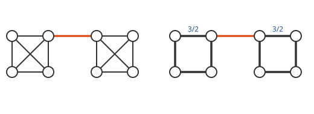

# 스펙트럼 희소화

# 개요

**스펙트럼 희소화(spectral sparsification)** 는 간선이 많은 [그래프](graphs.md)를 간선이 훨씬 적은 그래프로 바꾸되, 정점마다 값을 줄 때 간선을 따라 생기는 차이의 총량이 거의 그대로이게 하는 방법이다. 정점 $n$ 개가 거의 모두 서로 이어진 전기 회로망은 간선이 $n^2$ 개쯤이라 계산이 비싸지만, 비슷한 길이 여럿 겹친 간선은 몇 개를 지우고 남은 간선을 굵게 해도 회로 전체의 성질이 거의 변하지 않는다. 간선마다 대신할 길이 얼마나 많은지를 [유효저항](effective-resistance.md)으로 재고 그에 비례하는 확률로 간선을 뽑으면, 정점 수에 로그를 곱한 정도의 간선으로 충분하다.

# 직관

아래 그림의 왼쪽은 정점 넷이 모두 서로 이어진 덩어리 두 개를 간선 하나로 이은 회로망이고, 간선의 전도도는 모두 $1$ 이다. 덩어리 안의 간선 하나를 지워도 그 두 정점 사이에는 다른 정점을 거치는 길이 넷 남는다. 두 덩어리를 잇는 간선을 지우면 회로망이 둘로 끊긴다.

그래서 덩어리 안에서는 간선을 덜어 내고 남은 간선을 굵게 하고, 잇는 간선은 그대로 둔다. 오른쪽은 덩어리마다 간선 여섯 개 가운데 넷만 남겨 순환을 만들고 전도도를 $3/2$ 로 키운 것이다. 각 정점에 연결된 전도도의 합이 왼쪽과 같이 $3$ 이다. 간선마다 대신할 길이 얼마나 있는지는 양 끝 사이의 [유효저항](effective-resistance.md) $R_e$ 와 전도도 $w_e$ 의 곱으로 잰다. 덩어리 안의 간선은 $w_eR_e=1/2$, 잇는 간선은 $w_eR_e=1$ 이다.

# 정의

## Spectral sparsifier

$G$ 를 정점 $n$ 개의 연결 가중 무향 그래프, $L_G$ 를 그 [그래프 Laplacian](graph-laplacian.md)이라 한다. $H$ 는 같은 정점 집합 위에서 $G$ 의 간선 일부에 새 가중치를 준 그래프이고, 오차 허용량은 $0 \lt\varepsilon \lt 1$ 이다. 모든 [실수](real-numbers.md) 벡터 $x$ 에 대해

$$
(1-\varepsilon)\thinspace x^{\mathsf T}L_Gx\ \le\ x^{\mathsf T}L_Hx\ \le\ (1+\varepsilon)\thinspace x^{\mathsf T}L_Gx
$$

가 성립하면 $H$ 를 $G$ 의 **$\varepsilon$ spectral sparsifier** 라 한다. $x^{\mathsf T}L_Gx=\sum_{uv\in E}w_{uv}(x_u-x_v)^2$ 는 정점값 $x$ 에서 간선을 따라 생기는 차이의 총량이다.

직관 절의 그림에서 $x$ 를 한 정점에서 $1$, 나머지에서 $0$ 으로 두면 양쪽 모두 그 정점에 연결된 전도도의 합이 나오고 값이 같다. 덩어리 하나의 Laplacian 고윳값은 왼쪽이 $0,4,4,4$, 오른쪽이 $0,3,3,6$ 이므로 덩어리마다 $\tfrac34 x^{\mathsf T}L_Gx\le x^{\mathsf T}L_Hx\le\tfrac32 x^{\mathsf T}L_Gx$ 이고, 잇는 간선은 양쪽이 같다. 그래서 오른쪽 그래프는 왼쪽 그래프의 $\varepsilon=1/2$ spectral sparsifier 다.

## 샘플링 분포

간선 $e$ 의 전도도를 $w_e$, 양 끝 사이 유효저항을 $R_e$ 라 하고

$$
p_e=\frac{w_eR_e}{n-1}
$$

로 둔다. 아래 Foster 정리로 연결 그래프에서 $\sum_e p_e = 1$ 이므로 확률분포다. **유효저항 샘플링(sampling by effective resistances)** 은 이 분포에서 간선을 $q$ 번 독립적으로 복원 추출하고, 뽑힌 간선의 가중치에 매번 $w_e/(q\thinspace p_e)$ 를 더해 $H$ 를 만드는 절차다. 뽑히지 않은 간선은 $H$ 에 없고, 한 간선이 여러 번 뽑히면 가중치가 누적된다.

직관 절의 그래프는 $n=8$ 이고 간선이 $13$ 개다. 덩어리 안의 간선은 $p_e=(1/2)/7=1/14$, 잇는 간선은 $p_e=1/7$ 이며 $12\cdot\tfrac1{14}+\tfrac17=1$ 이다.

# 성질

## Foster 정리

Foster 정리(Foster's theorem)는 연결 그래프에서 $\sum_{e\in E}w_eR_e=n-1$ 이라는 정리다. $w_eR_e$ 는 간선 가중치의 곱에 비례하는 확률로 뽑은 무작위 신장트리가 $e$ 를 포함할 확률이고, 신장트리는 간선이 $n-1$ 개이므로 합이 $n-1$ 이다. 그래서 $w_eR_e$ 의 총합이 간선 수와 무관하게 정점 수로 정해진다.

## 기댓값 일치

간선 $e$ 가 $H$ 에서 받는 가중치의 기댓값은 $q \cdot p_e \cdot w_e/(q p_e) = w_e$ 이므로 $\mathbb{E}\lbrack L_H\rbrack = L_G$ 다. 아래 주 정리는 편차가 모든 이차형식에서 동시에 작다는 것이다.

## 주 정리

Spielman 과 Srivastava 의 논문[^1] 가운데 Theorem 1 은 충분히 큰 $n$ 과 충분히 큰 절대상수 $C$ 에 대해

$$
\frac1{\sqrt n}\lt\varepsilon\lt 1,\qquad q=\left\lceil\frac{Cn\log n}{\varepsilon^2}\right\rceil
$$

이면 유효저항 샘플링으로 얻은 $H$ 가 $G$ 의 $\varepsilon$ spectral sparsifier 일 확률이 적어도 $1/2$ 다. 성공 확률은 독립 반복과 검증으로 올린다.

간선 수는 $q$ 이하이므로 $O(n \log n / \varepsilon^2)$ 이고 원래 간선 수 $m$ 과 무관하다. 완전그래프에서는 $m = \Theta(n^2)$ 이 $O(n \log n)$ 으로 줄어든다.

## 증명의 요지

간선 $e=(u,v)$ 에 대해 $b_e=e_u-e_v$ 로 두면 $L_G = \sum_e w_e b_e b_e^{\mathsf T}$ 다. 여기에 $L_G^{+/2}$ 를 양쪽에서 곱해 정규화한다.

$$
\Pi=L_G^{+/2}L_GL_G^{+/2}=\sum_e\big(\sqrt{w_e}\thinspace L_G^{+/2}b_e\big)\big(\sqrt{w_e}\thinspace L_G^{+/2}b_e\big)^{\mathsf T}
$$

$\Pi$ 는 $L_G$ 의 상에 대한 사영이고, 각 항의 노름 제곱이 정확히 $w_e R_e$ 이므로 샘플링 확률 $p_e$ 가 각 항의 기여도에 비례한다.

목표는 $\Vert L_G^{+/2}L_HL_G^{+/2} - \Pi\Vert \le \varepsilon$ 이다. 이 노름 부등식은 모든 $x$ 에 대한 이차형식 부등식과 동치이고, 독립 무작위 [행렬](matrices.md) $q$ 개의 평균이 기댓값 $\Pi$ 에 집중한다는 진술이다. Spielman 과 Srivastava 는 이 집중을 Rudelson 의 무작위 벡터 합에 대한 [집중부등식](concentration-inequalities.md)으로 보인다.

## 절단 근사

$x$ 를 정점 집합 $S$ 의 지시벡터로 잡으면 $x^{\mathsf T}L_Gx$ 가 $S$ 와 나머지를 가르는 절단(cut)을 건너는 가중치의 합이므로, spectral sparsifier 는 모든 절단을 동시에 $1\pm\varepsilon$ 배 안으로 근사한다. 직관 절의 그림에서 $S$ 를 왼쪽 덩어리로 잡으면 양쪽 모두 값이 $1$ 이다.

역은 성립하지 않는다. 모든 절단을 보존하는 cut sparsifier 가 모든 이차형식을 보존하지는 않는다.

## 보존되지 않는 양

간선이 통째로 사라질 수 있으므로 두 정점 사이 거리는 크게 늘어날 수 있고, 최단 경로 길이는 보존되지 않는다. 거리를 보존하는 희소 부분그래프는 spanner 라 하고 따로 다룬다.

## 유효저항의 근사 계산

모든 간선의 정확한 유효저항은 $L^+$ 를 요구하므로 희소화보다 비싸다. Spielman 과 Srivastava 는 Johnson–Lindenstrauss 보조정리(Johnson–Lindenstrauss lemma)의 무작위 사영으로 $O(\log n)$ 차원에 모든 정점을 매장해 유효저항을 상수배 안에서 동시에 근사하고, 각 사영 벡터는 Laplacian 선형계를 한 번 푸는 것으로 얻는다. 빠른 Laplacian 해법과 결합하면 근사 전체가 준선형 시간이다.

샘플링 확률이 상수배 안에서 맞으면 표본 수만 상수배 늘어나므로 상수배 근사로 충분하다.

# 활용

- Laplacian 계산의 [전처리](preconditioning.md). Laplacian 선형계, [고윳값](eigenvalues.md) 근사, 확산 계산에서 먼저 희소화하면 간선 수가 $O(n \log n)$ 으로 줄고 오차는 $\varepsilon$ 이하다. 반복적 Laplacian 해법의 시간이 간선 수에 비례하므로 이 감소가 그대로 시간 감소가 된다.
- 무작위 알고리즘의 표본 설계. 항들의 합으로 쓰인 행렬에서 각 항의 레버리지 점수(leverage score)에 비례해 뽑으면 합 전체를 근사할 수 있고, 유효저항은 그래프에서의 레버리지 점수다. 무작위 수치선형대수의 열 샘플링이 같은 원리를 쓴다.
- 간선 수의 개선. Batson, Spielman, Srivastava 는 $O(n/\varepsilon^2)$ 개의 간선으로 충분함을 보였다. 그 구성은 결정론적이고 $O(mn^3/\varepsilon^2)$ 시간이 든다.

[^1]: Spielman, Srivastava, *Graph Sparsification by Effective Resistances*, arXiv 2008 / SIAM J. Comput. 2011, https://arxiv.org/abs/0803.0929. Theorem 1 의 조건, Section 3 의 행렬 집중 논증, Section 4 의 유효저항 근사 계산.

# 연관 문서

## 선수지식

- [유효저항](effective-resistance.md)
- [유한 확률 공간](probability.md)

## 더 알아보기

아직 연결한 문서가 없다.

#graph_theory #algorithms #paper
