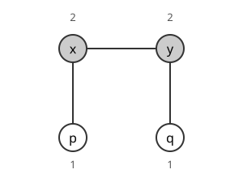

# 분할 그래프

# 개요

**분할 그래프(split graph)** 는 정점을 서로 모두 이어진 무리와 서로 하나도 이어지지 않은 무리로 나눌 수 있는 그래프다. 네 사람에게 아는 사람의 수를 물어 $2,2,1,1$ 을 들었다고 하자. 누가 누구와 아는지는 몰라도, 서로 다 아는 핵심 무리와 서로 모르는 나머지로 이 모임이 나뉘는지는 이 네 수만으로 판정된다.

아는 사람이 많은 쪽부터 몇 명을 핵심 무리로 잡고, 그들의 차수 합이 무리 안의 친분과 나머지 사람의 차수 합으로 정확히 채워지는지 본다. 등호이면 분할 그래프이고, 아니면 어떤 친분 관계로 실현해도 분할 그래프가 아니다.

# 직관

차수 $2,2,1,1$ 을 갖는 그래프 하나는 아래 그림의 경로 $p\text{–}x\text{–}y\text{–}q$ 다. 회색 정점 $x,y$ 는 서로 이어져 있고, 흰 정점 $p,q$ 는 서로 이어져 있지 않다. 정점 옆의 수가 차수다.

나뉘는 그래프에서 핵심 무리의 차수 합을 세어 본다. 무리 안의 친분이 각 사람에게 하나씩 세어지고, 나머지는 바깥 사람과의 친분이다. 바깥 사람끼리는 친분이 없으므로 바깥과의 친분 수는 바깥 사람의 차수 합과 같다. 그림에서는 $x,y$ 의 차수 합 $4$ 가 무리 안의 $2$ 와 바깥 차수 합 $2$ 의 합이다.

거꾸로 차수가 큰 두 사람의 차수 합이 무리 안에서 나올 수 있는 최대 $2$ 와 나머지 차수 합의 합과 같으면, 두 사람은 서로 알아야 하고 나머지 사람의 친분은 모두 두 사람에게 가야 한다. 그래서 어떤 그래프로 실현해도 나머지 사람끼리는 모른다. 네 사람이 둘씩 아는 순환 $2,2,2,2$ 에서는 이 셈이 맞지 않는다.

# 정의

[그래프](graphs.md) $G$ 의 정점 집합이 클릭(clique) $K$ 와 독립집합(independent set) $I$ 로 나뉘면 $G$ 를 **분할 그래프** 라 하고 $(K,I)$ 를 **분할(split partition)** 이라 한다. 클릭은 서로 모두 이어진 정점의 집합이고, 독립집합은 서로 하나도 이어지지 않은 정점의 집합이다. 직관 절의 경로는 $K=\lbrace x,y\rbrace$, $I=\lbrace p,q\rbrace$ 로 나뉘는 분할 그래프다.

[Threshold 그래프](threshold-graphs.md)는 분할 그래프다. 생성열에서 지배 정점으로 더한 정점을 $K$ 로, 나머지를 $I$ 로 두면 된다. 직관 절의 경로는 Threshold 그래프가 아닌 분할 그래프다.

# 성질

## Földes–Hammer 정리

**Földes–Hammer 정리(Földes–Hammer theorem)** 는 그래프가 분할 그래프인 것이 $2K\_2$, $C\_4$, $C\_5$ 를 유도 부분그래프(induced subgraph)로 포함하지 않는 것과 동치이고, $G$ 와 여그래프(complement graph)가 둘 다 [현 그래프](chordal-graphs.md)인 것과도 동치라는 진술이다[^1]. $2K\_2$ 는 겹치지 않는 간선 둘, $C\_k$ 는 정점 $k$ 개의 순환이다.

분할 그래프의 여그래프는 $K$ 와 $I$ 의 역할을 바꾼 분할 그래프다. 분할 그래프의 순환은 $I$ 의 정점을 연달아 지나지 못하므로, 길이 $4$ 이상의 순환에는 $K$ 의 정점이 둘 이상 있고 그 둘이 현을 준다. 그래서 분할 그래프와 그 여그래프는 현 그래프다.

## Hammer–Simeone 정리

$d_1\ge\dots\ge d_n$ 을 $G$ 의 차수열이라 하고 $m$ 을 $d_i\ge i-1$ 인 가장 큰 $i$ 라 하자. **Hammer–Simeone 정리(Hammer–Simeone theorem)** 는 $G$ 가 분할 그래프인 것이 다음 등식과 동치라는 진술이다[^2].

$$
\sum_{i=1}^{m}d_i=m(m-1)+\sum_{i=m+1}^{n}d_i
$$

등식이면 분할 그래프인 쪽은 직관 절의 셈이다. 차수가 큰 $m$ 개 정점의 집합 $K$ 와 나머지 $I$ 에 대해, $K$ 안의 간선 수를 $e(K)$, $K$ 와 $I$ 사이의 간선 수를 $e(K,I)$ 라 하면 다음이 성립한다.

$$
\sum_{i=1}^{m}d_i=2e(K)+e(K,I),\qquad\sum_{i=m+1}^{n}d_i=e(K,I)+2e(I)
$$

$2e(K)\le m(m-1)$ 이고 $e(I)\ge 0$ 이므로 등식은 $K$ 가 클릭이고 $I$ 가 독립집합일 때만 성립한다. 이 판정은 차수열만 보므로, 분할 그래프의 차수열을 갖는 그래프는 모두 분할 그래프다. $2,2,1,1$ 은 $m=2$ 에서 $4=2+2$ 이고, $2,2,2,2$ 는 $m=3$ 에서 $6\lt 6+2$ 다.

## 분할 거리

같은 논문은 분할 그래프가 되도록 더하거나 지워야 하는 간선의 최소 개수가 다음과 같음을 보였다[^2].

$$
\frac12\left(m(m-1)-\sum_{i=1}^{m}d_i+\sum_{i=m+1}^{n}d_i\right)
$$

$2,2,2,2$ 의 순환 $C\_4$ 는 $\tfrac12(6-6+2)=1$ 이고, 간선 하나를 지우면 직관 절의 경로가 된다.

# 활용

- 현 그래프의 대부분. 정점 $n$ 개의 현 그래프 가운데 분할 그래프의 비율은 $n\to\infty$ 일 때 $1$ 로 간다[^3].
- [완벽그래프](perfect-graphs.md)의 예. 분할 그래프는 현 그래프이므로 완벽그래프이고, 색칠 수와 클릭 수가 선형 시간에 구해진다.
- 차수열만으로 하는 판정. Hammer–Simeone 정리는 정렬과 덧셈만 쓰므로, 차수열을 정렬해 두면 분할 그래프인지 $O(n)$ 시간에 판정한다.

[^1]: S. Földes, P. L. Hammer, "Split graphs", *Proceedings of the Eighth Southeastern Conference on Combinatorics, Graph Theory and Computing*, Congressus Numerantium 19 (1977), 311–315.
[^2]: P. L. Hammer, B. Simeone, "The splittance of a graph", *Combinatorica* 1 (1981), 275–284.
[^3]: E. A. Bender, L. B. Richmond, N. C. Wormald, "Almost all chordal graphs split", *Journal of the Australian Mathematical Society, Series A* 38 (1985), 214–221.

# 연관 문서

## 선수지식

- [현 그래프](chordal-graphs.md)
- [Erdős–Gallai 정리](erdos-gallai-theorem.md)

## 더 알아보기

아직 연결한 문서가 없다.

#graph_theory #combinatorics #algorithms
