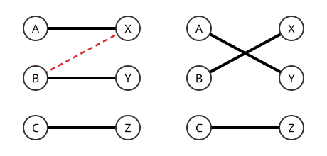

# 안정 매칭

# 개요

**안정 매칭(stable matching)** 은 두 집단의 구성원이 상대 집단의 구성원에 대한 선호 순서를 가질 때, 서로를 지금 짝보다 더 좋아하는 두 사람이 없는 일대일 [매칭](matchings.md)이다. 의대 졸업생을 병원에 배정할 때 어떤 졸업생과 병원이 서로를 지금 배정보다 더 원하면, 둘은 배정을 무시하고 따로 계약한다. 한쪽이 좋아하는 순서대로 제안하고 다른 쪽이 가장 좋은 제안만 남겨 두는 절차를 되풀이하면 그런 쌍이 없는 배정이 언제나 나온다.

# 직관

남자 $A,B,C$ 와 여자 $X,Y,Z$ 가 다음처럼 상대를 좋아하는 순서를 가진다.

| 사람 | 선호 순서 | 사람 | 선호 순서 |
| ---- | --------- | ---- | --------- |
| $A$  | $X,Y,Z$   | $X$  | $B,A,C$   |
| $B$  | $X,Z,Y$   | $Y$  | $A,C,B$   |
| $C$  | $Y,X,Z$   | $Z$  | $A,B,C$   |

짝을 $A\text{–}X$, $B\text{–}Y$, $C\text{–}Z$ 로 정하면 $B$ 는 $Y$ 보다 $X$ 를, $X$ 는 $A$ 보다 $B$ 를 좋아하므로 $B$ 와 $X$ 가 짝을 깨고 둘이 짝이 되려 한다. 그 둘을 짝지으면 $A$ 와 $Y$ 가 남는데, 이렇게 어긋난 쌍을 하나씩 고쳐 나가면 고친 짝이 다른 쌍을 다시 어긋나게 할 수 있다.

고치는 순서를 정한다. 남자가 좋아하는 순서대로 청혼하고, 여자는 받은 청혼 가운데 가장 좋아하는 사람만 보류하고 나머지를 거절한다. $A$ 와 $B$ 가 $X$ 에게, $C$ 가 $Y$ 에게 청혼하면 $X$ 는 $B$ 를 보류하고 $A$ 를 거절한다. $A$ 가 $Y$ 에게 청혼하면 $Y$ 는 $C$ 보다 $A$ 를 좋아하므로 $A$ 를 보류하고 $C$ 를 거절한다. $C$ 는 $X$ 에게 거절당한 뒤 $Z$ 에게 청혼해 보류되고, 결과는 $A\text{–}Y$, $B\text{–}X$, $C\text{–}Z$ 다. 이 짝에서는 서로를 지금 짝보다 좋아하는 남녀가 없다.

아래 그림의 왼쪽이 처음 짝이고 점선이 짝을 깨려는 $B$ 와 $X$ 이며, 오른쪽이 절차가 내놓은 짝이다. 이 절차가 D. Gale 과 L. S. Shapley 의 지연 수락 알고리즘(deferred acceptance algorithm)이고[^1], 이 문제를 안정 결혼 문제(stable marriage problem)라고도 한다.



# 정의

크기가 같은 유한집합 $M$, $W$ 가 있고, $M$ 의 원소마다 $W$ 위의 전순서가, $W$ 의 원소마다 $M$ 위의 전순서가 주어져 있다. 전단사 $\mu:M\to W$ 를 매칭이라 한다.

$m\in M$, $w\in W$ 가 $\mu(m)\ne w$ 이고, $m$ 이 $\mu(m)$ 보다 $w$ 를 좋아하며 $w$ 가 $\mu^{-1}(w)$ 보다 $m$ 을 좋아하면 $(m,w)$ 를 차단 쌍(blocking pair)이라 한다. 차단 쌍이 없는 매칭이 안정 매칭이다.

지연 수락 알고리즘은 다음과 같다.

```typescript
// prefM[m] 은 m 이 좋아하는 순서의 여자 목록, rankW[w][m] 은 w 가 m 을 몇 번째로 좋아하는지
function deferredAcceptance(prefM: number[][], rankW: number[][]): number[] {
  const n = prefM.length;
  const next = new Array(n).fill(0); // m 이 다음에 청혼할 목록의 위치
  const holder = new Array(n).fill(-1); // w 가 보류 중인 남자, 없으면 -1
  const free = [...Array(n).keys()];
  while (free.length > 0) {
    const m = free.pop()!;
    const w = prefM[m][next[m]++];
    const h = holder[w];
    if (h === -1) holder[w] = m;
    else if (rankW[w][m] < rankW[w][h]) { holder[w] = m; free.push(h); }
    else free.push(m);
  }
  return holder; // holder[w] 가 w 의 짝
}
```

# 성질

## 존재와 종료

지연 수락 알고리즘은 청혼 $n^2$ 번 안에 끝나고 안정 매칭을 낸다[^1]. 남자는 같은 여자에게 두 번 청혼하지 않으므로 청혼은 $n^2$ 번 이하다. 여자가 보류하는 상대는 바뀔 때마다 더 좋아하는 사람이 되고, 한 번 청혼을 받은 여자는 끝까지 누군가를 보류한다. 모든 여자에게 거절당한 남자가 있다면 여자 $n$ 명이 모두 다른 남자를 보류하는데 남자는 $n$ 명뿐이라 모순이다.

안정성. $m$ 이 짝보다 $w$ 를 좋아하면 $m$ 은 그 전에 $w$ 에게 청혼해 거절당했다. 거절할 때 $w$ 는 $m$ 보다 좋아하는 사람을 보류했고 그 뒤로 보류 상대는 나빠지지 않으므로, $w$ 는 마지막 짝을 $m$ 보다 좋아한다. 그래서 $(m,w)$ 는 차단 쌍이 아니다.

## 청혼하는 쪽의 최적성

어떤 안정 매칭에서 $m$ 과 짝이 되는 여자를 $m$ 의 안정 짝이라 하면, 남자가 청혼하는 지연 수락 알고리즘은 모든 남자에게 그의 안정 짝 가운데 가장 좋아하는 여자를 준다[^1]. 같은 결과에서 모든 여자는 자기의 안정 짝 가운데 가장 싫어하는 남자를 받는다. 청혼 순서는 결과에 영향을 주지 않는다.

증명의 요지. 안정 짝에게 거절당하는 일이 처음 일어난 순간을 본다. $m$ 이 안정 짝 $w$ 에게 거절당하고 $w$ 가 $m'$ 을 보류했다면, $m'$ 은 그때까지 안정 짝에게 거절당한 적이 없으므로 $m$ 과 $w$ 가 짝인 안정 매칭에서 $m'$ 의 짝보다 $w$ 를 좋아한다. $w$ 도 $m$ 보다 $m'$ 을 좋아하므로 $(m',w)$ 가 그 매칭의 차단 쌍이 되어 모순이다.

## 안정 매칭의 격자

두 안정 매칭 $\mu,\nu$ 에서 남자마다 더 좋아하는 짝을 고르면 다시 안정 매칭이 되고, 이 연산으로 안정 매칭 전체는 분배 격자를 이룬다. 남자 최적 매칭이 최대 원소, 여자 최적 매칭이 최소 원소다. D. E. Knuth 가 이 결과를 J. H. Conway 의 것으로 소개했다[^2].

## 전략과 조작

남자가 청혼하는 지연 수락 알고리즘에서 어느 남자도 거짓 선호를 내서 더 좋은 짝을 얻을 수 없다[^3]. 여자는 거짓 선호로 더 좋은 짝을 얻을 수 있는 경우가 있다. 양쪽 모두 거짓 선호로 이득을 볼 수 없는 안정 매칭 규칙은 존재하지 않는다[^4].

## 룸메이트 문제

한 집단 안에서 둘씩 짝짓는 룸메이트 문제(stable roommates problem)에서는 안정 매칭이 없을 수 있다[^1]. $a,b,c$ 가 각각 $b,c$ 와 $c,a$ 와 $a,b$ 의 순서로 좋아하고 $d$ 를 가장 싫어하면, $d$ 와 짝이 된 사람과 그를 가장 좋아하는 사람이 차단 쌍이 된다. R. W. Irving 은 안정 매칭이 있으면 찾고 없으면 없다고 답하는 다항시간 알고리즘을 주었다[^5].

# 활용

- 의사 수련 배정. 미국의 수련의 배정(National Resident Matching Program)은 지연 수락 알고리즘의 병원 정원 판본을 쓴다. 병원 하나가 여러 명을 받는 경우에도 같은 알고리즘이 안정 매칭을 낸다[^6].
- 학교 배정. 학생이 청혼하는 판본은 학생에게 거짓 선호의 이득이 없으므로 학생 지망을 받아 배정하는 제도에 쓰인다.
- [목록 색칠](list-coloring.md)의 Galvin 정리. 이분그래프의 간선 사이에 순서를 주고 안정 매칭의 존재를 써서 목록 색칠을 만든다.

[^1]: D. Gale, L. S. Shapley, "College admissions and the stability of marriage", American Mathematical Monthly 69 (1962), 9–15.
[^2]: D. E. Knuth, Mariages stables et leurs relations avec d'autres problèmes combinatoires, Les Presses de l'Université de Montréal (1976).
[^3]: L. E. Dubins, D. A. Freedman, "Machiavelli and the Gale–Shapley algorithm", American Mathematical Monthly 88 (1981), 485–494.
[^4]: A. E. Roth, "The economics of matching: stability and incentives", Mathematics of Operations Research 7 (1982), 617–628.
[^5]: R. W. Irving, "An efficient algorithm for the stable roommates problem", Journal of Algorithms 6 (1985), 577–595.
[^6]: A. E. Roth, E. Peranson, "The redesign of the matching market for American physicians", American Economic Review 89 (1999), 748–780.

# 연관 문서

## 선수지식

- [매칭](matchings.md)

## 더 알아보기

아직 연결한 문서가 없다.

#graph_theory #algorithms #combinatorics
