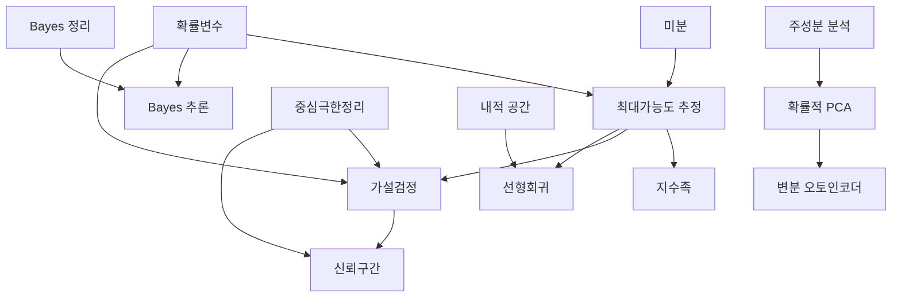

# 통계 개관

# 개요

통계(statistics)는 관측된 표본에서 그 표본을 만든 분포에 관한 진술을 끌어낸다. 확률론이 분포에서 표본으로 가는 방향을 다룬다면 통계는 그 반대 방향이다. 물음은 세 가지다. 모수를 어떤 값으로 추정하는가, 그 추정이 얼마나 확실한가, 그리고 데이터가 어떤 가설을 기각할 만큼 강한가.

갈래는 다섯이다. 가능도와 사전분포로 모수를 정하는 추정, 표본분포로 불확실성을 재는 검정과 구간, 분포를 모수로 두지 않는 경험 분포와 재표본, 설명변수를 둔 회귀와 모형 선택, 관측되지 않는 변수를 둔 잠재변수 모형이다. 확률적 기반은 [확률론 개관](probability-overview.md)에, 우도비의 측도론적 정의는 [측도변환](change-of-measure.md)에 있다.

시작은 [최대가능도 추정](maximum-likelihood.md)이다. 거기서 [지수족](exponential-families.md)으로 가면 추정량이 닫힌 꼴로 나오는 구조가 보이고, [가설검정](hypothesis-testing.md)에서 [신뢰구간](confidence-intervals.md)으로 이어지며, [Bayes 추론](bayesian-inference.md)이 사전분포를 쓰는 다른 길로 간다.

# 지도

# 갈래

처음 읽는 사람은 추정, 검정과 구간의 순서로 읽는다. 그 뒤는 세 방향으로 갈린다. 경험 분포와 재표본은 분포에 모수를 두지 않고 표본분포를 세우고, 회귀와 모형 선택은 설명변수를 둔 모형을 적합하고 비교하며, 잠재변수 모형은 관측되지 않는 변수를 둔 모형을 추정한다.

## 추정

먼저 읽을 것: [확률변수](random-variables.md)(확률 개관), [미분](derivative.md)(해석 개관), [Bayes 정리](bayes.md)(확률 개관), [KL divergence](kl-divergence.md)(정보이론 개관). 곁가지인 정보기하는 [내적 공간](inner-product-spaces.md)(선형대수 개관)과 [Riemann 계량](riemannian-metrics.md)(미분기하 개관)을 더 쓴다. 시작 문서: [최대가능도 추정](maximum-likelihood.md).

- [최대가능도 추정](maximum-likelihood.md): 가능도함수를 최대로 하는 모수, 점근 정규성과 Cramér–Rao 하한
- [지수족](exponential-families.md): 자연모수와 로그분배함수로 적은 분포족, 충분통계량과 켤레 사전분포
- [Fisher 정보](fisher-information.md): 점수함수의 [공분산](covariance.md), 정보 등식과 Cramér–Rao 하한의 유도
  - [정보기하](information-geometry.md): 분포족을 다양체로 보는 Fisher–Rao 계량, 쌍대 접속과 자연 경사법
- [Bayes 추론](bayesian-inference.md): 사전분포에서 사후분포로 가는 갱신, 사후예측분포와 최대사후추정

## 검정과 구간

먼저 읽을 갈래: 추정. 먼저 읽을 것: [중심극한정리](central-limit-theorem.md), [반복로그 법칙](law-of-iterated-logarithm.md)(확률 개관). 시작 문서: [가설검정](hypothesis-testing.md).

- [가설검정](hypothesis-testing.md): 귀무가설과 검정통계량, 제1종·제2종 오류, Neyman–Pearson 보조정리
  - [가능도비 검정](likelihood-ratio-test.md): 두 모수 집합 위의 최대 가능도의 비로 세우는 검정, Wilks 정리의 카이제곱 극한
- [신뢰구간](confidence-intervals.md): 피벗량으로 세우는 구간, 피복확률과 검정과의 쌍대성
- [순차확률비 검정](sequential-probability-ratio-test.md): 누적 우도비와 두 문턱, Wald 의 오류율 경계와 기대 표본 수
- [군축차 설계](group-sequential-design.md): 중간분석 시점마다의 경계, 알파 소비 함수로 1 종 오류율을 통제하는 설계
- [신뢰열](confidence-sequences.md): 모든 표본 크기에서 동시에 모수를 포함하는 구간의 열. Ville 부등식과 혼합법, 반복로그 법칙이 주는 폭의 하한
  - [e-값](e-values.md): 귀무가설 아래 기댓값이 1 이하인 음이 아닌 통계량. 곱과 평균으로 합치고, p-값과 보정 함수로 바꾸며, 보편 추론과 e-BH 다중검정에 쓴다

## 경험 분포와 재표본

먼저 읽을 갈래: 추정. 먼저 읽을 것: [VC 차원](vc-dimension.md)(머신러닝 개관). 시작 문서: [Glivenko–Cantelli 정리](glivenko-cantelli.md).

- [Glivenko–Cantelli 정리](glivenko-cantelli.md): 경험 분포함수가 참 분포함수로 균등수렴한다, Kolmogorov–Smirnov 거리와 Dvoretzky–Kiefer–Wolfowitz 부등식
  - [Kolmogorov–Smirnov 검정](kolmogorov-smirnov-test.md): 경험 분포함수와 가설 분포함수의 최대 차이로 세우는 적합도 검정, Kolmogorov 분포의 분위수와 이표본 판본
    - [이차 경험분포함수 통계량](quadratic-edf-statistics.md): 차이의 제곱을 가중 적분한 Cramér–von Mises 와 Anderson–Darling 통계량, Brown 다리의 Karhunen–Loève 전개로 얻는 극한분포
- [경험 과정](empirical-process.md): 함수족을 지표로 갖는 확률과정, Donsker 족과 덮개수, 사슬 묶기와 Dudley 적분
- [붓스트랩](bootstrap.md): 경험 분포에서 다시 표본을 뽑아 분포를 세우는 절차, Donsker 족에서의 타당성과 표본 최대값에서 깨지는 예

## 회귀와 모형 선택

먼저 읽을 갈래: 추정. 먼저 읽을 것: 내적 공간(선형대수 개관). 시작 문서: [선형회귀](linear-regression.md).

- [선형회귀](linear-regression.md): 정규방정식과 사영으로 적은 최소제곱 추정, Gauss–Markov 정리
  - [일반화선형모형](generalized-linear-models.md): 반응분포를 지수족으로 둔 회귀, 정준연결함수와 반복 가중최소제곱
- [편향-분산 분해](bias-variance-decomposition.md): 평균제곱오차를 편향의 제곱과 분산으로 가르는 항등식
  - [James–Stein 추정량](james-stein-estimator.md): 세 개 이상의 정규 평균을 함께 줄여 추정하면 모든 모수에서 관측 자체보다 제곱오차가 작다
    - [Ledoit–Wolf 축소 추정](ledoit-wolf-shrinkage.md): 표본공분산을 단위행렬의 배수 쪽으로 줄이는 볼록결합, 자료에서 계산한 최적 비율과 신탁 추정량에 대한 일치성
- [정칙화](regularization.md): 잔차제곱합에 계수의 크기를 재는 벌점을 더하는 추정, 능형회귀와 라소의 축소와 희소성
- [교차검증](cross-validation.md): 적합에 쓰지 않은 조각으로 오차를 재는 절차, 선형 적합에서의 닫힌 꼴
- [정보 기준](information-criteria.md): 로그가능도에 모수 개수의 벌점을 더해 모형을 비교하는 양, 벌점의 크기에서 갈리는 두 기준

## 잠재변수 모형

먼저 읽을 갈래: 추정. 먼저 읽을 것: [주성분 분석](principal-component-analysis.md)(머신러닝 개관). 시작 문서: [기댓값 최대화 알고리즘](em-algorithm.md).

- [기댓값 최대화 알고리즘](em-algorithm.md): 은닉변수 모형에서 가능도를 올리는 두 단계, 증거 하한과 가능도의 단조 증가
- [확률적 PCA](probabilistic-pca.md)(principal component analysis): 저차원 잠재변수를 둔 Gauss 모형, 주성분과의 관계
- [Kalman 필터](kalman-filter.md): 선형 Gauss 상태공간 모형의 순차 추정, Kalman 이득과 정보 형식
- [은닉 Markov 모형](hidden-markov-model.md): 유한 상태 뒤에 숨은 열의 추정, 전향 후향 재귀와 Viterbi 복호

# 연관 문서

## 선수지식

- [집합](sets.md)

## 더 알아보기

- [최대가능도 추정](maximum-likelihood.md)
- [Bayes 추론](bayesian-inference.md)
- [확률적 PCA](probabilistic-pca.md)

#statistics #probability #machine_learning #overview
