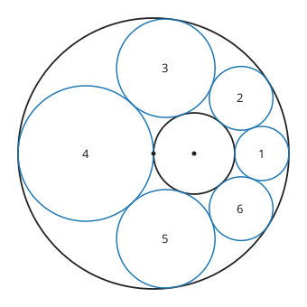

# Steiner 폐형 정리

# 개요

**Steiner 폐형 정리(Steiner's porism)** 는 한 원 안에 다른 원이 있을 때, 두 원 사이의 고리 모양 틈에 두 원과 앞 원에 접하는 원을 차례로 넣어 가는 사슬이 첫 원으로 되돌아와 닫히는지가 첫 원을 어디에 놓는지에 달려 있지 않다는 정리다. 반지름 $10$ 인 원 안에 반지름 $3$ 인 원을 한쪽으로 치우치게 넣고 틈에 동전을 하나씩 접하게 놓아 가면, 동전의 크기가 자리마다 달라서 마지막 동전이 첫 동전에 딱 맞을지 알기 어렵다. 원 반전으로 두 원을 중심이 같은 두 원으로 바꾸면 사슬은 크기가 같은 원들을 돌려 놓은 것이 되고, 닫히는 조건이 각 하나로 정해진다.

# 직관

중심이 $0$ 이고 반지름이 $10$ 인 원 $\Gamma$ 안에 중심이 $3$ 이고 반지름이 $3$ 인 원 $\gamma$ 가 있다. 오른쪽 틈에는 지름이 $\lbrack 6,10\rbrack$ 인 원, 곧 중심 $8$, 반지름 $2$ 인 원이 두 원에 접한다. 이 원에 접하면서 $\Gamma$ 와 $\gamma$ 에도 접하는 다음 원을 구하려면 세 접선 조건을 연립해 풀어야 하고, 원마다 같은 계산을 되풀이해야 한다.

점 $10/3$ 을 중심으로 하고 반지름의 제곱이 $80/9$ 인 원에 대해 [원 반전](circle-inversion.md)을 한다. 실수축 위의 점 $x$ 는 다음 점으로 옮겨진다.

$$
x\mapsto\frac{10}{3}+\frac{80/9}{x-10/3}
$$

$10$ 과 $-10$ 은 $14/3$ 과 $8/3$ 으로, $\gamma$ 의 두 끝 $0$ 과 $6$ 은 $2/3$ 과 $20/3$ 으로 옮겨진다. 두 상은 모두 중심이 $11/3$ 이고 반지름은 $1$ 과 $3$ 이다.

중심이 같은 두 원 사이에서는 사슬의 원이 모두 반지름 $1$ 이고 중심이 반지름 $2$ 인 원 위에 있다. 이웃한 두 원이 접하려면 두 중심 사이의 거리가 $2$ 이므로 중심에서 본 각이 $60^\circ$ 이고, 원 여섯 개로 사슬이 닫힌다. 여섯 원을 함께 돌려도 그대로 사슬이므로 첫 원의 위치와 상관없이 닫힌다.

이 여섯 원을 다시 반전하면 $\Gamma$ 와 $\gamma$ 사이의 사슬이 된다. 실수축 위의 두 원은 중심 $8$, 반지름 $2$ 인 원과 중심 $-5$, 반지름 $5$ 인 원이고, 나머지 넷은 반지름 $40/17$ 인 원 둘과 $40/11$ 인 원 둘이다.

그림의 원 1 부터 6 까지가 차례로 접하고 원 6 이 원 1 에 접한다. 원 1 을 고리를 따라 옮겨 다시 사슬을 이어도 원 여섯 개로 닫힌다.

# 정의

## Steiner 사슬

원 $\gamma$ 가 원 $\Gamma$ 안에 있고 두 원이 만나지 않는다. 원 $K_1,K_2,\dots,K_n$ 이 모두 $\Gamma$ 에 안쪽에서, $\gamma$ 에 바깥쪽에서 접하고, $K_i$ 와 $K_{i+1}$ 이 접하며, $K_n$ 과 $K_1$ 이 접하면 이 원들을 **Steiner 사슬(Steiner chain)** 이라 한다. 직관 절의 원 여섯 개가 Steiner 사슬이다.

## 극한점

두 원 모두에 대해 서로의 반전인 두 점을 두 원의 **극한점(limiting points)** 이라 한다. 직관 절의 $\Gamma$ 와 $\gamma$ 의 극한점은 $10/3$ 과 $30$ 이다. $(10/3)\cdot 30=100=10^2$ 이고 $(10/3-3)(30-3)=9=3^2$ 이다.

# 성질

## 중심이 같은 원으로 옮기기

만나지 않는 두 원은 한 극한점을 중심으로 하는 반전으로 중심이 같은 두 원에 옮겨진다.

증명의 요지. 극한점 $p$, $q$ 를 지나는 원은 두 원과 모두 직교한다. $p$ 를 중심으로 반전하면 이런 원들은 $q$ 의 상을 지나는 직선이 되고, 그 직선들이 두 원의 상과 모두 직교하므로 두 상의 중심은 모두 $q$ 의 상이다. 직관 절에서 $30$ 의 상은 $10/3+(80/9)/(80/3)=11/3$ 이다.

## Steiner 폐형 정리

$\Gamma$ 와 $\gamma$ 사이에 원 $n$ 개로 된 Steiner 사슬이 하나 있으면, $\Gamma$ 와 $\gamma$ 에 접하는 어느 원에서 시작해도 사슬이 $n$ 개 만에 닫힌다.

증명의 요지. 극한점에 대한 반전으로 두 원을 중심이 같은 두 원으로 옮긴다. 반전은 접하는 관계를 보존하므로 사슬은 사슬로 옮겨진다. 중심이 같은 두 원 사이의 사슬은 공통 중심에 대한 회전으로 서로 옮겨지므로, 하나가 닫히면 모두 닫힌다.

## 닫히는 조건

반지름이 $R$, $r$ 이고 중심이 같은 두 원 사이에서 사슬의 원은 반지름이 $(R-r)/2$ 이고 중심이 반지름 $(R+r)/2$ 인 원 위에 있다. 원 $n$ 개로 고리를 한 바퀴 돌아 닫히는 것은 다음과 동치다.

$$
\sin\frac{\pi}{n}=\frac{R-r}{R+r}
$$

고리를 $k$ 바퀴 돌아 닫히면 왼쪽이 $\sin(k\pi/n)$ 이다. 직관 절의 상은 $R=3$, $r=1$ 이고 $\sin(\pi/6)=1/2$ 다.

중심 사이의 거리가 $d$ 인 두 원에서 한 바퀴에 원 $n$ 개로 닫히는 것은 다음과 동치다.

$$
(R-r)^2-4Rr\tan^2\frac{\pi}{n}=d^2
$$

직관 절의 $\Gamma$ 와 $\gamma$ 는 $R=10$, $r=3$, $d=3$ 이고 $49-40=9$ 다.

## 중심이 놓이는 타원

사슬의 원의 중심은 $\Gamma$ 와 $\gamma$ 의 중심을 초점으로 하는 타원 위에 있다. 반지름 $\rho$ 인 사슬의 원의 중심 $P$ 에서 두 중심 $O$, $O'$ 까지의 거리가 $R-\rho$ 와 $r+\rho$ 이므로 $PO+PO'=R+r$ 이다. 직관 절의 원 중심 $8$ 은 $8+5=13$, 중심 $-5$ 는 $5+8=13$ 이다.

# 활용

- [Poncelet 폐형 정리](poncelet-porism.md)와 같은 꼴의 진술. 두 정리 모두 두 원 사이에서 되풀이하는 작도가 닫히는지가 출발점에 달려 있지 않다고 말한다. Poncelet 폐형 정리는 접선을 꺾고, 이 정리는 접하는 원을 잇는다.
- Pappus 사슬(Pappus chain). [원 반전](circle-inversion.md) 문서의 직관 절처럼 두 원이 한 점에서 접하는 극한의 경우, 사슬은 닫히지 않고 접점으로 모여 든다.
- Soddy 육구(Soddy's hexlet). 서로 접하는 세 구에 모두 접하면서 앞 구에 접하는 구를 이어 가면 언제나 구 여섯 개로 닫힌다. 세 구 가운데 둘의 접점을 중심으로 반전해 두 구를 평행한 평면으로 바꾸면, 이 정리의 중심이 같은 경우와 같은 계산이 된다.

# 연관 문서

## 선수지식

- [원 반전](circle-inversion.md)

## 더 알아보기

아직 연결한 문서가 없다.

#complex_analysis #algebra
