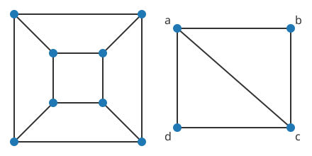

# Steinitz 정리

# 개요

**Steinitz 정리(Steinitz's theorem)** 는 어떤 그래프가 3 차원 [볼록 다면체](convex-polytopes.md)의 꼭짓점과 모서리로 된 그래프인지 판정하는 정리다. 정육면체의 꼭짓점 여덟 개와 모서리 열두 개를 종이 위에 그리면 큰 사각형 안에 작은 사각형이 있고 꼭짓점끼리 이어진 그림이 된다. 거꾸로 종이 위에 그린 그래프 하나가 주어졌을 때, 이 그래프를 모서리로 갖는 볼록 다면체가 있는지 묻는 문제가 이 정리의 문제다.

이 정리는 답을 그래프의 두 성질로 준다. 변이 교차하지 않게 평면에 그릴 수 있고, 어느 꼭짓점 두 개를 지워도 연결되어 있으면 그런 다면체가 있다.

# 직관

아래 그림의 왼쪽은 정육면체의 그래프를 변이 교차하지 않게 그린 것이다. 바깥 사각형이 한 면이고 안쪽 사각형이 맞은편 면이며, 그 사이의 사다리꼴 넷이 옆면 넷이다. 오른쪽은 사각형 $abcd$ 에 대각선 $ac$ 를 그은 그래프다.

오른쪽 그래프도 변이 교차하지 않게 그려져 있다. 그런데 이것을 모서리로 갖는 볼록 다면체는 없다. 꼭짓점 $b$ 에는 모서리가 둘만 모이는데, 볼록 다면체의 꼭짓점은 면 셋 이상이 만나는 자리라 모서리가 셋 이상 모인다.

$b$ 에 모서리가 둘뿐이라는 것은 $a$ 와 $c$ 를 지우면 $b$ 가 나머지와 끊어진다는 것이다. 정육면체의 그래프에서는 어느 꼭짓점 둘을 지워도 나머지가 이어져 있다. Steinitz 정리는 평면에 그릴 수 있는 그래프에서 이 차이만이 다면체가 있는지를 가른다는 정리다.

# 정의

## 다면체의 그래프

볼록 다면체 $P$ 의 꼭짓점을 정점으로, 모서리를 간선으로 하는 그래프를 $P$ 의 **그래프(graph of a polytope)** 라 한다. 그림 왼쪽이 정육면체의 그래프다.

## 3-연결 그래프

정점이 넷 이상인 그래프에서 어느 두 정점을 지워도 남은 그래프가 연결되어 있으면 **3-연결(3-connected)** 이라 한다. [Menger 정리](menger-theorem.md)에 따르면 이것은 서로 다른 두 정점 사이에 끝점 말고는 겹치지 않는 경로가 셋 있는 것과 동치다.

정육면체의 그래프는 3-연결이다. 그림 오른쪽의 그래프는 $a,c$ 를 지우면 $b$ 와 $d$ 가 끊어지므로 3-연결이 아니다.

## 실현

그래프 $G$ 에 대해 $P$ 의 그래프가 $G$ 와 동형인 3 차원 볼록 다면체 $P$ 를 $G$ 의 **실현(realization)** 이라 한다. 정육면체는 그림 왼쪽 그래프의 실현이고, 같은 그래프의 실현으로 밑면과 윗면의 크기가 다른 사각뿔대도 있다.

# 성질

## 정리

정리. 단순 그래프 $G$ 가 어떤 3 차원 볼록 다면체의 그래프인 것은 $G$ 가 [평면 그래프](planar-graphs.md)이고 3-연결인 것과 동치다[^1][^2].

## 필요성

다면체의 한 면 바로 바깥의 점에서 나머지 다면체를 그 면 위로 비추면, 모서리들이 그 면 안에 교차 없이 그려진다. 이 그림을 **Schlegel 도형(Schlegel diagram)** 이라 하고, 그림 왼쪽이 정육면체의 Schlegel 도형이다. 그래서 다면체의 그래프는 평면 그래프다.

$d$ 차원 볼록 다면체의 그래프는 어느 $d-1$ 개의 정점을 지워도 연결되어 있다. 이것을 **Balinski 정리(Balinski's theorem)** 라 한다. 지운 정점 $d-1$ 개와 다른 꼭짓점 하나를 지나는 초평면을 잡고, 그 법선 방향의 일차식을 키우거나 줄이는 모서리 경로로 남은 꼭짓점이 모두 최댓값 꼭짓점이나 최솟값 꼭짓점에 이어진다는 것을 써서 증명한다[^2]. $d=3$ 이 3-연결이다.

## 충분성

증명의 요지. Steinitz 의 원래 증명은 그래프를 줄이는 조작을 쓴다. 삼각형 하나를 세 갈래 정점 하나로 바꾸는 조작과 그 역을 **Δ–Y 변환(Δ–Y transformation)** 이라 한다. 3-연결 평면 그래프는 이 변환과 평행 간선·차수 2 정점의 정리를 되풀이해 사면체의 그래프 $K\_4$ 로 줄어든다. 각 변환이 다면체의 실현을 유지하도록 꼭짓점 하나를 잘라 내거나 면 셋을 연장하는 기하 조작으로 거꾸로 돌릴 수 있으므로, $K\_4$ 의 실현인 사면체에서 시작해 $G$ 의 실현을 얻는다[^2].

다른 증명은 원 채움(circle packing)을 쓴다. 3-연결 평면 그래프는 모든 모서리가 하나의 구에 접하는 다면체로 실현되고, 그 실현은 사영 변환을 빼면 하나뿐이다. 이것을 Koebe–Andreev–Thurston 정리(Koebe–Andreev–Thurston theorem)라 한다[^2].

## 정수 좌표

Δ–Y 변환을 거꾸로 돌리는 조작은 유리수 좌표를 유리수 좌표로 보내므로, 3-연결 평면 그래프는 꼭짓점 좌표가 모두 정수인 다면체로 실현된다[^2].

## 4 차원 이상

4 차원 이상에서는 이런 판정이 알려져 있지 않다. Richter-Gebert 는 4 차원 다면체의 면 구조가 주어졌을 때 실현의 존재를 판정하는 문제가 실수 계수 다항식 연립의 해 존재 문제와 같은 어려움을 가짐을 보였다. 꼭짓점 좌표를 모두 유리수로 잡을 수 없는 4 차원 다면체도 있다[^3].

# 활용

- 다면체의 분류. 3 차원 볼록 다면체를 면 구조로 세는 문제가 3-연결 평면 그래프를 세는 문제와 같아진다. 꼭짓점 수와 면 수가 정해진 다면체의 종류를 이 대응으로 센다.
- 평면 그래프의 그림. 3-연결 평면 그래프는 모든 면이 볼록 다각형인 교차 없는 그림을 갖고, Tutte 의 용수철 그림(Tutte embedding)이 바깥 면을 고정하고 각 정점을 이웃들의 무게중심에 놓아 그런 그림을 만든다. 이 그림은 Maxwell–Cremona 대응으로 다면체 실현으로 들어올려진다.
- [Euler 지표](euler-characteristic.md). 이 정리로 3-연결 평면 그래프의 정점, 간선, 면의 수에 대한 사실과 3 차원 볼록 다면체의 f 벡터에 대한 사실이 서로 옮겨진다.

[^1]: E. Steinitz, "Polyeder und Raumeinteilungen", in *Encyklopädie der mathematischen Wissenschaften* III.1.2, Teubner, 1922, 1–139.
[^2]: G. M. Ziegler, *Lectures on Polytopes*, Graduate Texts in Mathematics 152, Springer, 1995, 3 장과 4 장.
[^3]: J. Richter-Gebert, *Realization Spaces of Polytopes*, Lecture Notes in Mathematics 1643, Springer, 1996.

# 연관 문서

## 선수지식

- [평면 그래프](planar-graphs.md)
- [볼록 다면체](convex-polytopes.md)

## 더 알아보기

아직 연결한 문서가 없다.

#graph_theory #combinatorics #optimization
