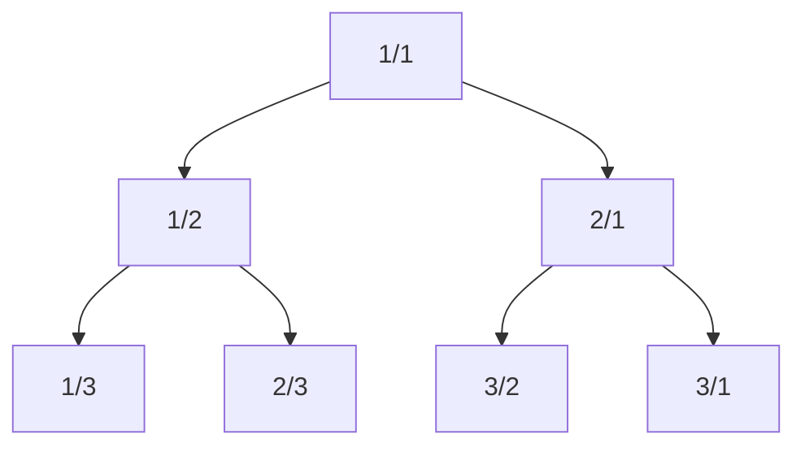

# Stern–Brocot 나무

# 개요

**Stern–Brocot 나무(Stern–Brocot tree)** 는 이웃한 두 분수 사이에 분자끼리, 분모끼리 더한 분수를 끼워 넣는 일을 되풀이해 모든 양의 유리수를 한 번씩 늘어놓은 이진 나무다. 톱니바퀴 두 개의 잇수 비로 $0.43$ 에 가까운 회전비를 내되 잇수를 작게 하려면, 분모가 작은 분수부터 차례로 시험해야 한다.

나무의 뿌리 $1/1$ 에서 시작해 목표가 작으면 왼쪽, 크면 오른쪽으로 내려가면 분모가 작은 분수부터 차례로 만난다. $0.43$ 을 향해 내려가면 $1/2,1/3,2/5,3/7$ 을 거친다.

# 직관

$0/1$ 과 $1/0$ 을 양 끝에 놓는다. $1/0$ 은 무한대를 나타내는 기호로만 쓴다. 두 분수 사이에 $(0+1)/(1+0)=1/1$ 을 넣는다.

다음 단계에서는 이웃한 두 쌍 사이에 각각 넣어 $0/1,1/2,1/1,2/1,1/0$ 이 된다. 한 번 더 하면 $1/3,2/3,3/2,3/1$ 이 들어간다. 새로 들어간 분수를 그 분수를 만든 두 이웃 가운데 늦게 생긴 쪽의 자식으로 이으면 다음 나무가 된다.

$3/7\approx 0.43$ 을 찾으면 $1/1$ 보다 작으니 왼쪽 $1/2$, $1/2$ 보다 작으니 왼쪽 $1/3$, $1/3$ 보다 크니 오른쪽 $2/5$, $2/5$ 보다 크니 오른쪽에서 $3/7$ 을 만난다.

# 정의

분수 $a/b$ 와 $c/d$ 의 **중간수(mediant)** 는 $(a+c)/(b+d)$ 다. [Farey 수열](farey-sequences.md)에서 이웃한 두 항 사이에 처음 들어가는 분수가 이 중간수다.

Stern–Brocot 나무는 다음 규칙으로 정의된다. 각 마디는 구간 $(a/b,c/d)$ 를 하나 맡고, 그 구간의 중간수를 값으로 갖는다. 뿌리는 구간 $(0/1,1/0)$ 의 마디 $1/1$ 이다. 값이 $m$ 인 마디의 왼쪽 자식은 구간 $(a/b,m)$, 오른쪽 자식은 구간 $(m,c/d)$ 를 맡는다.

직관 절의 $2/5$ 는 구간 $(1/3,1/2)$ 를 맡은 마디이고, 오른쪽 자식 $3/7$ 은 구간 $(2/5,1/2)$ 를 맡는다.

# 성질

## 이웃의 행렬식

한 마디가 맡은 구간 $(a/b,c/d)$ 는 언제나 다음을 만족한다.

$$
bc-ad=1
$$

증명의 요지. 뿌리에서 $1\cdot 1-0\cdot 0=1$ 이다. 구간을 중간수로 나누면 $b(a+c)-a(b+d)=bc-ad$ 이고 $(b+d)c-(a+c)d=bc-ad$ 이므로 두 자식에서도 $1$ 이다. 마디의 값 $(a+c)/(b+d)$ 의 분자와 분모의 공약수는 $b(a+c)-a(b+d)=1$ 을 나누므로 마디의 값은 기약분수다.

## 모든 양의 유리수가 한 번씩

양의 기약분수 $p/q$ 는 나무에 정확히 한 번 나온다.[^1]

증명의 요지. 마디의 구간이 서로 겹치지 않게 갈라지므로 두 번 나오지 않는다. $p/q$ 가 구간 $(a/b,c/d)$ 안에 있으면 $bp-aq\ge 1$, $cq-dp\ge 1$ 이고, 행렬식이 $1$ 이므로 다음 등식이 성립한다.

$$
(c+d)(bp-aq)+(a+b)(cq-dp)=p+q
$$

한 단계 내려갈 때마다 $a+b$ 나 $c+d$ 가 커지므로 좌변이 $p+q$ 를 넘기 전에 $p/q$ 가 마디의 값이 된다.

## 경로와 연분수

왼쪽으로 내려가는 것을 $L$, 오른쪽을 $R$ 로 적으면 $p/q$ 에 이르는 경로는 [연분수](continued-fractions.md) 전개 $p/q=\lbrack a_0;a_1,\dots,a_k\rbrack$ 에서 다음과 같다.

$$
R^{a_0}L^{a_1}R^{a_2}\cdots X^{a_k-1}
$$

마지막 글자 $X$ 는 $k$ 가 짝수이면 $R$, 홀수이면 $L$ 이다. 직관 절의 $3/7=\lbrack 0;2,3\rbrack$ 은 $R^0L^2R^2=LLRR$ 이다. 같은 방향으로 내려가는 횟수가 [유클리드 알고리즘](euclidean-algorithm.md)의 몫이다.

## 구간 안의 가장 간단한 분수

$0\le x\lt y$ 인 열린 구간 $(x,y)$ 에 들어가는 분수 가운데 분모가 가장 작은 것은, 뿌리에서 내려가며 처음으로 $(x,y)$ 안에 들어가는 마디의 값이다. 그 분수는 분자도 가장 작다.[^1]

$(0.42,0.44)$ 에서는 $1/1,1/2,1/3,2/5$ 가 모두 구간 밖이고 다음 마디 $3/7\approx 0.4286$ 이 처음으로 안에 든다. 분모가 $7$ 보다 작은 분수는 이 구간에 없다.

# 활용

- 시계공 Brocot 은 1861 년에 원하는 회전비에 가까운 톱니 수의 비를 찾는 표로 이 나무를 썼고, Stern 은 1858 년에 같은 구성을 수론에서 다뤘다.[^1]
- 분모 상한이 있는 가장 좋은 유리수 근사를 찾는 이분 탐색이다. 같은 방향으로 여러 번 내려가는 구간을 연분수의 몫 하나로 건너뛰면 단계 수가 분모의 자릿수에 비례한다.
- $L=\begin{pmatrix}1&0\cr 1&1\end{pmatrix}$, $R=\begin{pmatrix}1&1\cr 0&1\end{pmatrix}$ 로 두면 성분이 음이 아닌 $\mathrm{SL}\_2(\mathbb Z)$ 의 원소는 $L$ 과 $R$ 의 곱으로 정확히 한 가지로 쓰인다. 경로 하나가 이 곱 하나에 대응한다.[^1]

[^1]: R. L. Graham, D. E. Knuth, O. Patashnik, *Concrete Mathematics*, 2nd ed., Addison-Wesley, 1994, 4.5 절.

# 연관 문서

## 선수지식

- [Farey 수열](farey-sequences.md)
- [연분수](continued-fractions.md)

## 더 알아보기

아직 연결한 문서가 없다.

#number_theory #combinatorics #algorithms
