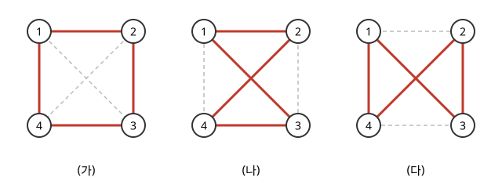

# 강한 순환 이중 덮개 추측

# 개요

**강한 순환 이중 덮개 추측(strong cycle double cover conjecture)** 은 다리가 없는 그래프에서 순환 하나를 미리 골라도, 그 순환을 포함하는 순환 이중 덮개가 있다는 추측이다. 정점 넷의 완전그래프 $K\_4$ 를 평면에 그리면 면의 테두리인 삼각형 넷이 모든 간선을 두 번씩 덮는다. 그런데 사각형 $1\text{–}2\text{–}3\text{–}4$ 를 꼭 쓰고 싶으면 면의 테두리로는 덮개를 만들 수 없다.

이 추측은 어느 순환을 골라도 나머지 순환을 맞춰 넣을 수 있다고 주장하며, 고른 순환이 모든 정점을 지나는 경우에는 짝수 부분그래프 둘로 덮개가 실제로 만들어진다.

# 직관

$K\_4$ 의 정점을 $1,2,3,4$ 로 두고 사각형 $H=1\text{–}2\text{–}3\text{–}4\text{–}1$ 을 고른다. $H$ 에 들지 않는 간선은 대각선 $13$, $24$ 둘이다. $H$ 가 사각형의 변을 한 번씩 덮었으므로, 남은 순환들은 변을 한 번씩, 대각선을 두 번씩 덮어야 한다.

대각선 $13$, $24$ 를 둘 다 포함하는 순환 두 개를 찾는다. 대각선만 모으면 모든 정점의 차수가 $1$ 이라 순환이 되지 않는다. 정점마다 차수를 하나씩 더 채우도록 변 $12$, $34$ 를 더하면 순환 $1\text{–}2\text{–}4\text{–}3\text{–}1$ 이 되고, 나머지 변 $23$, $41$ 을 더하면 순환 $1\text{–}3\text{–}2\text{–}4\text{–}1$ 이 된다.

그림의 세 사각형에서 어느 간선이든 정확히 두 그림에 굵게 그려져 있다. 그래서 세 사각형이 $H$ 를 포함하는 순환 이중 덮개다.

# 정의

그래프 $G$ 의 순환들의 모임 $\mathcal C$ 에서 $G$ 의 모든 간선이 정확히 두 순환에 들면 $\mathcal C$ 를 $G$ 의 순환 이중 덮개라 한다([순환 이중 덮개 추측](cycle-double-cover-conjecture.md)). 모든 정점의 차수가 짝수인 부분그래프를 짝수 부분그래프라 한다.

**강한 순환 이중 덮개 추측**: 다리가 없는 모든 그래프 $G$ 와 $G$ 의 모든 순환 $C$ 에 대해, $C$ 를 포함하는 $G$ 의 순환 이중 덮개가 있다[^1]. 직관 절은 $G=K\_4$ 이고 $C$ 가 사각형 $H$ 인 경우다.

# 성질

## 순환 이중 덮개 추측과의 관계

다리가 없는 그래프에 간선이 있으면 순환이 있으므로, 강한 추측이 참이면 순환 이중 덮개 추측도 참이다. 역은 따라 나오지 않는다. $K\_4$ 의 삼각형 넷은 순환 이중 덮개이지만 사각형을 포함하지 않는다.

## Hamilton 순환

$C$ 가 $G$ 의 [Hamilton 순환](hamiltonian-cycles.md)이면 $C$ 를 포함하는 순환 이중 덮개가 있다.

$C$ 에 들지 않는 간선의 집합을 $F$ 라 하고, $F$ 에서 차수가 홀수인 정점의 집합을 $T$ 라 한다. $F$ 의 차수를 모두 더하면 $2\vert F\vert$ 이므로 $\vert T\vert$ 는 짝수다. 순환 $C$ 를 따라 $T$ 의 정점을 차례로 둘씩 짝지어 그 사이의 경로를 모으면, $T$ 의 정점에서만 차수가 홀수인 $C$ 의 간선 집합 $X$ 가 나온다.

$A=F\cup X$ 와 $B=F\cup(E(C)\setminus X)$ 는 짝수 부분그래프다. 정점 $v$ 의 $C$ 에서의 차수가 $2$ 이므로 $E(C)\setminus X$ 에서의 차수는 $X$ 에서의 차수와 홀짝이 같기 때문이다. $C$ 의 간선은 $C$ 와 $A$, $B$ 가운데 하나에 들고, $F$ 의 간선은 $A$ 와 $B$ 에 든다. $A$ 와 $B$ 를 겹치지 않는 순환들로 나누면 $C$ 를 포함하는 순환 이중 덮개다.

직관 절에서 $F=\lbrace 13,24\rbrace$, $T=\lbrace 1,2,3,4\rbrace$, $X=\lbrace 12,34\rbrace$ 이고 $A$, $B$ 가 그림의 (나), (다)다.

## 평면에 그린 경우

$G$ 를 평면에 그렸을 때 $C$ 가 어느 면의 테두리이면 면의 테두리들이 $C$ 를 포함하는 순환 이중 덮개다. 평면 그래프에서도 면의 테두리가 아닌 $C$ 를 고르면 이 구성을 쓸 수 없다. 직관 절의 사각형 $H$ 가 그런 $C$ 다.

# 활용

- 원형 그리기 추측(circular embedding conjecture). 2 연결 그래프를 어떤 곡면에 그려 모든 면의 테두리가 순환이 되게 할 수 있다는 추측이다. 순환 $C$ 가 한 면의 테두리가 되는 그리기가 있으면 면의 테두리들이 $C$ 를 포함하는 덮개이므로, 그런 그리기를 찾는 것이 강한 추측의 한 경우를 푸는 방법이다[^1].
- 순환 이중 덮개의 귀납적 구성. 작은 그래프의 덮개를 이어 붙여 큰 그래프의 덮개를 만들 때, 이어 붙이는 자리의 순환을 덮개에 넣어야 한다. 강한 추측은 그런 순환을 미리 정해 둔 귀납 가정으로 쓰인다[^1].

[^1]: C.-Q. Zhang, *Circuit Double Cover of Graphs*, London Mathematical Society Lecture Note Series 399, Cambridge University Press, 2012.

# 연관 문서

## 선수지식

- [순환 이중 덮개 추측](cycle-double-cover-conjecture.md)

## 더 알아보기

아직 연결한 문서가 없다.

#graph_theory #combinatorics
