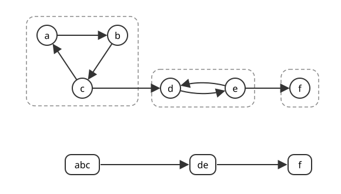

# 강연결성분

# 개요

**강연결성분(strongly connected component)** 은 방향 그래프에서 서로 오갈 수 있는 정점들을 한데 모은 덩어리다. 일방통행 길로 이어진 동네 여섯 곳이 있을 때, 어느 동네끼리 서로 갔다 올 수 있는지를 묻는 문제가 이 꼴이다. 강연결성분은 서로 오갈 수 있는 동네를 한 덩어리로 묶고, 덩어리 사이의 길이 한 방향으로만 흐른다는 것을 보여 준다.

# 직관

동네 $a,b,c,d,e,f$ 를 잇는 일방통행 길이 $a\to b$, $b\to c$, $c\to a$, $c\to d$, $d\to e$, $e\to d$, $e\to f$ 다. [위상정렬](topological-sort.md)로 동네를 한 줄로 세우려 하면 $a\to b\to c\to a$ 가 순환이라서 세울 수 없다.

순환 위의 $a,b,c$ 는 서로 갔다 올 수 있으므로 하나로 묶는다. $d$ 와 $e$ 도 서로 오가므로 묶고, $f$ 는 혼자 남는다. 묶음 $\lbrace a,b,c\rbrace$ 에서 $\lbrace d,e\rbrace$ 로 가는 길 $c\to d$ 는 있지만 거꾸로 가는 길은 없다. 거꾸로 가는 길이 있다면 두 묶음이 서로 오갈 수 있어 한 묶음이 되었을 것이다.

아래 그림의 위쪽이 길이고 점선 상자가 묶음이다. 아래쪽은 묶음 하나를 점 하나로 줄인 것이고, 화살표가 모두 오른쪽을 향하므로 순환이 없다.



순환이 있어 한 줄로 세울 수 없던 그래프도 묶음끼리는 한 줄로 세워진다. 그래서 순환은 묶음 안에서, 순서는 묶음 사이에서 따로 다룬다.

# 정의

## 강연결성분

방향 그래프 $G=(V,E)$ 에서 $u$ 에서 $v$ 로 가는 경로와 $v$ 에서 $u$ 로 가는 경로가 모두 있으면 $u\sim v$ 로 적는다. 길이 $0$ 인 경로를 허용하므로 $v\sim v$ 다. $\sim$ 는 [동치관계](equivalence-relations.md)이고, 그 동치류를 $G$ 의 **강연결성분** 이라 한다. 강연결성분이 하나뿐인 그래프를 **강연결(strongly connected)** 이라 한다.

직관 절의 그래프에서 $a\sim c$ 이고 $c\not\sim d$ 이므로 강연결성분은 $\lbrace a,b,c\rbrace$, $\lbrace d,e\rbrace$, $\lbrace f\rbrace$ 셋이고, 그래프는 강연결이 아니다.

## 응축

$G$ 의 **응축(condensation)** $G^{\mathrm{SCC}}$ 는 강연결성분을 정점으로 하고, 성분 $C$ 의 정점에서 다른 성분 $C'$ 의 정점으로 가는 간선이 $G$ 에 하나라도 있을 때 간선 $C\to C'$ 를 두는 방향 그래프다.

직관 절 그림의 아래쪽이 응축이다. 간선은 $\lbrace a,b,c\rbrace\to\lbrace d,e\rbrace$ 와 $\lbrace d,e\rbrace\to\lbrace f\rbrace$ 둘이다.

# 성질

## 응축의 비순환성

정리. 응축 $G^{\mathrm{SCC}}$ 는 방향 순환이 없는 그래프(directed acyclic graph, DAG)다.

증명의 요지. 성분 $C\_1\to C\_2\to\dots\to C\_k\to C\_1$ 이 순환이면, 각 성분 안의 경로와 성분 사이의 간선을 이어 $C\_1$ 의 정점과 $C\_2$ 의 정점이 서로 오간다. 그러면 두 성분이 같은 동치류여서 모순이다.

그래서 응축은 위상정렬을 가진다. 순환이 있는 그래프의 문제는 성분 안의 문제와 응축 위의 위상순 계산으로 나뉜다.

## 종료 시각과 성분의 순서

[그래프 탐색](graph-search.md)의 깊이 우선 탐색(depth-first search, DFS)을 $G$ 전체에 하고, 성분 $C$ 의 종료 시각 가운데 가장 큰 것을 $f(C)$ 로 적는다.

정리. 응축에 간선 $C\to C'$ 가 있으면 $f(C)\gt f(C')$ 다.

증명의 요지. DFS 가 $C\cup C'$ 에서 처음 들어간 정점을 $x$ 라 한다. $x\in C$ 이면 $x$ 가 종료되기 전에 $C\cup C'$ 의 모든 정점이 방문되고 종료되므로 $f(C)=f(x)$ 가 가장 크다. $x\in C'$ 이면 $C'$ 에서 $C$ 로 가는 경로가 없으므로, $C'$ 의 정점이 모두 종료된 뒤에야 $C$ 의 정점이 방문된다.

직관 절의 그래프에서 $a$ 부터 이웃을 알파벳 순으로 살피면 $a,b,c,d,e,f$ 순으로 들어가고, 종료 시각은 $f,e,d,c,b,a$ 순으로 $7$ 부터 $12$ 다. $f(\lbrace a,b,c\rbrace)=12$, $f(\lbrace d,e\rbrace)=9$, $f(\lbrace f\rbrace)=7$ 이고 응축의 간선 방향과 맞는다.

## Kosaraju 알고리즘

**Kosaraju 알고리즘(Kosaraju's algorithm)** 은 두 번의 DFS 로 강연결성분을 구한다.

1. $G$ 에서 DFS 를 하고 정점을 종료 시각이 큰 순서로 늘어놓는다.
2. 간선을 모두 뒤집은 그래프 $G^{\mathrm T}$ 에서, 1 의 순서대로 아직 방문하지 않은 정점을 골라 DFS 를 한다. 한 번의 DFS 가 방문한 정점들이 성분 하나다.

정리. 2 단계의 DFS 한 번이 방문하는 정점은 정확히 성분 하나다. Kosaraju 가 1978 년에 고안했고 Sharir 가 1981 년에 발표했다[^1].

증명의 요지. $G$ 와 $G^{\mathrm T}$ 는 성분이 같다. 2 단계에서 고른 정점이 속한 성분 $C$ 는 남은 성분 가운데 $f(C)$ 가 가장 크다. 앞 정리로 $G$ 에서 $C$ 로 들어오는 간선은 $f$ 가 더 큰 성분, 곧 이미 방문한 성분에서만 온다. 그 간선이 $G^{\mathrm T}$ 에서는 $C$ 에서 나가는 간선이므로, $G^{\mathrm T}$ 의 DFS 는 $C$ 밖의 새 정점으로 나가지 못한다.

직관 절의 그래프에서 뒤집은 간선은 $b\to a$, $c\to b$, $a\to c$, $d\to c$, $e\to d$, $d\to e$, $f\to e$ 다. 순서 $a,b,c,d,e,f$ 에 따라 $a$ 에서 시작한 DFS 는 $a,c,b$ 를 방문하고 멈춘다. 다음으로 $d$ 에서 시작한 DFS 는 $c$ 가 이미 방문되었으므로 $d,e$ 만 방문하고, 마지막으로 $f$ 만 남는다.

```typescript
function kosaraju(n: number, adj: number[][]): number[] {
  const order: number[] = [];
  const seen = new Array<boolean>(n).fill(false);
  const dfs1 = (v: number): void => {
    seen[v] = true;
    for (const w of adj[v]) if (!seen[w]) dfs1(w);
    order.push(v); // 종료 시각 순서
  };
  for (let v = 0; v < n; v++) if (!seen[v]) dfs1(v);

  const radj: number[][] = Array.from({ length: n }, () => []);
  for (let v = 0; v < n; v++) for (const w of adj[v]) radj[w].push(v);

  const comp = new Array<number>(n).fill(-1);
  const dfs2 = (v: number, c: number): void => {
    comp[v] = c;
    for (const w of radj[v]) if (comp[w] === -1) dfs2(w, c);
  };
  let c = 0;
  for (let i = n - 1; i >= 0; i--) {
    const v = order[i];
    if (comp[v] === -1) dfs2(v, c++);
  }
  return comp;
}
```

인접 리스트 표현에서 두 DFS 와 간선 뒤집기가 각각 $O(\lvert V\rvert+\lvert E\rvert)$ 시간이므로 전체도 $O(\lvert V\rvert+\lvert E\rvert)$ 다. Kosaraju 알고리즘이 내놓는 성분의 순서는 응축의 위상정렬이다.

## Tarjan 알고리즘

**Tarjan 알고리즘(Tarjan's algorithm)** 은 DFS 한 번으로 강연결성분을 구한다[^2]. 정점을 방문할 때 스택에 넣고, 정점 $v$ 마다 값 $\mathrm{low}(v)$ 를 계산한다. $\mathrm{low}(v)$ 는 $v$ 의 방문 시각 $d(v)$ 와, $v$ 를 뿌리로 하는 DFS 서브트리의 정점에서 간선 하나로 가는 정점 $w$ 가운데 아직 스택에 있는 것의 $d(w)$ 들 가운데 가장 작은 값이다. $v$ 를 종료할 때 $\mathrm{low}(v)=d(v)$ 이면 $v$ 는 자기 성분에서 처음 방문된 정점이고, 스택에서 $v$ 까지 꺼낸 정점들이 성분 하나다.

직관 절의 그래프에서 $d(a)=1$, $d(d)=4$ 이고 $\mathrm{low}(c)=1$, $\mathrm{low}(e)=4$, $\mathrm{low}(f)=6=d(f)$ 다. 그래서 $f$, $\lbrace d,e\rbrace$, $\lbrace a,b,c\rbrace$ 순으로 성분이 나온다. 이 순서는 응축의 위상정렬을 뒤집은 것이다.

# 활용

- 2-충족 가능성(2-satisfiability, 2-SAT). 절마다 리터럴이 둘인 논리식에서 절 $x\lor y$ 를 함의 $\lnot x\to y$ 와 $\lnot y\to x$ 로 바꾼 함의 그래프를 만든다. 논리식이 충족 가능한 것은 어떤 변수 $x$ 도 $\lnot x$ 와 같은 강연결성분에 있지 않은 것과 동치이고, 선형 시간에 판정된다[^3]. 일반 충족 가능성 문제는 [NP-완전성과 Cook–Levin 정리](np-completeness.md)에서 다루는 NP(nondeterministic polynomial time)-완전 문제다.
- [Markov 연쇄](markov-chains.md). 상태를 정점, 양의 전이 확률을 간선으로 둔 그래프의 강연결성분이 서로 오가는 상태의 류(communicating class)이고, 그래프가 강연결인 것이 연쇄가 기약인 것이다.
- [Perron–Frobenius 정리](perron-frobenius.md). 음이 아닌 행렬이 기약인 것은 그 그래프가 강연결인 것이고, 정리의 강한 결론은 이 조건에서 성립한다.
- 프로그램 분석. 함수 호출 그래프의 강연결성분이 서로 재귀하는 함수의 묶음이고, 응축의 위상순으로 함수마다 요약을 계산한다.

[^1]: M. Sharir, "A strong-connectivity algorithm and its applications in data flow analysis", Computers & Mathematics with Applications 7 (1981), 67–72.
[^2]: R. E. Tarjan, "Depth-first search and linear graph algorithms", SIAM Journal on Computing 1 (1972), 146–160.
[^3]: B. Aspvall, M. F. Plass, R. E. Tarjan, "A linear-time algorithm for testing the truth of certain quantified boolean formulas", Information Processing Letters 8 (1979), 121–123.

# 연관 문서

## 선수지식

- [위상정렬](topological-sort.md)

## 더 알아보기

아직 연결한 문서가 없다.

#graph_theory #algorithms #computation
