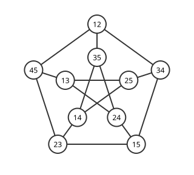

# 강정칙 그래프

# 개요

**강정칙 그래프(strongly regular graph)** 는 모든 정점의 이웃 수가 같고, 두 정점의 공통 이웃 수가 두 정점이 이웃인지 아닌지에 따라서만 정해지는 [그래프](graphs.md)다. 오각형에서는 모든 정점의 이웃이 둘이고, 이웃한 두 꼭짓점은 공통 이웃이 없고, 이웃하지 않은 두 꼭짓점은 공통 이웃이 하나다. 이런 그래프는 공통 이웃 수 세 개만으로 인접행렬의 제곱이 적히고, 그 식에서 고윳값과 그 개수가 나온다.

# 직관

아래 그림은 $\lbrace 1,2,3,4,5\rbrace$ 의 두 원소 부분집합 열 개를 정점으로 두고 겹치지 않는 두 부분집합을 이은 그래프다. 이 그래프를 Petersen 그래프(Petersen graph)라 하고, [Kneser 그래프](kneser-graphs.md) $K(5,2)$ 와 같다. 모든 정점의 이웃이 셋이다.

이 그래프의 인접행렬(adjacency matrix) $A$ 의 [고윳값](eigenvalues.md)을 구하려 한다. $10\times 10$ [행렬](matrices.md)의 특성다항식을 손으로 전개하는 대신 $A^2$ 의 성분을 센다. $(A^2)\_{uv}$ 는 $u$ 에서 두 걸음 만에 $v$ 에 닿는 방법의 수, 곧 $u\ne v$ 이면 $u$ 와 $v$ 의 공통 이웃 수이고 $u=v$ 이면 $u$ 의 이웃 수 $3$ 이다.

그림에서 이웃한 $12$ 와 $34$ 의 공통 이웃은 $1,2,3,4$ 를 모두 피해야 하는데 남은 원소가 $5$ 하나뿐이라 없다. 이웃하지 않은 $12$ 와 $13$ 의 공통 이웃은 $1,2,3$ 을 피하는 $45$ 하나다. 어느 쌍을 골라도 같으므로 $J$ 를 성분이 모두 $1$ 인 행렬이라 하면

$$
A^2=3I+(J-I-A)
$$

이다. $J-I-A$ 는 이웃하지 않은 서로 다른 두 정점에서 $1$ 인 행렬이다.

성분이 모두 $1$ 인 벡터는 고윳값 $3$ 의 고유벡터다. $A$ 는 대칭이므로 [스펙트럼 정리](spectral-theorem.md)에 따라 나머지 고유벡터를 성분의 합이 $0$ 인 것으로 고를 수 있고, 그런 $x$ 에서는 $Jx=0$ 이다. $Ax=\theta x$ 를 위 식에 넣으면 $\theta^2=2-\theta$ 이므로 $\theta$ 는 $1$ 이나 $-2$ 다. 나머지 고윳값 아홉 개 가운데 $1$ 이 $f$ 개, $-2$ 가 $g$ 개라 하면 $f+g=9$ 이고, $A$ 의 대각합이 $0$ 이므로 $3+f-2g=0$ 이다. 따라서 $f=5$, $g=4$ 다.

# 정의

정점이 $v$ 개인 단순 그래프가 다음 세 조건을 만족하면 매개변수 $(v,k,\lambda,\mu)$ 의 **강정칙 그래프** 라 하고 $\mathrm{srg}(v,k,\lambda,\mu)$ 로 적는다[^1].

- 모든 정점의 이웃이 $k$ 개다. 이 조건만 만족하는 그래프를 정칙 그래프(regular graph)라 한다.
- 이웃한 두 정점의 공통 이웃이 $\lambda$ 개다.
- 이웃하지 않은 서로 다른 두 정점의 공통 이웃이 $\mu$ 개다.

완전그래프와 간선이 없는 그래프는 셋째나 둘째 조건이 비어 있으므로 보통 제외한다. 인접행렬 $A$ 로는 세 조건이

$$
AJ=kJ,\qquad A^2=kI+\lambda A+\mu(J-I-A)
$$

와 동치다. 직관 절의 Petersen 그래프는 $\mathrm{srg}(10,3,0,1)$ 이고 개요의 오각형은 $\mathrm{srg}(5,2,0,1)$ 이다.

$\mathrm{srg}(v,k,\lambda,\mu)$ 의 여그래프(complement), 곧 이웃 관계를 뒤집은 그래프는 $\mathrm{srg}(v,\thinspace v-k-1,\thinspace v-2k+\mu-2,\thinspace v-2k+\lambda)$ 다. Petersen 그래프의 여그래프는 $\mathrm{srg}(10,6,3,4)$ 다.

$\mu=0$ 이면 이웃하지 않은 두 정점은 공통 이웃이 없어 거리가 $2$ 인 쌍이 없으므로 그래프는 크기 $k+1$ 인 완전그래프들의 서로소 합이다. 이 경우와 그 여그래프(완전 다분 그래프)를 자명한 강정칙 그래프라 하고, 그래프와 여그래프가 모두 연결인 것을 원시적(primitive)이라 한다.

$v=4\mu+1$, $k=2\mu$, $\lambda=\mu-1$ 인 강정칙 그래프를 **회의 그래프(conference graph)** 라 한다. 오각형은 $\mu=1$ 인 회의 그래프다. $q$ 가 $4$ 로 나눈 나머지가 $1$ 인 [소수](primes.md)의 거듭제곱이면 [회의 행렬](conference-matrices.md) 문서의 [Paley 그래프](paley-graphs.md)는 $\mathrm{srg}(q,(q-1)/2,(q-5)/4,(q-1)/4)$ 인 회의 그래프다. $q=9$ 이면 $\mathrm{srg}(9,4,1,2)$ 이고, $3\times 3$ 격자의 칸을 정점으로 두고 같은 행이나 같은 열의 두 칸을 이은 그래프와 같다.

# 성질

## 매개변수의 관계

$$
k(k-\lambda-1)=(v-k-1)\mu
$$

정점 $x$ 를 하나 고정하고, $x$ 의 이웃 $y$ 와 $x$ 의 이웃이 아닌 $z\ne x$ 가 이웃한 쌍 $(y,z)$ 를 두 가지로 센다. $y$ 는 $k$ 개이고 각 $y$ 의 이웃 $k$ 개 가운데 $x$ 와 공통 이웃 $\lambda$ 개를 빼면 $k-\lambda-1$ 개가 남는다. $z$ 는 $v-k-1$ 개이고 각 $z$ 는 $x$ 와 공통 이웃이 $\mu$ 개다. Petersen 그래프에서는 양쪽이 $3\cdot 2=6\cdot 1$ 이다.

## 고윳값과 중복도

연결된 $\mathrm{srg}(v,k,\lambda,\mu)$ 의 인접행렬은 고윳값이 $k$ 와

$$
r,s=\frac{(\lambda-\mu)\pm\sqrt{(\lambda-\mu)^2+4(k-\mu)}}{2}
$$

셋뿐이고, $k$ 의 중복도는 $1$, $r$ 과 $s$ 의 중복도는

$$
f,g=\frac12\left((v-1)\mp\frac{2k+(v-1)(\lambda-\mu)}{r-s}\right)
$$

이다[^1]. 직관 절과 같이 성분의 합이 $0$ 인 고유벡터에서 $\theta^2=(\lambda-\mu)\theta+(k-\mu)$ 가 나오고, 중복도는 $f+g=v-1$ 과 대각합 $k+fr+gs=0$ 을 풀어 얻는다. 역으로 연결된 정칙 그래프의 인접행렬이 서로 다른 고윳값을 정확히 셋 가지면 그 그래프는 강정칙이다.

Petersen 그래프는 $r=1$, $s=-2$, $r-s=3$ 이고 $2k+(v-1)(\lambda-\mu)=6-9=-3$ 이므로 $f=5$, $g=4$ 다. 회의 그래프는 $2k+(v-1)(\lambda-\mu)=0$ 이어서 $f=g=(v-1)/2$ 이고, 고윳값은 $(-1\pm\sqrt v)/2$ 다. 오각형의 고윳값 $(-1\pm\sqrt5)/2$ 는 [무리수](irrational-numbers.md)다.

## 정수성 조건

중복도 $f,g$ 는 정수여야 한다. 이 정수성 조건(integrality condition)에서 다음이 따른다[^1].

- 연결된 강정칙 그래프는 회의 그래프이거나, $r$ 과 $s$ 가 정수다.

$2k+(v-1)(\lambda-\mu)\ne 0$ 이면 $\sqrt{(\lambda-\mu)^2+4(k-\mu)}=(2k+(v-1)(\lambda-\mu))/(g-f)$ 가 유리수이므로 정수이고, 그 정수와 $\lambda-\mu$ 의 홀짝이 같아 $r,s$ 가 정수다. $2k+(v-1)(\lambda-\mu)=0$ 이면 $0\lt k\lt v-1$ 에서 $\lambda-\mu=-1$, $v-1=2k$ 이고 매개변수의 관계에 넣으면 $k=2\mu$ 다.

## Moore 그래프

이웃이 $k$ 개이고 지름이 $2$ 인 그래프의 정점은 많아야 $1+k+k(k-1)=k^2+1$ 개다. 이 수를 달성하는 그래프를 지름 $2$ 의 Moore 그래프(Moore graph)라 하고, 그런 그래프는 $\mathrm{srg}(k^2+1,k,0,1)$ 과 같다. 오각형($k=2$)과 Petersen 그래프($k=3$)가 그 예다.

Hoffman–Singleton 정리(Hoffman–Singleton theorem). 지름 $2$ 의 Moore 그래프가 있으면 $k\in\lbrace 2,3,7,57\rbrace$ 이다[^2].

$k=2$ 는 회의 그래프인 경우다. 그 밖에는 $m=\sqrt{4k-3}$ 이 정수이고 $k=(m^2+3)/4$ 다. 중복도 공식에서 $m(f-g)=k^2-2k$ 이고, $k$ 를 $m$ 으로 쓰면 $16m(f-g)=m^4-2m^2-15$ 이므로 $m$ 은 $15$ 의 약수다. $m=1,3,5,15$ 가 $k=1,3,7,57$ 이고 $k=1$ 은 완전그래프 $K_2$ 다. $k=7$ 에서는 정점 $50$ 개의 Hoffman–Singleton 그래프가 유일하게 있고[^2], $k=57$ 인 정점 $3250$ 개의 Moore 그래프가 있는지는 알려져 있지 않다[^1].

## 독립집합의 상한

$k$-정칙 그래프의 인접행렬의 가장 작은 고윳값이 $s$ 이면 이웃한 쌍이 없는 정점 집합, 곧 독립집합(independent set)의 크기는

$$
\alpha\le v\frac{-s}{k-s}
$$

이하다. 이를 Hoffman 비율 한계(Hoffman ratio bound)라 한다[^1]. 독립집합 $S$ 에 대해 $x=\mathbf 1\_S-(\lvert S\rvert/v)\mathbf 1$ 은 성분의 합이 $0$ 이므로 $x^{\mathsf T}Ax\ge s\thinspace x^{\mathsf T}x$ 다. $\mathbf 1\_S^{\mathsf T}A\mathbf 1\_S=0$ 을 넣어 정리하면 위 부등식이 나온다. Petersen 그래프에서는 $10\cdot 2/5=4$ 이고, $1$ 을 포함하는 네 부분집합 $12,13,14,15$ 가 서로 겹치므로 이 상한이 달성된다. 이 값은 [Erdős–Ko–Rado 정리](erdos-ko-rado.md)의 $n=5$, $k=2$ 경우와 같다.

## 공스펙트럼

매개변수가 같은 두 강정칙 그래프는 고윳값과 중복도가 같다. 그래서 고윳값으로는 구별되지 않는다. $4\times 4$ 격자의 칸을 정점으로 두고 같은 행이나 같은 열의 두 칸을 이은 그래프와 Shrikhande 그래프(Shrikhande graph)는 둘 다 $\mathrm{srg}(16,6,2,2)$ 이고 동형이 아니다[^1]. 앞의 그래프에서는 한 정점의 이웃 여섯이 삼각형 둘로 나뉘고, Shrikhande 그래프에서는 이웃 여섯이 6 각형을 이룬다.

# 활용

- 회의 행렬의 구성. 회의 그래프 $\mathrm{srg}(q,(q-1)/2,(q-5)/4,(q-1)/4)$ 의 인접행렬 $A$ 에 대해 $Q=2A+I-J$ 는 $Q^2=qI-J$ 를 만족하고, 첫 행과 첫 열에 $1$ 을 붙이면 회의 행렬 문서의 정의대로 차수 $q+1$ 의 대칭 회의 행렬이 된다.
- [등각 직선](equiangular-lines.md). Seidel 행렬(Seidel matrix) $S=J-I-2A$ 의 가장 작은 고윳값이 $-\theta$ 이고 중복도가 $m$ 이면 $I+S/\theta$ 는 양의 준정부호이고 계수가 $v-m$ 이다. 그 Gram 분해로 $\mathbb R^{v-m}$ 에서 어느 두 직선이 이루는 각의 코사인이 $1/\theta$ 인 직선 $v$ 개를 얻는다. Petersen 그래프의 $S$ 는 고윳값이 $3$ 과 $-3$ 이고 각각 중복도가 $5$ 이므로 $\mathbb R^5$ 에서 코사인 $1/3$ 의 등각 직선 $10$ 개가 나온다.
- [그래프 동형](graph-isomorphism.md) 판정의 어려운 입력. 매개변수가 같은 강정칙 그래프는 모든 정점의 차수가 같아서 [Color refinement](color-refinement.md)가 한 정점도 가르지 못한다.

[^1]: A. E. Brouwer, W. H. Haemers, *Spectra of Graphs*, Springer, 2012. 9 장.
[^2]: A. J. Hoffman, R. R. Singleton, "On Moore graphs with diameters 2 and 3", *IBM Journal of Research and Development* 4 (1960), 497–504.

# 연관 문서

## 선수지식

- [그래프](graphs.md)
- [스펙트럼 정리](spectral-theorem.md)
- [회의 행렬](conference-matrices.md)

## 더 알아보기

- [Paley 그래프](paley-graphs.md)

#graph_theory #combinatorics #linear_algebra
