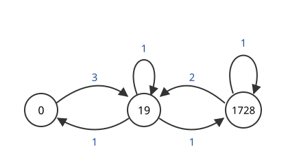

# 초특이 동종사상 그래프

# 개요

**초특이 동종사상 그래프(supersingular isogeny graph)** 는 표수 $p$ 의 초특이 타원곡선을 정점으로, 차수 $\ell$ 의 동종사상(isogeny)을 간선으로 둔 그래프다. $p=23$, $\ell=2$ 이면 정점은 $j$ 불변량이 $0$, $19$, $1728$ 인 세 곡선이고, 각 정점에서 화살표가 세 개씩 나간다. $p$ 가 $2^{256}$ 정도이면 정점이 $2^{252}$ 개쯤이 되고, 두 정점이 주어졌을 때 그 사이의 경로를 찾는 데 고전 컴퓨터로 알려진 방법은 모두 $\sqrt p$ 정도의 시간이 걸린다. 이 그래프는 경로 찾기의 어려움을 해시함수와 서명의 안전성 가정으로 쓰는 동종사상 암호의 바탕이다.

# 직관

[Lang–Trotter 추측](lang-trotter.md)은 곡선 $E/\mathbb Q$ 하나를 고정하고 소수 $p$ 를 바꾸며 초특이가 되는 때를 센다. 여기서는 반대로 $p=23$ 을 고정하고 표수 $23$ 의 초특이 곡선을 전부 모은다. 그런 곡선은 $j$ 불변량으로 $0$, $19$, $1728\equiv3$ 의 세 개뿐이다.

각 곡선 $E$ 에서 크기 $2$ 인 부분군은 $E\lbrack2\rbrack$ 의 영이 아닌 세 점이 하나씩 만든다. 부분군마다 그것을 핵으로 하는 차수 $2$ 의 동종사상이 하나 있으므로 $E$ 에서 화살표가 세 개 나가고, 그 도착점도 초특이 곡선이다. 화살표를 모두 그리면 다음 그림이다.

$0$ 에서 나간 세 화살표는 모두 $19$ 로 가고, $1728$ 에서는 두 개가 $19$ 로, 하나가 자기 자신으로 간다. $p$ 를 키우면 정점은 $p/12$ 개 정도로 늘지만 각 정점에서 나가는 화살표는 그대로 세 개다. 이 그래프에서 화살표를 따라 무작위로 걸으면 $\log p$ 정도의 걸음 만에 어느 정점에 있을 확률이 거의 고르게 퍼진다. 반면 두 곡선을 주고 그 사이의 경로를 찾으라고 하면 알려진 방법은 정점 수의 제곱근 정도를 뒤져야 한다.

# 정의

## 초특이 곡선

[타원곡선](elliptic-curves.md) $E/\overline{\mathbb F_p}$ 의 $p$ 비틀림 점은 두 경우뿐이다.

$$
E\lbrack p\rbrack(\overline{\mathbb F_p})\cong\mathbb Z/p\ \ (\text{보통})\qquad\text{또는}\qquad E\lbrack p\rbrack(\overline{\mathbb F_p})=0\ \ (\text{초특이})
$$

뒤쪽을 **초특이(supersingular)** 곡선이라 한다. $p\ge5$ 이고 $E$ 가 $\mathbb F_p$ 위에서 정의되면 초특이는 $\char35{}E(\mathbb F_p)=p+1$ 과 동치다. $p=23$ 에서 $y^2=x^3+1$ ($j=0$) 은 $\char35{}E(\mathbb F_{23})=24$ 이므로 초특이다.

## 동종사상

**동종사상** 은 원점을 원점으로 보내는 곡선 사이의 영이 아닌 유리사상이다. $\phi\colon E_1\to E_2$ 가 차수 $\ell$ 의 분리 가능한 동종사상이고 $\ell$ 이 소수이면 $\ker\phi\subset E_1\lbrack\ell\rbrack$ 은 크기 $\ell$ 의 부분군이다. 역으로 크기 $\ell$ 의 부분군마다 그것을 핵으로 하는 동종사상이 도착 곡선의 동형을 빼고 하나 있고, Vélu 공식(Vélu's formulas)이 그 식을 준다. $\ell\ne p$ 이면 $E\lbrack\ell\rbrack\cong(\mathbb Z/\ell)^2$ 에 크기 $\ell$ 의 부분군이 $\ell+1$ 개 있다.

## 그래프

$$
V=\lbrace j\in\mathbb F_{p^2}:\ j\ \text{는 초특이 곡선의 }j\text{ 불변량}\rbrace,\qquad
j_1\to j_2\iff\Phi_\ell(j_1,j_2)=0
$$

$\Phi_\ell$ 은 $j(E_1)$ 과 $j(E_2)$ 가 차수 $\ell$ 의 동종사상으로 이어질 때 $0$ 이 되는 모듈러 다항식(modular polynomial)이다. 화살표 $j_1\to j_2$ 의 개수는 $\Phi_\ell(j_1,Y)$ 의 근 $j_2$ 의 중복도다. 이 유향 다중그래프 $G_\ell(p)$ 가 **초특이 동종사상 그래프** 다. 초특이 $j$ 불변량은 모두 $\mathbb F_{p^2}$ 에 있으므로 $V$ 는 유한이다.

$\ell=2$ 의 모듈러 다항식은 다음과 같다.

$$
\Phi_2(X,Y)=X^3+Y^3-X^2Y^2+1488(X^2Y+XY^2)-162000(X^2+Y^2)+40773375XY+8748000000(X+Y)-157464000000000
$$

$p=23$ 에서 $\Phi_2(0,Y)\equiv(Y-19)^3$, $\Phi_2(3,Y)\equiv(Y-3)(Y-19)^2$, $\Phi_2(19,Y)\equiv Y(Y-3)(Y-19)$ 이고, 이것이 직관 절의 그림이다.

# 성질

## 정점의 개수

정점 수는 다음과 같다.

$$
\char35{}V=\Big\lfloor\frac p{12}\Big\rfloor+\varepsilon_p,\qquad
\varepsilon_p=\begin{cases}0&p\equiv1\cr 1&p\equiv5,7\cr 2&p\equiv11\end{cases}\pmod{12}
$$

$p=23$ 이면 $1+2=3$ 이다. 이 개수는 Eichler 의 [질량 공식](mass-formula.md)

$$
\sum_{E\ \text{초특이}}\frac1{\char35{}\mathrm{Aut}(E)}=\frac{p-1}{24}
$$

에서 나온다. 대부분의 곡선은 $\char35{}\mathrm{Aut}(E)=2$ 이고, $j=0$ 은 $6$, $j=1728$ 은 $4$ 이므로 이 둘이 초특이일 때 보정항 $\varepsilon_p$ 가 붙는다. $p=23$ 에서는 $\tfrac16+\tfrac14+\tfrac12=\tfrac{22}{24}$ 이다.

## 정칙성

$\ell\ne p$ 이면 각 정점에서 나가는 화살표는 중복도를 세어 $\ell+1$ 개다. 자기동형이 $\pm1$ 뿐인 두 정점 사이에서는 $j_1\to j_2$ 와 $j_2\to j_1$ 의 개수가 같다. $j=0$, $1728$ 에서는 여분의 자기동형이 서로 다른 부분군을 같은 곡선으로 보내므로 개수가 어긋난다. $p=23$ 에서 $0\to19$ 는 세 개이고 $19\to0$ 은 하나다.

## 연결성

$\ell\ne p$ 이면 $G_\ell(p)$ 는 연결이다. 곧 임의의 두 초특이 곡선은 차수가 $\ell$ 의 거듭제곱인 동종사상으로 이어진다. 사원수 대수에 대한 강한 근사 정리(strong approximation theorem)로 증명된다.

## Deuring 대응

초특이 곡선의 자기준동형환 $\mathrm{End}(E)$ 는 $p$ 와 $\infty$ 에서만 분지하는 유리 [사원수 대수](quaternion-algebras.md) $B_{p,\infty}$ 의 극대 순서(maximal order)다. 보통 곡선의 자기준동형환은 허수이차체의 순서이므로 가환이고, 초특이 곡선의 것은 비가환이다. $E\mapsto\mathrm{End}(E)$ 는 다음 일대일 대응을 준다.

$$
\lbrace\text{초특이 }j\rbrace/(j\sim j^{p})\ \longleftrightarrow\ \lbrace B_{p,\infty}\ \text{의 극대 순서}\rbrace/\text{공액}
$$

이 대응에서 동종사상은 극대 순서의 왼쪽 [아이디얼](ideals-quotient-rings.md)이 되고, 경로 문제는 사원수 쪽의 아이디얼 문제가 된다. 자세한 것은 [Deuring 대응](deuring-correspondence.md)이 다룬다.

## Ramanujan 성질

$k$ 정규 그래프의 인접행렬 [고윳값](eigenvalues.md)을 $k=\lambda_1\ge\lambda_2\ge\dots$ 라 하면 Alon–Boppana 정리(Alon–Boppana theorem)로 $\lambda_2\ge2\sqrt{k-1}-o(1)$ 이다. 자명한 고윳값 $\pm k$ 를 뺀 모든 고윳값이 $\vert\lambda\vert\le2\sqrt{k-1}$ 을 만족하는 그래프가 [Ramanujan 그래프의 명시적 구성](ramanujan-graphs.md)의 Ramanujan 그래프다.

$G_\ell(p)$ 의 인접행렬은 $B_{p,\infty}$ 의 Brandt 행렬(Brandt matrix)이고, 자명하지 않은 고윳값은 준위 $p$, 무게 $2$ 의 첨점 형식의 [Hecke 작용소](hecke-operators.md) $T_\ell$ 의 고윳값 $a_\ell$ 이다. [Jacquet–Langlands 대응](jacquet-langlands.md)이 둘을 잇고, 무게 $2$ 의 Ramanujan–Petersson 추정 $\vert a_\ell\vert\le2\sqrt\ell$ 이 Ramanujan 조건이다[^1]. 이 추정은 [Eichler–Shimura 관계](eichler-shimura.md)와 곡선에 대한 Weil 의 정리로 증명된다.

## 혼합 시간과 지름

Ramanujan 성질에서 $\lambda_2\le2\sqrt\ell$ 이므로 [무작위 걷기](random-walks.md)의 혼합 시간은

$$
t_{\mathrm{mix}}=O\Big(\frac{\log\char35{}V}{\log\big((\ell+1)/2\sqrt\ell\big)}\Big)=O(\log p)
$$

이고, 같은 계산으로 임의의 두 정점 사이에 길이 $O(\log p)$ 의 경로가 있다. 이 그래프는 [Expander 그래프](expander-graphs.md)다.

## 경로 문제의 계산 비용

| 문제 | 알려진 최선의 비용 |
|---|---|
| 일반 경로 찾기 (고전) | $\tilde O(\sqrt p)$ (Delfs–Galbraith) |
| 일반 경로 찾기 (양자) | $\tilde O(p^{1/4})$ (Biasse–Jao–Sankar) |
| 자기준동형환 계산 | 일반화 [Riemann 가설](riemann-hypothesis.md)(generalized Riemann hypothesis) 아래 경로 찾기와 다항시간 동치 (Wesolowski) |
| SIDH(supersingular isogeny Diffie–Hellman) 비밀 복원 | 다항시간 (Castryck–Decru, Maino–Martindale, Robert) |

일반 경로 찾기에는 다항시간 알고리즘이 알려져 있지 않다. SIDH 에 대한 다항시간 공격은 아래의 보조점을 이용하므로 일반 경로 문제에 적용되지 않는다[^2].

# 활용

## CGL 해시함수

CGL 해시함수(Charles–Goren–Lauter hash function)는 메시지의 비트열에 따라 $G_2(p)$ 를 걷고 도착한 정점의 $j$ 불변량을 출력한다. 각 정점에서 들어온 화살표를 빼면 나갈 화살표가 두 개 남으므로 비트 하나가 한 걸음을 정한다. 두 메시지가 같은 정점에 도착하면 두 경로를 이어 순환이 생기므로, 충돌을 찾는 것은 경로 문제와 자기준동형환 계산으로 환원된다. [암호 해시 함수](cryptographic-hash-functions.md)의 한 구성이다.

## SIDH 와 Castryck–Decru 공격

SIDH 는 $p=2^{e_A}3^{e_B}-1$ 과 시작 곡선 $E_0$, 기저 $E_0\lbrack2^{e_A}\rbrack=\langle P_A,Q_A\rangle$, $E_0\lbrack3^{e_B}\rbrack=\langle P_B,Q_B\rangle$ 를 공개한다.

1. Alice 가 비밀 $a$ 로 핵 $\langle P_A+\lbrack a\rbrack Q_A\rangle$ 을 갖는 $\phi_A\colon E_0\to E_A$ 를 계산한다.
2. Alice 가 $E_A$ 와 보조점 $\phi_A(P_B)$, $\phi_A(Q_B)$ 를 공개한다. Bob 도 같은 일을 한다.
3. 각자 상대의 곡선에서 자기 비밀로 핵을 만들어 걸으면 같은 $j$ 불변량에 도착하고, 그것이 공유 비밀이다.

이 방식을 쓴 SIKE(supersingular isogeny key encapsulation)는 NIST(National Institute of Standards and Technology) 후양자 표준화의 4 차 후보였다. 2022 년 Castryck–Decru 는 Kani 의 정리(Kani's theorem)로 보조점에서 두 곡선의 곱 사이의 차수 $(N,N)$ 동종사상을 만들고, 그 도착 곡면이 두 곡선의 곱으로 갈라지는지를 판정해 Alice 의 비밀을 한 자리씩 복원했다. SIKE 의 가장 작은 매개변수는 개인용 컴퓨터에서 한 시간 남짓에 깨졌고, 제출자들이 후보에서 물러났다.

## CSIDH 와 SQIsign

- CSIDH(commutative supersingular isogeny Diffie–Hellman)는 $\mathbb F_p$ 위에서 정의된 초특이 곡선만 쓴다. 그러면 $\mathbb Z\lbrack\sqrt{-p}\rbrack$ 의 아이디얼 류군이 이 곡선들 위에 가환 [군 작용](group-actions.md)으로 작용하고, Diffie–Hellman 과 같은 키교환이 된다. 가환 작용이므로 Kuperberg 알고리즘(Kuperberg's algorithm)이라는 준지수 시간 양자 공격이 있고, 매개변수를 그에 맞게 키운다. 보조점을 공개하지 않으므로 Castryck–Decru 공격이 적용되지 않는다.
- SQIsign 은 Deuring 대응으로 자기준동형환을 아는 쪽만 경로를 빠르게 찾을 수 있다는 점을 써서 서명을 만든다. NIST 보안 수준 I 에서 서명이 177 바이트로, [격자 기반 후양자 암호](post-quantum-cryptography.md)의 Dilithium2 서명 2420 바이트보다 짧다.

## 모듈러 형식의 계산

Brandt [행렬](matrices.md)의 고윳값이 준위 $p$ 의 무게 $2$ 첨점 형식의 Hecke 고윳값이므로, 초특이 곡선의 그래프로 [모듈러 형식](modular-forms.md)의 Hecke 고윳값을 계산할 수 있다. [모듈러 기호](modular-symbols.md)와 다른 계산 방법이다.

[^1]: A. Pizer, *Ramanujan graphs and Hecke operators*, Bull. AMS **23** (1990). Eichler–[Selberg 대각합 공식](selberg-trace-formula.md)과 Ramanujan–Petersson 추정으로 이 그래프가 Ramanujan 임을 보인다.

[^2]: W. Castryck, T. Decru, *An efficient key recovery attack on SIDH*, EUROCRYPT 2023. 독립적인 공격으로 L. Maino, C. Martindale 와 D. Robert 의 것이 있고, Robert 의 방법은 시작 곡선의 자기준동형환을 몰라도 통한다. 경로 문제와 자기준동형환 문제의 동치는 B. Wesolowski, *The supersingular isogeny path and endomorphism ring problems are equivalent*, FOCS 2021. 고전 알고리즘은 C. Delfs, S. Galbraith, *Computing isogenies between supersingular elliptic curves over F_p*, Des. Codes Cryptogr. **78** (2016), 양자 알고리즘은 J.-F. Biasse, D. Jao, A. Sankar, *A quantum algorithm for computing isogenies between supersingular elliptic curves*, INDOCRYPT 2014.

# 연관 문서

## 선수지식

- [Lang–Trotter 추측](lang-trotter.md)
- [Ramanujan 그래프의 명시적 구성](ramanujan-graphs.md)
- [무작위 걷기](random-walks.md)

## 더 알아보기

- [Deuring 대응](deuring-correspondence.md)

#number_theory #cryptography #graph_theory #computation
