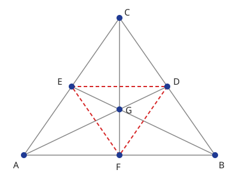

# Sylvester–Gallai 정리

# 개요

**Sylvester–Gallai 정리(Sylvester–Gallai theorem)** 는 평면 위의 유한 개의 점이 모두 한 직선 위에 있지 않으면, 그 가운데 정확히 두 점만 지나는 직선이 있다는 정리다. 점을 잘 배치해서 두 점을 잇는 직선마다 셋째 점이 놓이게 하려고 하면, 삼각형의 세 꼭짓점과 세 변의 중점과 무게중심을 찍은 일곱 점에서도 중점끼리 잇는 직선 세 개에는 셋째 점이 없다. 이 정리는 이런 배치가 실평면에서는 어떤 점 집합으로도 불가능함을, 점과 직선 사이의 가장 짧은 거리를 골라 증명한다.

# 직관

삼각형 $ABC$ 와 변의 중점 $D, E, F$, 무게중심 $G$ 를 찍는다. 세 변 위에는 꼭짓점 둘과 중점 하나가 있고, 세 중선 위에는 꼭짓점과 중점과 $G$ 가 있다. 이 여섯 직선은 각각 점 세 개를 지난다.

일곱 점에서 두 점을 고르는 방법은 $21$ 가지이고, 점 세 개를 지나는 직선 하나가 그 가운데 $3$ 가지를 차지한다. 여섯 직선이 $18$ 가지를 차지하므로 $3$ 가지가 남는다. 남은 쌍은 $DE$, $EF$, $FD$ 이고, 이 세 직선은 점을 두 개만 지난다.

아래 그림에서 회색 직선 여섯 개가 점 세 개씩을 지나고, 붉은 점선 세 개가 점 두 개만 지난다.

$DE$ 위에 점을 하나 더 찍어 이 직선을 없애면, 새 점과 기존 점을 잇는 새 직선들이 생긴다. Sylvester 는 1893 년에 점 두 개만 지나는 직선이 하나도 없는 배치가 있는지 물었고, 1944 년에 Gallai 의 증명으로 그런 배치가 없음이 알려졌다.[^1]

# 정의

평면의 유한 점 집합 $P$ 에서 두 점 이상을 지나는 직선을 $P$ 의 **연결 직선(connecting line)** 이라 한다. 연결 직선 가운데 $P$ 의 점을 정확히 두 개 지나는 것을 **보통 직선(ordinary line)** 이라 한다. 직관 절의 일곱 점에서 연결 직선은 아홉 개이고 보통 직선은 $DE$, $EF$, $FD$ 셋이다.

$t_k$ 는 $P$ 의 점을 정확히 $k$ 개 지나는 직선의 개수다. 직관 절의 배치에서 $t_2=3$, $t_3=6$ 이다. Sylvester–Gallai 정리는 $P$ 가 한 직선 위에 있지 않으면 $t_2\ge 1$ 이라는 진술이다.

# 성질

## Kelly 의 증명

연결 직선 $\ell$ 과 그 위에 없는 점 $p\in P$ 의 쌍 가운데 $p$ 에서 $\ell$ 까지의 거리가 가장 작은 것을 고른다. 점이 유한 개이므로 이런 쌍이 있다. 이 $\ell$ 이 보통 직선이다.

증명의 요지. $\ell$ 이 점을 셋 이상 지난다고 하자. $p$ 에서 $\ell$ 에 내린 수선의 발 $q$ 의 한쪽에 $\ell$ 위의 점이 둘 있으므로, $q$ 에 가까운 쪽을 $r_1$, 먼 쪽을 $r_2$ 라 한다($r_1=q$ 일 수도 있다). 그러면 $r_1$ 에서 직선 $pr_2$ 까지의 거리가 $p$ 에서 $\ell$ 까지의 거리보다 작다. $r_1$ 에서 $pr_2$ 에 내린 수선이 만드는 직각삼각형은 직각삼각형 $pqr_2$ 와 닮음이고, 닮음비 $\vert r_1r_2\vert/\vert pr_2\vert$ 가 $1$ 보다 작다. 이것은 거리가 가장 작다는 선택과 어긋난다.[^2]

## Melchior 부등식

$P$ 가 한 직선 위에 있지 않으면 다음 Melchior 부등식(Melchior's inequality)이 성립한다.[^3]

$$
\sum_{k\ge 2}(3-k)\thinspace t_k\ge 3
$$

$k=2$ 의 항만 양수이므로 이 식을 $t_2$ 에 대해 풀면 다음이 나오고, 특히 보통 직선이 셋 이상이다.

$$
t_2\ge 3+t_4+2t_5+3t_6+\cdots
$$

직관 절의 배치는 $3\cdot 1+0\cdot 6=3$ 으로 등호를 만족한다.

증명의 요지. 평면을 [실사영공간](real-projective-space.md) $\mathbb{RP}^2$ 에 넣고 점과 직선을 맞바꾸면, $P$ 의 점은 직선이 되고 $k$ 개의 점을 지나는 연결 직선은 직선 $k$ 개가 만나는 꼭짓점이 된다. 이 직선들이 사영평면을 나눈 그림에서 꼭짓점은 $V=\sum t_k$ 개, 변은 $E=\sum k\thinspace t_k$ 개다. 사영평면의 [Euler 지표](euler-characteristic.md)는 $1$ 이므로 $V-E+F=1$ 이고, 면마다 변이 셋 이상이므로 $3F\le 2E$ 다. 둘을 합치면 $3V-E\ge 3$ 이 나온다.

## 연결 직선의 개수

$n$ 개의 점이 한 직선 위에 있지 않으면 연결 직선이 $n$ 개 이상이다. 이것을 de Bruijn–Erdős 직선 정리(de Bruijn–Erdős theorem on lines)라 한다.

증명의 요지. 보통 직선 $pq$ 를 하나 잡고 $p$ 를 뺀다. 남은 $n-1$ 개가 한 직선 위에 있으면 그 직선과 $p$ 를 지나는 $n-1$ 개의 직선으로 $n$ 개다. 아니면 귀납법으로 남은 점들의 연결 직선이 $n-1$ 개 이상이고, 직선 $pq$ 는 남은 점을 하나만 지나므로 그 가운데 없다.

## 보통 직선의 개수

$n\ne 7$ 이면 보통 직선은 $6n/13$ 개 이상이다.[^4] $n=7$ 의 예외가 직관 절의 배치이고, 보통 직선이 $3$ 개다.

Green 과 Tao 는 $n$ 이 충분히 크면 보통 직선이 $n$ 이 짝수일 때 $n/2$ 개 이상, 홀수일 때 $3\lfloor n/4\rfloor$ 개 이상임을 보였다.[^5] 정다각형의 꼭짓점과 그 변 방향의 무한원점을 섞은 Böröczky 배치가 이 값을 정확히 만든다.

## 다른 체 위의 평면

이 정리는 실수의 순서에 의존한다. Kelly 의 증명은 거리와 "가까운 쪽" 을 쓰고, Melchior 의 증명은 실사영평면의 Euler 지표를 쓴다.

- 위수 $2$ 의 [유한 사영평면](finite-projective-planes.md)인 Fano 평면은 점 $7$ 개, 직선 $7$ 개로 되어 있고 모든 직선이 점을 정확히 세 개 지난다. 보통 직선이 없다.
- 복소 사영평면에서 매끄러운 삼차곡선의 변곡점 $9$ 개는 두 점을 잇는 직선마다 셋째 변곡점을 지난다. 이 배치를 Hesse 배치(Hesse configuration)라 한다.
- 복소수 공간에서 두 점을 잇는 직선마다 셋째 점이 있는 유한 점 집합은 한 평면 안에 들어간다.[^6]

# 활용

- [Szemerédi–Trotter 정리](szemeredi-trotter.md). 점 $n$ 개에서 한 직선 위에 많은 점이 있지 않으면 연결 직선이 $cn^2$ 개 이상이라는 Beck 정리(Beck's theorem)가 접촉 횟수의 상한에서 나온다. de Bruijn–Erdős 직선 정리의 $n$ 을 $n^2$ 규모로 올린 진술이다.
- 국소 정정 가능 부호(locally correctable code). 부호어의 각 자리를 다른 두 자리로 복원하는 부호는 점 집합이 Sylvester–Gallai 조건을 만족하는 것과 같은 꼴이고, 정리의 정량적 판본이 이런 부호의 차원에 상한을 준다.[^7]
- [유한 사영평면](finite-projective-planes.md). Fano 평면이 반례이므로 Fano 평면은 실평면에 점과 직선의 접촉 관계를 보존한 채 그려지지 않는다.

[^1]: R. Steinberg, Problem 4065 의 풀이, *The American Mathematical Monthly* 51, 1944, pp. 169–171 (T. Gallai 의 증명 수록).
[^2]: H. S. M. Coxeter, "A problem of collinear points", *The American Mathematical Monthly* 55, 1948, pp. 26–28 (L. M. Kelly 의 증명 수록).
[^3]: E. Melchior, "Über Vielseite der projektiven Ebene", *Deutsche Mathematik* 5, 1941, pp. 461–475.
[^4]: J. Csima, E. T. Sawyer, "There exist 6n/13 ordinary points", *Discrete & Computational Geometry* 9, 1993, pp. 187–202.
[^5]: B. Green, T. Tao, "On sets defining few ordinary lines", *Discrete & Computational Geometry* 50, 2013, pp. 409–468.
[^6]: L. M. Kelly, "A resolution of the Sylvester–Gallai problem of J.-P. Serre", *Discrete & Computational Geometry* 1, 1986, pp. 101–104.
[^7]: B. Barak, Z. Dvir, A. Wigderson, A. Yehudayoff, "Rank bounds for design matrices with applications to combinatorial geometry and locally correctable codes", *Proceedings of the 43rd ACM Symposium on Theory of Computing*, 2011, pp. 519–528.

# 연관 문서

## 선수지식

- [평면 그래프](planar-graphs.md)

## 더 알아보기

아직 연결한 문서가 없다.

#combinatorics #graph_theory #topology
