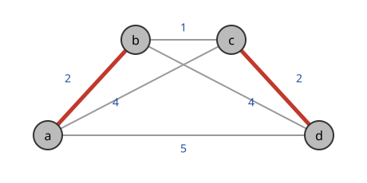

# T-join

# 개요

**T-join** 은 그래프에서 정해진 정점 집합 $T$ 의 정점에만 홀수 개의 변이 붙도록 고른 변들의 모임이다. 우편배달부가 두 번 걸을 길을 고를 때, 길 수가 홀수인 교차로마다 길을 홀수 개, 나머지 교차로마다 짝수 개 더해야 모든 교차로의 길 수가 짝수가 된다. $T$ 를 두 정점으로 잡으면 두 정점을 잇는 가장 짧은 길도 같은 꼴의 선택이 된다. 가장 가벼운 T-join 은 $T$ 의 정점들을 가장 짧은 길로 둘씩 짝짓는 [매칭](matchings.md)으로 구한다.

# 직관

아래 그림은 [중국인 우편배달부 문제](chinese-postman-problem.md)의 동네다. 네 교차로 $a,b,c,d$ 에 모두 길이 셋씩 붙어 있어 회색으로 칠했고, 굵은 선 $ab$ 와 $cd$ 가 두 번 걸을 길이다.

굵은 선만 남기면 네 교차로에 선이 하나씩 붙는다. 회색 교차로마다 붙은 선이 홀수 개이므로, 원래 길에 굵은 선을 한 벌 더하면 모든 교차로의 길 수가 짝수가 된다.

같은 일을 $a$ 와 $d$ 두 곳만 회색으로 칠하고 하면, 굵은 선만 남겼을 때 $a$ 와 $d$ 에만 홀수 개가 붙어야 한다. 경로 $a,b,c,d$ 나 길 $ad$ 하나가 그런 선택이고, 가장 가벼운 것은 $a$ 에서 $d$ 로 가는 가장 짧은 길이다.

# 정의

## T-join

그래프 $G=(V,E)$ 와 $T\subseteq V$ 에 대해, 변 집합 $J\subseteq E$ 의 변만 남긴 그래프 $(V,J)$ 에서 차수가 홀수인 정점의 집합이 정확히 $T$ 이면 $J$ 를 **T-join** 이라 한다. 직관 절의 그림에서 $T=\lbrace a,b,c,d\rbrace$ 이면 $\lbrace ab,cd\rbrace$ 와 $\lbrace bc,ad\rbrace$ 가 T-join 이고, $T=\lbrace a,d\rbrace$ 이면 $\lbrace ad\rbrace$ 와 $\lbrace ab,bc,cd\rbrace$ 가 T-join 이다.

변마다 무게 $w(e)$ 가 있을 때 $w(J)=\sum\_{e\in J}w(e)$ 가 가장 작은 T-join 을 찾는 문제를 **최소 T-join 문제** 라 한다.

## T-cut

$S\subseteq V$ 가 $T$ 의 정점을 홀수 개 포함할 때 절단 $\delta(S)$, 곧 한 끝이 $S$ 에 있고 다른 끝이 $V\setminus S$ 에 있는 변의 집합을 **T-cut** 이라 한다. 직관 절에서 $T=\lbrace a,b,c,d\rbrace$, $S=\lbrace a\rbrace$ 이면 $\delta(S)=\lbrace ab,ac,ad\rbrace$ 가 T-cut 이다.

# 성질

## 존재 조건

T-join 이 있는 것과 $G$ 의 연결성분마다 $T$ 의 정점이 짝수 개 있는 것은 동치다. 한 연결성분 안에서 $(V,J)$ 의 차수를 더하면 짝수이므로 필요하다. 거꾸로 연결성분마다 $T$ 의 정점을 둘씩 짝지어 경로 $P\_1,\dots,P\_k$ 로 잇고, 여러 번 쓰인 변은 쓰인 횟수가 홀수인 것만 남기면 T-join 이 된다.

## 대칭차

$J\_1$ 이 $T\_1$-join 이고 $J\_2$ 가 $T\_2$-join 이면 대칭차 $J\_1\triangle J\_2$ 는 $(T\_1\triangle T\_2)$-join 이다. 정점마다 두 집합의 변 수를 더한 값과 대칭차의 변 수는 겹치는 변 수의 두 배만큼 다르므로 홀짝이 같다. 특히 두 T-join 의 대칭차는 모든 차수가 짝수인 변 집합이고, 그런 집합은 변이 겹치지 않는 순환들로 나뉜다. 직관 절의 $\lbrace ab,cd\rbrace\triangle\lbrace bc,ad\rbrace$ 는 순환 $a,b,c,d,a$ 다.

## 최단경로로 짝짓기

무게가 모두 $0$ 이상이면 최소 T-join 은 $T$ 의 정점을 둘씩 잇는 변이 겹치지 않는 경로 $\lvert T\rvert/2$ 개로 나뉜다. 그래서 $T$ 를 정점으로 하고 두 정점 사이의 무게를 [최단경로](shortest-paths.md)의 길이 $d(s,t)$ 로 둔 완전그래프에서 다음이 성립한다.

$$
\min_J w(J)=\min_M\sum_{\lbrace s,t\rbrace\in M}d(s,t)
$$

여기서 $M$ 은 완전 매칭 전체를 돈다. J. Edmonds 와 E. L. Johnson 이 이 환원을 주었다[^1]. 직관 절의 $T=\lbrace a,b,c,d\rbrace$ 에서 오른쪽은 다음과 같고 $\lbrace ab,cd\rbrace$ 가 최소 T-join 이다.

$$
\min(1+5,\thinspace 2+2,\thinspace 3+3)=4
$$

## 특수한 경우

- $T=\lbrace s,t\rbrace$ 이면 최소 T-join 은 $s$ 에서 $t$ 로 가는 최단경로다. 무게가 음수인 변이 있어도 무게 합이 음수인 순환이 없으면 그렇다. 음수 변의 집합 $N$ 에 대해 $J$ 가 T-join 인 것과 $J\triangle N$ 이 $T'$-join 인 것이 동치이고 $w(J)=\sum\_{e\in J\triangle N}\vert w(e)\vert+w(N)$ 이다. 여기서 $T'$ 은 $T$ 와 $(V,N)$ 의 홀수 차수 정점 집합의 대칭차이므로, 무게가 $0$ 이상인 문제로 바뀐다.
- $T$ 가 차수가 홀수인 정점 전체이면 최소 T-join 은 중국인 우편배달부 문제에서 두 번 지날 변이다.
- $T=V$ 이고 무게가 모두 $1$ 이면 T-join 은 변을 $\lvert V\rvert/2$ 개 이상 쓰고, 정확히 $\lvert V\rvert/2$ 개인 것은 완전 매칭이다.

## T-cut 과의 쌍대성

T-join 과 T-cut 은 언제나 만난다. $J$ 가 T-join 이고 $\delta(S)$ 가 T-cut 이면, $(V,J)$ 에서 $S$ 의 정점들의 차수 합은 $S\cap T$ 가 홀수 개이므로 홀수이고, $S$ 안에 두 끝이 있는 변은 두 번씩 세어지므로 $J\cap\delta(S)$ 의 원소 수가 홀수다. 따라서 무게가 모두 $1$ 이면 최소 T-join 의 크기는 변이 겹치지 않는 T-cut 의 최대 개수 이상이다.

P. D. Seymour 는 이분 그래프에서 이 둘이 같음을 증명했다[^2]. 이분 그래프가 아니면 같지 않을 수 있다. 직관 절의 그래프에서 무게를 모두 $1$ 로 두고 $T=\lbrace a,b,c,d\rbrace$ 이면 최소 T-join 의 크기는 $2$ 인데, T-cut 은 한 정점이나 세 정점의 절단이라 어느 둘도 변을 공유한다. 네 절단 $\delta(\lbrace v\rbrace)$ 에 무게 $1/2$ 씩을 주면 각 변은 두 절단에 들어 무게 합이 $1$ 이고, 절단 무게의 합 $2$ 가 최소 T-join 의 크기와 같다.

# 활용

- [중국인 우편배달부 문제](chinese-postman-problem.md). 두 번 지날 변의 집합이 차수가 홀수인 정점들의 최소 T-join 이다.
- [최대 절단](max-cut.md). 평면 그래프의 최대 절단 밖의 변은 평면 쌍대 그래프에서 차수가 홀수인 정점들의 최소 T-join 과 대응하여, 매칭 계산으로 다항 시간에 풀린다[^3].
- 무향 그래프의 음수 무게 최단경로. 유향 그래프의 최단경로 알고리즘은 무향 변을 양방향 호로 바꾸면 음수 변 하나가 음수 순환을 만들어 쓸 수 없다. 특수한 경우 절의 변환으로 $T=\lbrace s,t\rbrace$ 인 최소 T-join 을 구해 계산한다.

[^1]: J. Edmonds, E. L. Johnson, "Matching, Euler tours and the Chinese postman", Mathematical Programming 5 (1973), 88–124.
[^2]: P. D. Seymour, "On odd cuts and plane multicommodity flows", Proceedings of the London Mathematical Society (3) 42 (1981), 178–192.
[^3]: F. Hadlock, "Finding a maximum cut of a planar graph in polynomial time", SIAM Journal on Computing 4 (1975), 221–225.

# 연관 문서

## 선수지식

- [중국인 우편배달부 문제](chinese-postman-problem.md)

## 더 알아보기

아직 연결한 문서가 없다.

#graph_theory #combinatorics #optimization #algorithms
