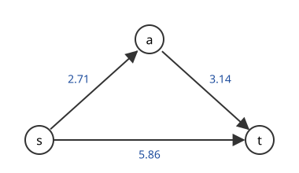
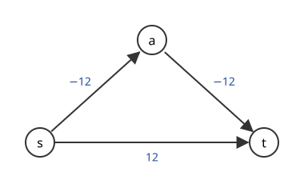

# Tardos 알고리즘

# 개요

**Tardos 알고리즘(Tardos' algorithm)** 은 비용이 아무리 크거나 자릿수가 많아도 정점 수와 간선 수만으로 정해지는 횟수의 계산으로 [최소 비용 흐름](min-cost-flow.md)을 찾는 알고리즘이다. $s$ 에서 $t$ 로 한 단위를 보낼 때 $a$ 를 거치는 길의 비용이 $2.71+3.14=5.85$ 이고 곧바로 가는 길의 비용이 $5.86$ 이면, 비용을 정수로 반올림한 $3+3$ 과 $6$ 으로는 어느 길이 싼지 가를 수 없다.

퍼텐셜로 두 길에 함께 들어 있는 몫을 빼고 남은 차이 $0.01$ 을 크기 $12$ 의 정수로 늘린 뒤 반올림하면, 작은 정수 비용의 문제 하나를 풀어 곧바로 가는 간선을 쓰지 않는다는 것이 확정된다. 이렇게 간선을 하나씩 확정해 지우기를 되풀이한다.

# 직관

아래 그림의 네트워크에서 간선 옆의 수는 한 단위를 보내는 비용이고, 용량은 모두 $1$ 이다. $s$ 에서 $t$ 로 $1$ 을 보내는 흐름 가운데 비용이 가장 작은 것을 찾는다.

[비용 척도 조정 알고리즘](cost-scaling-algorithm.md)은 비용이 정수여야 하므로 비용에 $100$ 을 곱해 $271, 314, 586$ 으로 바꾸고, 반복 횟수가 가장 큰 비용의 로그만큼 늘어난다. 자릿수가 더 많으면 횟수가 더 늘어난다. 비용을 그대로 정수로 반올림하면 $3, 3, 6$ 이 되어 두 길의 비용이 둘 다 $6$ 이고, 어느 길이 싼지가 사라진다.

두 길의 비용 $5.85$ 와 $5.86$ 의 차이 $0.01$ 이 반올림 오차 $0.5$ 보다 작아서 반올림이 실패했다. 최소 비용 흐름의 퍼텐셜 $p$ 로 비용을 축소 비용으로 바꾸면 $s$ 에서 $t$ 로 가는 모든 길의 비용이 똑같이 $p(s)-p(t)$ 만큼 바뀌므로, 어느 흐름이 최적인지는 바뀌지 않는다. $p(s)=0$, $p(a)=2.71+1/300$, $p(t)=5.85+2/300$ 으로 두면 축소 비용은 $s\to a$, $a\to t$, $s\to t$ 의 차례로 $-1/300$, $-1/300$, $1/300$ 이다. 두 길에 함께 들어 있던 몫이 빠지고 차이 $0.01$ 만 세 간선에 나뉘어 남는다.

이 값에 $3600$ 을 곱하면 가장 큰 절댓값이 $12$ 가 되고 비용은 $-12, -12, 12$ 다. 아래 그림이 이 정수 비용의 문제다. $a$ 를 거치는 길의 비용은 $-24$ 이고 곧바로 가는 길은 $12$ 이므로 차이가 반올림 오차보다 훨씬 크다.

이 문제의 최적 흐름은 $s\to a\to t$ 에 $1$ 을 보내는 것이고, 퍼텐셜 $\pi'(s)=0$, $\pi'(a)=-12$, $\pi'(t)=-24$ 가 그 최적성을 보인다. 이 퍼텐셜로 $s\to t$ 의 축소 비용은 $12+0-(-24)=36$ 이다. $36$ 은 정점 수 $3$ 보다 크고 간선 하나의 반올림 오차는 $1$ 보다 작으므로, 원래 문제의 모든 최적 흐름이 $s\to t$ 에 $0$ 을 보낸다. $s\to t$ 를 지우면 길이 $s\to a\to t$ 하나만 남아 최적 흐름이 정해지고 비용은 $5.85$ 다.

# 정의

이 문서에서 최소 비용 흐름 문제는 최소 비용 흐름 문서와 같이 유향 그래프 $G=(V,E)$, 용량 $c$, 비용 $w$, 공급량 $\beta$ 로 주어진다. $n$ 은 정점 수, $m$ 은 간선 수다. 간선 $e=(u,v)$ 와 퍼텐셜 $p$ 의 축소 비용은 $w^p(e)=w(e)+p(u)-p(v)$ 다.

## 순환 공간 사영

간선마다 실수를 준 함수 $g:E\to\mathbb R$ 가 모든 정점 $v$ 에서 다음을 만족하면 $g$ 를 **균형(balanced)** 이라 한다.

$$
\sum_{e\in\delta^{+}(v)}g(e)=\sum_{e\in\delta^{-}(v)}g(e)
$$

축소 비용 $w^p$ 가 균형이 되는 퍼텐셜 $p$ 가 존재하고, 그때의 $w^p$ 는 $p$ 의 선택과 무관하게 하나로 정해진다(성질 절). 이 $w^p$ 를 $w$ 의 **순환 공간 사영(projection onto the cycle space)** 이라 하고 $\tilde w$ 로 쓴다.

직관 절의 축소 비용 $\tilde w=(-1/300,-1/300,1/300)$ 이 순환 공간 사영이다. $s$ 에서 나가는 값은 $-1/300+1/300=0$ 이고 들어오는 값은 없다. $a$ 에서 들어오는 값과 나가는 값은 둘 다 $-1/300$ 이고, $t$ 로 들어오는 값의 합은 $-1/300+1/300=0$ 이다.

## 반올림 문제

$\tilde w\ne 0$ 일 때 $M=\max_e\lvert\tilde w(e)\rvert$, $K=(n+1)m$ 으로 두고 다음 정수 비용 $w'$ 을 **반올림 비용(rounded cost)** 이라 한다.

$$
w'(e)=\left\lceil\frac{K\thinspace\tilde w(e)}{M}\right\rceil
$$

$w'$ 의 절댓값은 $K$ 이하이고, $w'(e)-1\lt K\tilde w(e)/M\le w'(e)$ 이다. 같은 그래프, 용량, 공급량에 비용만 $w'$ 으로 바꾼 문제를 **반올림 문제(rounded problem)** 라 한다.

직관 절에서 $n=3$, $m=3$ 이므로 $K=12$ 이고, $M=1/300$ 이므로 $w'=(-12,-12,12)$ 다.

## 알고리즘

Tardos 알고리즘은 다음을 되풀이한다[^1].

1. 남은 간선들로 $\tilde w$ 를 구한다. $\tilde w=0$ 이면 남은 문제의 실현 가능한 흐름 하나를 최대 흐름으로 찾고, 앞에서 고정한 값과 합쳐 끝낸다.
2. 반올림 문제를 풀어 최적 흐름 $f'$ 과 최적성을 보이는 퍼텐셜 $\pi'$ 을 구한다.
3. 남은 간선 $e=(u,v)$ 가운데 $w'^{\pi'}(e)\gt n$ 인 것은 흐름을 $0$ 으로, $w'^{\pi'}(e)\lt -n$ 인 것은 흐름을 $c(e)$ 로 고정한다. 고정한 값을 $\varphi$ 라 할 때 $e$ 를 그래프에서 지우고 $\beta(u)$ 에서 $\varphi$ 를 빼고 $\beta(v)$ 에 $\varphi$ 를 더한다.

직관 절에서 첫 반복은 $s\to t$ 를 $0$ 으로 고정한다. 둘째 반복에서 남은 간선 $s\to a$, $a\to t$ 는 순환을 이루지 않으므로 $\tilde w=0$ 이고, 실현 가능한 흐름 $1, 1$ 이 답이다.

# 성질

## 순환 공간 사영의 존재와 유일성

모든 $w$ 에 대해 $w^p$ 가 균형이 되는 $p$ 가 존재하고, 그런 $w^p$ 는 하나뿐이다.

증명의 요지. 간선 함수의 공간에 내적 $\langle g,h\rangle=\sum_e g(e)h(e)$ 를 준다. $p$ 로 만든 $d\_p(e)=p(u)-p(v)$ 들의 공간을 $D$ 라 하면 다음이 성립한다.

$$
\langle g,d_p\rangle=\sum_{v}p(v)\left(\sum_{e\in\delta^{+}(v)}g(e)-\sum_{e\in\delta^{-}(v)}g(e)\right)
$$

그래서 $g$ 가 균형인 것은 $g$ 가 $D$ 에 직교하는 것과 동치다. $w^p=w+d\_p$ 가 $D$ 에 직교하는 것은 $w^p$ 가 $w$ 의 $D^\perp$ 위로의 직교 사영인 것이고, 직교 사영은 하나 존재한다. ∎

$p$ 는 [그래프 Laplacian](graph-laplacian.md) $L$ 의 연립일차방정식 $Lp=b$ 의 해다. 여기서 $b(v)$ 는 $v$ 로 들어오는 $w$ 의 합에서 나가는 $w$ 의 합을 뺀 값이고, [Gauss 소거법](gaussian-elimination.md)으로 $O(n^3)$ 번의 연산에 구한다.

## 최적 흐름의 불변성

$w$ 와 $\tilde w$ 는 최적 흐름이 같다.

증명의 요지. 공급량 $\beta$ 를 만족하는 흐름 $f$ 에 대해 $\sum_e d\_p(e)f(e)=\sum_v p(v)\beta(v)$ 는 $f$ 와 무관한 상수이므로 두 비용의 총비용은 상수만큼 차이 난다. ∎

## 간선 고정 보조정리

반올림 문제의 최적 흐름 $f'$ 과 퍼텐셜 $\pi'$ 에 대해 다음이 성립한다.

- $w'^{\pi'}(e)\gt n$ 이면 원래 문제의 모든 최적 흐름 $f$ 가 $f(e)=0$ 이다.
- $w'^{\pi'}(e)\lt -n$ 이면 원래 문제의 모든 최적 흐름 $f$ 가 $f(e)=c(e)$ 이다.

증명의 요지. 첫째 경우를 보인다. 잔여 그래프 $G\_{f'}$ 의 간선은 축소 비용 $w'^{\pi'}$ 이 $0$ 이상이므로 거꾸로 간선의 축소 비용이 $-w'^{\pi'}(e)\lt 0$ 인 $e$ 는 $f'(e)=0$ 이다. $f(e)\gt 0$ 인 최적 흐름 $f$ 가 있다고 하자. $f-f'$ 은 모든 정점에서 균형이므로 $G\_{f'}$ 의 순환들에 양수 양을 흘린 합으로 쪼개지고, $e$ 를 앞방향으로 지나는 순환 $C$ 가 그 가운데 있다. $C$ 를 거꾸로 돌린 것은 $G\_f$ 의 순환이다.

$C$ 의 다른 간선은 축소 비용이 $0$ 이상이므로 $w'(C)=w'^{\pi'}(C)\ge w'^{\pi'}(e)\gt n$ 이다. 간선마다 $K\tilde w\gt w'-1$ 이고 $C$ 의 간선은 $n$ 개 이하이므로 $K\tilde w(C)/M\gt w'(C)-n\gt 0$ 이다. $\tilde w(C)=w(C)$ 이므로 거꾸로 돌린 순환은 $G\_f$ 의 음수 순환이고, 최소 비용 흐름의 음수 순환 조건에 어긋난다. 둘째 경우는 간선의 방향을 바꿔 같은 논법을 쓴다. ∎

## 고정할 간선의 존재

$\tilde w\ne 0$ 이면 셋째 단계에서 적어도 하나의 간선이 고정된다.

증명의 요지. 모든 $e$ 에서 $\lvert w'^{\pi'}(e)\rvert\le n$ 이라 하자. $q=M\pi'/K$ 로 두면 다음이 성립한다.

$$
w'^{\pi'}(e)-1\lt\frac{K\thinspace\tilde w^{q}(e)}{M}\le w'^{\pi'}(e)
$$

그래서 $\lvert\tilde w^q(e)\rvert\lt(n+1)M/K=M/m$ 이다. 한편 $\tilde w$ 는 $D$ 에 직교하므로 다음이 성립한다.

$$
\sum_{e}\tilde w^{q}(e)^2=\sum_{e}\tilde w(e)^2+\sum_{e}d_q(e)^2\ge M^2
$$

그래서 어느 간선에서 $\lvert\tilde w^q(e)\rvert\ge M/\sqrt m\ge M/m$ 이다. 이것은 앞의 부등식과 어긋난다. ∎

## 반복 횟수와 시간

반복마다 간선이 하나 이상 지워지므로 반복은 $m$ 번 이하다. 반올림 문제의 비용은 절댓값이 $K=(n+1)m$ 이하인 정수이므로, 비용 척도 조정 알고리즘으로 $O(n^2m\log(nK))=O(n^2m\log(nm))$ 시간에 푼다. 그 결과 전체 계산은 다음 횟수의 연산으로 끝난다.

$$
O\left(m\left(n^3+n^2m\log(nm)\right)\right)
$$

이 횟수는 용량과 비용의 크기와 무관하므로 Tardos 알고리즘은 [최소 평균 순환 제거법](minimum-mean-cycle-canceling.md)에서 정의한 강다항 시간 알고리즘이다. Tardos 가 1985 년에 이 꼴의 논법으로 최소 비용 흐름의 첫 강다항 시간 해법을 보였다[^1].

# 활용

- 최소 비용 흐름의 강다항 시간 해법. Goldberg–Tarjan 의 최소 평균 순환 제거법이 이어서 나왔고, Orlin 은 공급량을 반씩 줄이는 용량 척도 조정에 간선 축약을 붙여 $O(m\log n\thinspace(m+n\log n))$ 시간의 판본을 보였다[^3].
- 실수 비용의 [수송 문제](transportation-problem.md)와 [할당 문제](assignment-problem.md). 비용이 측정값이나 무리수여도 반복 횟수가 정점 수와 간선 수로만 정해진다.
- 조합 선형계획(combinatorial linear programming). Tardos 는 같은 반올림과 고정의 논법으로, 제약 행렬의 성분이 작은 정수인 [선형계획법](linear-programming.md) 문제를 우변과 목적함수의 크기와 무관한 횟수의 연산으로 푸는 알고리즘을 보였다[^2].

[^1]: Éva Tardos, "A strongly polynomial minimum cost circulation algorithm", *Combinatorica* **5** (1985), 247–255.
[^2]: Éva Tardos, "A strongly polynomial algorithm to solve combinatorial linear programs", *Operations Research* **34** (1986), 250–256.
[^3]: James B. Orlin, "A faster strongly polynomial minimum cost flow algorithm", *Operations Research* **41** (1993), 338–350.

# 연관 문서

## 선수지식

- [최소 평균 순환 제거법](minimum-mean-cycle-canceling.md)
- [비용 척도 조정 알고리즘](cost-scaling-algorithm.md)

## 더 알아보기

아직 연결한 문서가 없다.

#graph_theory #optimization #algorithms
