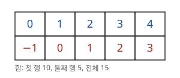

# Thoma 정리

# 개요

**Thoma 정리(Thoma's theorem)** 는 자연수를 유한 개만 옮기는 순열 전체의 군에서, 더 쪼갤 수 없는 지표가 어떤 꼴인지 정한 정리다. 두 행의 길이가 같은 Young 도형 $(m,m)$ 을 키우면서 대칭군의 기약지표를 항등원의 값으로 나누면, 호환에서의 값이 $m=2,5,50$ 일 때 $0$, $1/3$, $0.485$ 로 $1/2$ 에 다가간다. Thoma 정리에 따르면 이런 극한은 전부 도형의 행 길이와 열 길이가 전체 칸 수에서 차지하는 비율로 정해지고, $k$ 칸 순환에서의 값은 그 비율들의 $k$ 제곱의 합이다.

# 직관

$S_n$ 의 기약지표 $\chi^\lambda$ 를 항등원의 값 $f^\lambda$ 로 나눈 것을 정규화된 지표라 하자. 호환에서의 정규화된 지표는 칸마다 열 번호에서 행 번호를 뺀 수를 적고 모두 더한 뒤 $\binom n2$ 로 나눈 값이다[^3]. 아래 그림은 $(5,5)$ 의 칸에 이 수를 적은 것이다. 첫 행의 합은 $10$, 둘째 행의 합은 $5$ 이고, $\binom{10}2=45$ 로 나누면 $1/3$ 이다.

$(m,m)$ 에서 같은 합은 $m(m-2)$ 이므로 정규화된 지표는 $(m-2)/(2m-1)$ 이고, $m$ 이 커지면 $1/2$ 로 간다. 길이 $a$ 인 행은 합에 약 $a^2/2$ 를 보태고 길이 $b$ 인 열은 약 $b^2/2$ 를 뺀다. $\binom n2\approx n^2/2$ 로 나누면 극한은 행 길이의 비율의 제곱합에서 열 길이의 비율의 제곱합을 뺀 값이다. $(m,m)$ 의 두 행은 비율이 $1/2$ 씩이고 열은 길이가 $2$ 라 비율이 $0$ 으로 가므로 $(1/2)^2+(1/2)^2=1/2$ 이다.

$S_n$ 은 $S_{n+1}$ 안에 들어 있으므로 이 극한은 모든 $n$ 의 순열, 곧 자연수를 유한 개만 옮기는 순열 전체 위의 함수다. $k$ 칸 순환에서는 같은 계산이 행 비율의 $k$ 제곱의 합과 열 비율의 $k$ 제곱의 합을 부호를 붙여 더한 값을 준다. Thoma 정리는 이 군 위의 쪼갤 수 없는 지표가 모두 이렇게 행 비율과 열 비율로 정해진다는 것이다.

# 정의

## 무한 대칭군

**무한 대칭군(infinite symmetric group)** $S\_\infty$ 는 $\lbrace 1,2,3,\dots\rbrace$ 의 전단사 가운데 유한 개의 점만 옮기는 것 전체가 합성으로 이루는 군이다. $S_n$ 을 $n$ 보다 큰 점을 고정하는 순열로 보면 $S\_\infty=\bigcup_n S_n$ 이다. 순열 $\sigma$ 가 옮기는 점의 집합을 $\sigma$ 의 지지(support)라 하고, 길이 $k\ge 2$ 인 순환의 개수를 $m_k(\sigma)$ 로 쓴다.

## 지표

$S\_\infty$ 의 **지표(character)** 는 다음 세 조건을 만족하는 함수 $\chi:S\_\infty\to\mathbb C$ 다.

- $\chi(e)=1$.
- 켤레에 대해 불변이다. 모든 $g,h$ 에서 $\chi(hgh^{-1})=\chi(g)$.
- 양의 정부호(positive definite)다. 원소 $g_1,\dots,g_r$ 와 복소수 $c_1,\dots,c_r$ 를 어떻게 골라도 다음이 성립한다.

$$
\sum_{i,j}c_i\overline{c_j}\thinspace\chi(g_j^{-1}g_i)\ge 0
$$

$e$ 에서 $1$, 나머지에서 $0$ 인 함수 $\delta_e$ 는 지표다. 직관 절의 극한도 지표이고, 정규화된 $\chi^\lambda/f^\lambda$ 는 $S_n$ 위에서 세 조건을 만족한다.

## 극단 지표

지표 전체는 볼록 집합이다. 서로 다른 두 지표 $\chi_1,\chi_2$ 와 $0\lt t\lt 1$ 로 $t\chi_1+(1-t)\chi_2$ 라 쓸 수 없는 지표를 **극단 지표(extreme character)** 라 한다. 상수함수 $1$ 과 부호 $\mathrm{sgn}$ 은 극단 지표이고, $(1+\mathrm{sgn})/2$ 는 극단 지표가 아니다.

## Thoma 단체

**Thoma 단체(Thoma simplex)** $\Omega$ 는 다음 조건을 만족하는 두 수열 $\alpha=(\alpha_1,\alpha_2,\dots)$, $\beta=(\beta_1,\beta_2,\dots)$ 의 쌍 전체다.

$$
\alpha_1\ge\alpha_2\ge\cdots\ge 0,\qquad \beta_1\ge\beta_2\ge\cdots\ge 0,\qquad \sum_i\alpha_i+\sum_i\beta_i\le 1
$$

직관 절의 $(m,m)$ 은 $\alpha=(1/2,1/2,0,\dots)$, $\beta=0$ 에 대응한다. $\alpha$ 는 행 길이의 비율, $\beta$ 는 열 길이의 비율이다.

# 성질

## Thoma 정리

**정리.** $(\alpha,\beta)\in\Omega$ 마다 다음 식이 $S\_\infty$ 의 극단 지표를 정의하고, 모든 극단 지표가 이렇게 한 번씩 나온다[^1].

$$
\chi\_{\alpha,\beta}(\sigma)=\prod_{k\ge 2}p_k(\alpha,\beta)^{m_k(\sigma)},\qquad p_k(\alpha,\beta)=\sum_i\alpha_i^k+(-1)^{k-1}\sum_i\beta_i^k
$$

호환은 $m_2=1$ 이므로 $\chi\_{\alpha,\beta}$ 의 값이 $p_2=\sum\alpha_i^2-\sum\beta_i^2$ 이고, 직관 절의 $1/2$ 이 이것이다. 매개변수 몇 개의 지표는 다음과 같다.

| 매개변수 | 지표 |
| --- | --- |
| $\alpha=\beta=0$ | $\delta_e$ |
| $\alpha=(1,0,\dots)$, $\beta=0$ | 상수함수 $1$ |
| $\alpha=0$, $\beta=(1,0,\dots)$ | 부호 $\mathrm{sgn}$ |
| $\alpha=(1/2,1/2,0,\dots)$, $\beta=0$ | $k$ 칸 순환마다 $2^{1-k}$ 를 곱한 값 |

$\beta=(1,0,\dots)$ 이면 $p_k=(-1)^{k-1}$ 이고, 이것은 $k$ 칸 순환의 부호다.

## 곱셈성

지표 $\chi$ 가 극단 지표인 것은 지지가 겹치지 않는 모든 $\sigma,\tau$ 에서 $\chi(\sigma\tau)=\chi(\sigma)\chi(\tau)$ 인 것과 동치다[^1]. 그래서 극단 지표는 $k$ 칸 순환에서의 값 $p_k$ 만으로 정해지고, 정리의 곱 꼴이 나온다. $(1+\mathrm{sgn})/2$ 는 두 호환의 곱에서 $1$ 이지만 호환 하나에서 $0$ 이므로 곱셈적이지 않다.

## 증명의 요지

$\chi$ 를 곱셈적인 지표라 하고, [대칭함수](symmetric-functions.md)의 환 $\Lambda$ 에서 실수로 가는 환 준동형 $\varphi$ 를 $\varphi(p_1)=1$, $\varphi(p_k)=p_k$ 로 정한다. 순환 꼴이 $\rho$ 인 $\sigma\in S_n$ 에서 $\chi(\sigma)=\varphi(p_\rho)$ 다. $\chi$ 를 $S_n$ 으로 제한하면 정규화된 기약지표의 볼록결합이다.

$$
\chi\vert\_{S_n}=\sum_{\vert\lambda\vert=n}M_n(\lambda)\frac{\chi^\lambda}{f^\lambda},\qquad M_n(\lambda)\ge 0
$$

[Murnaghan–Nakayama 규칙](murnaghan-nakayama-rule.md)의 증명에 쓰는 Frobenius 지표 공식(Frobenius character formula) $p_\rho=\sum_\lambda\chi^\lambda(\rho)s_\lambda$ 에 $\varphi$ 를 씌워 위 식과 맞추면 $M_n(\lambda)=f^\lambda\varphi(s_\lambda)$ 이다. 그래서 모든 Schur 함수(Schur function) $s_\lambda$ 에서 $\varphi(s_\lambda)\ge 0$ 이다.

Jacobi–Trudi 항등식(Jacobi–Trudi identity)에 따라 [Toeplitz 행렬](toeplitz-matrices.md) $\lbrack h\_{i-j}\rbrack$ 의 소행렬식은 비틀린 Schur 함수(skew Schur function)이고, 비틀린 Schur 함수는 $s_\lambda$ 들의 음 아닌 정수 결합이다. 그래서 $\varphi(h_k)$ 는 [Pólya 빈도 수열](polya-frequency-sequences.md)이고, Aissen–Schoenberg–Whitney–Edrei 정리(Aissen–Schoenberg–Whitney–Edrei theorem)에서 $\alpha$ 와 $\beta$ 의 자리를 바꾸어 쓰면 생성함수가 다음 꼴이다.

$$
\sum_{k\ge 0}\varphi(h_k)z^k=e^{\gamma z}\prod_i\frac{1+\beta_iz}{1-\alpha_iz},\qquad \gamma=1-\sum_i\alpha_i-\sum_i\beta_i
$$

좌변은 $\exp(\sum_k\varphi(p_k)z^k/k)$ 이므로 양변의 로그를 비교하면 $p_k(\alpha,\beta)$ 가 나온다. 거꾸로 $(\alpha,\beta)\in\Omega$ 가 주어지면 같은 정리의 충분성에서 $\varphi(s_\lambda)\ge 0$ 이 나오고, $M_n(\lambda)=f^\lambda\varphi(s_\lambda)$ 가 $\chi\_{\alpha,\beta}$ 를 기약지표의 볼록결합으로 쓴다.

## Young 격자의 조화함수

[Pieri 규칙](pieri-rule.md) $s_\lambda p_1=\sum_{\mu\gtrdot\lambda}s_\mu$ 에 $\varphi$ 를 씌우면 $\varphi(s_\lambda)=\sum_{\mu\gtrdot\lambda}\varphi(s_\mu)$ 다. 곧 $\lambda\mapsto\varphi(s_\lambda)$ 는 [Young 격자](youngs-lattice.md) 위에서 값이 음이 아니고 $\varphi(s\_\varnothing)=1$ 이며, 각 도형의 값이 그 도형을 덮는 도형들의 값의 합인 함수다. 이런 함수를 조화함수(harmonic function)라 하고, 지표와 조화함수는 일대일로 대응한다. Thoma 정리는 극단 조화함수를 $\Omega$ 로 분류한 것과 같다.

## Vershik–Kerov 근사 정리

도형의 열 $\lambda^{(n)}$, $\vert\lambda^{(n)}\vert=n$ 에서 $i$ 번째 행의 길이를 $n$ 으로 나눈 값이 $\alpha_i$ 로, $i$ 번째 열의 길이를 $n$ 으로 나눈 값이 $\beta_i$ 로 수렴하면, 정규화된 지표 $\chi^{\lambda^{(n)}}/f^{\lambda^{(n)}}$ 는 각 순열에서 $\chi\_{\alpha,\beta}$ 로 수렴한다[^2]. 모든 극단 지표가 이런 극한이다. 직관 절의 $(m,m)$ 은 행 비율 $(1/2,1/2)$ 로 가는 열이다.

## 일반 지표의 분해

$S\_\infty$ 의 모든 지표는 $\Omega$ 위의 확률측도 $P$ 하나로 다음과 같이 쓰이고, $P$ 는 유일하다[^3].

$$
\chi(\sigma)=\int_\Omega\chi\_{\alpha,\beta}(\sigma)\thinspace dP(\alpha,\beta)
$$

지표 전체가 극단점에 대한 적분 표현이 유일한 볼록 집합이라는 뜻이고, [Choquet 정리](choquet-theorem.md)의 단체 경우다. $(1+\mathrm{sgn})/2$ 는 $\alpha=(1)$ 과 $\beta=(1)$ 에 무게 $1/2$ 씩을 준 측도다.

# 활용

- Plancherel 성장. 지표 $\delta_e$ 의 $M_n(\lambda)$ 는 $(f^\lambda)^2/n!$ 이고, 이것이 [Plancherel 측도](plancherel-measure.md)다. Plancherel 측도를 따르는 도형은 행과 열의 길이가 $\sqrt n$ 정도이므로 비율이 $0$ 으로 가고, Thoma 매개변수 $\alpha=\beta=0$ 과 맞는다.
- 교환가능한 무작위 분할. [Kingman 표현정리](kingman-representation-theorem.md)는 자연수 집합의 무작위 분할 가운데 번호를 바꾸어도 분포가 같은 것을, $\sum s_i\le 1$ 인 감소수열 $s$ 위의 확률측도로 분류한다. 이것은 [de Finetti 정리](de-finetti-theorem.md)를 분할로 옮긴 것이고, 매개변수 공간이 $\beta=0$ 인 Thoma 단체와 같은 꼴이다.
- 무한 유니터리군의 지표. Voiculescu 는 무한 유니터리군 $U(\infty)$ 의 극단 지표를 비슷한 매개변수로 적었고, Vershik–Kerov 와 Boyer 는 그 목록이 전부라는 것을 Edrei 의 양쪽 무한 Pólya 빈도 수열 정리로 증명했다[^3].
- 유한 인자 표현. $S\_\infty$ 의 극단 지표는 생성하는 [von Neumann 대수](von-neumann-algebras.md)가 유한 인자(finite factor)인 표현의 정규화된 대각합(trace)과 일대일로 대응한다. 정규 표현에 대응하는 것이 $\delta_e$ 다.

[^1]: E. Thoma, "Die unzerlegbaren, positiv-definiten Klassenfunktionen der abzählbar unendlichen, symmetrischen Gruppe", Mathematische Zeitschrift 85 (1964), 40–61.
[^2]: A. M. Vershik, S. V. Kerov, "Asymptotic theory of characters of the symmetric group", Functional Analysis and Its Applications 15 (1981), 246–255.
[^3]: A. Borodin, G. Olshanski, *Representations of the Infinite Symmetric Group*, Cambridge University Press, 2017, 3 장과 4 장.

# 연관 문서

## 선수지식

- [Murnaghan–Nakayama 규칙](murnaghan-nakayama-rule.md)
- [Pólya 빈도 수열](polya-frequency-sequences.md)
- [Young 격자](youngs-lattice.md)

## 더 알아보기

아직 연결한 문서가 없다.

#group_theory #combinatorics #probability
