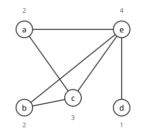
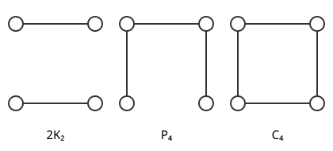

# Threshold 그래프

# 개요

**Threshold 그래프(threshold graph)** 는 사람이 한 명씩 들어올 때마다 새 사람이 이미 있는 사람을 아무도 모르거나 모두 아는 식으로 만들어지는 친분 관계다. 다섯 사람에게 아는 사람의 수만 물어 $4,3,2,2,1$ 을 들었다고 하자. 이 다섯 수만으로 누가 누구와 아는지가 하나로 정해진다.

보통의 차수열은 그렇지 않다. 같은 차수를 갖는 그래프가 여럿이고, Threshold 그래프는 차수열이 그래프를 하나로 정하는 그래프 전부다.

# 직관

다섯 사람을 $a,b,c,d,e$ 라 하고 아는 사람의 수가 차례로 $2,2,3,1,4$ 라 하자. $e$ 는 네 명을 알므로 나머지 모두와 안다. 그러면 $d$ 가 아는 한 명은 $e$ 이고, $d$ 는 다른 사람을 모른다.

$e$ 와 $d$ 를 빼고 나면 $a,b,c$ 가 서로 알아야 하는 수가 $1,1,2$ 다. $c$ 는 두 명을 알아야 하므로 $a$ 와 $b$ 를 둘 다 알고, $a$ 와 $b$ 는 서로 모른다. 매 단계에서 고를 것이 없었으므로 친분 관계가 하나로 정해진다. 아래 그림이 그 관계이고, 정점 옆의 수가 아는 사람의 수다.

[Erdős–Gallai 정리](erdos-gallai-theorem.md) 문서의 차수열 $3,3,2,2,2$ 는 다르다. 그 문서의 그래프에서 2-교환을 하면 차수는 그대로이고 간선이 다른 그래프가 나온다.

그림의 관계를 들어온 순서로 다시 적으면 $a$, $b$, $c$, $d$, $e$ 순이다. $b$ 는 $a$ 를 모르고, $c$ 는 $a,b$ 를 모두 알고, $d$ 는 아무도 모르고, $e$ 는 모두 안다. 새 사람이 늘 아무도 모르거나 모두 알았기 때문에, 차수가 가장 큰 사람과 가장 작은 사람부터 관계를 하나씩 확정할 수 있었다.

# 정의

정점 하나에서 시작해, 다음 두 가지를 거듭해 얻는 [그래프](graphs.md)를 **Threshold 그래프** 라 한다.

- 고립 정점을 하나 더한다. 새 정점은 기존 정점과 이어지지 않는다.
- 지배 정점을 하나 더한다. 새 정점은 기존 정점 모두와 이어진다.

고립 정점을 더하는 것을 $0$, 지배 정점을 더하는 것을 $1$ 로 적은 열을 **생성열(creation sequence)** 이라 한다. 직관 절의 그래프는 $a$ 에서 시작해 $b,c,d,e$ 를 더했으므로 생성열이 $0,1,0,1$ 이다.

정점 네 개로 된 다음 세 그래프를 $2K\_2$, $P\_4$, $C\_4$ 라 한다. $2K\_2$ 는 겹치지 않는 간선 둘, $P\_4$ 는 정점 네 개의 경로, $C\_4$ 는 정점 네 개의 순환이다.

# 성질

## 금지 유도 부분그래프

그래프가 Threshold 그래프인 것은 $2K\_2$, $P\_4$, $C\_4$ 를 유도 부분그래프(induced subgraph)로 포함하지 않는 것과 동치다[^1].

Threshold 그래프의 유도 부분그래프는 생성열에서 남은 정점의 단계만 남긴 Threshold 그래프다. Threshold 그래프에는 마지막에 더한 고립 정점이나 지배 정점이 있는데, 세 그래프에는 고립 정점도 지배 정점도 없다. 그래서 세 그래프는 Threshold 그래프의 유도 부분그래프가 될 수 없다.

## 차수열이 정하는 그래프

그래프 $G$ 가 Threshold 그래프인 것은 $G$ 와 차수가 같은 그래프가 $G$ 하나뿐인 것과 동치다. Erdős–Gallai 정리 문서의 2-교환에서 간선 $vw$, $ux$ 가 있고 $vu$, $wx$ 가 없으면 네 정점 $v,w,u,x$ 가 만드는 유도 부분그래프는 남은 두 쌍 $vx$, $wu$ 의 연결에 따라 $2K\_2$, $P\_4$, $C\_4$ 가운데 하나다. 거꾸로 세 그래프 가운데 하나가 유도 부분그래프로 있으면 2-교환을 할 수 있다.

같은 차수열의 실현은 2-교환으로 모두 이어지므로, 2-교환을 할 수 없는 그래프는 그 차수열의 유일한 실현이다. 직관 절의 그래프가 그렇다.

## 무게와 문턱

그래프가 Threshold 그래프인 것은 정점마다 실수 무게 $w\_v$ 와 문턱 $t$ 를 정해, 두 정점이 이어지는 것이 두 무게의 합이 $t$ 보다 큰 것과 같게 할 수 있는 것과 동치다[^1]. 이름이 여기서 왔다. 직관 절의 그래프는 다음 무게와 $t=5$ 로 적힌다.

$$
w\_a=2,\quad w\_b=2,\quad w\_c=4,\quad w\_d=1,\quad w\_e=5
$$

$c$ 와 $d$ 의 합은 $5$ 라서 이어지지 않고, $c$ 와 $a$ 의 합은 $6$ 이라서 이어진다. 생성열에서 지배 정점으로 늦게 들어온 정점일수록 무게가 크고, 고립 정점으로 늦게 들어온 정점일수록 무게가 작다.

## Erdős–Gallai 부등식의 등호

$d_1\ge\dots\ge d_n$ 에 대해 $m$ 을 $d_i\ge i-1$ 인 가장 큰 $i$ 라 하자. $d$ 가 Threshold 그래프의 차수열인 것은 $k=1,\dots,m$ 마다 Erdős–Gallai 부등식이 등호로 성립하는 것과 동치다[^2].

$$
\sum_{i=1}^{k}d_i=k(k-1)+\sum_{i=k+1}^{n}\min(d_i,k)
$$

$4,3,2,2,1$ 은 $m=3$ 이고 $k=1,2,3$ 에서 양쪽이 $4=4$, $7=7$, $9=9$ 다. $3,3,2,2,2$ 는 $k=1$ 에서 $3\lt 4$ 이므로 Threshold 그래프의 차수열이 아니다.

# 활용

- 정수계획의 부등식 합치기. Chvátal 과 Hammer 는 $0\text{-}1$ 변수에 대한 부등식 $x_u+x_v\le 1$ 들을 부등식 하나 $\sum w\_v x\_v\le t$ 로 바꿀 수 있는 경우를 찾다가 Threshold 그래프를 정의했다[^1]. 그래프의 독립집합이 정확히 이 부등식 하나의 $0\text{-}1$ 해가 되는 경우가 Threshold 그래프다.
- 차수열 다면체. 정점 $n$ 개의 단순 그래프의 차수열 전체의 볼록 껍질에서 꼭짓점은 Threshold 그래프의 차수열이다[^3].
- [완벽그래프](perfect-graphs.md)의 예. Threshold 그래프는 $C\_4$ 를 유도 부분그래프로 포함하지 않고, $P\_4$ 가 없어 길이 $5$ 이상의 유도 순환도 없으므로 [현 그래프](chordal-graphs.md)이고, 여그래프(complement graph)도 Threshold 그래프다. 생성열을 따라 클릭과 독립집합이 바로 읽힌다.

[^1]: V. Chvátal, P. L. Hammer, "Aggregation of inequalities in integer programming", *Annals of Discrete Mathematics* 1 (1977), 145–162.
[^2]: P. L. Hammer, T. Ibaraki, B. Simeone, "Threshold sequences", *SIAM Journal on Algebraic and Discrete Methods* 2 (1981), 39–49.
[^3]: M. Koren, "Extreme degree sequences of simple graphs", *Journal of Combinatorial Theory, Series B* 15 (1973), 213–224.

# 연관 문서

## 선수지식

- [Erdős–Gallai 정리](erdos-gallai-theorem.md)

## 더 알아보기

아직 연결한 문서가 없다.

#graph_theory #combinatorics #optimization
