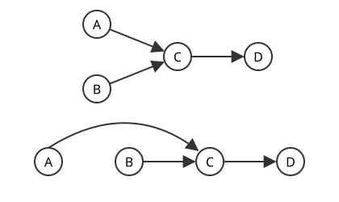

# 위상정렬

# 개요

**위상정렬(topological sort)** 은 방향 [그래프](graphs.md)의 정점을 모든 간선이 앞에서 뒤로 향하도록 일렬로 세우는 것이다. 선수과목이 정해진 과목들을 한 학기에 하나씩 들을 순서를 정하는 문제가 이 꼴이다. 아직 아무것도 기다리지 않는 과목을 하나씩 꺼내 적으면 순서가 나오고, 꺼낼 것이 없는데 과목이 남으면 서로를 기다리는 순환이 있어 순서가 없다.

# 직관

과목 네 개의 선수 관계가 $A\to C$, $B\to C$, $C\to D$ 로 주어졌다고 하자. 아직 아무것도 기다리지 않는 과목은 $A$ 와 $B$ 이고, 그중 하나를 꺼내 목록에 적고 그 과목을 지우면 남은 그래프에서 같은 질문을 다시 하면 된다. 이렇게 하면 $A\ B\ C\ D$ 가 나오고, 처음에 $B$ 를 꺼내면 $B\ A\ C\ D$ 가 나오므로 답은 하나가 아니다. 아래 그림의 위쪽이 선수 관계이고, 아래쪽은 같은 그래프의 정점을 $A\ B\ C\ D$ 순서로 늘어놓은 것으로 모든 화살표가 오른쪽을 향한다.

꺼낼 것이 없는데 과목이 남으면 남은 과목들이 서로를 기다리는 순환이다. 순환을 따라가면 순번이 계속 커지다가 시작점으로 돌아와야 하므로 어떤 순번 배정도 그 순환을 만족시킬 수 없다. 그래서 이 절차는 정렬기이면서 순환 검출기다.

# 정의

## DAG

**DAG(directed acyclic graph)** 는 방향 순환이 없는 방향 그래프다. 직관 절의 과목 그래프 $A\to C$, $B\to C$, $C\to D$ 는 DAG 이고, 여기에 $D\to A$ 를 더하면 순환 $A\to C\to D\to A$ 가 생겨 DAG 가 아니다.

## 위상정렬

유한 방향 그래프 $G = (V, E)$ 와 $\vert V\vert = n$ 에 대해 **위상정렬** 은 각 정점에 $1$ 부터 $n$ 까지 서로 다른 순번을 주는 함수 $\tau$ 로서

$$
(u,v)\in E\Rightarrow\tau(u)\lt\tau(v)
$$

를 만족하는 것이다. 정점으로 들어오는 간선의 수를 그 정점의 **진입차수(in-degree)** 라 한다.

과목 그래프에서 $\tau(A)=1$, $\tau(B)=2$, $\tau(C)=3$, $\tau(D)=4$ 와 $\tau(B)=1$, $\tau(A)=2$, $\tau(C)=3$, $\tau(D)=4$ 가 위상정렬이고, $\tau(C)=1$ 로 시작하는 배정은 $A\to C$ 를 어겨 위상정렬이 아니다. 진입차수는 $A$ 와 $B$ 가 $0$, $C$ 가 $2$, $D$ 가 $1$ 이다.

# 성질

## 존재 정리

유한 방향 그래프가 위상정렬을 가지는 것과 DAG 인 것은 동치다.

증명의 요지. 순환이 있으면 순번이 순환을 따라 증가하다 시작점으로 돌아와 모순이다. 역으로 비어 있지 않은 유한 DAG 에는 진입차수 $0$ 인 정점이 있다. 없다면 들어오는 간선을 거꾸로 계속 따라갈 수 있고, 정점이 유한하므로 같은 정점을 다시 만나 순환이 생긴다.

## 선형 확장과 유일성

DAG 에서 도달 가능성 관계는 [부분순서](partial-orders.md)이고, 유한 부분순서의 Hasse 도형(Hasse diagram)은 DAG 다. 위상정렬은 그 부분순서를 포함하는 전순서, 곧 선형 확장(linear extension)과 같다.

선형 확장이 여럿이므로 위상정렬도 유일하지 않다. 위상정렬이 유일한 것과 결과가 Hamilton 경로를 이루는 것, 곧 전체가 하나의 사슬인 것은 동치다.

## 추이 축약

$A \to B$ 이고 $B \to C$ 이면 $A$ 에서 $C$ 로 도달할 수 있지만 직접 간선이 필요하지는 않다. 추이 폐포(transitive closure)는 도달 가능한 모든 쌍을 간선으로 채운 그래프이고, 추이 축약(transitive reduction)은 도달 가능성을 바꾸지 않고 지울 수 있는 간선을 모두 지운 그래프다. DAG 에서 추이 축약은 유일하며 그것이 Hasse 도형이다. 선수과목 표에서 다른 선수과목의 선수과목을 지우는 것이 이 조작이다.

## Kahn 알고리즘

Kahn 알고리즘(Kahn's algorithm)은 진입차수 $0$ 인 정점을 꺼내 결과 뒤에 붙이고 그 정점에서 나가는 간선을 지우는 과정을 반복하는 절차다. 직관 절의 계산이 이 알고리즘이다. 전부 꺼내면 위상정렬이고, 남은 정점이 있는데 꺼낼 수 없으면 순환이 있다.

인접 리스트와 큐를 쓰면 각 정점과 간선을 상수 횟수만 처리하므로 간선 수를 $m$ 이라 할 때 시간 복잡도는

$$
O(n+m)
$$

이다. 큐 대신 우선순위 큐를 쓰면 사전순으로 가장 앞선 위상정렬을 $O((n+m)\log n)$ 에 얻는다.

[그래프 탐색](graph-search.md)의 깊이 우선 탐색(depth-first search, DFS)으로 구현하면 종료 시각이 늦은 정점부터 늘어놓은 것이 위상정렬이고, 후향 간선(back edge)이 나오면 순환이 있다. 두 구현의 출력 순서는 다를 수 있다.

## 위상순 순회

위상정렬된 순서로 정점을 훑으면 각 정점을 처리할 때 선행 정점들이 이미 끝나 있다. DAG 위의 여러 문제가 한 번의 선형 순회로 풀린다.

| 문제 | 방법 |
|---|---|
| 최장 경로 | 위상순으로 $\mathrm{dp}[v] = \max(\mathrm{dp}[u]+w)$ |
| 최단 경로 (음수 가중치 허용) | 같은 점화식, 음수여도 무방 |
| 경로 개수 | $\mathrm{cnt}[v] = \sum \mathrm{cnt}[u]$ |
| 도달 가능성 | 역위상순으로 비트집합 합집합 |

일반 그래프에서 최장 경로는 NP(nondeterministic polynomial time)-난해이고 DAG 에서는 선형 시간이다. [동적 계획법](dynamic-programming.md)의 상태 그래프가 DAG 여야 하는 것도 같은 이유다. 부분문제 의존 관계에 순환이 있으면 계산 순서를 정할 수 없다.

## 임계 경로

작업마다 소요 시간이 있을 때 소요 시간의 합이 가장 큰 경로를 임계 경로(critical path)라 하고, 그 합이 전체 완료 시간의 하한이다. 임계 경로 위의 작업이 지연되면 전체가 지연된다. 과목마다 한 학기가 걸리면 과목 그래프의 임계 경로는 $A\to C\to D$ 이고, 동시에 여러 과목을 들어도 세 학기가 필요하다.

부분순서에서 임계 경로는 가장 긴 사슬이다. Mirsky 정리(Mirsky's theorem)로 가장 긴 사슬의 원소 수는 부분순서를 반사슬로 나누는 최소 개수와 같으므로, 동시에 실행할 수 있는 작업의 층으로 나눌 때 필요한 층 수가 임계 경로의 작업 수다. [Dilworth 정리](dilworth-theorem.md)는 가장 큰 반사슬의 크기가 사슬로 나누는 최소 개수와 같다는 짝 정리다.

## 간선 추가

DAG 에 간선 $(u, v)$ 를 추가해도 순환이 생기지 않는 것과 $v$ 에서 $u$ 로 가는 경로가 없는 것은 동치이므로, 검사는 $v$ 에서 출발하는 도달 가능성 탐색 한 번이면 된다.

간선이 계속 추가되는 상황에서는 매번 전체를 다시 정렬하는 대신 순번을 국소적으로 고치는 온라인 위상정렬(online topological ordering)을 쓴다. 기존 순번이 $\tau(u) \lt\tau(v)$ 를 만족하면 손댈 필요가 없고, 어긋날 때만 두 순번 사이의 구간을 재배치한다.

# 활용

- 빌드 시스템은 파일 의존 그래프를, 패키지 관리자는 라이브러리 의존 그래프를, 스프레드시트는 셀 참조 그래프를 위상정렬한다. 오류 메시지에 순환 경로를 실어 주려면 검출만으로 부족하므로 DFS 기반 구현이 유리하다. 병렬 실행에서는 진입차수가 $0$ 이 된 정점들을 한꺼번에 내보내는 층 분해를 쓰며, 층의 개수가 임계 경로의 길이이고 각 층의 크기가 그 시점의 병렬도다.
- 자동 미분은 순전파를 위상순으로, 역전파를 역위상순으로 수행한다. 데이터 처리 파이프라인과 작업 스케줄러의 실행 계획도 DAG 위의 순회이며, 계산을 DAG 로 표현하면 실행 순서 결정, 중복 계산 제거, 증분 재계산을 함께 얻는다.[^1]

[^1]: Robert Sedgewick and Kevin Wayne, *Algorithms*, Directed Graphs. 방향 순환 검출과 위상정렬. https://algs4.cs.princeton.edu/42digraph/

# 연관 문서

## 선수지식

- [그래프](graphs.md)
- [부분순서](partial-orders.md)
- [그래프 탐색](graph-search.md)

## 더 알아보기

- [동적 계획법](dynamic-programming.md)

#graph_theory #algorithms
