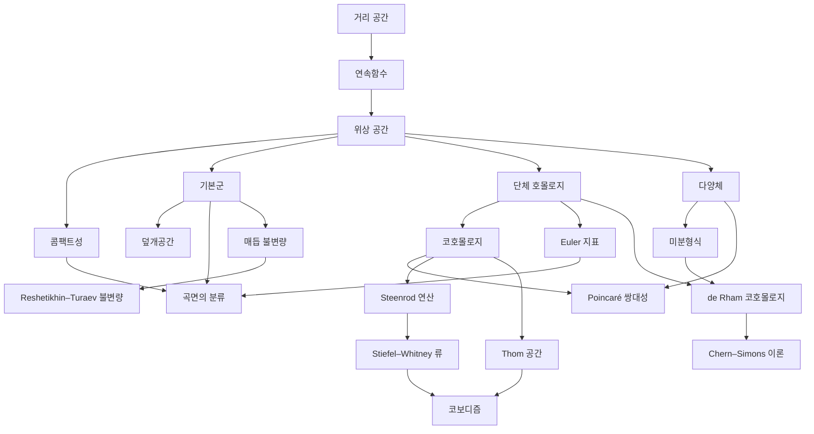

# 위상수학 개관

# 개요

위상수학(topology)은 늘리고 구부려도 변하지 않는 성질을 다룬다. 물음은 두 공간이 같은가이고, 답은 대개 불변량으로 온다. 연결성분의 수, 기본군, 호몰로지, Euler 지표, 매듭 다항식이 그것이다. 정수론과 만나는 에탈 코호몰로지와 기하적 Langlands 는 [정수론 개관](number-theory-overview.md)에 있다.

시작은 [거리 공간](metric-spaces.md)에서 [위상 공간](topology.md)으로 가는 추상화다. 거기서 [콤팩트성](compactness.md)이 점집합 위상의 축이고, [기본군](fundamental-group.md)과 [단체 호몰로지](homology.md)가 불변량을 만드는 두 입구이며, [다양체](manifolds.md)에서 미분 쪽 갈래가 시작한다.

# 지도

# 갈래

처음 읽는 사람은 점집합 위상, 기본군과 덮개공간, 호몰로지와 코호몰로지의 순서로 읽는다. 고정점 정리는 호몰로지 뒤에 오는 응용 갈래다. 미분 쪽은 다양체와 de Rham 이론에서 시작해 쌍대성과 고차원 분류, 호모토피론의 도구, 특성류와 코보디즘으로 간다. 층 코호몰로지는 대수기하로 갈라지고, 곡면과 3 다양체와 양자 위상과 게이지 이론이 저차원 갈래다.

## 점집합 위상

먼저 읽을 것: [함수](functions.md)(수학기초론 개관), [수열의 극한](limits.md)(해석학 개관). 시작 문서: [거리 공간](metric-spaces.md).

- [거리 공간](metric-spaces.md): 두 점 사이의 거리로 수렴과 연속을 정의하는 공간
- [위상 공간](topology.md): 거리값을 버리고 열린집합의 모임만 남긴 공간
- [콤팩트성](compactness.md): 모든 열린 덮개에서 유한 부분덮개를 뽑을 수 있다는 성질
  - [Heine–Borel 정리](heine-borel.md): 유클리드 공간에서 콤팩트성이 닫힘과 유계로 판정된다는 정리
  - [연결성](connectedness.md): 겹치지 않는 두 열린집합으로 나눌 수 없다는 성질
  - [필터와 그물](filters-and-nets.md): 수열이 모자라는 공간에서 수렴을 적는 두 언어와 그 번역
- [Tychonoff 정리](tychonoff-theorem.md): 콤팩트 공간의 임의 곱이 콤팩트하다는 정리, 선택공리와 동치
- [분리공리](separation-axioms.md): 점과 닫힌집합을 열린집합으로 갈라 놓을 수 있는 정도를 재는 조건들
- [Stone–Čech 콤팩트화](stone-cech-compactification.md): 유계 연속함수를 모두 확장하는 가장 큰 콤팩트화
- [위상군](topological-groups.md): 연산이 연속인 군, 항등원 근방이 위상 전체를 정한다
  - [격자 부분군](lattice-subgroups.md): 몫이 유한 부피인 이산 부분군, 기본 영역과 공부피

## 기본군과 덮개공간

먼저 읽을 갈래: 점집합 위상. 시작 문서: [기본군](fundamental-group.md).

- [기본군](fundamental-group.md): 한 점을 지나는 닫힌 경로를 연속 변형으로 동일시해 얻는 군
  - [Seifert–van Kampen 정리](seifert-van-kampen.md): 열린 두 조각의 기본군에서 전체의 기본군을 계산하는 정리
- [덮개공간](covering-spaces.md): 경로를 유일하게 올릴 수 있는 사상, 기본군의 부분군과의 대응
  - [감김수](winding-number.md): 닫힌 경로가 한 점 둘레를 도는 횟수, 각의 올림과 복소적분, 편각 원리
- [호모토피군](homotopy-groups.md): 고차원 구면에서 오는 사상을 연속 변형으로 분류한 군
  - [Freudenthal 매달기 정리](freudenthal-suspension.md): 매달기가 동형을 주는 차수 범위

## 호몰로지와 코호몰로지

먼저 읽을 갈래: 기본군과 덮개공간. 시작 문서: [단체 호몰로지](homology.md).

- [단체 호몰로지](homology.md): 경계가 없으면서 무엇의 경계도 아닌 사슬을 세어 얻는 아벨군
- [코호몰로지](cohomology.md): 사슬 위의 함수로 만든 불변량, 컵곱이 주는 환 구조
- [Mayer–Vietoris 완전열](mayer-vietoris.md): 두 조각과 그 교집합의 호몰로지를 전체의 것과 잇는 긴 완전열
  - [Jordan 곡선 정리](jordan-curve-theorem.md): 평면의 단순 닫힌 곡선이 평면을 두 성분으로 나눈다는 정리, 원판과 구면을 뺀 공간의 호몰로지 계산
- [CW 복합체](cw-complexes.md)(CW complex, closure-finite weak topology): 원판을 테두리째 붙여 차원 순으로 쌓은 공간, 세포마다 생성원 하나
  - [실사영공간](real-projective-space.md): 차원마다 세포가 하나인 몫공간, 절단 다항식환이 되는 코호몰로지
- [Euler 지표](euler-characteristic.md): 조각 수의 교대합으로 정의되는 정수
  - [평면 그래프](planar-graphs.md): 간선이 교차하지 않게 평면에 그릴 수 있는 그래프

## 고정점 정리

먼저 읽을 갈래: 호몰로지와 코호몰로지. 시작 문서: [Brouwer 고정점 정리](brouwer-fixed-point.md).

- [Brouwer 고정점 정리](brouwer-fixed-point.md): 닫힌 공의 연속 자기사상에 고정점이 있다는 정리
  - [Sperner 보조정리](sperner-lemma.md): 삼각형을 쪼개고 꼭짓점에 이름을 붙여 얻는 조합적 증명
  - [Kakutani 고정점 정리](kakutani-fixed-point.md): 집합값 사상으로의 확장, 균형의 존재 증명에 쓰인다
  - [Borsuk–Ulam 정리](borsuk-ulam.md): 구면의 연속사상이 대척점 쌍에서 같은 값을 갖는다는 정리
  - [Lefschetz 고정점 정리](lefschetz-fixed-point.md): 유도 준동형의 대각합으로 고정점의 존재를 판정하는 정리
  - [Brouwer 차수](brouwer-degree.md): 경계에서 값을 피하는 사상에 붙는 정수, 해를 부호와 함께 센다

## 다양체와 de Rham 이론

먼저 읽을 갈래: 호몰로지와 코호몰로지. 시작 문서: [다양체](manifolds.md).

- [다양체](manifolds.md): 작은 영역마다 좌표계를 붙여 미적분을 옮기는 공간
  - [털난 공 정리](hairy-ball-theorem.md): 짝수 차원 구면의 접벡터장에 영점이 있다는 정리, 항등사상과 대척사상의 차수 비교
- [미분형식](differential-forms.md): 적분 정리 넷을 한 정리로 묶는 반대칭 텐서
- [de Rham 코호몰로지](de-rham-cohomology.md): 닫힘형식을 완전형식으로 나눈 몫
- [Hodge 이론](hodge-theory.md): 코호몰로지류마다 조화 대표원 하나를 골라내는 분해
  - [Kähler 다양체](kahler-manifolds.md): 복소구조와 계량이 맞물린 다양체, 차수별로 갈라지는 코호몰로지
- [Gauss–Bonnet 정리](gauss-bonnet.md): 곡률의 적분이 계량과 무관하게 위상으로 결정된다는 정리
  - [Poincaré–Hopf 정리](poincare-hopf.md): 벡터장 특이점 지표의 합이 벡터장과 무관하다는 정리
- [Fredholm 작용소](fredholm-operators.md): 핵과 여핵이 유한차원인 작용소, 두 차원의 차가 연속변형으로 바뀌지 않는다
- [지표 정리](index-theorem.md): 타원 미분작용소의 해석적 지표가 위상적 불변량과 같다는 정리

## 쌍대성과 고차원 분류

먼저 읽을 갈래: 다양체와 de Rham 이론. 시작 문서: [Poincaré 쌍대성](poincare-duality.md).

- [Poincaré 쌍대성](poincare-duality.md): 닫힌 유향 다양체에서 차수가 상보적인 코호몰로지와 호몰로지의 동형
  - [콤팩트 지지 코호몰로지](compactly-supported-cohomology.md): 지지가 콤팩트한 코사슬만으로 만든 판본
  - [교차형식](intersection-form.md): 4 차원 다양체의 둘째 코호몰로지에 생기는 단모듈러 대칭형식
- [Reidemeister 비틀림](reidemeister-torsion.md): 사슬복합체의 행렬식이 남기는 단순 호모토피 불변량
- [s-코보디즘 정리와 고차원 Poincaré 추측](s-cobordism.md): 호모토피만 같은 코보디즘이 원기둥이 되는 조건
- [Freedman 정리](freedman-theorem.md): 닫힌 단연결 4 차원 위상다양체를 교차형식과 Kirby–Siebenmann 불변량으로 분류하는 정리
- [수술 이론](surgery-theory.md): 손잡이 교체로 호모토피 핵을 없애고 분류를 장애군으로 적는 이론
  - [이색 구면](exotic-spheres.md): 위상동형이지만 미분동형이 아닌 매끄러운 구면

## 호모토피론의 도구

먼저 읽을 갈래: 다양체와 de Rham 이론. 시작 문서: [올화](fibrations.md).

- [올화](fibrations.md): 호모토피를 올릴 수 있는 사상, 올과 밑공간과 전체공간을 잇는 긴 완전열
  - [Hopf 불변량](hopf-invariant.md): 차원이 다른 구면 사이의 사상에 붙는 정수
  - [스펙트럼 수열](spectral-sequences.md): 페이지를 차례로 고쳐 가며 코호몰로지를 계산하는 도구
- [단순 집합](simplicial-sets.md): 차수마다 단체의 집합과 면 사상을 적은 조합적 자료
  - [Kan 복합체](kan-complexes.md): 모든 뿔이 채워지는 단순 집합, 호모토피를 자료 안에서 끝낸다
- [Steenrod 연산](steenrod-operations.md): 현수를 지나도 남는 코호몰로지 연산, Adem 관계
- [분류공간](classifying-spaces.md): 다발을 세는 문제를 사상의 호모토피류를 세는 문제로 바꾸는 공간
- [Bott 주기성](bott-periodicity.md): 안정 유니터리군과 직교군의 호모토피군이 주기 2 와 8 로 되풀이된다, K 이론의 주기성
  - [Adams 연산](adams-operations.md): 선다발을 거듭제곱으로 보내는 K 이론의 환 준동형, Hopf 불변량 1 문제의 풀이
  - [J 준동형](j-homomorphism.md): 회전의 족에서 구면 사이의 사상을 만드는 준동형, 상의 위수와 Bernoulli 수
- [Eilenberg–MacLane 공간](eilenberg-maclane-spaces.md): 호모토피군이 한 차수에만 있는 공간, 코호몰로지의 표현가능성
  - [Brown 표현 정리](brown-representability.md): 쐐기합 공리와 Mayer–Vietoris 공리를 만족하는 함자를 표현하는 공간의 존재
- [장애 이론](obstruction-theory.md): 사상을 차원마다 늘릴 때 나오는 류가 확장과 단면의 존재를 판정한다
  - [Postnikov 탑](postnikov-tower.md): 높은 차수의 호모토피군을 차례로 지워 얻는 공간의 열

## 특성류와 코보디즘

먼저 읽을 갈래: 호모토피론의 도구. 시작 문서: [Stiefel–Whitney 류](stiefel-whitney-classes.md).

- [Stiefel–Whitney 류](stiefel-whitney-classes.md): 실 벡터다발에 붙는 계수 2 의 특성류, 방향가능성과 스핀 구조의 판정
- [Pontryagin 류](pontryagin-classes.md): 다발을 복소화해 얻는 정수 계수 특성류
- [Thom 공간](thom-space.md): 섬유마다 무한원점을 붙인 공간, 차수를 랭크만큼 올리는 동형
- [코보디즘](cobordism.md): 분리합이 어떤 콤팩트 다양체의 경계가 되는 동치관계
- [Hirzebruch 부호수 정리](hirzebruch-signature-theorem.md): 부호수를 특성류의 다항식으로 적는 공식
  - [Novikov 추측](novikov-conjecture.md): 기본군의 분류공간에서 당긴 류와 짝지은 고차 부호수의 호모토피 불변성, Baum–Connes 조립 사상에서의 유도
- [곱셈적 종수](multiplicative-genera.md): 멱급수 하나가 정하는 코보디즘 환의 환 준동형
- [위상 양자장론](topological-quantum-field-theory.md): 코보디즘 범주에서 벡터공간 범주로 가는 대칭 모노이드 함자, 2 차원에서는 가환 Frobenius 대수와 같다

## 층 코호몰로지

먼저 읽을 갈래: 호몰로지와 코호몰로지. 먼저 읽을 것: [층](sheaves.md)(범주론 개관). 시작 문서: [층 코호몰로지](sheaf-cohomology.md).

- [층 코호몰로지](sheaf-cohomology.md): 전역 단면 함자의 유도 함자, 국소에서 전역으로 가는 장애를 잰다
  - [에탈 코호몰로지](etale-cohomology.md): 에탈 사상을 덮개로 쓴 판본, 유한체 위 다양체의 점을 센다
  - [Picard 군](picard-group.md): 가역층의 동형류가 텐서곱으로 이루는 군

## 곡면과 3 다양체

먼저 읽을 갈래: 호몰로지와 코호몰로지. 시작 문서: [곡면의 분류](classification-of-surfaces.md).

- [곡면의 분류](classification-of-surfaces.md): 닫힌 곡면이 가향성과 종수 둘로 결정된다는 정리
  - [사상류군](mapping-class-group.md): 곡면의 미분동형을 동위로 나눈 군, Dehn 비틀림 생성원
- [Riemann 곡면](riemann-surfaces.md): 다가 함수를 한 값으로 만드는 복소 1 차원 다양체
  - [Teichmüller 공간](teichmuller-space.md): 같은 곡면 위 복소구조의 모듈라이
- [매듭 불변량](knot-invariants.md): 도식 조작에 변하지 않는 양, 매듭군과 Jones 다항식
  - [Alexander 다항식](alexander-polynomial.md): Seifert 곡면 위 곡선의 꼬임수로 만든 행렬의 행렬식, Conway 관계와 종수의 하한
  - [땋임군](braid-groups.md): 가닥을 꼬는 조작이 이루는 유한표시군
  - [Khovanov 호몰로지](khovanov-homology.md): 상태합을 사슬복합체로 올려 얻는 매듭 불변량
  - [매듭 콩코던스](knot-concordance.md): 4 차원 공 안의 고리면으로 매듭을 묶는 동치관계와 그 군, 부호수와 Fox–Milnor 조건, 위상적 슬라이스와 매끄러운 슬라이스의 차이
- [Dehn 수술](dehn-surgery.md): 매듭 근방을 떼고 다시 붙여 새 3 다양체를 얻는 조작
  - [렌즈 공간](lens-spaces.md): 3 구면을 순환군의 자유 작용으로 나눈 몫
- [Lobachevsky 함수](lobachevsky-function.md): 쌍곡 사면체의 부피를 적는 함수
- [쌍곡 3 다양체](hyperbolic-3-manifolds.md): 곡률이 음으로 일정한 계량을 갖는 3 다양체, 계량의 유일성
  - [기하화 정리](geometrization.md): 닫힌 3 다양체가 여덟 기하 조각으로 분해된다는 정리
  - [볼륨 추측](volume-conjecture.md): 양자 불변량의 점근이 쌍곡 부피를 준다는 추측

## 양자 위상과 게이지 이론

먼저 읽을 갈래: 곡면과 3 다양체. 시작 문서: [Chern–Simons 이론](chern-simons.md).

- [Chern–Simons 이론](chern-simons.md): 계량 없이 정의되는 3 차원 접속의 범함수
  - [Wess–Zumino–Witten 모형](wess-zumino-witten.md): 경계에 나타나는 2 차원 등각장론
- [모듈러 텐서범주](modular-tensor-categories.md): 융합 구조와 모듈러 변환을 갖춘 텐서범주
- [Reshetikhin–Turaev 불변량](reshetikhin-turaev.md): 범주 하나에서 3 다양체와 매듭의 불변량을 만드는 구성
  - [애니온](anyons.md): 교환 통계가 땋임군의 표현으로 주어지는 2 차원 준입자
  - [Witten 점근 추측과 Ohtsuki 급수](witten-asymptotics.md): 레벨이 커질 때 불변량의 점근 전개
- [Casson 불변량](casson-invariant.md): 호몰로지 3 구면의 표현을 부호와 함께 센 정수
- [순간자 Floer 호몰로지](instanton-floer-homology.md): 평탄 접속을 임계점으로 보아 얻는 호몰로지
  - [Heegaard Floer 호몰로지](heegaard-floer-homology.md): Heegaard 분해의 대칭곱에서 만드는 3 다양체 불변량

# 연관 문서

## 선수지식

- [집합](sets.md)

## 더 알아보기

- [거리 공간](metric-spaces.md)
- [위상 공간](topology.md)

#topology #algebraic_topology #overview
