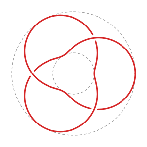

# 원환면 매듭

# 개요

**원환면 매듭(torus knot)** 은 도넛 겉면 위에 그린 곧은 길이 만드는 매듭이다. 도넛의 구멍을 두 번 도는 동안 관을 세 번 감는 끈을 따라가면 끈은 삼엽매듭으로 엉킨다. 원환면 위의 곧은 길은 두 정수로 정해지므로, 이런 매듭의 불변량은 두 정수의 식으로 계산된다.

# 직관

[원환면](torus.md) 문서의 정사각형 화면에서 $(0,0)$ 부터 $(2,3)$ 까지 곧게 걸으면 닫힌 고리가 생긴다. 이 고리는 가로 고리 $\alpha$ 를 두 번, 세로 고리 $\beta$ 를 세 번 감는다. 도넛에서는 구멍을 두 바퀴 도는 동안 관을 세 바퀴 감는 끈이다.

중심원 반지름 $2$, 관의 반지름 $1$ 인 도넛에서 이 끈은 $\varphi\in\lbrack 0,2\pi)$ 에 대해 다음 점들이다.

$$
\bigl((2+\cos 3\varphi)\cos 2\varphi,\ (2+\cos 3\varphi)\sin 2\varphi,\ \sin 3\varphi\bigr)
$$

그림은 이 끈을 위에서 본 것이고, 끊어진 자리는 끈이 아래로 지나가는 교차점이다. 교차점이 셋이고 위아래가 번갈아 나타나므로 [매듭 불변량](knot-invariants.md) 문서의 삼엽매듭 도식과 같다.

# 정의

## 원환면 매듭

$p$, $q$ 가 서로소인 정수이고 $\vert p\vert,\vert q\vert\ge 2$ 라 한다. 원환면 $T^2=\mathbb R^2/\mathbb Z^2$ 에서 $(0,0)$ 부터 $(p,q)$ 까지의 선분은 류 $(p,q)$ 의 닫힌 고리가 되고, 원환면을 공간에 놓으면 이 고리는 매듭이다. 이 매듭을 $(p,q)$ **원환면 매듭** 이라 하고 $T\_{p,q}$ 로 쓴다.

$p$ 는 구멍을 도는 횟수이고 $q$ 는 관을 감는 횟수다. 직관 절의 매듭은 $T\_{2,3}$ 이고 삼엽매듭이다. $p$ 나 $q$ 가 $\pm 1$ 이면 고리는 원환면 밖에서 풀리므로 풀린 매듭이다.

# 성질

## 대칭

$T\_{p,q}$ 와 $T\_{q,p}$ 는 같은 매듭이다. $S^3$ 은 두 꽉 찬 원환면을 경계에서 붙인 것이고, 한쪽의 구멍을 도는 방향이 다른 쪽의 관을 감는 방향이므로 두 꽉 찬 원환면의 역할을 바꾸면 $p$ 와 $q$ 가 바뀐다. $T\_{p,-q}$ 는 $T\_{p,q}$ 의 거울상이다.

## 매듭군

$T\_{p,q}$ 의 매듭군은 다음과 같다.

$$
\pi_1\bigl(S^3\setminus T_{p,q}\bigr)=\langle x,y\mid x^p=y^q\rangle
$$

증명의 요지. 여공간을 두 꽉 찬 원환면에서 매듭을 뺀 두 조각으로 나누면 각 조각의 기본군은 $\mathbb Z$ 이고, 겹치는 부분은 원환면에서 매듭을 뺀 띠라서 기본군이 $\mathbb Z$ 다. 띠의 중심 고리는 한쪽에서 생성원의 $p$ 제곱, 다른 쪽에서 $q$ 제곱이므로 [Seifert–van Kampen 정리](seifert-van-kampen.md)가 위 표시를 준다.

$x^p$ 은 모든 원소와 교환하므로 이 군의 중심에 들어 있다. 매듭 불변량 문서의 삼엽매듭 군 $\langle x,y\mid xyx=yxy\rangle$ 에서 $a=xyx$, $b=xy$ 로 두면 $b^3=(xyx)(yxy)=a^2$ 이고, 이것이 $p=2$, $q=3$ 인 표시다.

## Alexander 다항식

$T\_{p,q}$ 의 [Alexander 다항식](alexander-polynomial.md)은 다음과 같다.

$$
\Delta_{T_{p,q}}(t)=\frac{(t^{pq}-1)(t-1)}{(t^p-1)(t^q-1)}
$$

$T\_{2,3}$ 에서는 다음이 나온다.

$$
\frac{(t^6-1)(t-1)}{(t^2-1)(t^3-1)}=t^2-t+1
$$

이 다항식은 $1$ 이 아니므로 삼엽매듭은 풀리지 않는다. 다항식의 차수는 $(p-1)(q-1)$ 이고, 서로 다른 $\lbrace\vert p\vert,\vert q\vert\rbrace$ 는 서로 다른 다항식을 주므로 원환면 매듭은 거울상을 빼고 이 쌍으로 구별된다.

## 종수와 풀기 수

$T\_{p,q}$ 의 종수와 풀기 수(unknotting number)는 모두 다음 값이다.

$$
\frac{(\vert p\vert-1)(\vert q\vert-1)}{2}
$$

종수는 Alexander 다항식의 차수의 절반이 아래 한계이고, 원환면 매듭이 경계가 되는 이 종수의 곡면을 실제로 만들어 같아진다. 풀기 수가 이 값이라는 것은 Milnor 가 추측했고 Kronheimer 와 Mrowka 가 게이지 이론으로 증명했다[^1]. 삼엽매듭은 종수와 풀기 수가 모두 $1$ 이다.

# 활용

- 평면 곡선의 특이점. 복소 곡선 $z^p=w^q$ 를 원점 둘레의 작은 구 $S^3$ 으로 자르면 $T\_{p,q}$ 가 나온다. $z^2=w^3$ 의 뾰족점에서 나오는 매듭이 삼엽매듭이다.
- [Dehn 수술](dehn-surgery.md). $T\_{p,q}$ 의 기울기 $pq\pm 1$ 수술은 [렌즈 공간](lens-spaces.md)을 준다.
- [기하화 정리](geometrization.md). 매듭의 여집합은 쌍곡 구조를 갖거나, 원환면 매듭이거나, 여집합에 압축되지 않는 원환면이 들어 있는 위성 매듭(satellite knot)이다. 원환면 매듭의 여집합은 Seifert 올다양체(Seifert fibered space)다.
- [볼륨 추측](volume-conjecture.md). 원환면 매듭의 여집합은 쌍곡 부피가 $0$ 이고, colored Jones 다항식의 크기도 거듭제곱 정도로만 자란다.

[^1]: P. B. Kronheimer, T. S. Mrowka, Gauge theory for embedded surfaces I, Topology 32 (1993), 773–826.

# 연관 문서

## 선수지식

- [원환면](torus.md)
- [매듭 불변량](knot-invariants.md)

## 더 알아보기

아직 연결한 문서가 없다.

#topology #algebraic_topology #complex_analysis
