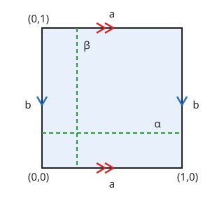

# 원환면

# 개요

**원환면(torus)** 은 도넛의 겉면이다. 오른쪽 끝으로 나간 캐릭터가 왼쪽 끝에서 들어오고 위로 나가면 아래에서 들어오는 게임 화면이 이 곡면이다. 원환면은 평면을 가로와 세로의 정수만큼 옮긴 점끼리 같다고 본 것이라, 그 위의 고리와 길이와 곡률을 평면의 좌표로 계산한다.

# 직관

한 변이 $1$ 인 정사각형 화면 $[0,1]\times[0,1]$ 에서 캐릭터가 오른쪽 변 $x=1$ 을 넘으면 왼쪽 변 $x=0$ 의 같은 높이로 들어온다. 그러면 화면의 왼쪽 변과 오른쪽 변은 같은 곳이고, 두 변을 붙이면 원기둥이 된다. 위 변과 아래 변도 같은 곳이므로 원기둥의 두 끝 원을 붙이면 도넛의 겉면이 된다.

그림에서 같은 글자의 화살표가 붙는 변이다. 가로 점선 $\alpha$ 는 오른쪽 변을 넘어 출발점으로 돌아오는 고리이고, 도넛에서는 구멍을 한 바퀴 도는 원이다. 세로 점선 $\beta$ 는 위 변을 넘어 돌아오는 고리이고, 도넛에서는 관을 한 바퀴 감는 원이다.

캐릭터가 출발점에서 가로로 $2$, 세로로 $1$ 만큼 곧게 걸으면 화면을 두 번 가로지르고 한 번 세로지른 뒤 출발점으로 돌아온다. 이 길은 $\alpha$ 를 두 번, $\beta$ 를 한 번 감는다. 평면의 점 $(0,0)$ 에서 $(2,1)$ 까지의 선분이 화면에서는 닫힌 고리가 되는 것이다.

# 정의

## 평면의 몫으로서의 원환면

평면 $\mathbb R^2$ 의 두 점 $(x,y)$ 와 $(x',y')$ 은 $x-x'$ 과 $y-y'$ 이 모두 정수일 때 같다고 본다. 같은 점끼리 묶은 공간을 다음과 같이 쓰고 원환면이라 한다.

$$
T^2=\mathbb R^2/\mathbb Z^2
$$

모든 점은 정사각형 $[0,1]\times[0,1]$ 안의 점과 같으므로, $T^2$ 는 직관 절의 정사각형에서 마주 보는 변을 붙인 것이다. 각 좌표를 원 $S^1=\mathbb R/\mathbb Z$ 의 점으로 보면 $T^2$ 는 두 원의 곱 $S^1\times S^1$ 이다. $n$ 개의 좌표로 같은 몫을 만든 $\mathbb R^n/\mathbb Z^n$ 을 $n$ 차원 원환면 $T^n$ 이라 한다.

## 공간 속의 원환면

$a\gt \mu\gt 0$ 일 때 다음 사상은 $T^2$ 를 $\mathbb R^3$ 의 도넛 겉면으로 보내는 위상동형이다.

$$
(x,y)\mapsto\bigl((a+\mu\cos 2\pi y)\cos 2\pi x,\ (a+\mu\cos 2\pi y)\sin 2\pi x,\ \mu\sin 2\pi y\bigr)
$$

$x$ 와 $y$ 에 정수를 더해도 값이 같으므로 이 사상은 $T^2$ 에서 정의된다. 직관 절의 $\alpha$ 는 반지름 $a+\mu$ 인 바깥 적도로, $\beta$ 는 반지름 $\mu$ 인 관의 단면으로 옮겨진다.

# 성질

## 기본군

원환면의 [기본군](fundamental-group.md)은 $\mathbb Z^2$ 이다. 고리의 류는 그 고리를 $\mathbb R^2$ 로 들어 올린 길의 끝점 $(m,n)$ 으로 정해지고, $\alpha$ 는 $(1,0)$, $\beta$ 는 $(0,1)$ 이다.

증명의 요지. 몫사상 $\mathbb R^2\to T^2$ 는 [덮개공간](covering-spaces.md)이고 $\mathbb R^2$ 는 단일연결이다. 덮개 변환은 정수 평행이동이므로 기본군은 평행이동군 $\mathbb Z^2$ 와 같다. 직관 절에서 $(0,0)$ 부터 $(2,1)$ 까지의 선분은 류 $(2,1)$ 의 고리, 곧 $\alpha^2\beta$ 다.

기본군이 가환이므로 $\alpha\beta$ 와 $\beta\alpha$ 는 같은 류다. 정사각형의 둘레를 $\alpha$, $\beta$, $\alpha$ 의 역, $\beta$ 의 역 순으로 돌면 정사각형 안에서 한 점으로 줄어든다는 것이 이 관계다.

## Euler 지표

정사각형의 꼭짓점 넷은 모두 한 점으로, 변 넷은 $a$ 와 $b$ 둘로 붙는다. 그래서 원환면은 꼭짓점 $1$ 개, 변 $2$ 개, 면 $1$ 개로 나뉘고 [Euler 지표](euler-characteristic.md)는 다음과 같다.

$$
\chi(T^2)=1-2+1=0
$$

[곡면의 분류](classification-of-surfaces.md)에서 방향을 줄 수 있는 콤팩트 연결 곡면은 구면이거나 원환면 $g$ 개의 연결합이고, Euler 지표는 $2-2g$ 다. 원환면은 $g=1$ 이다.

## 평탄한 원환면과 공간 속 원환면의 곡률

$\mathbb R^2$ 의 거리는 정수 평행이동에서 바뀌지 않으므로 $T^2$ 에 내려온다. 이 거리로 본 원환면은 어디서나 Gauss [곡률](curvature.md)이 $0$ 이고, 이것을 평탄한 원환면(flat torus)이라 한다.

공간 속 원환면의 Gauss 곡률은 관의 각 $\varphi=2\pi y$ 에 따라 다음과 같다.

$$
K=\frac{\cos\varphi}{\mu(a+\mu\cos\varphi)}
$$

바깥쪽 $\cos\varphi\gt 0$ 에서는 곡률이 양수이고, 구멍 쪽 $\cos\varphi\lt 0$ 에서는 음수다. 넓이 요소가 $\mu(a+\mu\cos\varphi)\thinspace d\theta\thinspace d\varphi$ 이므로 곡률의 적분은 $\cos\varphi$ 의 한 주기 적분이 되어 $0$ 이다. [Gauss–Bonnet 정리](gauss-bonnet.md)에서 이 값은 $2\pi\chi(T^2)=0$ 이다.

## 곧은 길

기울기가 $c$ 인 직선을 원환면으로 내리면, $c$ 가 유리수일 때 닫힌 고리가 되고 무리수일 때 원환면에서 조밀하다. $c=n/m$ 이 기약분수이면 직선은 $(m,n)$ 에서 처음으로 정수점을 지나 류 $(m,n)$ 의 고리가 된다.

증명의 요지. $c$ 가 무리수이면 직선이 세로 원 $x=0$ 을 지나는 높이는 $kc$ 의 소수 부분, $k=0,1,2,\dots$ 이고, 이 값들은 서로 다르다. 길이 $1/N$ 인 구간 $N$ 개에 $N+1$ 개의 값을 넣으면 두 값이 한 구간에 들어가므로, 차가 $1/N$ 보다 작은 걸음 $j$ 가 있다. $j$ 걸음씩 건너뛰면 세로 원 위를 $1/N$ 보다 작은 간격으로 고르게 지나고, $N$ 이 임의이므로 높이의 집합이 조밀하다.

# 활용

- 주기 경계 조건. 결정이나 유체를 상자 안에서 모의할 때 상자의 마주 보는 면을 붙여 원환면 $T^n$ 위의 문제로 바꾼다. 상자 밖으로 나간 입자는 반대쪽에서 들어온다.
- [타원함수](elliptic-functions.md). 두 방향으로 주기를 갖는 복소함수는 복소평면을 격자로 나눈 원환면 $\mathbb C/\Lambda$ 위의 함수다.
- [Lie 군](lie-groups.md). 콤팩트 가환 연결 Lie 군은 원환면 $T^n$ 이고, 콤팩트 Lie 군의 표현론은 그 안의 극대 원환면에서 시작한다.
- [그래프의 종수](graph-genus.md). $K_5$ 부터 $K_7$ 까지의 완전그래프는 평면에는 교차 없이 그릴 수 없고 원환면에는 그릴 수 있다.
- 다중 주기 신호. 주기가 $1$ 과 $\sqrt2$ 인 두 진동을 합친 신호의 위상은 곧은 길 절의 무리수 기울기 직선을 따라 원환면을 조밀하게 채운다.

# 연관 문서

## 선수지식

- [기본군](fundamental-group.md)
- [Euler 지표](euler-characteristic.md)

## 더 알아보기

- [Möbius 띠](mobius-strip.md)
- [원환면 매듭](torus-knots.md)

#topology #algebraic_topology #differential_geometry
