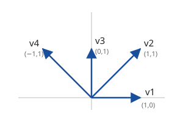

# 완전 음 아닌 Grassmann 다양체

# 개요

**완전 음 아닌 Grassmann 다양체(totally nonnegative Grassmannian)** 는 행렬로 적었을 때 크기가 가장 큰 소행렬식을 모두 $0$ 이상으로 맞출 수 있는 부분공간 전체다. 평면에 화살표 네 개를 그리고 첫 화살표에서 시작해 반시계 방향으로 반 바퀴 안에서 차례로 돌며 나머지를 만나도록 놓으면, 네 화살표를 열로 쌓은 $2\times 4$ 행렬이 이런 부분공간 하나를 준다. 화살표 두 개가 한 방향으로 겹치면 소행렬식 하나가 $0$ 이 된다. 어느 소행렬식이 $0$ 인지에 따라 공간을 조각으로 나누면 조각마다 양수 좌표가 붙는다.

# 직관

[Grassmann 다양체](grassmannian.md) $\mathrm{Gr}(2,4)$ 의 점은 $2\times 4$ 행렬의 행 공간이고, Plücker 좌표 $p\_{ij}$ 는 $i$ 열과 $j$ 열로 만든 $2\times 2$ 소행렬식이다. 아래 그림의 네 열 $v_1=(1,0)$, $v_2=(1,1)$, $v_3=(0,1)$, $v_4=(-1,1)$ 로 행렬을 만든다.

$p\_{ij}=\det(v_i,v_j)$ 를 계산하면 $p\_{12}=p\_{13}=p\_{14}=p\_{23}=p\_{34}=1$, $p\_{24}=2$ 로 모두 양수다. 같은 행 공간을 다른 행렬로 적으면 모든 $p\_{ij}$ 에 같은 수가 곱해지므로, 모두 $0$ 이상으로 맞출 수 있는지는 부분공간이 정한다.

$\det(v_i,v_j)\ge 0$ 은 $v_i$ 에서 반시계 방향으로 반 바퀴 안에 $v_j$ 가 있다는 뜻이다. 그래서 모든 $p\_{ij}$ 가 $0$ 이상인 것은 그림처럼 화살표가 번호 순서대로 반 바퀴 안에서 돌아가는 것이다. $v_2$ 를 $(2,0)$ 으로 옮겨 $v_1$ 과 같은 방향에 두면 $p\_{12}=0$ 이고 나머지 다섯 좌표는 양수로 남는다. 이렇게 $0$ 이 되는 좌표의 집합이 바뀌면 다른 조각으로 넘어간다.

# 정의

## 완전 음 아닌 Grassmann 다양체

실수 위의 $\mathrm{Gr}(k,n)$ 의 점 $V$ 의 Plücker 좌표를 모두 $0$ 이상으로 고를 수 있으면 $V$ 가 완전 음 아닌 점이라 하고, 그런 점 전체를 $\mathrm{Gr}\_{\ge 0}(k,n)$ 으로 쓴다. 모두 양수로 고를 수 있는 점 전체는 **완전 양 Grassmann 다양체(totally positive Grassmannian)** $\mathrm{Gr}\_{\gt 0}(k,n)$ 이다. 직관 절의 네 화살표가 주는 평면은 $\mathrm{Gr}\_{\gt 0}(2,4)$ 의 점이고, $v_2=(2,0)$ 으로 옮긴 평면은 $\mathrm{Gr}\_{\ge 0}(2,4)$ 의 점이지만 $\mathrm{Gr}\_{\gt 0}(2,4)$ 의 점은 아니다.

## 양의 세포

$\lbrack n\rbrack=\lbrace 1,\dots,n\rbrace$ 의 $k$ 원소 부분집합들의 모임 $\mathcal M$ 에 대해 다음 집합을 정의한다.

$$
S\_{\mathcal M}=\lbrace V\in\mathrm{Gr}\_{\ge 0}(k,n): p_I(V)\ne 0\iff I\in\mathcal M\rbrace
$$

$S\_{\mathcal M}$ 이 비어 있지 않으면 이것을 **양의 세포(positroid cell)** 라 하고 $\mathcal M$ 을 **positroid** 라 한다. $\mathcal M$ 은 열벡터들의 [매트로이드](matroids.md)의 기저 모임이다. 직관 절에서 $v_2=(2,0)$ 으로 옮긴 평면은 $\lbrace 1,2\rbrace$ 를 뺀 다섯 쌍이 positroid 인 세포에 든다.

## 장식된 순열

$V$ 를 열 $v_1,\dots,v_n$ 으로 적는다. 번호를 원형으로 보아 $i$ 다음의 $i+1,i+2,\dots$ 를 차례로 보면서, $v_i$ 가 $v\_{i+1},\dots,v_j$ 의 생성에 처음 들어가는 $j$ 를 $\pi(i)$ 로 둔다. $v_i=0$ 이면 $\pi(i)=i$ 이고, $v_i$ 가 나머지 열의 생성에 들지 않아도 $\pi(i)=i$ 이며 두 경우를 색으로 구별한다. 이렇게 얻은 순열을 **장식된 순열(decorated permutation)** 이라 한다.

직관 절의 네 화살표에서는 어느 둘도 같은 방향이 아니므로 $\pi=(3,4,1,2)$, 곧 $\pi(i)=i+2$ 다. $v_2=(2,0)$ 으로 옮기면 $v_1$ 이 $v_2$ 의 생성에 들고 $v_4$ 는 $v_1,v_2$ 의 생성에 들지 않으므로 $\pi=(2,4,1,3)$ 이다.

# 성질

## Postnikov 세포 분해

**정리.** $\mathrm{Gr}\_{\ge 0}(k,n)$ 은 양의 세포들의 서로소 합집합이고, 각 세포는 어떤 $d$ 에 대해 $\mathbb R\_{\gt 0}^d$ 와 위상동형이다. 같은 세포의 점은 장식된 순열이 같고, 세포와 장식된 순열은 일대일로 대응한다[^1].

$\mathrm{Gr}\_{\ge 0}(2,4)$ 의 세포는 $33$ 개다[^2]. 차원별로 $0$ 차원 $6$ 개, $1$ 차원 $12$ 개, $2$ 차원 $10$ 개, $3$ 차원 $4$ 개, $4$ 차원 $1$ 개다. $0$ 차원 세포는 좌표 평면 $\langle e_i,e_j\rangle$ 여섯이다. $3$ 차원 세포는 $p\_{12}$, $p\_{23}$, $p\_{34}$, $p\_{14}$ 가운데 하나만 $0$ 인 넷이고, 직관 절의 $p\_{12}=0$ 인 평면이 그 하나다.

## 양성 판정

$\mathrm{Gr}(2,4)$ 의 Plücker 관계 $p\_{13}p\_{24}=p\_{12}p\_{34}+p\_{14}p\_{23}$ 에서 $p\_{12},p\_{23},p\_{34},p\_{14},p\_{13}$ 이 양수이면 $p\_{24}$ 도 양수다. 그래서 $\mathrm{Gr}\_{\gt 0}(2,4)$ 의 판정에는 여섯 좌표 가운데 다섯이면 된다. 같은 관계로 $p\_{13}$ 이나 $p\_{24}$ 하나만 $0$ 인 점은 없고, 이것이 $3$ 차원 세포가 넷뿐인 까닭이다.

일반적으로 $\mathrm{Gr}\_{\gt 0}(k,n)$ 의 판정에는 잘 고른 Plücker 좌표 $k(n-k)+1$ 개의 양성이면 충분하다[^1]. 고른 좌표의 모임은 [클러스터 대수](cluster-algebras.md)의 한 클러스터이고, 나머지 좌표는 이 좌표들의 분모가 단항식인 양의 계수 유리식이다[^3].

## 완전 음 아닌 행렬과의 관계

$2\times 2$ 행렬 $A$ 의 성분을 $a,b$ 와 $c,d$ 의 두 행으로 두고, 다음 행렬의 행 공간을 생각한다.

$$
\begin{pmatrix}1&0&-b&-a\cr 0&1&d&c\end{pmatrix}
$$

Plücker 좌표는 $p\_{12}=1$, $p\_{13}=d$, $p\_{14}=c$, $p\_{23}=b$, $p\_{24}=a$, $p\_{34}=ad-bc$ 이다. 그래서 $A$ 가 [완전 음 아닌 행렬](totally-nonnegative-matrices.md)인 것과 이 평면이 $\mathrm{Gr}\_{\ge 0}(2,4)$ 에 드는 것은 동치다. 일반적으로 열의 순서를 뒤집고 행마다 부호를 번갈아 붙이는 같은 방법으로, $k\times(n-k)$ 완전 음 아닌 행렬 전체가 $p\_{1\cdots k}\ne 0$ 인 $\mathrm{Gr}\_{\ge 0}(k,n)$ 의 점 전체와 일대일로 대응한다[^1].

## 순환 대칭

열을 $(v_1,\dots,v_n)$ 에서 $(v_2,\dots,v_n,(-1)^{k-1}v_1)$ 로 돌리면 $\mathrm{Gr}\_{\ge 0}(k,n)$ 이 자기 자신으로 간다. 직관 절에서 $-v_1=(-1,0)$ 은 $v_4=(-1,1)$ 에서 반시계 방향으로 $45^\circ$ 돈 자리에 있어 $\det(v_4,-v_1)=1$ 이다. 완전 음 아닌 행렬에는 이런 대칭이 보이지 않고, 행렬을 Grassmann 다양체의 점으로 옮겨야 보인다.

## Plabic 그래프

원판 안에 그린 평면 그래프의 꼭짓점을 흰색과 검은색으로 칠하고 원판 경계에 $1,\dots,n$ 의 꼭짓점을 둔 것을 **plabic 그래프(plabic graph)** 라 한다. Postnikov 는 간선에 양수 가중치를 준 plabic 그래프에서 경계 꼭짓점 사이의 경로를 세어 $\mathrm{Gr}\_{\ge 0}(k,n)$ 의 점을 만들고, 모든 양의 세포가 어떤 축소된 plabic 그래프의 가중치 전체로 매개화된다는 것을 보였다[^1]. 이때 세포의 차원은 그래프의 면의 수에서 $1$ 을 뺀 것이다. 경로의 수가 소행렬식을 주는 것은 [Lindström–Gessel–Viennot 보조정리](lindstrom-gessel-viennot-lemma.md)와 같은 원리다.

## 닫힌 공

$\mathrm{Gr}\_{\ge 0}(k,n)$ 은 차원 $k(n-k)$ 인 닫힌 공과 위상동형이다[^4]. $\mathrm{Gr}\_{\ge 0}(2,4)$ 에서는 세포 수의 교대합 $6-12+10-4+1=1$ 이 공의 [Euler 지표](euler-characteristic.md)와 맞는다.

# 활용

- KP(Kadomtsev–Petviashvili) 솔리톤. Kodama 와 Williams 는 $\mathrm{Gr}\_{\ge 0}(k,n)$ 의 점이 [KP 위계](kp-hierarchy.md)의 tau 함수로서 모든 실수 시간에서 정칙인 솔리톤 해를 주고, 해가 만드는 물결 무늬가 장식된 순열로 분류된다는 것을 보였다[^5].
- 산란 진폭. Arkani-Hamed 등은 게이지 이론의 산란 진폭을 $\mathrm{Gr}\_{\ge 0}(k,n)$ 의 양의 세포 위 적분으로 적고, 진폭을 계산하는 도형을 plabic 그래프로 읽었다[^6].
- 클러스터 대수. Scott 은 $\mathrm{Gr}(k,n)$ 의 동차 좌표환이 Plücker 좌표를 클러스터 변수로 하는 클러스터 대수라는 것을 보였고, 양성 판정 절의 다섯 좌표가 $\mathrm{Gr}(2,4)$ 의 한 클러스터다[^3].
- 깃발다양체의 양의 부분. Lusztig 은 [깃발다양체](flag-varieties.md)를 비롯한 $G/P$ 에 완전 양의 부분을 정의했고, $\mathrm{Gr}\_{\ge 0}(k,n)$ 은 그 특수한 경우다.

[^1]: A. Postnikov, "Total positivity, Grassmannians, and networks", arXiv:math/0609764 (2006).
[^2]: L. K. Williams, "Enumeration of totally positive Grassmann cells", Advances in Mathematics 190 (2005), 319–342.
[^3]: J. S. Scott, "Grassmannians and cluster algebras", Proceedings of the London Mathematical Society 92 (2006), 345–380.
[^4]: P. Galashin, S. N. Karp, T. Lam, "The totally nonnegative Grassmannian is a ball", Advances in Mathematics 397 (2022), 108123.
[^5]: Y. Kodama, L. Williams, "KP solitons and total positivity for the Grassmannian", Inventiones Mathematicae 198 (2014), 637–699.
[^6]: N. Arkani-Hamed, J. Bourjaily, F. Cachazo, A. Goncharov, A. Postnikov, J. Trnka, *Grassmannian Geometry of Scattering Amplitudes*, Cambridge University Press, 2016.

# 연관 문서

## 선수지식

- [완전 음 아닌 행렬](totally-nonnegative-matrices.md)
- [Grassmann 다양체](grassmannian.md)

## 더 알아보기

아직 연결한 문서가 없다.

#combinatorics #algebra #linear_algebra
