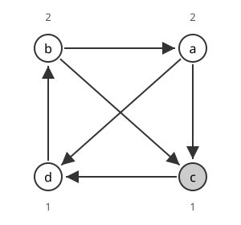

# 토너먼트 해

# 개요

**토너먼트 해(tournament solution)** 는 후보를 두 명씩 다수결에 붙인 결과만 보고 뽑을 만한 후보의 집합을 정하는 규칙이다. 네 후보 $a,b,c,d$ 를 두 명씩 겨루게 했더니 $b$ 가 $a$ 를, $a$ 가 $c$ 와 $d$ 를, $c$ 가 $d$ 를, $d$ 가 $b$ 를, $b$ 가 $c$ 를 이겼다고 하자. 나머지 모두를 이긴 후보가 없어서 다수결만으로는 당선자가 정해지지 않는다.

토너먼트 해는 이런 결과에서도 비어 있지 않은 후보 집합을 내놓고, 나머지 모두를 이긴 후보가 있으면 그 후보 하나만 내놓는다. 위 결과에서 $c$ 는 자기가 이긴 $d$ 를 $a$ 도 이겼고 $a$ 에게 졌으므로 뽑을 근거가 가장 약하다.

# 직관

개요의 대결 결과는 [토너먼트](tournaments.md) 문서의 네 팀 리그와 같다. 화살표는 이긴 후보에서 진 후보로 간다.

이긴 수로 고르면 두 번씩 이긴 $a$ 와 $b$ 가 남는다. 그런데 $d$ 는 한 번만 이겼어도 $b$ 를 이겼고, $b$ 를 거쳐 $a$ 와 $c$ 에 닿는다. $d$ 를 빼야 할 이유는 이긴 수가 적다는 것뿐이다.

$c$ 는 다르다. $c$ 가 이긴 후보는 $d$ 하나인데 $a$ 가 $d$ 를 이겼고 $c$ 도 이겼다. $c$ 를 뽑자고 하면 $a$ 를 지지하는 쪽은 $a$ 가 $c$ 를 이겼고 $c$ 가 이긴 상대도 다 이겼다고 반박할 수 있다. 그림의 회색 정점 $c$ 가 이렇게 반박당하는 후보이고, 나머지 셋은 반박당하지 않는다.

# 정의

후보의 집합 $V$ 위의 토너먼트 $T$ 마다 $V$ 의 비어 있지 않은 부분집합 $S(T)$ 를 정하는 규칙 $S$ 가 다음 두 조건을 만족하면 **토너먼트 해** 라 한다.

- 정점의 이름을 바꾼 토너먼트에는 이름을 바꾼 집합을 정한다.
- 나머지 모든 정점을 이긴 정점 $x$ 가 있으면 $S(T)=\lbrace x\rbrace$ 다. 이런 $x$ 를 **Condorcet 승자(Condorcet winner)** 라 한다.

직관 절의 토너먼트에는 Condorcet 승자가 없다. 다음 셋이 토너먼트 해다.

**Copeland 집합(Copeland set)** 은 점수, 곧 이긴 수가 가장 큰 정점의 집합이다. 직관 절에서는 $\lbrace a,b\rbrace$ 다.

$x\to y$ 이고 $y$ 가 이긴 정점을 $x$ 도 모두 이기면 $x$ 가 $y$ 를 **덮는다(covers)** 고 한다. 어느 정점에게도 덮이지 않는 정점의 집합을 **덮이지 않은 집합(uncovered set)** 이라 한다. 직관 절에서 $a$ 가 $c$ 를 덮고 다른 덮음은 없으므로 덮이지 않은 집합은 $\lbrace a,b,d\rbrace$ 다.

비어 있지 않은 집합 $D$ 의 모든 정점이 $D$ 밖의 모든 정점을 이기면 $D$ 를 지배 집합(dominant set)이라 한다. 가장 작은 지배 집합을 **꼭대기 순환(top cycle)** 이라 한다. 직관 절의 토너먼트는 바깥 네모 $b\to a\to c\to d\to b$ 를 따라 어디서 어디로나 가므로 꼭대기 순환이 $\lbrace a,b,c,d\rbrace$ 다.

# 성질

## 꼭대기 순환과 강연결성분

두 지배 집합 가운데 하나는 다른 하나를 포함한다. 서로 상대에 없는 정점 $x\in D_1$, $y\in D_2$ 가 있으면 $x\to y$ 이면서 $y\to x$ 여야 하기 때문이다. 그래서 가장 작은 지배 집합은 하나로 정해진다.

꼭대기 순환은 토너먼트의 [강연결성분](strongly-connected-components.md) 가운데 다른 모든 성분을 이기는 맨 위 성분이다. 강연결성분을 한 점으로 줄인 그래프는 추이적 토너먼트이고, 지배 집합은 그 순서에서 앞쪽 성분 몇 개를 합친 것이다.

## 덮이지 않은 집합과 왕

덮이지 않은 정점은 [토너먼트](tournaments.md) 문서의 왕, 곧 다른 모든 정점에 화살표 하나나 둘로 닿는 정점과 같다. $y$ 가 $x$ 를 덮는 것은 $y\to x$ 이고 $x\to z\to y$ 인 $z$ 가 없는 것이다. 그러므로 $x$ 가 덮이지 않는 것은 $x$ 를 이긴 모든 $y$ 에 $x$ 가 두 걸음으로 닿는 것이다. 직관 절에서 $c$ 는 $c\to d\to b$ 로 $b$ 에 닿지만 $a$ 에는 두 걸음으로 닿지 못한다.

## 포함 관계

세 해는 다음 포함 관계를 만족한다.

$$
\mathrm{CO}(T)\subseteq\mathrm{UC}(T)\subseteq\mathrm{TC}(T)
$$

$\mathrm{CO}$, $\mathrm{UC}$, $\mathrm{TC}$ 는 차례로 Copeland 집합, 덮이지 않은 집합, 꼭대기 순환이다. 점수가 가장 큰 정점이 왕이라는 토너먼트 문서의 정리가 첫째 포함이다. 왕은 모든 정점에 닿으므로 지배 집합 밖에 있을 수 없고, 이것이 둘째 포함이다. 직관 절에서는 $\lbrace a,b\rbrace\subseteq\lbrace a,b,d\rbrace\subseteq\lbrace a,b,c,d\rbrace$ 로 세 포함이 모두 진포함이다.

## McGarvey 정리

**McGarvey 정리(McGarvey's theorem)** 는 모든 토너먼트가 어떤 유권자들의 다수결 결과로 나온다는 진술이다[^1]. 간선 $x\to y$ 마다 유권자 두 명을 두어, 한 명은 맨 앞에 $x,y$ 를 이 순서로 두고 나머지를 어떤 순서로 둔 순위를, 다른 한 명은 나머지를 그 거꾸로 둔 뒤 맨 뒤에 $x,y$ 를 이 순서로 둔 순위를 내게 한다. 두 사람은 $x$ 와 $y$ 사이에서만 같은 쪽을 고르고 다른 쌍에서는 서로 상쇄한다. 그래서 토너먼트 해를 연구할 때는 유권자의 순위 대신 토너먼트만 보아도 된다.

# 활용

- Copeland 방식. 후보마다 다수결에서 이긴 수를 세어 가장 많은 후보를 뽑는 선거 규칙이고, Copeland 집합에서 동점을 가르는 규칙을 더한 것이다.
- 의제 설정. 두 후보씩 차례로 표결해 이긴 쪽을 다음 표결에 올리는 방식에서 유권자가 결과를 내다보고 전략적으로 투표하면, 어떤 순서로 표결해도 당선자는 덮이지 않은 집합 안에 있다[^2]. 덮이지 않은 집합 밖의 후보는 의제 순서를 조작해도 당선되지 않는다.
- 다수결 순환의 진단. [Arrow 불가능성 정리](arrow-impossibility-theorem.md)의 Condorcet 역설은 꼭대기 순환이 둘 이상의 후보를 담는 경우다. 꼭대기 순환이 후보 하나면 Condorcet 승자가 있고, 아니면 그 집합이 순환에 얽힌 후보들이다.
- 순위와의 비교. [Kemeny 순위](kemeny-ranking.md)는 후보 전체에 한 줄 순서를 주고, 토너먼트 해는 당선 후보의 집합만 준다. Kemeny 순위의 첫 후보는 꼭대기 순환 안에 있다.

[^1]: D. C. McGarvey, "A theorem on the construction of voting paradoxes", *Econometrica* 21 (1953), 608–610.
[^2]: N. R. Miller, "A new solution set for tournaments and majority voting: further graph-theoretical approaches to the theory of voting", *American Journal of Political Science* 24 (1980), 68–96.

# 연관 문서

## 선수지식

- [토너먼트](tournaments.md)

## 더 알아보기

- [Banks 집합](banks-set.md)
- [Slater 집합](slater-set.md)

#graph_theory #order_theory #combinatorics
