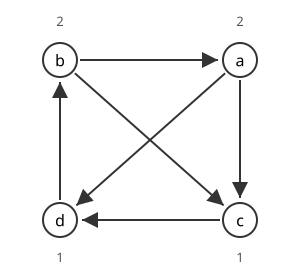

# 토너먼트

# 개요

**토너먼트(tournament)** 는 모든 두 선수가 한 번씩 겨뤄 승패를 가린 결과를, 이긴 쪽에서 진 쪽으로 가는 화살표로 적은 그래프다. 네 팀이 서로 한 번씩 경기한 리그에서 승수가 $0,0,3,3$ 이라고 하자. 경기 수 $6$ 과 승수의 합 $6$ 이 맞지만, 승수가 $0$ 인 두 팀도 서로 맞붙었고 그 경기에서 한 팀은 이겼으므로 이런 결과는 나올 수 없다.

승수가 작은 팀부터 $k$ 팀씩 묶어, 묶음의 승수 합이 묶음 안에서 치른 경기 수 이상인지 본다. 모든 $k$ 에서 그런 것이 그 승수가 나오는 리그가 있을 필요충분조건이다.

# 직관

네 팀 $a,b,c,d$ 가 한 번씩 경기한다. 두 팀이 한 경기를 하고 그 경기의 승리는 둘 가운데 한 팀에 간다. 그래서 어느 $k$ 팀을 골라도 그들끼리 치른 $k(k-1)/2$ 경기의 승리가 모두 그 $k$ 팀의 승수에 들어 있고, $k$ 팀의 승수 합은 $k(k-1)/2$ 이상이다. 개요의 $0,0,3,3$ 은 승수가 작은 두 팀의 합이 $0$ 이라서 $k=2$ 에서 $0\lt 1$ 로 깨진다.

승수 $2,2,1,1$ 은 작은 팀부터 더한 $1$, $2$, $4$, $6$ 이 각각 $0$, $1$, $3$, $6$ 이상이다. 아래 그림의 경기 결과가 이 승수를 낸다. 화살표는 이긴 팀에서 진 팀으로 가고, 정점 옆의 수가 승수다.



이 리그의 순위를 정하려 한다. 그림의 바깥 네모를 따라 $b,a,c,d$ 로 세우면 앞 팀이 바로 뒤 팀을 이겼다. 그런데 $d$ 도 $b$ 를 이겼으므로 이 줄을 돌려 $d,b,a,c$ 로 세워도 같다. 바로 뒤 팀을 이기는 줄은 모든 리그에 있지만, 하나로 정해지지는 않는다.

# 정의

**토너먼트** 는 유한 집합 $V$ 위의 [방향 그래프](graphs.md)이고, 서로 다른 두 정점 $u,v$ 마다 간선 $(u,v)$ 와 $(v,u)$ 가운데 정확히 하나만 있는 것이다. 고리는 없다. 간선 $(u,v)$ 를 $u\to v$ 로 쓰고 $u$ 가 $v$ 를 이긴다고 읽는다. 직관 절의 그림은 정점 $4$ 개의 토너먼트다.

정점 $v$ 가 이긴 정점의 수 $s(v)$ 를 $v$ 의 **점수(score)** 라 하고, 점수를 작은 것부터 늘어놓은 $s_1\le s_2\le\dots\le s_n$ 을 **점수열(score sequence)** 이라 한다. 그림의 점수열은 $1,1,2,2$ 다.

$u\to v$ 이고 $v\to w$ 이면 언제나 $u\to w$ 인 토너먼트를 **추이적 토너먼트(transitive tournament)** 라 한다. 그림의 토너먼트는 $b\to c$, $c\to d$ 인데 $d\to b$ 이므로 추이적이지 않다.

모든 두 정점 $u,v$ 에 대해 $u$ 에서 $v$ 로 가는 방향 경로가 있으면 토너먼트가 [강연결](strongly-connected-components.md)이라 한다. 그림의 토너먼트는 바깥 네모 $b\to a\to c\to d\to b$ 를 따라 어느 정점에서 어느 정점으로나 가므로 강연결이다.

모든 다른 정점에 화살표 하나나 둘을 따라 닿는 정점을 **왕(king)** 이라 한다. 그림에서 $b$ 는 $a$ 와 $c$ 를 이기고 $c\to d$ 이므로 왕이다.

# 성질

## Landau 정리

**Landau 정리(Landau's theorem)** 는 다음 진술이다. 음이 아닌 정수 $s_1\le\dots\le s_n$ 이 어떤 토너먼트의 점수열인 것은 $k=1,\dots,n$ 마다 다음이 성립하고 $k=n$ 에서 등호인 것과 동치다[^1].

$$
\sum_{i=1}^{k}s_i\ge\binom{k}{2}
$$

필요성은 직관 절의 셈이다. 점수가 작은 $k$ 개 정점끼리의 경기 $\binom{k}{2}$ 개는 모두 그 $k$ 개 정점의 점수에 들어가고, 전체 경기 수가 $\binom{n}{2}$ 이므로 $k=n$ 에서 등호다.

충분성은 [네트워크 흐름](network-flow.md)으로 증명된다. 출발점에서 두 정점의 쌍 $\lbrace u,v\rbrace$ 마다 용량 $1$ 인 간선을 두고, 쌍에서 $u$ 와 $v$ 로 각각 용량 $1$ 인 간선을, 정점 $v$ 에서 도착점으로 용량 $s(v)$ 인 간선을 둔다. 값이 $\binom{n}{2}$ 인 정수 흐름이 있으면 쌍마다 흐름이 들어간 정점을 승자로 정해 토너먼트를 얻는다.

최대유량 최소절단 정리(max-flow min-cut theorem)로 절단의 용량을 따지면, 흐름이 있을 조건은 모든 정점 집합 $A$ 에 대해 $A$ 안의 쌍 $\binom{\vert A\vert}{2}$ 개가 $A$ 의 점수 합 이하인 것이다. 크기가 $k$ 인 $A$ 가운데 점수 합이 가장 작은 것은 점수가 작은 $k$ 개이므로 위 부등식이 그 조건이다.

[Erdős–Gallai 정리](erdos-gallai-theorem.md)가 무향 그래프의 차수열에 대해 같은 물음에 답한다. 토너먼트에서는 모든 쌍 사이에 간선이 있으므로 간선을 놓을지가 아니라 방향만 정하면 되고, 조건이 점수가 작은 쪽의 부등식 하나로 줄어든다.

## 3-순환의 개수와 추이성

$a\to b\to c\to a$ 꼴의 세 정점을 **3-순환(3-cycle)** 이라 한다. 정점 $n$ 개의 토너먼트에서 3-순환의 개수는 다음과 같다.

$$
\binom{n}{3}-\sum_{v\in V}\binom{s(v)}{2}
$$

세 정점이 3-순환이 아니면 셋 가운데 나머지 둘을 모두 이긴 정점이 정확히 하나 있다. $v$ 가 나머지 둘을 모두 이긴 세 정점은 $v$ 가 이긴 정점 가운데 둘을 고른 것이라 $\binom{s(v)}{2}$ 개다. 직관 절의 그림에서는 점수가 $2$ 인 두 정점이 $1$ 씩 빼므로 $4-2=2$ 이고, $\lbrace a,b,d\rbrace$ 와 $\lbrace b,c,d\rbrace$ 가 3-순환이다.

토너먼트가 추이적인 것, 3-순환이 없는 것, 점수열이 $0,1,\dots,n-1$ 인 것은 동치다. 3-순환이 없으면 점수가 $n-1$ 인 정점이 하나 있고, 그 정점을 지우고 귀납법을 쓴다.

## Rédei 정리

**Rédei 정리(Rédei's theorem)** 는 모든 토너먼트에 [Hamilton 경로](hamiltonian-cycles.md)가 있다는 진술이다[^2]. 정점을 하나씩 넣으며 경로를 늘린다. 경로 $v_1\to\dots\to v_m$ 과 새 정점 $x$ 가 있을 때, $x\to v_1$ 이면 $x$ 를 맨 앞에, $v_m\to x$ 이면 맨 뒤에 둔다. 둘 다 아니면 $v_1\to x$ 이고 $x\to v_m$ 이므로, $v_i\to x$ 이고 $x\to v\_{i+1}$ 인 $i$ 가 있어 그 사이에 넣는다.

```javascript
// beats(u, v) 가 u→v 이면 true 인 토너먼트에서 Hamilton 경로를 만든다
function hamiltonPath(vertices, beats) {
  const path = [];
  for (const x of vertices) {
    let lo = 0;
    let hi = path.length; // path[lo-1] → x 이고 x → path[hi] 인 자리를 찾는다
    while (lo < hi) {
      const mid = (lo + hi) >> 1;
      if (beats(path[mid], x)) lo = mid + 1;
      else hi = mid;
    }
    path.splice(lo, 0, x);
  }
  return path;
}
```

넣을 자리를 이분 탐색으로 찾으므로 경기 결과를 $O(n\log n)$ 번 묻는다. 토너먼트가 추이적이면 이 절차는 [비교 정렬](comparison-sorting.md)의 이진 삽입 정렬이고, Hamilton 경로는 정렬된 순서 하나뿐이다. Rédei 는 Hamilton 경로의 개수가 언제나 홀수임도 증명했다.

## Camion 정리

**Camion 정리(Camion's theorem)** 는 정점이 $3$ 개 이상인 강연결 토너먼트에 Hamilton 순환이 있다는 진술이다[^3]. 강연결이면 3-순환이 있고, 순환 $C=c_1\to\dots\to c_m\to c_1$ 을 다음과 같이 늘린다.

- $C$ 밖의 정점 $x$ 가 $C$ 의 어느 정점을 이기고 어느 정점에게 지면, $c_i\to x\to c\_{i+1}$ 인 $i$ 가 있어 $x$ 를 끼워 넣는다.
- 그런 정점이 없으면 $C$ 밖의 정점은 $C$ 를 모두 이기는 $A$ 와 $C$ 에게 모두 지는 $B$ 로 나뉜다. 강연결이므로 $C$ 에서 $A$ 로 가는 경로가 있어 $B$ 의 $y$ 와 $A$ 의 $x$ 가 $y\to x$ 를 만족한다. 그러면 $c_1\to y\to x\to c_3\to\dots\to c_m\to c_1$ 은 $c_2$ 를 빼고 $x,y$ 를 넣은 길이 $m+1$ 의 순환이다.

J. W. Moon 은 같은 논법으로 강연결 토너먼트의 모든 정점이 길이 $3,\dots,n$ 의 순환에 모두 들어 있음을 보였다[^4].

## 왕의 존재

점수가 가장 큰 정점은 왕이다[^1]. $v$ 의 점수가 가장 크고 $u\to v$ 라 하자. $u$ 가 $v$ 가 이긴 정점을 모두 이겼다면 $s(u)\ge s(v)+1$ 이므로, $v$ 가 이긴 정점 가운데 $w\to u$ 인 $w$ 가 있다. 그러면 $v\to w\to u$ 로 $v$ 가 $u$ 에 닿는다. 직관 절의 그림에서 점수가 $2$ 인 $a$ 와 $b$ 가 모두 왕이다.

# 활용

- 서열 연구. Landau 는 닭 무리에서 쪼는 순서를 기록한 자료가 한 줄 서열에서 얼마나 벗어나는지 재려고 점수열을 연구했다. 3-순환의 개수가 그 벗어난 정도의 척도로 쓰인다.
- 다수결과 투표. 후보마다 두 후보씩 다수결을 하면 이긴 쪽에서 진 쪽으로 화살표를 그은 토너먼트가 나온다. [Arrow 불가능성 정리](arrow-impossibility-theorem.md)의 Condorcet 역설이 이 토너먼트의 3-순환이고, 다른 모든 후보를 이기는 Condorcet 승자는 점수가 $n-1$ 인 정점이다. 승자가 없을 때 왕들의 집합이나 강연결성분의 맨 위 성분이 후보를 좁히는 규칙, 곧 [토너먼트 해](tournament-solutions.md)로 쓰인다.
- 비추이적 비교. [비추이적 주사위](nontransitive-dice.md)처럼 둘씩 비교한 결과가 순환하는 대상에서도 Rédei 정리의 삽입 절차로 바로 뒤를 이기는 순서를 얻는다.
- [확률적 방법](probabilistic-method.md). Erdős 는 화살표 방향을 무작위로 정한 토너먼트로, 어느 $k$ 명을 골라도 그들을 모두 이긴 선수가 있는 토너먼트의 존재를 증명했다.

[^1]: H. G. Landau, "On dominance relations and the structure of animal societies III. The condition for a score structure", *Bulletin of Mathematical Biophysics* 15 (1953), 143–148.
[^2]: L. Rédei, "Ein kombinatorischer Satz", *Acta Litterarum ac Scientiarum Szeged* 7 (1934), 39–43.
[^3]: P. Camion, "Chemins et circuits hamiltoniens des graphes complets", *Comptes Rendus de l'Académie des Sciences de Paris* 249 (1959), 2151–2152.
[^4]: J. W. Moon, "On subtournaments of a tournament", *Canadian Mathematical Bulletin* 9 (1966), 297–301.

# 연관 문서

## 선수지식

- [Hamilton 순환](hamiltonian-cycles.md)
- [Erdős–Gallai 정리](erdos-gallai-theorem.md)

## 더 알아보기

- [Seymour 두 번째 이웃 추측](seymour-second-neighborhood-conjecture.md)
- [Sumner 보편 토너먼트 추측](sumner-universal-tournament-conjecture.md)
- [Rosenfeld 추측](rosenfeld-conjecture.md)
- [토너먼트 해](tournament-solutions.md)

#graph_theory #combinatorics #algorithms
