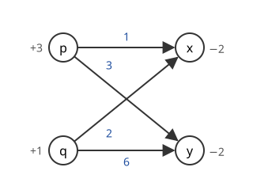

# 수송 문제

# 개요

**수송 문제(transportation problem)** 는 공급지마다 내보낼 양과 수요지마다 받을 양이 정해져 있을 때, 공급지에서 수요지로 보내는 양을 정해 단위당 운송비를 곱한 합을 가장 작게 하는 문제다. 창고 두 곳에 물건이 $3$ 개와 $1$ 개 있고 매장 두 곳이 $2$ 개씩 원하며 길마다 한 개당 운송비가 다르면, 어느 창고에서 어느 매장으로 몇 개를 보낼지가 이 꼴이다. 공급지를 행, 수요지를 열로 둔 표에 운송량을 채우는 규칙으로 처음 계획을 세우고, [네트워크 단체법](network-simplex-method.md)으로 고쳐 최소 비용 계획을 얻는다.

# 직관

아래 그림은 창고 $p,q$ 가 $3$ 개와 $1$ 개를 내보내고 매장 $x,y$ 가 $2$ 개씩 받는 경우이고, 간선 위의 수가 한 개당 운송비다.

운송량을 행이 창고, 열이 매장인 표에 적는다. 왼쪽 위 칸 $(p,x)$ 에서 시작해 그 칸에 보낼 수 있는 만큼 채우고, 매장이 다 차면 오른쪽으로, 창고가 비면 아래로 옮긴다. $(p,x)$ 에 $2$, $(p,y)$ 에 $1$, $(q,y)$ 에 $1$ 이 들어가고 비용은 $2+3+6=11$ 이다.

이 규칙은 운송비를 보지 않아 $q$ 의 물건을 가장 비싼 길 $q\to y$ 로 보냈다. 행마다 가장 싼 길과 둘째로 싼 길의 차를 보면 $p$ 는 $3-1=2$, $q$ 는 $6-2=4$ 이므로, $q$ 가 싼 길을 놓치면 손해가 가장 크다. $q$ 의 $1$ 개를 먼저 $q\to x$ 로 보내고 남은 $p$ 의 $3$ 개를 $x$ 에 $1$, $y$ 에 $2$ 보내면 비용은 $2+1+6=9$ 다.

이 계획이 가장 싼지 확인하려고 쓰는 칸마다 $c\_{ij}=u\_i+v\_j$ 가 되는 수를 정한다. $u\_p=0$ 으로 두면 $v\_x=1$, $v\_y=3$, $u\_q=1$ 이다. 쓰지 않는 칸 $(q,y)$ 에서 $6-(u\_q+v\_y)=2$ 가 $0$ 이상이므로 비용 $9$ 가 최소다.

# 정의

## 수송 문제

공급지 $m$ 곳의 공급량 $a\_i\ge 0$, 수요지 $n$ 곳의 수요량 $b\_j\ge 0$, 운송비 $c\_{ij}$ 가 주어지고 $\sum\_i a\_i=\sum\_j b\_j$ 다. **수송 문제** 는 다음 [선형계획법](linear-programming.md) 문제다.

$$
\begin{aligned}
\min\quad & \sum_{i=1}^{m}\sum_{j=1}^{n}c_{ij}x_{ij}\cr
\text{s.t.}\quad & \sum_{j=1}^{n}x_{ij}=a_i,\qquad \sum_{i=1}^{m}x_{ij}=b_j,\qquad x_{ij}\ge 0
\end{aligned}
$$

공급지에서 수요지로 가는 간선만 있는 완전 이분 그래프에서 이것은 용량 상한이 없는 [최소 비용 흐름](min-cost-flow.md) 문제다. 직관 절은 $a=(3,1)$, $b=(2,2)$ 이고 최적 계획은 $x\_{px}=1$, $x\_{py}=2$, $x\_{qx}=1$, $x\_{qy}=0$ 이다.

## 북서 모서리 규칙

표의 왼쪽 위 칸에서 시작해 그 칸에 남은 공급량과 남은 수요량 가운데 작은 값을 넣고, 수요가 다 차면 오른쪽 칸으로, 공급이 다 떨어지면 아래 칸으로 옮기는 규칙을 **북서 모서리 규칙(northwest corner rule)** 이라 한다. 직관 절의 비용 $11$ 인 계획이 이 규칙의 결과다.

## Vogel 근사법

남은 행과 열마다 가장 싼 칸과 둘째로 싼 칸의 비용 차를 벌점으로 두고, 벌점이 가장 큰 행이나 열의 가장 싼 칸에 보낼 수 있는 만큼 넣기를 되풀이하는 규칙을 **Vogel 근사법(Vogel's approximation method)** 이라 한다. 직관 절의 비용 $9$ 인 계획이 이 규칙의 결과다.

# 성질

## 해의 존재와 정수성

공급량의 합과 수요량의 합이 같으면 $x\_{ij}=a\_ib\_j/\sum\_k a\_k$ 가 허용해이고, 허용 영역이 유계이므로 최적해가 존재한다. 공급량과 수요량이 정수이면 값이 모두 정수인 최적해가 있다. 제약 행렬이 이분 그래프의 접합 행렬(incidence matrix)이어서 [완전 단일모듈 행렬](totally-unimodular-matrices.md)이다.

## 기저 해와 신장 트리

등식 $m+n$ 개 가운데 하나는 나머지에서 나오므로 기저 해는 많아야 $m+n-1$ 개의 칸을 쓰고, 쓰는 칸들은 이분 그래프의 순환을 이루지 않는다. 북서 모서리 규칙은 칸을 하나 채울 때마다 행이나 열 하나를 지우므로 $m+n-1$ 칸 이하를 쓰는 기저 허용해를 낸다. 직관 절의 두 계획은 모두 $2+2-1=3$ 칸을 쓴다.

## 최적성 판정

쓰는 칸에서 $c\_{ij}=u\_i+v\_j$ 를 만족하는 $u,v$ 를 정했을 때, 모든 칸에서 $c\_{ij}-u\_i-v\_j\ge 0$ 이면 그 기저 해는 최적이다. $u,v$ 는 쌍대 문제 $\max\sum a\_iu\_i+\sum b\_jv\_j$, $u\_i+v\_j\le c\_{ij}$ 의 허용해가 되고 두 목적값이 같다. 음수인 칸이 있으면 그 칸을 들여 순환을 따라 운송량을 옮기는 것이 네트워크 단체법의 피벗이다. 이 판정과 피벗을 표 위에서 하는 절차를 MODI 법(modified distribution method)이라 한다.

# 활용

- [최적 수송](optimal-transport.md)의 이산 판본. 두 이산 확률분포의 질량을 공급량과 수요량으로 두면 Kantorovich 문제가 수송 문제다.
- [할당 문제](assignment-problem.md). 공급량과 수요량이 모두 $1$ 이고 $m=n$ 인 경우다.
- 물류 계획. 공장과 창고, 창고와 매장 사이의 운송 계획을 세운다. Hitchcock 이 1941 년에 이 꼴의 문제를 세웠고[^1], Dantzig 가 단체법을 이 문제에 맞춰 썼다[^2].

[^1]: Frank L. Hitchcock, "The distribution of a product from several sources to numerous localities", *Journal of Mathematics and Physics* **20** (1941), 224–230.
[^2]: George B. Dantzig, "Application of the simplex method to a transportation problem", in T. C. Koopmans (ed.), *Activity Analysis of Production and Allocation*, Wiley, 1951, 359–373.

# 연관 문서

## 선수지식

- [최소 비용 흐름](min-cost-flow.md)

## 더 알아보기

아직 연결한 문서가 없다.

#graph_theory #optimization #algorithms
