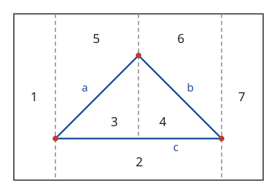

# 사다리꼴 분할

# 개요

**사다리꼴 분할(trapezoidal map)** 은 서로 만나지 않는 선분들이 놓인 평면에서, 선분의 끝점마다 위아래로 세로선을 그어 가장 가까운 선분에서 멈추게 하여 평면을 사다리꼴 조각으로 나눈 것이다. [점 위치 찾기](point-location.md)의 띠 방법은 꼭짓점마다 세로선을 평면 끝까지 그어 조각이 선분 수의 제곱만큼 생겼다. 세로선을 가장 가까운 선분에서 멈추면 조각 수가 선분 수에 비례한다.

선분을 무작위 순서로 하나씩 넣으며 사다리꼴 분할과 그 위의 탐색 구조를 함께 고치면, 기대 크기 $O(n)$ 과 기대 질의 시간 $O(\log n)$ 의 점 위치 찾기 구조가 나온다.

# 직관

점 위치 찾기 문서의 삼각형을 다시 쓴다. 꼭짓점은 $(1,1)$, $(3,3)$, $(5,1)$ 이고 왼쪽 위 변이 $a$, 오른쪽 위 변이 $b$, 밑변이 $c$ 다. 삼각형을 넉넉히 감싸는 직사각형 $R$ 안에서 본다.

끝점 $(1,1)$ 의 위아래에는 선분이 없으므로 세로선이 $R$ 의 위아래 변까지 간다. $(5,1)$ 도 같다. $(3,3)$ 에서 위로 그은 세로선은 $R$ 의 윗변까지 가고, 아래로 그은 세로선은 밑변 $c$ 의 점 $(3,1)$ 에서 멈춘다.



그림의 조각은 일곱 개다. 삼각형 안의 두 조각은 한쪽 세로변의 길이가 $0$ 인 사다리꼴, 곧 삼각형이다. 띠 방법에서 $x=3$ 의 세로선은 삼각형 아래의 영역까지 갈랐지만 여기서는 갈리지 않아 조각 $2$ 가 하나로 남는다.

# 정의

## 사다리꼴 분할

평면의 선분 $n$ 개가 끝점 말고는 만나지 않고, 서로 다른 끝점의 $x$ 좌표가 모두 다르다고 한다. 모든 선분을 포함하는 직사각형 $R$ 을 둔다.

각 끝점에서 위와 아래로 세로선을 긋고, 처음 만나는 선분이나 $R$ 의 변에서 멈춘다. 이 세로선들을 **세로 연장선(vertical extension)** 이라 한다. 선분들과 세로 연장선이 $R$ 을 나눈 조각들의 모임이 **사다리꼴 분할(trapezoidal map)** 이다.

각 조각은 위아래가 선분이나 $R$ 의 변이고 좌우가 세로선인 사다리꼴이다. 좌우 세로변의 길이가 $0$ 인 것은 삼각형이다. 직관 절의 조각 $3$ 은 위가 $a$, 아래가 $c$, 오른쪽이 $(3,3)$ 에서 내린 세로선이고 왼쪽 세로변은 점 $(1,1)$ 하나다.

## 탐색 구조

사다리꼴 분할의 **탐색 구조(search structure)** 는 두 종류의 내부 노드와 조각을 잎으로 둔 방향 비순환 그래프다.

- 끝점 노드. 끝점 $p$ 를 저장하고, 질의점이 $p$ 의 왼쪽인지 오른쪽인지로 갈린다.
- 선분 노드. 선분 $s$ 를 저장하고, 질의점이 $s$ 의 위인지 아래인지로 갈린다.

질의점은 뿌리에서 출발해 비교를 따라 내려가고, 닿은 잎이 질의점이 든 조각이다.

# 성질

## 조각의 수

선분이 $n$ 개이면 조각은 $3n+1$ 개 이하다.

증명의 요지. 각 조각의 왼쪽 세로변은 어떤 끝점에서 그은 세로선 위에 있거나 $R$ 의 왼쪽 변이다. 선분의 왼쪽 끝점은 그 선분 바로 위의 조각과 바로 아래의 조각, 많아야 두 조각의 왼쪽 세로변을 정한다. 선분의 오른쪽 끝점은 그 점의 오른쪽에 붙은 조각 하나만 정한다. 그래서 $2n+n=3n$ 이고, $R$ 의 왼쪽 변이 정하는 조각 하나를 더한다.

직관 절은 $n=3$ 이고 조각이 $7$ 개로 상한 $10$ 이하다.

## 무작위 점진 구성

선분을 무작위 순서 $s\_1,\dots,s\_n$ 으로 하나씩 넣는다. $s\_i$ 를 넣을 때, 지금의 탐색 구조로 $s\_i$ 의 왼쪽 끝점이 든 조각을 찾고, 거기서 오른쪽 이웃을 따라가며 $s\_i$ 가 가로지르는 조각들을 모두 찾는다. 그 조각들을 지우고 $s\_i$ 와 새 세로 연장선으로 생긴 조각들을 넣으며, 지운 잎 자리에 새 조각을 가르는 노드를 단다.[^1][^2]

```javascript
function buildTrapezoidalMap(segments, boundingBox) {
  const order = shuffle(segments);
  const map = new TrapezoidalMap(boundingBox); // 조각 하나, 잎 하나
  const search = new SearchDag(map.onlyTrapezoid());
  for (const s of order) {
    const first = search.locate(s.left);          // 왼쪽 끝점이 든 조각
    const crossed = map.followRight(first, s);    // s 가 가로지르는 조각들
    const created = map.split(crossed, s);        // 세로 연장선을 다시 긋는다
    search.replaceLeaves(crossed, created, s);    // 끝점 노드와 선분 노드를 단다
  }
  return { map, search };
}
```

## 기대 비용

선분 $n$ 개에서 사다리꼴 분할과 탐색 구조를 기대 $O(n\log n)$ 시간에 만들고, 탐색 구조의 기대 크기는 $O(n)$, 고정된 질의점의 기대 질의 시간은 $O(\log n)$ 이다.[^1][^2]

증명의 요지. 넣은 순서를 거꾸로 본다. 처음 $i$ 개 선분의 사다리꼴 분할에서 한 조각은 위아래 선분과 좌우 끝점으로, 많아야 선분 $4$ 개로 정해진다. $s\_i$ 는 처음 $i$ 개 가운데 고르게 뽑힌 것이므로, 한 조각이 $s\_i$ 를 넣을 때 새로 생긴 것일 확률은 $4/i$ 이하다. 조각이 $3i+1$ 개 이하이므로 $s\_i$ 가 만든 조각의 기대 수는 $4(3i+1)/i=O(1)$ 이고, 탐색 구조의 기대 크기가 $O(n)$ 이다.

질의점 $q$ 의 탐색 경로는 $q$ 가 든 조각이 바뀐 단계마다 노드가 많아야 $3$ 개 늘어난다. 단계 $i$ 에서 $q$ 의 조각이 바뀔 확률이 $4/i$ 이하이므로 경로의 기대 길이는 $\sum\_{i=1}^n12/i=O(\log n)$ 이다.

# 활용

- 점 위치 찾기. 평면 분할의 선분들로 사다리꼴 분할을 만들고, 조각마다 원래 분할의 어느 칸에 드는지 적어 두면 기대 $O(\log n)$ 시간에 질의에 답한다.
- 다각형의 삼각분할. 단순 다각형의 변들로 사다리꼴 분할을 만들면 다각형을 단조 다각형들로 나눌 수 있고, 단조 다각형은 선형 시간에 삼각형으로 나뉜다. R. Seidel 의 이 방법은 기대 $O(n\log^\ast n)$ 시간이 든다.[^2]
- 선분 교차가 있는 경우. 교차하는 선분 $n$ 개와 교점 $k$ 개의 사다리꼴 분할을 같은 무작위 점진 방법으로 기대 $O(n\log n+k)$ 시간에 만든다. 결정적인 [Bentley–Ottmann 알고리즘](bentley-ottmann.md)의 $O((n+k)\log n)$ 보다 빠르다.[^1]

[^1]: K. Mulmuley, "A fast planar partition algorithm, I", *Journal of Symbolic Computation* **10** (1990), 253–280.
[^2]: R. Seidel, "A simple and fast incremental randomized algorithm for computing trapezoidal decompositions and for triangulating polygons", *Computational Geometry: Theory and Applications* **1** (1991), 51–64.

# 연관 문서

## 선수지식

- [점 위치 찾기](point-location.md)

## 더 알아보기

아직 연결한 문서가 없다.

#algorithms #computation #data_structures
