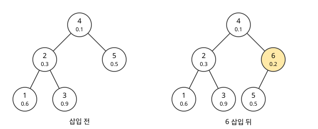

# 트립

# 개요

**트립(treap)** 은 키마다 무작위로 뽑은 우선순위를 붙여, 키로 보면 이진 탐색 트리이고 우선순위로 보면 힙인 트리를 만드는 자료구조다. 이진 탐색 트리에 $1,2,\dots,1000$ 을 차례로 넣으면 높이 $1000$ 인 한 줄이 되어 탐색이 목록을 처음부터 훑는 것과 같아진다. 트립은 우선순위가 작은 키부터 넣은 것과 같은 트리를 유지하므로, 실제로 넣는 순서와 상관없이 무작위 순서로 넣은 트리가 되어 깊이의 기댓값이 $2\ln n$ 이하다.

# 직관

키 $1,2,3$ 을 이진 탐색 트리에 넣는 순서는 여섯 가지다. $2$ 를 먼저 넣는 두 순서 $(2,1,3)$ 과 $(2,3,1)$ 은 뿌리 $2$ 아래에 $1$ 과 $3$ 이 매달린 높이 $1$ 의 트리를 만들고, 나머지 네 순서는 높이 $2$ 인 한 줄을 만든다. 순서를 무작위로 고르면 한 줄이 될 확률은 $4/6$ 이지만, 키가 많아지면 대부분의 순서에서 높이가 로그 정도다. 삽입 순서는 자료구조를 쓰는 쪽이 정하므로 이 확률을 쓸 수 없다.

그래서 키를 넣을 때 키마다 무작위 수 하나를 뽑아 두고, 그 수가 작은 키부터 넣은 것과 같은 트리를 만든다. 키 $1,2,3,4,5$ 에 수 $0.6,0.3,0.9,0.1,0.5$ 를 뽑았으면 $4,2,5,1,3$ 의 순서로 넣은 트리다. 뿌리는 수가 가장 작은 $4$ 이고, 그 왼쪽에는 $4$ 보다 작은 키 가운데 수가 가장 작은 $2$ 가 온다.

부모가 자식보다 먼저 들어가므로 이 트리에서는 부모의 수가 자식의 수보다 작다. 그러므로 새 키 $6$ 이 수 $0.2$ 를 뽑으면, 탐색 트리의 규칙대로 $5$ 의 오른쪽 자식으로 매단 뒤 부모 $5$ 의 수 $0.5$ 보다 작으므로 회전으로 $6$ 을 한 칸 올린다. 새 부모 $4$ 의 수 $0.1$ 은 $0.2$ 보다 작으므로 멈춘다.

아래 그림의 왼쪽은 $6$ 을 넣기 전, 오른쪽은 넣은 뒤의 트리다. 각 노드의 위 숫자가 키, 아래 숫자가 뽑은 수이고, 칠한 노드가 새로 넣은 $6$ 이다.



# 정의

## 트립

**트립(treap)** 은 각 노드가 키와 우선순위를 갖는 이진 트리이며, 키에 대해 [균형 이진 탐색 트리](balanced-binary-search-trees.md)의 이진 탐색 트리 조건을, 우선순위에 대해 부모의 우선순위가 자식의 우선순위보다 작다는 [이진 힙](binary-heaps.md)의 힙 조건을 만족하는 것이다. 우선순위는 키마다 독립으로, 서로 겹치지 않을 만큼 큰 범위의 정수에서 균등하게 뽑는다. 이 확률은 [유한 확률 공간](probability.md) 위의 확률이다.

Seidel 과 Aragon 이 1989 년에 제안했다[^1]. 이름은 tree 와 heap 을 합친 것이다.

예. 직관 절의 왼쪽 트리는 키 $2$ 의 왼쪽에 $1$, 오른쪽에 $3$ 이 있어 탐색 트리 조건을 만족하고, 뿌리 $4$ 의 우선순위 $0.1$ 이 자식 $2$, $5$ 의 $0.3$, $0.5$ 보다 작고 $2$ 의 $0.3$ 이 자식의 $0.6$, $0.9$ 보다 작아 힙 조건을 만족한다.

## 삽입과 삭제

**삽입** 은 새 키를 이진 탐색 트리의 규칙대로 잎에 매달고, 부모의 우선순위가 더 큰 동안 회전으로 한 칸씩 올린다. **삭제** 는 지울 노드를 두 자식 가운데 우선순위가 작은 쪽과 회전으로 자리를 바꾸며 내리고, 잎이 되면 떼어 낸다.

```typescript
interface TreapNode {
  key: number;
  priority: number;
  left: TreapNode | null;
  right: TreapNode | null;
}

function rotateRight(x: TreapNode): TreapNode {
  const y = x.left!;
  x.left = y.right;
  y.right = x;
  return y;
}

function rotateLeft(x: TreapNode): TreapNode {
  const y = x.right!;
  x.right = y.left;
  y.left = x;
  return y;
}

// 부분 트리 t 에 키 k 를 넣고 새 뿌리를 돌려준다.
function insert(t: TreapNode | null, k: number): TreapNode {
  if (t === null) {
    return { key: k, priority: Math.random(), left: null, right: null };
  }
  if (k < t.key) {
    t.left = insert(t.left, k);
    if (t.left.priority < t.priority) t = rotateRight(t);
  } else {
    t.right = insert(t.right, k);
    if (t.right.priority < t.priority) t = rotateLeft(t);
  }
  return t;
}
```

예. 직관 절에서 $6$ 은 $5$ 의 오른쪽 자식으로 들어간 뒤 $5$ 에서 `rotateLeft` 한 번으로 올라간다. 회전 뒤 $5$ 는 $6$ 의 왼쪽 자식이다.

## 분할과 병합

**분할(split)** 은 트립 하나와 키 $a$ 를 받아 $a$ 보다 작은 키의 트립과 $a$ 이상인 키의 트립 둘로 나누는 연산이다. **병합(merge)** 은 모든 키가 다른 쪽의 모든 키보다 작은 두 트립을 하나로 합치는 연산이다. 분할은 우선순위가 어느 노드보다 작은 키 $a$ 를 삽입하면 그 노드가 뿌리까지 올라오므로, 뿌리의 두 부분 트리를 떼어 얻는다. 병합은 두 트립을 우선순위가 가장 큰 가짜 뿌리 아래에 놓고 그 뿌리를 삭제해 얻는다.

예. 직관 절의 오른쪽 트리를 $a=3.5$ 로 분할하면 키 $1,2,3$ 의 트립과 키 $4,5,6$ 의 트립이 나온다.

# 성질

## 유일성

키와 우선순위가 모두 서로 다르면, 이 키와 우선순위로 된 트립은 하나뿐이고 우선순위가 작은 키부터 차례로 이진 탐색 트리에 넣은 트리와 같다.

*증명의 요지.* 힙 조건에서 뿌리는 우선순위가 가장 작은 키여야 한다. 탐색 트리 조건에서 뿌리보다 작은 키는 전부 왼쪽 부분 트리에, 큰 키는 오른쪽에 있다. 두 부분 트리에 같은 논증을 되풀이하면 모양이 하나로 정해진다. 우선순위 순서로 넣은 트리도 두 조건을 만족하므로 그 트리다.

그러므로 트립의 모양은 삽입과 삭제의 이력에 상관없이 현재의 키와 우선순위로만 정해진다. 우선순위가 독립이고 균등하면, 트립은 키를 균등한 무작위 순서로 넣은 이진 탐색 트리와 분포가 같다.

## 조상 확률

키를 작은 것부터 $x_1\lt x_2\lt\cdots\lt x_n$ 이라 하자. $i\ne j$ 일 때 $x_i$ 가 $x_j$ 의 조상인 사건을 $A_{ij}$ 라 하면 그 확률은 다음과 같다.

$$
\Pr\lbrack A_{ij}\rbrack=\frac{1}{\vert i-j\vert+1}
$$

*증명의 요지.* $x_i$ 와 $x_j$ 사이의 키 $\vert i-j\vert+1$ 개를 본다. 우선순위 순서로 넣을 때 이 가운데 처음 들어가는 키가 $x_i$ 와 $x_j$ 사이에 있으면 둘을 다른 부분 트리로 가르고, $x_i$ 자신이면 $x_j$ 가 $x_i$ 아래로 들어간다. $x_i$ 는 이 범위 밖의 키에 의해서는 $x_j$ 와 갈리지 않는다. 처음 들어가는 키는 이 $\vert i-j\vert+1$ 개 가운데 균등하게 하나다.

## 기대 깊이

노드의 깊이는 그 노드의 조상 수다. 조상 확률을 더하면 다음이 나온다.

$$
\mathbb E\lbrack\mathrm{depth}(x_k)\rbrack=\sum_{i\ne k}\frac{1}{\vert i-k\vert+1}=H_k+H_{n-k+1}-2
$$

여기서 $H_m$ 은 다음 조화수다.

$$
H_m=1+\frac12+\cdots+\frac1m
$$

$H_m\le 1+\ln m$ 이므로 깊이의 기댓값은 $2\ln n$ 이하다. 탐색, 삽입, 삭제의 기대 시간은 $O(\log n)$ 이고, 이 상한은 키의 삽입 순서와 상관없이 성립한다[^1].

## 회전 수

삽입과 삭제 한 번에 하는 회전 수의 기댓값은 $2$ 보다 작다[^1].

*증명의 요지.* 삽입은 같은 노드를 삭제하는 과정을 거꾸로 한 것이므로 삭제만 센다. $x_k$ 를 내리는 회전은 한 번마다 $x_k$ 의 왼쪽 부분 트리의 오른쪽 끝 경로나 오른쪽 부분 트리의 왼쪽 끝 경로에서 노드 하나를 위로 보낸다. 조상 확률과 같은 논증으로 두 경로의 기대 길이는 $1-1/k$ 와 $1-1/(n-k+1)$ 이다.

AVL 트리(Adelson-Velsky–Landis tree)와 red-black 트리는 삽입 한 번에 회전을 상수 번 하지만 높이나 색을 노드마다 저장한다. 트립은 우선순위 하나만 저장한다.

## quicksort 와의 대응

트립의 모양은 우선순위가 가장 작은 키를 기준으로 키를 둘로 나누고 양쪽에서 되풀이한 재귀의 모양이다. 이는 [비교 정렬](comparison-sorting.md)의 무작위 quicksort 가 기준을 고르는 재귀와 같은 분포를 갖는다. 키 $x_i$ 와 $x_j$ 가 quicksort 에서 비교되는 것은 한쪽이 다른 쪽의 조상인 것과 같으므로, 기대 비교 횟수는 모든 노드의 기대 깊이의 합 $2n\ln n+O(n)$ 이다.

# 활용

- 정렬된 사전. [스킵 리스트](skip-lists.md)처럼 노드마다 높이나 색을 저장하지 않고 탐색, 삽입, 삭제를 기대 $O(\log n)$ 에 한다. 노드마다 부분 트리의 크기를 저장하면 순서 통계 질의도 같은 시간이다.
- 집합 연산. 분할과 병합을 재귀로 쓰면 크기 $m\le n$ 인 두 트립의 합집합, 교집합, 차집합을 기대 $O(m\log(n/m+1))$ 시간에 구한다[^2].
- 수열 자료구조. 키를 저장하지 않고 부분 트리의 크기로 위치를 셈하면, 수열의 구간을 잘라 붙이기와 구간 뒤집기를 분할과 병합으로 기대 $O(\log n)$ 에 한다.

[^1]: R. Seidel, C. R. Aragon, "Randomized search trees", Algorithmica 16 (1996), 464–497.
[^2]: G. E. Blelloch, M. Reid-Miller, "Fast set operations using treaps", Proceedings of the 10th ACM Symposium on Parallel Algorithms and Architectures (1998), 16–26.

# 연관 문서

## 선수지식

- [균형 이진 탐색 트리](balanced-binary-search-trees.md)
- [이진 힙](binary-heaps.md)
- [유한 확률 공간](probability.md)

## 더 알아보기

아직 연결한 문서가 없다.

#data_structures #algorithms #probability
