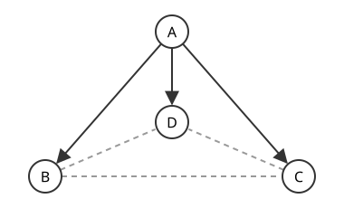
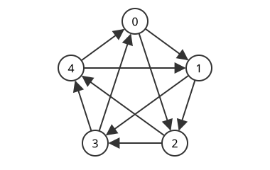

# Tutte 3 흐름 추측

# 개요

**Tutte 3 흐름 추측(Tutte's 3-flow conjecture)** 은 간선을 어느 셋을 지워도 갈라지지 않는 그래프는 모두 값이 $\pm 1$, $\pm 2$ 인 [nowhere-zero 흐름](nowhere-zero-flows.md)을 가진다는 추측이다. 간선마다 방향을 주어 모든 정점에서 들어오는 간선 수와 나가는 간선 수의 차가 $3$ 의 배수가 되게 하는 문제와 같다. 정점마다 간선이 셋인 완전 그래프 $K_4$ 에서는 정점마다 간선이 모두 들어오거나 모두 나가야 해서 삼각형 하나가 막히고, 이런 방향이 없다.

추측은 간선 연결이 충분히 단단하면 이런 막힘이 생기지 않는다고 말한다. [평면 그래프](planar-graphs.md)에서는 참이고, 간선을 어느 다섯을 지워도 갈라지지 않는 그래프에서는 증명되었다.

# 직관

아래 그림은 삼각형 $ABC$ 안에 정점 $D$ 를 두고 세 꼭짓점과 이은 $K_4$ 다. 정점마다 간선이 셋이므로, 들어오는 간선 수와 나가는 간선 수의 차는 $3, 1, -1, -3$ 가운데 하나다. 이 차가 $3$ 의 배수이려면 셋이 모두 들어오거나 모두 나가야 한다.

$A$ 의 간선을 모두 나가게 두면 $B$, $C$, $D$ 는 $A$ 에서 들어오는 간선이 있으므로 셋 다 간선이 모두 들어오는 정점이어야 한다. 그림의 점선 $BD$ 는 $B$ 와 $D$ 가 둘 다 받아야 하므로 방향을 정할 수 없다.

정점마다 간선이 넷인 완전 그래프 $K_5$ 에서는 같은 계산이 막히지 않는다. 아래 그림처럼 바깥 오각형을 한 방향으로 돌고 안쪽 별 모양도 한 방향으로 돌면, 정점마다 두 간선이 들어오고 두 간선이 나가서 차가 $0$ 이다.

$K_4$ 에서는 정점 $A$ 하나를 지나는 간선 셋을 지우면 $A$ 가 떨어져 나간다. $K_5$ 는 간선을 어느 셋을 지워도 갈라지지 않는다. 추측은 이 차이가 방향의 존재를 가른다고 말한다.

# 정의

## 간선 연결도

연결 그래프 $G$ 에서 간선을 어느 $k-1$ 개를 지워도 연결이 유지되면 $G$ 를 **$k$ 간선 연결(k-edge-connected)** 이라 한다. 그런 $k$ 의 최댓값이 **간선 연결도(edge connectivity)** 다. 직관 절의 $K_4$ 는 간선 연결도가 $3$ 이고 $K_5$ 는 $4$ 다.

## 모듈러 3 방향

그래프 $G$ 의 간선마다 방향을 정한 것을 $G$ 의 방향이라 한다. 정점 $v$ 로 들어오는 간선 수를 $d^-(v)$, 나가는 간선 수를 $d^+(v)$ 라 할 때, 모든 정점에서 다음이 성립하는 방향을 **모듈러 3 방향(mod 3-orientation)** 이라 한다.

$$
d^{+}(v)\equiv d^{-}(v)\pmod 3
$$

직관 절의 $K_5$ 의 방향은 모든 정점에서 $d^+(v)=d^-(v)=2$ 이므로 모듈러 3 방향이다.

## 추측

Tutte 3 흐름 추측은 다음이다.

> $4$ 간선 연결인 그래프는 모두 nowhere-zero $3$ 흐름을 가진다.

다음 절의 동치에 따라 이것은 $4$ 간선 연결인 그래프가 모두 모듈러 3 방향을 가진다는 진술과 같다.

# 성질

## 3 흐름과 모듈러 3 방향

$G$ 가 nowhere-zero $3$ 흐름을 가지는 것은 모듈러 3 방향을 가지는 것과 동치다.

증명의 요지. Tutte 의 정리에 따라 nowhere-zero $3$ 흐름의 존재는 nowhere-zero $\mathbb Z\_3$ 흐름의 존재와 동치다. $\mathbb Z\_3$ 에서 $0$ 이 아닌 값은 $1$ 과 $2=-1$ 이므로, 값이 $2$ 인 간선의 방향을 뒤집으면 모든 값이 $1$ 이 된다. 모든 값이 $1$ 일 때 흐름 보존은 $d^-(v)\equiv d^+(v)\pmod 3$ 이다. ∎

## 차수가 모두 짝수인 그래프

모든 정점의 차수가 짝수인 그래프는 모듈러 3 방향을 가진다. 연결 성분마다 [Euler 회로](eulerian-circuits.md)를 따라 간선의 방향을 정하면 모든 정점에서 $d^+(v)=d^-(v)$ 이다. 직관 절의 $K_5$ 의 방향이 이 꼴이다. 그래서 추측의 내용은 차수가 홀수인 정점이 있는 그래프에 있다.

## 3 정칙 그래프

모든 정점의 차수가 $3$ 인 그래프가 nowhere-zero $3$ 흐름을 가지는 것은 이분 그래프(bipartite graph)인 것과 동치다.

증명의 요지. 차수가 $3$ 이면 $d^+(v)-d^-(v)\in\lbrace 3,1,-1,-3\rbrace$ 이므로 모듈러 3 방향에서 정점마다 간선이 모두 나가거나 모두 들어온다. 간선은 모두 나가는 정점에서 모두 들어오는 정점으로 가므로 두 종류가 이분 그래프의 두 쪽이다. 거꾸로 이분 그래프는 모든 간선을 한쪽에서 다른 쪽으로 향하게 두면 된다. ∎

$K_4$ 와 [Petersen 그래프](petersen-graph.md)는 $3$ 간선 연결이고 홀수 순환이 있어 nowhere-zero $3$ 흐름이 없다. 추측의 가정을 $3$ 간선 연결로 줄일 수 없다.

## 평면 그래프

$4$ 간선 연결인 평면 그래프는 nowhere-zero $3$ 흐름을 가진다.

증명의 요지. 평면 그래프 $G$ 의 쌍대 그래프 $G^\ast$ 에서 순환은 $G$ 의 간선 절단과 대응한다. $G$ 가 $4$ 간선 연결이면 크기가 $3$ 이하인 절단이 없으므로 $G^\ast$ 에는 길이가 $3$ 이하인 순환이 없다. [Grötzsch 정리](grotzsch-theorem.md)에 따라 $G^\ast$ 의 정점을 세 색으로 칠할 수 있고, 이것은 $G$ 의 면 3 색칠이다. 면 색칠과 흐름의 쌍대성에서 $G$ 는 nowhere-zero $3$ 흐름을 가진다. ∎

## 큰 간선 연결도

Thomassen 은 $8$ 간선 연결인 그래프가 모두 nowhere-zero $3$ 흐름을 가진다는 것을 증명했다[^1]. Lovász, Thomassen, Wu, Zhang 은 이것을 $6$ 간선 연결로 줄였다[^2].

두 증명은 더 강한 진술을 귀납한다. 정점마다 $\mathbb Z\_3$ 의 값 $\beta(v)$ 를 합이 $0$ 이 되게 미리 정하고, 다음을 만족하는 방향이 있다고 증명한다.

$$
d^{+}(v)-d^{-}(v)\equiv\beta(v)\pmod 3\quad(\forall v\in V)
$$

$\beta=0$ 이 모듈러 3 방향이다. 간선을 축약하거나 정점을 쪼개 그래프를 줄일 때 경계의 값이 바뀌므로, 귀납 가정에 임의의 $\beta$ 를 허용해야 귀납이 닫힌다.

## Kochol 의 동치

Tutte 3 흐름 추측은 $5$ 간선 연결인 그래프가 모두 nowhere-zero $3$ 흐름을 가진다는 진술과 동치다[^3]. Lovász, Thomassen, Wu, Zhang 의 논문은 $4$ 와 $5$ 간선 연결의 경우가 증명되지 않았다고 적는다[^2].

# 활용

- 평면 그래프의 색칠. 면 색칠과의 쌍대성으로 추측의 평면 경우가 Grötzsch 정리와 같은 내용이 된다. 추측은 Grötzsch 정리를 평면에 그릴 수 없는 그래프로 옮긴 꼴이다.
- 모듈러 $k$ 방향. $d^+(v)\equiv d^-(v)\pmod{2k+1}$ 인 방향을 모듈러 $(2k+1)$ 방향이라 한다. Lovász, Thomassen, Wu, Zhang 은 $6k$ 간선 연결인 그래프가 모듈러 $(2k+1)$ 방향을 가진다는 것을 증명했다[^2]. Jaeger 는 $4k$ 간선 연결로 충분하다고 추측했고, $k\ge 3$ 에서는 반례가 나왔다[^4].
- 원형 흐름(circular flow). 모듈러 $(2k+1)$ 방향은 흐름 값이 $1$ 이상 $1+1/k$ 이하의 실수인 흐름과 대응한다. 이 대응으로 위 결과는 $6k$ 간선 연결인 그래프의 원형 흐름수(circular flow number)가 $2+1/k$ 이하라는 진술이 된다.

[^1]: C. Thomassen, "The weak 3-flow conjecture and the weak circular flow conjecture", *Journal of Combinatorial Theory, Series B* 102 (2012), 521–529.
[^2]: L. M. Lovász, C. Thomassen, Y. Wu, C.-Q. Zhang, "Nowhere-zero 3-flows and modulo k-orientations", *Journal of Combinatorial Theory, Series B* 103 (2013), 587–598.
[^3]: M. Kochol, "An equivalent version of the 3-flow conjecture", *Journal of Combinatorial Theory, Series B* 83 (2001), 258–261.
[^4]: M. Han, J. Li, Y. Wu, C.-Q. Zhang, "Counterexamples to Jaeger's circular flow conjecture", *Journal of Combinatorial Theory, Series B* 131 (2018), 1–11.

# 연관 문서

## 선수지식

- [Nowhere-zero 흐름](nowhere-zero-flows.md)

## 더 알아보기

아직 연결한 문서가 없다.

#graph_theory #combinatorics
