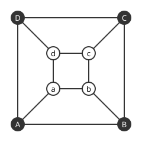

# Tutte 그리기

# 개요

**Tutte 그리기(Tutte embedding)** 는 3-연결 [평면 그래프](planar-graphs.md)의 한 면을 볼록 다각형으로 고정하고, 나머지 정점을 모두 이웃 정점 위치의 평균에 놓아 얻는 직선 그림이다. 정육면체의 꼭짓점과 모서리를 종이에 옮길 때 모서리를 곧은 선분으로 그리면서 서로 엇갈리지 않게 하려면 정점 여덟 개의 좌표를 정해야 한다. Tutte 그리기는 그 좌표를 연립일차방정식 하나의 해로 정하고, 그 해가 언제나 엇갈림 없는 그림이 된다는 것이 Tutte 의 정리다.

# 직관

정육면체 그래프의 바깥 네 정점 $A,B,C,D$ 를 정사각형의 꼭짓점 $(0,0),(4,0),(4,4),(0,4)$ 에 못 박는다. 안쪽 정점 $a,b,c,d$ 는 각각 같은 글자의 바깥 정점 하나와 안쪽 정점 둘에 이어져 있다. 모서리마다 같은 세기의 용수철을 달고 놓으면, 못 박지 않은 정점은 당기는 힘의 합이 $0$ 인 자리, 곧 이웃 셋의 위치를 평균한 자리에서 멈춘다.

네 정점의 자리는 대칭이므로 $a=(t,t)$, $b=(4-t,t)$, $d=(t,4-t)$ 로 둘 수 있다. $a$ 의 이웃은 $A$, $b$, $d$ 이고, $x$ 좌표의 평균 조건은 다음과 같다.

$$
t=\frac{0+(4-t)+t}{3}=\frac43
$$

$y$ 좌표도 같은 식이다. 안쪽 정점은 $4/3$ 과 $8/3$ 을 좌표로 하는 작은 정사각형에 놓인다. 아래 그림에서 보듯 모서리 열두 개가 서로 엇갈리지 않고, 다섯 면이 모두 볼록 사각형이다.

# 정의

$G=(V,E)$ 를 3-연결 평면 그래프라 하고, $F$ 를 $G$ 의 어느 평면 그림에서 한 면의 경계를 이루는 순환이라 한다. 3-연결은 [Steinitz 정리](steinitz-theorem.md)의 정의대로 어느 두 정점을 지워도 연결이 남는 것이다.

$F$ 의 정점을 순환 순서대로 볼록 다각형의 꼭짓점 $q\_v\in\mathbb R^2$ 에 놓는다. 나머지 정점 $v$ 의 위치 $p\_v$ 는 다음 식으로 정한다.

$$
p_v=\frac{1}{\deg v}\sum_{u\sim v}p_u
$$

$u\sim v$ 는 $u$ 와 $v$ 가 이웃이라는 뜻이고, $F$ 위의 이웃은 $p\_u=q\_u$ 다. 이 해로 정점을 놓고 모서리를 선분으로 그린 것을 **Tutte 그리기** 라 한다. 직관 절의 그림이 $F=ABCD$ 인 정육면체 그래프의 Tutte 그리기다.

고정하지 않은 정점 $v$ 와 그 이웃 $u$ 마다 양의 가중치 $\lambda\_{vu}\gt 0$ 을 주고, 평균 대신 가중 평균을 쓴 것을 가중 Tutte 그리기라 한다. $\lambda\_{vu}$ 와 $\lambda\_{uv}$ 는 달라도 된다.

$$
p_v=\frac{\sum_{u\sim v}\lambda_{vu}p_u}{\sum_{u\sim v}\lambda_{vu}}
$$

# 성질

## 연립방정식과 에너지

가중치가 없는 경우 [그래프 Laplacian](graph-laplacian.md) $L$ 의 행과 열을 $F$ 밖의 정점 $I$ 와 $F$ 위의 정점 $B$ 로 나누면, 정의의 식은 다음 연립방정식이다. $P\_I$ 와 $P\_B$ 는 위치를 행으로 쌓은 행렬이다.

$$
L_{II}P_I=-L_{IB}P_B
$$

이 해는 모서리 길이 제곱의 합 $\sum\_{uv\in E}\Vert p\_u-p\_v\Vert^2$ 를 $F$ 의 위치를 고정한 채 최소화한 점이다. $G$ 가 연결이고 $B$ 가 비어 있지 않으면 $L\_{II}$ 는 양의 정부호이므로 해가 하나뿐이다. 계수 행렬이 희소한 양의 정부호 행렬이어서 [켤레기울기법](conjugate-gradient.md)으로 푼다.

## 엇갈림 없음과 면의 볼록성

정리(Tutte, 1963). $G$ 가 3-연결 평면 그래프이고 $F$ 가 면의 경계 순환이면, Tutte 그리기에서 어느 두 모서리도 끝점 밖에서 만나지 않고 $F$ 를 뺀 모든 면이 볼록 다각형이다[^1]. $G$ 의 안쪽 면이 모두 삼각형이면 가중 Tutte 그리기에서도 같다[^2].

증명의 요지. 고정하지 않은 정점은 이웃들의 볼록 껍질 안에 있다. 그래서 어느 직선을 잡아도, 그 직선보다 한쪽에 있는 이웃을 가진 정점은 반대쪽에 있는 이웃도 가지거나 모든 이웃이 직선 위에 있다. 3-연결성을 쓰면 직선 한쪽의 정점들이 그쪽에 있는 $F$ 의 정점까지 이어지는 경로를 가지므로, 어느 정점도 이웃들과 한 직선 위로 무너지지 않는다. 이로부터 각 정점 둘레의 면들이 각을 겹치지 않고 나누어 가지며, 면이 볼록하고 서로 겹치지 않는다.

## 2-연결 그래프의 반례

$G$ 가 2-연결이기만 하면 결론이 깨진다. 두 정점 $x,y$ 를 지우면 떨어져 나가는 조각이 $F$ 와 만나지 않으면, 그 조각의 정점은 모두 $x$ 와 $y$ 를 잇는 선분 위에 놓인다. 예를 들어 $x$ 와 $y$ 에만 이어진 정점 둘은 둘 다 $(p\_x+p\_y)/2$ 에 놓여 한 점으로 겹친다.

## 볼록 그림의 가중치 표현

안쪽 면이 모두 삼각형인 그래프에서 $F$ 를 볼록 다각형으로 고정한 엇갈림 없는 직선 그림이 있고 내부 정점이 모두 이웃들의 볼록 껍질의 내부에 있으면, 그 그림은 어떤 양의 가중치의 가중 Tutte 그리기다[^2]. 내부 정점의 위치를 이웃 위치의 볼록 결합으로 적는 계수가 가중치다.

# 활용

- 그래프 그리기. 평면 그래프를 엇갈림 없는 직선 그림으로 그리는 방법이다. 연립방정식 하나를 풀면 되므로 정점이 많은 그래프에도 쓴다.
- 곡면 삼각망의 매개화. 원판과 위상이 같은 삼각망의 경계를 볼록 다각형에 고정하고 가중 Tutte 그리기를 구하면, 삼각형이 뒤집히지 않는 평면 좌표가 나온다. 3 차원 모형에 그림을 입히는 텍스처 좌표를 이렇게 만든다[^2].
- Steinitz 정리의 증명. 가중치를 잘 고른 Tutte 그리기를 Maxwell–Cremona 들어올림(Maxwell–Cremona lifting)으로 3 차원으로 올리면 그 그래프를 가진 볼록 다면체가 나온다[^3].

[^1]: W. T. Tutte, "How to draw a graph", *Proceedings of the London Mathematical Society* (3) **13** (1963), 743–767.
[^2]: M. S. Floater, "Parametrization and smooth approximation of surface triangulations", *Computer Aided Geometric Design* **14** (1997), 231–250.
[^3]: J. Richter-Gebert, *Realization Spaces of Polytopes*, Lecture Notes in Mathematics 1643, Springer, 1996.

# 연관 문서

## 선수지식

- [Steinitz 정리](steinitz-theorem.md)
- [그래프 Laplacian](graph-laplacian.md)

## 더 알아보기

아직 연결한 문서가 없다.

#graph_theory #linear_algebra #combinatorics
