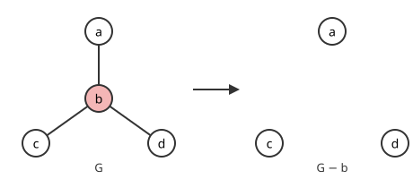

# Tutte 정리

# 개요

**Tutte 정리(Tutte's theorem)** 는 그래프의 정점을 빠짐없이 둘씩 짝지을 수 있는지를, 정점 몇 개를 지운 뒤 남는 홀수 크기 조각의 수로 판정하는 정리다. 정점 넷인 별에서 가운데 정점을 지우면 잎 셋이 서로 떨어진 조각 셋으로 남고, 세 잎은 모두 가운데 정점 하나와만 짝지어질 수 있으므로 완전 매칭이 없다. Tutte 정리는 이런 막힘이 완전 매칭이 없는 유일한 이유임을 보여, 완전 매칭이 없다는 것을 정점 집합 하나로 확인할 수 있게 한다.

# 직관

[매칭](matchings.md) 문서의 Hall 결혼 정리(Hall's marriage theorem)는 이분 그래프에서 한쪽 정점 집합의 이웃이 그 집합보다 작으면 완전 매칭이 없다는 막힘이 유일한 막힘이라는 정리다. 일반 그래프에서는 이 막힘만으로는 부족하다. 삼각형은 정점 하나하나가 이웃을 둘씩 가지지만 정점이 셋이라 완전 매칭이 없다.

아래 그림 왼쪽은 가운데 정점 $b$ 에 잎 $a,c,d$ 가 붙은 별이다. 오른쪽은 $b$ 를 지운 그래프이고, 세 잎이 서로 떨어진 조각 셋으로 남는다.

완전 매칭이 있다면 각 잎은 $b$ 와 짝지어져야 한다. 잎은 셋인데 $b$ 는 하나이므로 완전 매칭이 없다. 조각의 크기가 홀수이면 그 조각 안에서 짝을 다 지을 수 없어 적어도 한 정점이 지운 정점과 짝지어져야 하고, 지운 정점 하나는 한 조각만 맡는다. 삼각형에서는 아무것도 지우지 않은 그래프 자체가 홀수 크기 조각 하나다.

# 정의

## 홀수 성분

그래프 $H$ 의 연결 성분 가운데 정점 수가 홀수인 것의 개수를 $o(H)$ 로 적는다. 그래프 $G=(V,E)$ 와 $S\subseteq V$ 에 대해 $G-S$ 는 $S$ 의 정점과 거기 붙은 간선을 지운 그래프다. 직관 절의 별에서 $S=\lbrace b\rbrace$ 이면 $o(G-S)=3$ 이고, 삼각형에서 $S=\varnothing$ 이면 $o(G)=1$ 이다.

## Tutte 조건

모든 $S\subseteq V$ 에 대해 $o(G-S)\le\vert S\vert$ 이면 $G$ 가 **Tutte 조건(Tutte's condition)** 을 만족한다고 한다. 별은 $S=\lbrace b\rbrace$ 에서 $3\gt 1$ 이라 Tutte 조건을 어기고, 길이 $4$ 인 순환은 $S$ 를 어떻게 잡아도 $o(G-S)\le\vert S\vert$ 라 Tutte 조건을 만족한다.

# 성질

## Tutte 정리

그래프 $G$ 가 완전 매칭을 가지는 것은 $G$ 가 Tutte 조건을 만족하는 것과 동치다[^1].

필요성. 완전 매칭 $M$ 이 있으면 $G-S$ 의 홀수 성분마다 적어도 한 정점이 $M$ 에서 $S$ 의 정점과 짝지어진다. 서로 다른 성분은 서로 다른 $S$ 의 정점을 쓰므로 $o(G-S)\le\vert S\vert$ 다.

충분성의 요지. Tutte 조건을 만족하지만 완전 매칭이 없는 그래프가 있다고 하고, 완전 매칭이 생기지 않는 한 간선을 더해 극대인 $G^\ast$ 를 얻는다. 간선을 더해도 $o(G-S)$ 는 늘지 않으므로 $G^\ast$ 도 Tutte 조건을 만족한다. 다른 모든 정점과 이웃한 정점의 집합을 $U$ 라 할 때, $G^\ast-U$ 의 성분이 모두 완전 그래프이면 홀수 성분마다 한 정점을 $U$ 와 짝짓고 나머지를 성분과 $U$ 안에서 짝지어 완전 매칭을 만들 수 있다. 완전 그래프가 아닌 성분이 있으면, 그 성분에서 고른 두 비인접 정점과 극대성에서 오는 두 완전 매칭의 대칭차로 $G^\ast$ 의 완전 매칭을 만든다[^2]. 어느 쪽이든 모순이다.

## Tutte–Berge 공식

최대 매칭의 크기 $\nu(G)$ 는 다음과 같다[^3].

$$
\nu(G)=\frac12\Big(\vert V\vert-\max_{S\subseteq V}\big(o(G-S)-\vert S\vert\big)\Big)
$$

증명의 요지. 우변의 최댓값을 $d$ 라 하면, $S$ 마다 홀수 성분 $o(G-S)-\vert S\vert$ 개는 짝이 없는 정점을 하나씩 남기므로 $\nu(G)\le(\vert V\vert-d)/2$ 다. 반대로 모든 정점과 이웃한 새 정점 $d$ 개를 더한 그래프는 Tutte 조건을 만족하므로 완전 매칭이 있고, 새 정점을 지우면 크기 $(\vert V\vert-d)/2$ 인 매칭이 남는다. 직관 절의 별에서는 $d=2$ 이고 $\nu=(4-2)/2=1$ 이다.

## Petersen 정리

다리가 없는 3-정규 그래프는 완전 매칭을 가진다. 이것이 Petersen 정리(Petersen's theorem)다.

증명의 요지. $G-S$ 의 홀수 성분 $C$ 에서 정점 차수의 합 $3\vert C\vert$ 는 홀수이고 $C$ 안의 간선은 그 합에 $2$ 씩 기여하므로, $C$ 에서 $S$ 로 가는 간선은 홀수 개다. 다리가 없으므로 그 수는 $1$ 이 아니어서 $3$ 이상이다. $S$ 에서 나가는 간선은 $3\vert S\vert$ 개 이하이므로 $3\thinspace o(G-S)\le 3\vert S\vert$ 이고 Tutte 조건이 성립한다.

# 활용

- [Gallai–Edmonds 분해](gallai-edmonds-decomposition.md). Tutte–Berge 공식의 최댓값을 주는 집합 $S$ 를 그래프마다 하나로 정하고, 최대 매칭이 덮지 않을 수 있는 정점의 구조를 준다.
- [매칭 다면체](matching-polytope.md). 홀수 크기 정점 집합마다 그 안의 간선이 크기의 절반을 넘지 못한다는 Edmonds 의 부등식은, 홀수 조각이 짝을 다 짓지 못한다는 Tutte 조건과 같은 관찰에서 나온다.
- [그래프 강인성](graph-toughness.md). 정점을 지웠을 때 남는 성분의 수 전체를 지운 정점 수로 묶는 조건이고, Tutte 조건을 확인하는 데 쓴다.
- 최대 매칭 알고리즘의 검증. Edmonds 의 blossom 알고리즘(blossom algorithm)은 최대 매칭과 함께 Tutte–Berge 공식의 등호를 이루는 $S$ 를 내므로, 결과가 최대임을 $S$ 하나로 확인한다.

[^1]: W. T. Tutte, The factorization of linear graphs, *Journal of the London Mathematical Society* 22 (1947), 107–111.
[^2]: L. Lovász, M. D. Plummer, *Matching Theory*, North-Holland (1986), 3 장.
[^3]: C. Berge, Sur le couplage maximum d'un graphe, *Comptes Rendus de l'Académie des Sciences Paris* 247 (1958), 258–259.

# 연관 문서

## 선수지식

- [매칭](matchings.md)

## 더 알아보기

- [Gallai–Edmonds 분해](gallai-edmonds-decomposition.md)

#graph_theory #combinatorics
