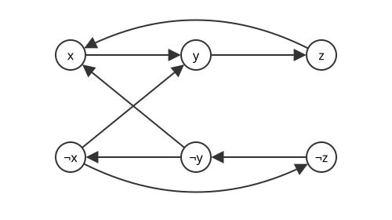

# 2SAT

# 개요

**2SAT(2-satisfiability)** 는 "둘 가운데 적어도 하나는 참" 꼴의 조건 여러 개를 동시에 만족하는 참거짓 배정이 있는지 묻는 문제다. 지도에 도시 이름표를 붙일 때 도시마다 이름표를 점의 위나 아래 가운데 한 곳에 두어야 하고, 이웃한 두 도시의 이름표가 겹치는 배치를 피해야 하는 문제가 이 꼴이다. 조건 하나를 "이것이 거짓이면 저것은 참" 이라는 화살표 두 개로 바꾸면, 배정이 있는지는 그 화살표들로 된 그래프에서 서로 오가는 묶음을 찾는 계산으로 선형 시간에 판정된다.

# 직관

변수 $x,y,z$ 에 다음 네 조건이 걸려 있다.

$$
(x\lor y)\land(\lnot x\lor y)\land(\lnot y\lor z)\land(x\lor\lnot z)
$$

$x$ 를 거짓으로 두면 첫 조건 때문에 $y$ 가 참이어야 하고, 셋째 조건 때문에 $z$ 가 참이어야 하고, 넷째 조건 때문에 $x$ 가 참이어야 한다. 처음의 선택과 어긋나므로 $x$ 는 참이어야 한다. 그러면 둘째 조건으로 $y$ 가, 셋째 조건으로 $z$ 가 참이고, $x=y=z=$ 참은 네 조건을 모두 만족한다.

이 계산은 조건 $a\lor b$ 를 " $a$ 가 거짓이면 $b$ 가 참" 과 " $b$ 가 거짓이면 $a$ 가 참" 으로 읽어 강제되는 값을 따라간 것이다. 이 읽기를 화살표로 그리면 아래 그림이 된다. 위 줄은 변수가 참인 경우, 아래 줄은 거짓인 경우다.

그림에서 $\lnot x$ 에서 출발해 $y$, $z$ 를 거쳐 $x$ 로 가는 경로가 앞 문단의 계산이다. $x$ 에서 $\lnot x$ 로 가는 경로는 없으므로 $x$ 를 참으로 두는 쪽은 막히지 않는다.

# 정의

## 2CNF 와 2SAT

[Cook–Levin 정리](np-completeness.md) 문서의 연언 표준형(conjunctive normal form, CNF) 논리식 가운데 각 절의 리터럴이 많아야 둘인 것을 2CNF 라 한다. 충족 가능한 2CNF 논리식 전체의 집합이 **2SAT** 다. 리터럴이 하나인 절 $a$ 는 $a\lor a$ 로 적는다.

직관 절의 네 절 논리식은 2CNF 이고 $x=y=z=$ 참이 충족 배정이므로 2SAT 에 속한다.

## 함의 그래프

2CNF 논리식 $\varphi$ 의 **함의 그래프(implication graph)** 는 변수마다 정점 $x$ 와 $\lnot x$ 를 두고, 절 $a\lor b$ 마다 간선 $\lnot a\to b$ 와 $\lnot b\to a$ 를 두는 방향 그래프다. $\lnot\lnot x$ 는 $x$ 로 적는다.

직관 절 그림이 그 논리식의 함의 그래프다. 절 $x\lor y$ 는 $\lnot x\to y$ 와 $\lnot y\to x$ 를, 절 $x\lor\lnot z$ 는 $\lnot x\to\lnot z$ 와 $z\to x$ 를 준다.

# 성질

## 대칭성

같은 절이 두 간선을 함께 주므로, 함의 그래프에 간선 $a\to b$ 가 있는 것과 간선 $\lnot b\to\lnot a$ 가 있는 것은 동치다. 그래서 경로 $a\to\cdots\to b$ 가 있으면 경로 $\lnot b\to\cdots\to\lnot a$ 도 있고, $a$ 와 $b$ 가 같은 [강연결성분](strongly-connected-components.md)에 있으면 $\lnot a$ 와 $\lnot b$ 도 같은 강연결성분에 있다.

## 충족 가능성 판정

정리. 2CNF 논리식 $\varphi$ 가 충족 가능한 것은 어떤 변수 $x$ 도 $\lnot x$ 와 같은 강연결성분에 있지 않은 것과 동치다[^1].

증명의 요지. 간선 $a\to b$ 는 " $a$ 가 참이면 $b$ 가 참" 이므로 충족 배정에서 경로를 따라 참이 전해진다. $x$ 와 $\lnot x$ 가 같은 성분이면 $x$ 를 참으로 두어도 거짓으로 두어도 $x$ 와 $\lnot x$ 가 함께 참이 되어 모순이다.

역으로 응축의 위상정렬에서 성분 $C$ 의 순번을 $\tau(C)$ 라 하고, 리터럴 $a$ 의 성분이 $\lnot a$ 의 성분보다 뒤에 오면 $a$ 를 참으로 둔다. 같은 성분인 변수가 없으므로 모든 변수에 값이 정해진다. 절 $a\lor b$ 의 두 리터럴이 모두 거짓이면 $\tau(a)\lt\tau(\lnot a)$ 이고 $\tau(b)\lt\tau(\lnot b)$ 다. 간선 $\lnot a\to b$ 와 $\lnot b\to a$ 로 $\tau(\lnot a)\le\tau(b)$ 와 $\tau(\lnot b)\le\tau(a)$ 가 성립하므로 다음 모순이 나온다.

$$
\tau(a)\lt\tau(\lnot a)\le\tau(b)\lt\tau(\lnot b)\le\tau(a)
$$

직관 절의 그래프에서 강연결성분은 $\lbrace x,y,z\rbrace$ 와 $\lbrace\lnot x,\lnot y,\lnot z\rbrace$ 이고 간선 $\lnot x\to y$ 때문에 뒤의 것이 앞에 온다. 그래서 $x,y,z$ 가 모두 참이 되어 직관 절의 답과 같다. 여기에 절 $\lnot x\lor\lnot y$ 를 더하면 간선 $x\to\lnot y$ 와 $y\to\lnot x$ 가 생겨 여섯 정점이 한 성분이 되고, 논리식은 충족 불가능하다.

## 계산 시간

함의 그래프는 변수 $n$ 개와 절 $m$ 개에 대해 정점 $2n$ 개와 간선 $2m$ 개이고, 강연결성분은 Tarjan 알고리즘으로 $O(n+m)$ 시간에 구한다. Tarjan 알고리즘이 성분을 내놓는 순서는 위상정렬의 역순이므로, 각 변수에 대해 $x$ 의 성분이 먼저 나왔으면 $x$ 를 참으로 둔다. 판정과 배정 모두 $O(n+m)$ 시간이다[^1].

## 복잡도 클래스

2SAT 는 [공간 복잡도](space-complexity.md)의 클래스 NL(nondeterministic logarithmic space)에 대해 완전하다. 충족 불가능성은 $x$ 에서 $\lnot x$ 로, $\lnot x$ 에서 $x$ 로 가는 경로를 추측하는 로그 공간 비결정 기계로 판정되고, Immerman–Szelepcsényi 정리(Immerman–Szelepcsényi theorem)로 NL 이 여집합에 대해 닫혀 있으므로 2SAT 도 NL 에 속한다.

절마다 리터럴이 셋이면 3SAT 이 되고 NP(nondeterministic polynomial time)-완전이다. 2SAT 에서도 만족하는 절의 수를 최대화하는 MAX-2SAT 은 NP-난해이고[^2], 충족 배정의 수를 세는 문제는 [셈 복잡도](counting-complexity.md)의 클래스 #P 에 대해 완전하다[^3].

# 활용

- 지도 이름표 배치. 도시마다 이름표를 둘 수 있는 자리가 두 곳이면 변수 하나로 자리를 정하고, 겹치는 두 자리마다 "둘이 함께 쓰이지 않는다" 를 절 $\lnot a\lor\lnot b$ 로 적는다.
- 그래프의 2 색칠. 간선 $uv$ 마다 절 $x\_u\lor x\_v$ 와 $\lnot x\_u\lor\lnot x\_v$ 를 두면 충족 배정이 이분 그래프의 두 쪽 나눔이다.
- 두 선택지 일정. 회의마다 시간이 두 후보 가운데 하나이고 충돌하는 쌍을 금지하는 일정 문제가 같은 꼴이다.
- 충족 가능성 풀이기. 충족가능성 문제(satisfiability problem, SAT)의 풀이기는 탐색 중에 2CNF 부분을 함의 그래프로 처리해 강제되는 값을 한꺼번에 정한다.

[^1]: B. Aspvall, M. F. Plass, R. E. Tarjan, "A linear-time algorithm for testing the truth of certain quantified boolean formulas", Information Processing Letters 8 (1979), 121–123.
[^2]: M. R. Garey, D. S. Johnson, L. Stockmeyer, "Some simplified NP-complete graph problems", Theoretical Computer Science 1 (1976), 237–267.
[^3]: L. G. Valiant, "The complexity of enumeration and reliability problems", SIAM Journal on Computing 8 (1979), 410–421.

# 연관 문서

## 선수지식

- [강연결성분](strongly-connected-components.md)
- [NP-완전성과 Cook–Levin 정리](np-completeness.md)

## 더 알아보기

아직 연결한 문서가 없다.

#computation #algorithms #graph_theory #logic
