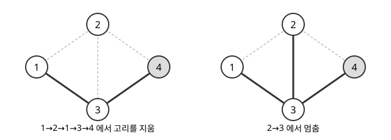

# 균등 신장트리

# 개요

**균등 신장트리(uniform spanning tree)** 는 그래프의 신장트리 전체에서 하나를 모두 같은 확률로 골라 얻은 무작위 신장트리다. 정점 네 개, 간선 다섯 개인 마름모 그래프에는 신장트리가 여덟 개 있어 하나씩 늘어놓고 제비를 뽑으면 되지만, 정점이 천 개인 격자에서는 신장트리의 수가 수백 자리라 늘어놓을 수 없다. Wilson 알고리즘은 무작위 걷기를 몇 번 하고 그 경로의 고리를 지우는 것만으로 이 분포에서 신장트리 하나를 뽑는다.

# 직관

[행렬-트리 정리](matrix-tree-theorem.md)의 마름모 그래프를 다시 쓴다. 정점은 $1,2,3,4$ 이고 간선은 $12,13,23,24,34$ 이며, 신장트리는 다음 여덟 개다.

$$
\begin{aligned}
&\lbrace 12,13,24\rbrace,\quad \lbrace 12,13,34\rbrace,\quad \lbrace 12,23,24\rbrace,\quad \lbrace 12,23,34\rbrace,\cr
&\lbrace 12,24,34\rbrace,\quad \lbrace 13,23,24\rbrace,\quad \lbrace 13,23,34\rbrace,\quad \lbrace 13,24,34\rbrace
\end{aligned}
$$

하나를 고르게 뽑으면 간선 $12$ 는 다섯 개에 들어 있으므로 확률 $5/8$ 로 뽑힌 나무에 들어간다. 간선 $23$ 은 네 개에 들어 있어 확률이 $1/2$ 이다.

목록 없이 뽑으려고 정점 $4$ 를 뿌리로 정하고, 정점 $1$ 에서 이웃을 고르게 골라 가며 걷는다. 걸음이 $1\to 2\to 1\to 3\to 4$ 였다면 $1\to 2\to 1$ 은 제자리로 돌아온 고리이므로 지우고, 남은 경로 $1\to 3\to 4$ 의 간선 $13,34$ 를 나무에 넣는다. 아직 나무에 없는 정점 $2$ 에서 다시 걷다가 $2\to 3$ 에서 나무에 닿으면 멈추고 간선 $23$ 을 넣는다.

아래 그림의 왼쪽이 첫 걸음 뒤의 나무, 오른쪽이 둘째 걸음 뒤의 나무다. 회색 정점이 뿌리이고, 굵은 선이 나무에 넣은 간선이다.



결과 $\lbrace 13,23,34\rbrace$ 는 목록의 일곱 번째 나무다. 걸음이 무작위이므로 매번 다른 나무가 나오고, 성질 절의 정리가 여덟 나무가 모두 확률 $1/8$ 로 나온다는 것을 보장한다.

# 정의

$G$ 를 유한 연결 무향 [그래프](graphs.md)라 한다. $G$ 의 신장트리 전체 위의 균등분포를 따르는 무작위 신장트리 $T$ 를 $G$ 의 균등 신장트리라 한다. 신장트리의 수를 $\tau(G)$ 라 하면 모든 신장트리 $t$ 에서 $\Pr\lbrack T=t\rbrack=1/\tau(G)$ 다. 마름모 그래프에서 $\tau=8$ 이다.

유한 경로 $\gamma=(v_0,v_1,\dots,v_k)$ 의 **고리 지우기(loop erasure)** $\mathrm{LE}(\gamma)$ 는 다음 절차로 얻는 경로다. 앞에서부터 읽다가 이미 지나간 정점 $v_i=v_j$ ($i\lt j$) 에 다시 오면 $v_{i+1},\dots,v_j$ 를 지우고, 같은 일을 끝까지 되풀이한다. 직관 절의 걸음 $(1,2,1,3,4)$ 에서는 $1$ 이 두 번째로 나올 때 $2,1$ 을 지워 $\mathrm{LE}=(1,3,4)$ 다.

**Wilson 알고리즘(Wilson's algorithm)** 은 뿌리 $r$ 을 하나 정하고 $T=\lbrace r\rbrace$ 에서 시작한다. $T$ 에 없는 정점 $v$ 를 아무 순서로 하나 골라, $v$ 에서 [무작위 걷기](random-walks.md)를 $T$ 에 닿을 때까지 하고, 그 경로의 고리 지우기를 $T$ 에 더한다. 모든 정점이 $T$ 에 들어가면 멈춘다.

```javascript
// adj[v]: 정점 v 의 이웃 배열. 뿌리 root 로 가는 부모 배열 parent 를 낸다
function wilson(n, adj, root) {
  const inTree = new Array(n).fill(false);
  const next = new Array(n);
  inTree[root] = true;
  for (let start = 0; start < n; start++) {
    let u = start;
    while (!inTree[u]) {              // 걷되 정점마다 마지막으로 나간 방향만 기억한다
      next[u] = adj[u][Math.floor(Math.random() * adj[u].length)];
      u = next[u];
    }
    u = start;
    while (!inTree[u]) {              // 기억한 방향을 따라가면 고리가 지워진 경로다
      inTree[u] = true;
      u = next[u];
    }
  }
  return next;                        // root 가 아닌 v 마다 간선 v–next[v]
}
```

정점마다 마지막으로 나간 방향만 남기면, 다시 따라갈 때 고리가 저절로 빠진다. 직관 절의 걸음에서 정점 $1$ 의 마지막 방향은 $3$ 이므로 $1\to 2$ 가 남지 않는다.

# 성질

## Wilson 알고리즘의 정확성

뿌리와 출발 정점의 순서를 어떻게 정해도 Wilson 알고리즘의 출력은 균등 신장트리다. Wilson 이 1996 년에 증명했다.[^1]

증명의 요지. 정점마다 무한히 긴 무작위 방향의 목록을 미리 뽑아 두고, 걸음은 정점에 올 때마다 그 정점 목록의 다음 방향을 쓴다고 본다. 고리 지우기는 목록에서 순환을 이루는 방향들을 맨 앞부터 걷어 내는 일과 같고, 어느 순환을 먼저 걷어 내도 결국 걷어 내는 순환의 모임과 남는 나무가 같다. 걷어 낸 순환들과 나무가 서로 독립이므로, 한 나무가 나올 확률은 그 나무의 간선 방향이 나올 확률에 비례하고 모든 나무에서 같다.

## 간선의 포함 확률

간선 $e=uv$ 가 균등 신장트리에 들어갈 확률은 모든 간선의 저항을 $1$ 로 둔 회로에서 $u$ 와 $v$ 사이의 [유효저항](effective-resistance.md) $R(u,v)$ 와 같다. Kirchhoff 의 결과다.[^2]

$$
\Pr\lbrack e\in T\rbrack=R(u,v)=\frac{\tau(G/e)}{\tau(G)}
$$

$G/e$ 는 $e$ 의 두 끝점을 한 점으로 합친 그래프다. 마름모 그래프에서 간선 $12$ 를 합치면 남은 간선 넷 가운데 둘을 고르는 여섯 가지에서 겹친 두 간선 $13,23$ 을 고르는 하나를 빼 $\tau(G/e)=5$ 이고, 직관 절의 $5/8$ 이 나온다.

## 음의 상관

서로 다른 두 간선 $e,f$ 에 대해 다음이 성립한다.

$$
\Pr\lbrack e\in T,\quad f\in T\rbrack\le\Pr\lbrack e\in T\rbrack\Pr\lbrack f\in T\rbrack
$$

간선 $e$ 가 나무에 들어가면 다른 간선이 들어갈 자리가 줄어든다. 마름모 그래프에서 $12$ 와 $34$ 를 함께 포함하는 나무는 셋이므로 $3/8$ 이고, 이 값은 $(5/8)^2=25/64$ 보다 작다. 더 강하게, 균등 신장트리의 간선 집합의 분포는 [강한 Rayleigh 측도](strongly-rayleigh-measures.md)다. Burton–Pemantle 의 전이 전류 정리(transfer current theorem)는 간선 여러 개를 함께 포함할 확률을 전류 값으로 된 행렬의 행렬식으로 준다.[^3]

# 활용

- 신장트리의 표본추출. 행렬-트리 정리로 $\tau(G)$ 를 세는 데는 행렬식 계산이 들지만, Wilson 알고리즘은 무작위 걷기만으로 표본을 낸다. Wilson 은 걸음 수의 기댓값이 무작위 걷기가 모든 정점을 방문하는 데 걸리는 시간의 기댓값보다 작음을 보였다.
- 그래프 희소화. 각 간선을 유효저항에 비례하는 확률로 남기는 [스펙트럼 희소화](spectral-sparsification.md)에서, 유효저항이 균등 신장트리에 간선이 들어갈 확률이므로 균등 신장트리를 여러 개 합쳐 간선 표본을 대신하는 방법이 있다.
- 격자의 무작위 나무. 평면 정사각 격자의 균등 신장트리에서 두 점을 잇는 경로는 고리 지운 무작위 걷기와 같은 분포이고, 격자 간격을 줄인 극한이 Schramm–Loewner 발전(Schramm–Loewner evolution, SLE)으로 기술된다.

[^1]: D. B. Wilson, "Generating random spanning trees more quickly than the cover time", *Proceedings of the 28th Annual ACM Symposium on Theory of Computing* (1996), 296–303.

[^2]: R. Lyons, Y. Peres, *Probability on Trees and Networks*, Cambridge University Press, 2016, 4 장. Wilson 알고리즘, 간선 포함 확률과 유효저항, 전이 전류 정리가 있다.

[^3]: R. Burton, R. Pemantle, "Local characteristics, entropy and limit theorems for spanning trees and domino tilings via transfer-impedances", *Annals of Probability* **21** (1993), 1329–1371.

# 연관 문서

## 선수지식

- [행렬-트리 정리](matrix-tree-theorem.md)
- [무작위 걷기](random-walks.md)

## 더 알아보기

아직 연결한 문서가 없다.

#probability #graph_theory #algorithms
