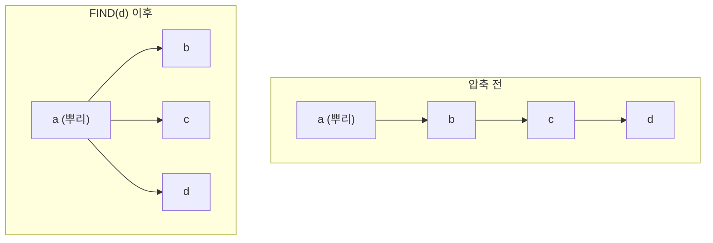

# 서로소 집합 자료구조

# 개요

**서로소 집합 자료구조(disjoint-set data structure)** 는 겹치지 않는 조각들로 나뉜 집합에서 두 조각을 합치는 연산과 두 원소가 같은 조각에 있는지 묻는 연산을 지원하는 자료구조다. 예로 도시 $n$ 개 사이에 도로가 하나씩 개통될 때마다 두 도시가 도로로 이어졌는지를 묻는다. 이 자료구조는 조각마다 대표 원소 하나를 두고 나머지 원소가 대표를 가리키게 해서 두 연산을 거의 상수 시간에 처리한다.

# 직관

도시 $n$ 개를 도로로 이어진 것끼리 부류로 나누고 "$x$ 와 $y$ 가 같은 부류인가" 를 반복해 묻는다. 각 원소에 부류 번호를 적어 두면 물음마다 비교 한 번이지만, 합치기가 $n-1$ 번 일어나면 번호를 고치는 쓰기가 $n^2$ 규모다. 번호를 전부 고치는 대신 부류마다 대표 원소 하나를 두고 나머지가 대표를 가리키게 한다. 각 부류를 뿌리 있는 트리로 만들면 합치기는 한 뿌리를 다른 뿌리의 자식으로 붙이는 쓰기 한 번이고, 물음은 두 원소에서 뿌리까지 올라가 비교한다.

트리가 한 줄로 길어지면 뿌리 찾기가 다시 $n$ 이다. 작은 트리를 큰 트리 밑에 붙이면 어떤 원소의 깊이가 $1$ 늘어날 때마다 그가 속한 트리의 크기가 최소 두 배가 되므로, 깊이가 $\log_2 n$ 을 넘지 못한다. 뿌리를 찾으러 올라간 길의 정점들을 그 자리에서 뿌리의 자식으로 바꾸면 그 길은 다음부터 한 걸음이다.

# 정의

## 분할과 세 연산

**서로소 집합 자료구조(disjoint-set data structure)** 는 유한한 원소 집합 $U$ 의 분할을 유지한다. 각 부분집합이 대표원 하나를 가진다.

- `MAKE-SET(x)` 는 원소 $x$ 만 든 새 집합을 만든다.
- `FIND(x)` 는 $x$ 가 속한 집합의 대표원을 반환한다.
- `UNION(x,y)` 는 두 집합을 하나로 합친다.

예. $U=\lbrace a,b,c,d,e\rbrace$ 에서 `MAKE-SET` 을 다섯 번 한 뒤 `UNION(a,b)` 와 `UNION(c,d)` 를 하면 분할은 $\lbrace a,b\rbrace$, $\lbrace c,d\rbrace$, $\lbrace e\rbrace$ 이다. 대표원이 $a$, $c$, $e$ 이면 `FIND(b)` 는 $a$, `FIND(d)` 는 $c$ 이므로 $b$ 와 $d$ 는 다른 집합에 있다.

## 트리 표현

각 집합을 [그래프](graphs.md)의 뿌리 있는 트리로 나타내고 뿌리를 대표원으로 삼는다. 배열 $parent\lbrack\rbrack$ 하나로 표현하고, 뿌리는 자기 자신을 부모로 가리킨다. `FIND` 는 부모 포인터를 따라 올라가고, `UNION` 은 서로 다른 두 뿌리 가운데 하나를 다른 하나의 자식으로 만든다.

예. 앞 절의 분할은 $parent\lbrack a\rbrack=a$, $parent\lbrack b\rbrack=a$, $parent\lbrack c\rbrack=c$, $parent\lbrack d\rbrack=c$, $parent\lbrack e\rbrack=e$ 로 표현된다. `UNION(b,d)` 는 뿌리 $a$ 와 $c$ 를 찾아 $parent\lbrack c\rbrack=a$ 로 바꾸고, 그 뒤 `FIND(d)` 는 $d,c,a$ 를 거쳐 $a$ 를 낸다.

# 성질

## 동치류

같은 집합에 속한다는 관계는 반사적·대칭적·추이적이므로 [동치관계](equivalence-relations.md)다. 그래서 `FIND(x)` 와 `FIND(y)` 가 같은 것은 $x$ 와 $y$ 가 같은 동치류에 있는 것과 동치다.

## 크기 기준 합치기의 높이 한계

작은 트리의 뿌리를 큰 트리의 뿌리에 붙이면, 어떤 원소의 깊이가 $1$ 증가할 때마다 그가 속한 트리의 크기가 최소 두 배가 된다. 따라서 높이는

$$
\lfloor\log_2 n\rfloor
$$

을 넘지 않는다. 랭크 기준으로 붙여도 같은 한계를 얻는다.

## 경로 압축과 분할상환 비용

경로 압축(path compression)은 `FIND` 가 지나간 원소들의 부모를 찾아낸 뿌리로 바꾼다. 크기 또는 랭크 기준 합치기와 함께 쓰면 $m$ 번의 연산열의 총비용이

$$
O\bigl(m\thinspace\alpha(n)\bigr)
$$

이다. $\alpha$ 는 역 Ackermann 함수(inverse Ackermann function)이며 실용적인 모든 $n$ 에서 $4$ 이하다. Tarjan 과 van Leeuwen 은 이 한계가 이 부류의 알고리즘에 대해 최적임을 보였다.

$\alpha(n)$ 은 긴 연산열의 평균 비용이고, 개별 `FIND` 가 항상 상수 시간이라는 뜻이 아니다. 최악의 단일 연산은 $O(\log n)$ 이 걸리므로 실시간 보장이 필요한 곳에서는 이 차이가 문제가 된다.

## 유지할 수 있는 부가 정보

뿌리에 부류별 집계를 달아 두면 합칠 때 갱신할 수 있다. 부류의 크기, 원소들의 합, 최솟값과 최댓값, 부류의 개수가 모두 상수 시간에 유지된다.

가중 변형에서는 각 정점에 부모와의 상대값을 저장해 $x$ 와 $y$ 의 차가 $d$ 라는 제약을 누적 관리하고 모순을 검출한다. 경로 압축을 하면서 상대값을 합산해 갱신한다. 등식 제약을 다루는 단일화 알고리즘과 같은 구조다.

## 합치기만 하는 한계

간선이 삭제되지 않는 증분(incremental) 연결성 문제만 다룬다. 삭제까지 다루는 완전 동적 연결성(fully dynamic connectivity)은 다른 기법을 쓴다. 모든 연산을 미리 알고 있으면 시간을 거꾸로 돌려 삭제를 추가로 바꾸는 오프라인 기법으로 이 자료구조를 재사용한다.

한 번 합친 것을 떼어 내는 연산은 없고 트리 구조가 이미 바뀌어 있어 되돌릴 수도 없다. 간선이 삭제되는 [동적 연결성](dynamic-connectivity.md) 문제에는 [Link-cut tree](link-cut-trees.md) 같은 다른 자료구조를 쓴다.

# 활용

## 최소 신장트리

[Kruskal 알고리즘](minimum-spanning-tree.md)은 간선을 가중치가 작은 순서로 보면서 `FIND(u)` 와 `FIND(v)` 가 다르면 선택하고 `UNION(u,v)` 를 수행한다. 대표원이 같으면 그 간선은 순환을 만들므로 버린다. 정렬이 $O(m\log m)$ 이고 나머지가 거의 선형이라, 전체 비용이 정렬에 지배된다.

## 연결 성분과 동치 제약

이미지의 연결 성분 표시, 격자의 침투 문제, 미로 생성, 컴파일러의 타입 단일화, 같은 계정을 가리키는 레코드 병합이 모두 같은 패턴이다. 같다는 선언을 순서대로 흡수하면서 현재 부류를 즉시 답하는 문제에 쓴다.

## 동치관계의 계산 구현

임의의 관계에서 반사, 대칭, 추이 폐포를 취하면 가장 작은 동치관계가 된다. 이 자료구조는 그 폐포를 점진적으로 계산하며 동치류의 정규형으로 대표원을 쓴다. 동치관계의 몫 구성을 계산으로 구현한다[^1].

[^1]: Robert Sedgewick and Kevin Wayne, *Algorithms*, §1.5 Union-Find. quick-union, weighted union, path compression 과 비용 분석. https://algs4.cs.princeton.edu/15uf/

# 연관 문서

## 선수지식

- [동치관계](equivalence-relations.md)
- [그래프](graphs.md)

## 더 알아보기

- [최소 신장트리](minimum-spanning-tree.md)
- [동적 연결성](dynamic-connectivity.md)

#data_structures #algorithms
