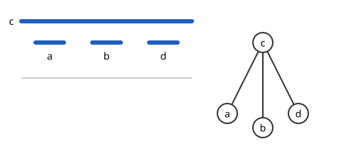

# 단위 구간 그래프

# 개요

**단위 구간 그래프(unit interval graph)** 는 길이가 모두 $1$ 인 구간들로 구간 표현을 줄 수 있는 구간 그래프다. 회의 시간이 모두 한 시간으로 같다면, 어떤 충돌 관계는 회의 길이가 제각각일 때만 생긴다. 긴 회의 하나가 서로 겹치지 않는 짧은 회의 셋과 모두 겹치는 관계가 그 예이고, Roberts 정리는 이 꼴만 없으면 길이를 모두 같게 할 수 있음을 보인다.

# 직관

아래 그림 왼쪽은 긴 구간 c 와, c 안에 떨어져 놓인 짧은 구간 a, b, d 다. c 는 셋과 모두 겹치고 a, b, d 는 서로 겹치지 않으므로 그래프는 오른쪽의 별 $K\_{1,3}$ 이다.

길이가 모두 $1$ 이면 이 그래프를 만들 수 없다. 서로 겹치지 않는 a, b, d 를 왼쪽부터 놓으면 가운데 b 는 a 의 오른쪽 끝과 d 의 왼쪽 끝 사이에 들어간다. c 가 a 와 d 에 모두 닿으려면 a 의 오른쪽 끝부터 d 의 왼쪽 끝까지를 덮어야 하는데, 그 사이에 길이 $1$ 인 b 가 통째로 있으므로 c 의 길이는 $1$ 보다 커야 한다.

# 정의

[구간 그래프](interval-graphs.md)의 구간 표현에서 모든 구간의 길이가 같을 수 있으면 그 그래프를 **단위 구간 그래프** 라 한다. 어느 구간도 다른 구간을 진부분집합으로 포함하지 않는 구간 표현을 가지면 **고유 구간 그래프(proper interval graph)** 라 한다. 별 $K\_{1,3}$ 을 그래프의 **발톱(claw)** 이라 하고, 유도 부분그래프로 발톱을 갖지 않는 그래프를 **발톱 없는 그래프(claw-free graph)** 라 한다. 직관 절의 표현에서 c 가 a 를 포함하므로 고유 표현이 아니다.

# 성질

## Roberts 정리

정리(Roberts). 구간 그래프 $G$ 에 대해 다음은 동치다[^1].

- $G$ 는 단위 구간 그래프다.
- $G$ 는 고유 구간 그래프다.
- $G$ 는 발톱 없는 그래프다.

증명의 요지. 단위 표현은 고유 표현이다. 고유 표현에서 구간 c 가 서로 겹치지 않는 세 구간과 겹치면 가운데 구간이 c 안에 들어가므로 발톱이 없다. 발톱이 없는 구간 그래프의 구간 표현에서 포함된 구간을 한쪽 끝으로 조금씩 늘이면 고유 표현이 되고, 고유 표현에서는 왼쪽 끝 순서와 오른쪽 끝 순서가 같으므로 끝점을 차례로 옮겨 길이를 모두 $1$ 로 맞출 수 있다.

## 정점 순서

그래프가 단위 구간 그래프인 것은 정점을 일렬로 놓아 각 정점의 닫힌 이웃이 그 순서에서 연속한 구간을 이루게 할 수 있는 것과 동치다. 이 순서는 구간의 왼쪽 끝 순서이고, 정점 순서와 구간 표현은 선형 시간에 구해진다[^2].

# 활용

- 길이가 같은 작업의 충돌. 모든 작업 시간이 같은 일정에서 충돌 그래프는 단위 구간 그래프이고, 발톱이 있으면 그 일정은 같은 길이의 작업으로 실현되지 않는다.
- 그래프 알고리즘. 단위 구간 그래프에서는 Hamilton 경로, 대역폭 같은 일반 그래프에서 어려운 문제가 정점 순서를 써서 다항 시간에 풀린다.

[^1]: F. S. Roberts, "Indifference graphs", in *Proof Techniques in Graph Theory*, Academic Press, 1969, 139–146.
[^2]: D. G. Corneil, "A simple 3-sweep LBFS algorithm for the recognition of unit interval graphs", *Discrete Applied Mathematics* **138** (2004), 371–379.

# 연관 문서

## 선수지식

- [구간 그래프](interval-graphs.md)

## 더 알아보기

아직 연결한 문서가 없다.

#graph_theory #combinatorics #order_theory
