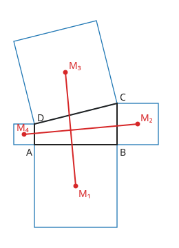

# van Aubel 정리

# 개요

**van Aubel 정리(van Aubel's theorem)** 는 사각형의 네 변 위에 바깥쪽으로 정사각형을 세우면, 마주 보는 두 정사각형의 중심을 이은 두 선분이 길이가 같고 서로 수직이라는 정리다. 모눈종이에 아무 사각형이나 그리고 변마다 정사각형을 붙인 뒤 중심을 이어 보면, 사각형의 모양과 상관없이 두 선분이 직각으로 만나고 길이도 같다. 꼭짓점을 [복소수](complex-numbers.md)로 놓으면 정사각형의 중심이 꼭짓점의 일차식이 되고, 두 선분이 $i$ 배 관계라는 항등식 하나로 증명된다.

# 직관

꼭짓점이 $A=(0,0)$, $B=(4,0)$, $C=(4,2)$, $D=(0,1)$ 인 사각형은 반시계 방향으로 놓여 있다. 변 $AB$ 의 바깥쪽은 아래이므로 $AB$ 위의 정사각형은 $(0,0)$, $(4,0)$, $(4,-4)$, $(0,-4)$ 이고 중심은 $M\_1=(2,-2)$ 다. 같은 방법으로 $BC$, $CD$, $DA$ 위의 정사각형의 중심은 $M\_2=(5,1)$, $M\_3=(3/2,7/2)$, $M\_4=(-1/2,1/2)$ 이다.

그림의 두 빨간 선분이 $M\_1M\_3$ 과 $M\_2M\_4$ 다.

$M\_1$ 에서 $M\_3$ 으로 가는 벡터는 $(-1/2,11/2)$ 이고, $M\_4$ 에서 $M\_2$ 로 가는 벡터는 $(11/2,1/2)$ 이다. 둘 다 길이가 $\sqrt{122}/2$ 이고 내적이 $-11/4+11/4=0$ 이다. 두 선분은 길이가 같고 서로 수직이다.

# 정의

## 변 위의 정사각형의 중심

사각형 $ABCD$ 의 꼭짓점이 반시계 방향으로 놓여 있다고 하고 꼭짓점을 복소수 $a,b,c,d$ 로 쓴다. 변 $PQ$ 의 바깥쪽은 $Q-P$ 를 시계 방향으로 직각만큼 돌린 쪽이고, 그 방향은 $-i(Q-P)$ 다. 변 $PQ$ 위에 바깥쪽으로 세운 정사각형의 중심은 변의 중점에서 그 방향으로 변의 절반만큼 간 점이다.

$$
\frac{p+q}{2}-i\thinspace\frac{q-p}{2}=\frac{(1+i)p+(1-i)q}{2}
$$

변 $AB$, $BC$, $CD$, $DA$ 위의 중심을 차례로 $m\_1,m\_2,m\_3,m\_4$ 라 한다. 직관 절에서 $a=0$, $b=4$ 이면 $m\_1=(1-i)\cdot 4/2=2-2i$ 다.

# 성질

## van Aubel 정리

다음 등식이 성립한다.

$$
m_3-m_1=i\left(m_2-m_4\right)
$$

$i$ 를 곱하는 것은 길이를 두고 직각만큼 돌리는 것이므로, 선분 $M\_1M\_3$ 과 $M\_2M\_4$ 는 길이가 같고 서로 수직이다.

증명의 요지. 정의 절의 식을 넣으면 양변의 두 배가 모두 다음 식이 된다.

$$
(1+i)(c-a)+(1-i)(d-b)
$$

직관 절에서 $m\_3-m\_1$ 과 $i(m\_2-m\_4)$ 는 둘 다 다음 값이다.

$$
i\left(\frac{11}{2}+\frac{i}{2}\right)=-\frac12+\frac{11}{2}i
$$

## 볼록하지 않은 사각형

증명은 등식만 쓰므로 사각형이 볼록하지 않아도, 변이 서로 엇갈려도 성립한다. 꼭짓점이 시계 방향이면 바깥쪽 방향이 $i(Q-P)$ 이고, 같은 계산으로 $m\_3-m\_1=-i(m\_2-m\_4)$ 가 나온다.

## 평행사변형

$ABCD$ 가 평행사변형이면 네 중심은 정사각형을 이룬다. 평행사변형의 중심에 대한 점대칭이 $m\_1$ 과 $m\_3$, $m\_2$ 와 $m\_4$ 를 맞바꾸므로 $M\_1M\_2M\_3M\_4$ 는 평행사변형이고, 대각선의 길이가 같고 수직인 평행사변형은 정사각형이다.

## 삼각형

$D$ 를 $A$ 로 보내면 변 $DA$ 의 정사각형은 점 $A$ 로 줄어 $m\_4=a$ 가 된다. 그러면 삼각형 $ABC$ 에서 $AB$, $CA$ 위의 정사각형의 중심을 잇는 선분은 $A$ 와 $BC$ 위의 정사각형의 중심을 잇는 선분과 길이가 같고 수직이다.

# 활용

- [Napoleon 정리](napoleon-theorem.md)와 같은 방법. 변 위에 정삼각형 대신 정사각형을 세우고, 중심을 꼭짓점의 일차식으로 적어 항등식으로 증명한다. 정삼각형에서는 $e^{-i\pi/3}$, 정사각형에서는 $-i$ 가 회전을 맡는다.
- 다각형 위의 정다각형. 변 위에 세운 도형의 중심은 꼭짓점의 일차식이다. $n$ 각형의 변 위에 꼭지각이 정해진 이등변삼각형을 세워 꼭짓점을 바꾸는 일을 $n-2$ 번 되풀이하면 정 $n$ 각형이 나온다는 Petr–Douglas–Neumann 정리(Petr–Douglas–Neumann theorem)는 이 일차식을 [이산 Fourier 변환](fourier.md)으로 대각화해 증명된다.

# 연관 문서

## 선수지식

- [Napoleon 정리](napoleon-theorem.md)

## 더 알아보기

아직 연결한 문서가 없다.

#algebra #complex_analysis
