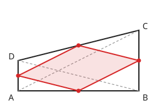

# Varignon 정리

# 개요

**Varignon 정리(Varignon's theorem)** 는 사각형의 네 변의 중점을 차례로 이으면 평행사변형이 된다는 정리다. 종이에 아무렇게나 찌그러진 사각형을 그리고 변마다 가운데 점을 찍어 이어 보면, 원래 사각형의 모양과 상관없이 마주 보는 변이 평행하고 길이가 같은 사각형이 나온다. 꼭짓점을 [벡터 공간](vector-spaces.md)의 벡터로 놓으면 중점을 잇는 벡터가 대각선의 절반이라는 한 줄의 계산으로 증명된다.

# 직관

꼭짓점이 $A=(0,0)$, $B=(4,0)$, $C=(4,2)$, $D=(0,1)$ 인 사각형에서 변 $AB$, $BC$, $CD$, $DA$ 의 중점은 $(2,0)$, $(4,1)$, $(2,3/2)$, $(0,1/2)$ 이다.

그림의 빨간 사각형에서 $(2,0)$ 에서 $(4,1)$ 로 가는 변과 $(0,1/2)$ 에서 $(2,3/2)$ 로 가는 변은 둘 다 $(2,1)$ 이고, 대각선 $AC=(4,2)$ 의 절반이다. 나머지 두 변은 둘 다 $(-2,1/2)$ 이고, 대각선 $BD=(-4,1)$ 의 절반이다. 마주 보는 변이 같은 벡터이므로 평행사변형이다.

빨간 평행사변형의 넓이는 두 변 벡터로 만든 행렬식 $2\cdot\tfrac12-1\cdot(-2)=3$ 이고, 사각형 $ABCD$ 의 넓이 $6$ 의 절반이다.

# 정의

## Varignon 평행사변형

사각형 $ABCD$ 의 변 $AB$, $BC$, $CD$, $DA$ 의 중점을 차례로 $P$, $Q$, $R$, $S$ 라 할 때, 사각형 $PQRS$ 를 $ABCD$ 의 **Varignon 평행사변형(Varignon parallelogram)** 이라 한다. 직관 절의 빨간 사각형이 그것이다.

# 성질

## Varignon 정리

$PQRS$ 는 평행사변형이고, 변 $PQ$ 와 $SR$ 은 대각선 $AC$ 와, 변 $QR$ 과 $PS$ 는 대각선 $BD$ 와 평행하며 길이가 그 절반이다.

증명의 요지. 꼭짓점을 벡터 $a,b,c,d$ 로 쓰면 다음이 나온다.

$$
q-p=\frac{b+c}{2}-\frac{a+b}{2}=\frac{c-a}{2}=\frac{d+c}{2}-\frac{a+d}{2}=r-s
$$

같은 계산으로 $r-q=s-p=(d-b)/2$ 다. 이 계산은 사각형이 볼록하지 않아도, 변이 서로 엇갈려도, 네 점이 한 평면 위에 있지 않아도 성립한다.

## 넓이와 둘레

평면의 단순한 사각형에서 Varignon 평행사변형의 넓이는 원래 사각형의 넓이의 절반이다. 평행사변형의 넓이는 두 변 $(c-a)/2$ 와 $(d-b)/2$ 로 만든 행렬식의 절댓값이고, 사각형의 넓이는 두 대각선으로 만든 행렬식의 절댓값의 절반이다.

둘레는 두 대각선의 길이의 합이다. 직관 절에서는 $\sqrt{20}+\sqrt{17}$ 이다.

## 모양의 판정

- 두 대각선의 길이가 같으면 $PQRS$ 는 마름모다.
- 두 대각선이 수직이면 $PQRS$ 는 직사각형이다.
- 두 대각선의 길이가 같고 수직이면 $PQRS$ 는 정사각형이다.

마지막 판정은 [van Aubel 정리](van-aubel-theorem.md)와 함께 쓰인다. 정사각형의 중심 넷이 이루는 사각형은 대각선의 길이가 같고 수직이므로, 그 Varignon 평행사변형은 정사각형이다.

## 중심

$PQRS$ 의 두 대각선은 $p$ 와 $r$ 의 중점에서 만나고, 이 점은 다음과 같다.

$$
\frac{p+r}{2}=\frac{a+b+c+d}{4}
$$

이 점은 네 꼭짓점의 무게중심이고, 대각선 $AC$ 와 $BD$ 의 중점을 잇는 선분의 중점이다.

# 활용

- [Petr–Douglas–Neumann 정리](petr-douglas-neumann-theorem.md)의 사각형의 경우. 변의 중점을 잡는 작도가 이 정리의 평행사변형이고, 정사각형의 중심을 잡는 작도와 합치면 정사각형이 나온다.
- 공간의 사각형. 네 점이 한 평면 위에 있지 않아도 네 중점은 한 평면 위에 있고 평행사변형을 이룬다. 사면체의 마주 보는 두 모서리의 중점을 잇는 선분 세 개가 한 점에서 만나 서로 이등분한다는 것이 여기서 나온다.
- 무게중심. 네 꼭짓점의 무게중심이 두 대각선의 중점을 잇는 선분의 중점이라는 것을 넓이 계산 없이 얻는다.

# 연관 문서

## 선수지식

- [벡터 공간](vector-spaces.md)

## 더 알아보기

아직 연결한 문서가 없다.

#algebra #linear_algebra
