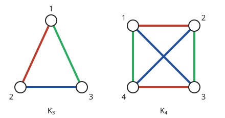

# Vizing 정리

# 개요

**Vizing 정리(Vizing's theorem)** 는 간선을 칠해 한 정점에서 만나는 간선끼리 색이 다르게 할 때, 드는 색의 수가 가장 많은 간선이 모인 정점의 간선 수와 같거나 그보다 하나 많다는 정리다. 팀 몇 개가 서로 경기를 치르고 한 팀이 한 번에 한 경기만 할 수 있으면, 경기가 간선이고 같은 회차의 경기가 같은 색이다. 경기가 가장 많은 팀이 세 경기를 치르면 회차는 셋이나 넷이다.

색의 수가 둘 가운데 어느 쪽인지는 그래프마다 다르고, 이분그래프는 언제나 작은 쪽이다.

# 직관

팀 세 개가 서로 한 번씩 경기를 한다. 경기는 셋이고 어느 두 경기도 팀 하나를 함께 쓰므로 회차가 세 번 든다. 각 팀이 치르는 경기는 둘뿐인데 회차는 셋이다.

팀 네 개면 경기가 여섯이고 각 팀은 세 경기를 치른다. 회차 $\lbrace 12,34\rbrace$, $\lbrace 13,24\rbrace$, $\lbrace 14,23\rbrace$ 로 나누면 세 회차에 끝난다. 다음 그림의 왼쪽은 세 팀, 오른쪽은 네 팀의 경기를 회차마다 다른 색으로 그린 것이다.

한 팀의 경기는 서로 다른 회차에 열리므로 회차의 수는 가장 바쁜 팀의 경기 수 이상이다. 세 팀에서는 그보다 하나 더 들었고 네 팀에서는 정확히 같았다. Vizing 정리에 따르면 어떤 대진표에서도 하나보다 더 많이 들지는 않는다.

# 정의

## 간선 색칠

그래프 $G$ 의 간선에 색 $1,\dots,k$ 를 주어 끝점을 공유하는 두 간선이 다른 색을 받게 한 것을 **간선 $k$ 색칠(edge k-coloring)** 이라 한다. 그런 $k$ 의 최솟값을 **간선 채색수(chromatic index)** $\chi'(G)$ 라 한다. 한 색의 간선들은 끝점을 공유하지 않으므로 [매칭](matchings.md)이고, 간선 색칠은 간선을 매칭들로 나눈 것이다.

$\Delta(G)$ 를 정점의 차수의 최댓값이라 한다. 직관 절에서 $\chi'(K\_3)=3$, $\Delta(K\_3)=2$ 이고 $\chi'(K\_4)=3=\Delta(K\_4)$ 다.

## 1 종과 2 종

$\chi'(G)=\Delta(G)$ 인 그래프를 **1 종(class 1)**, $\chi'(G)=\Delta(G)+1$ 인 그래프를 **2 종(class 2)** 이라 한다. $K\_4$ 는 1 종이고 $K\_3$ 은 2 종이다.

# 성질

## Vizing 정리

고리와 중복 간선이 없는 그래프 $G$ 에 대해

$$
\Delta(G)\le\chi'(G)\le\Delta(G)+1
$$

이다[^1]. 왼쪽 부등식은 차수가 $\Delta$ 인 정점의 간선들이 서로 다른 색을 받아야 하기 때문이다.

증명의 요지. 색 $\Delta+1$ 개로 간선을 하나씩 칠한다. 아직 칠하지 않은 간선 $uv$ 에서, 각 정점의 차수는 $\Delta$ 이하이므로 $u$ 와 $v$ 에는 각각 쓰지 않은 색이 있다. 둘이 함께 쓰지 않은 색이 있으면 그 색을 준다.

그런 색이 없으면 $u$ 의 이웃 $v=v\_0,v\_1,\dots,v\_k$ 를 $v\_i$ 가 쓰지 않은 색이 간선 $uv\_{i+1}$ 의 색이 되게 늘어놓은 부채(fan)를 만든다. 부채를 따라 간선의 색을 한 칸씩 옮기거나, 두 색이 번갈아 나오는 경로의 두 색을 맞바꾸면 $uv$ 를 칠할 자리가 생긴다. Misra 와 Gries 는 이 과정을 $O(mn)$ 시간의 알고리즘으로 적었다[^2]. $m$ 은 간선 수, $n$ 은 정점 수다.

## König 의 간선 색칠 정리

이분그래프는 1 종이다[^3]. 이것을 König 의 간선 색칠 정리(König's line coloring theorem)라 한다.

증명. 색 $\Delta$ 개로 간선을 하나씩 칠한다. 칠하지 않은 간선 $uv$ 에서 $u$ 가 쓰지 않은 색 $\alpha$ 와 $v$ 가 쓰지 않은 색 $\beta$ 가 있다. $\alpha=\beta$ 이면 그 색을 준다. 아니면 $v$ 에서 색 $\alpha$ 의 간선으로 시작해 $\alpha$ 와 $\beta$ 가 번갈아 나오는 가장 긴 경로 $P$ 를 잡는다.

$P$ 가 $u$ 에 닿는다면 $u$ 에는 $\alpha$ 간선이 없으므로 $\beta$ 간선으로 닿고, $P$ 의 길이는 짝수다. 그런데 $u$ 와 $v$ 는 이분그래프의 서로 다른 쪽에 있어 둘을 잇는 경로의 길이는 홀수이므로 모순이다. 그래서 $P$ 는 $u$ 를 지나지 않고, $P$ 위의 $\alpha$ 와 $\beta$ 를 맞바꾸면 $v$ 에서 $\alpha$ 가 비고 $u$ 는 그대로다. $uv$ 에 $\alpha$ 를 준다. ∎

## 완전그래프

$\chi'(K\_n)$ 은 $n$ 이 짝수이면 $n-1$, 홀수이면 $n$ 이다. $n$ 이 홀수이면 매칭 하나는 간선이 $(n-1)/2$ 개 이하이고 간선은 $n(n-1)/2$ 개이므로 색이 $n$ 개 이상 든다. 그래서 홀수 $n$ 의 $K\_n$ 은 2 종이고, 직관 절의 $K\_3$ 이 그 경우다.

같은 셈으로 정점이 홀수 개인 정칙 그래프는 2 종이다. [Petersen 그래프](petersen-graph.md)는 정점이 $10$ 개인 $3$ 정칙 그래프인데 2 종이다.

## 판정의 복잡도

$\Delta=3$ 인 그래프가 1 종인지 판정하는 문제는 NP-완전(NP-complete, NP 는 nondeterministic polynomial time)이다[^4]. 정리가 답을 둘로 좁히지만 둘 가운데 어느 쪽인지 정하는 것은 어렵다.

## 중복 간선이 있는 그래프

중복 간선을 허용하면 상한이 늘어난다. Shannon 은 $\chi'(G)\le\lfloor 3\Delta/2\rfloor$ 을 증명했다[^5]. 정점 세 개의 각 쌍을 간선 $\Delta/2$ 개로 이은 그래프에서 등호가 성립한다.

# 활용

- 대진표와 시간표. 직관 절처럼 쌍으로 이루어지는 일을 회차로 나누는 문제가 간선 색칠이다. 짝수 팀의 리그는 $n-1$ 회차에, 홀수 팀의 리그는 $n$ 회차에 끝난다.
- [그래프 색칠](graph-coloring.md)과 선 그래프. 간선 색칠은 선 그래프(line graph)의 정점 색칠이다. Vizing 정리에 따라 선 그래프의 채색수는 가장 큰 클릭의 크기보다 많아야 하나 크다.
- 이분그래프의 분해. König 의 간선 색칠 정리에 따라 $\Delta$ 정칙 이분그래프는 완전 매칭 $\Delta$ 개로 나뉜다. 증명은 중복 간선이 있는 이분그래프에서도 그대로 성립하므로, 행합과 열합이 모두 $\Delta$ 인 음 아닌 정수 행렬은 순열 행렬 $\Delta$ 개의 합이다. [Birkhoff–von Neumann 정리](birkhoff-von-neumann-theorem.md)를 정수 행렬에 쓴 꼴이다.

[^1]: V. G. Vizing, "On an estimate of the chromatic class of a p-graph", *Diskretnyĭ Analiz* 3 (1964), 25–30.
[^2]: J. Misra, D. Gries, "A constructive proof of Vizing's theorem", *Information Processing Letters* 41 (1992), 131–133.
[^3]: D. Kőnig, "Über Graphen und ihre Anwendung auf Determinantentheorie und Mengenlehre", *Mathematische Annalen* 77 (1916), 453–465.
[^4]: I. Holyer, "The NP-completeness of edge-coloring", *SIAM Journal on Computing* 10 (1981), 718–720.
[^5]: C. E. Shannon, "A theorem on coloring the lines of a network", *Journal of Mathematics and Physics* 28 (1949), 148–151.

# 연관 문서

## 선수지식

- [그래프 색칠](graph-coloring.md)
- [매칭](matchings.md)

## 더 알아보기

- [Snark](snarks.md)

#graph_theory #combinatorics
