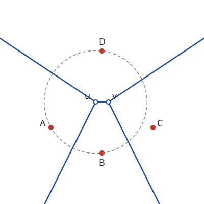

# Voronoi 도형

# 개요

**Voronoi 도형(Voronoi diagram)** 은 평면에 놓인 점들 각각에 대해 그 점이 가장 가까운 곳을 모아 평면을 나눈 그림이다. 도시에 우체국이 네 곳 있으면 집마다 가장 가까운 우체국이 정해지고, 같은 우체국을 쓰는 집들이 한 구역을 이룬다. 구역의 경계는 두 우체국에서 같은 거리에 있는 점들이다.

Voronoi 도형은 그 경계를 선분과 반직선으로 계산해 둔다. 그러면 새 집이 어느 구역에 드는지 찾는 것으로 가장 가까운 우체국이 나온다. 처음 읽는 사람은 직관 절의 네 점 그림에서 시작한다.

# 직관

[Delaunay 삼각분할](delaunay-triangulation.md)의 네 점 $A=(0,0)$, $B=(2,-1)$, $C=(4,0)$, $D=(2,3)$ 을 우체국으로 둔다. 두 우체국 $A$, $B$ 에서 같은 거리에 있는 점은 선분 $AB$ 의 수직이등분선 위에 있다. 이등분선의 한쪽은 $A$ 에, 다른 쪽은 $B$ 에 더 가깝다.

세 우체국 $A,B,D$ 에서 같은 거리에 있는 점은 세 점을 지나는 원의 중심 $u=(1.75,1)$ 이다. $BD$ 의 이등분선은 $y=1$ 이고, $AB$ 의 이등분선 $2x-y=2.5$ 와 $y=1$ 에서 만나 $x=1.75$ 다. 같은 계산으로 $B,C,D$ 의 원의 중심은 $v=(2.25,1)$ 이다.



그림의 실선이 구역의 경계다. $u$ 와 $v$ 사이의 선분은 $B$ 와 $D$ 의 경계이고, $u$ 에서 뻗는 두 반직선은 $A$ 와 $B$, $A$ 와 $D$ 의 경계다. $v$ 에서 뻗는 두 반직선은 $B$ 와 $C$, $C$ 와 $D$ 의 경계다.

점선 원은 $u$ 를 중심으로 $A,B,D$ 를 지나고, 안에 $C$ 가 없다. $C$ 가 원 안에 있었다면 $u$ 는 $C$ 에 더 가까워 세 우체국의 경계가 만나는 점이 되지 못한다. Delaunay 삼각분할의 빈 원 조건이 여기서 다시 나온다.

# 정의

## Voronoi 영역

평면의 서로 다른 점 $n$ 개의 집합 $S$ 를 둔다. $S$ 의 점을 **사이트(site)** 라 한다. 사이트 $p$ 의 **Voronoi 영역(Voronoi cell)** 은 다음이다.

$$
V(p)=\lbrace x\in\mathbb R^2:\ \lvert x-p\rvert\le\lvert x-q\rvert\quad\forall q\in S\rbrace
$$

직관 절에서 $V(B)$ 는 선분 $uv$, $u$ 에서 왼쪽 아래로 뻗는 반직선, $v$ 에서 오른쪽 아래로 뻗는 반직선으로 둘러싸인 영역이다.

## 꼭짓점과 변

영역 $V(p)$ 와 $V(q)$ 의 공통부분이 선분이나 반직선이나 직선이면 그것을 Voronoi 도형의 **변(edge)** 이라 한다. 세 개 이상의 영역에 속하는 점을 Voronoi 도형의 **꼭짓점(vertex)** 이라 한다. 직관 절의 도형은 꼭짓점이 $u,v$ 둘이고 변이 다섯이다.

# 성질

## 영역의 꼴

$V(p)$ 는 반평면 $\lbrace x:\lvert x-p\rvert\le\lvert x-q\rvert\rbrace$ 를 $q\ne p$ 에 대해 모두 교차한 것이므로 볼록 다각형이다. 유계가 아닐 수 있다.

$V(p)$ 가 유계가 아닌 것과 $p$ 가 $S$ 의 [볼록 껍질](convex-hull-algorithms.md)의 꼭짓점인 것은 동치다. 직관 절의 네 점은 모두 볼록 껍질의 꼭짓점이므로 영역이 모두 유계가 아니다.

## 빈 원

점 $x$ 가 Voronoi 도형의 꼭짓점인 것과, $x$ 를 중심으로 사이트 세 개 이상을 지나고 내부에 사이트가 없는 원이 존재하는 것은 동치다. 점 $x$ 가 $V(p)\cap V(q)$ 의 내부에 있는 것은 $x$ 를 중심으로 $p,q$ 만 지나고 내부가 빈 원이 존재하는 것과 동치다.

그러므로 두 사이트의 영역이 변을 공유하는 것과 두 사이트를 잇는 선분이 Delaunay 삼각분할의 변인 것은 동치다. 네 사이트가 한 원 위에 있지 않으면 Voronoi 꼭짓점과 Delaunay 삼각형이 일대일로 대응한다.

## 크기

$n\ge 3$ 이고 사이트가 한 직선 위에 있지 않으면 Voronoi 도형의 꼭짓점은 많아야 $2n-5$ 개, 변은 많아야 $3n-6$ 개다.

증명의 요지. 무한히 먼 곳에 꼭짓점 하나를 더해 반직선들을 거기서 만나게 하면 평면 그래프가 된다. 면이 $n$ 개, 꼭짓점이 $v+1$ 개, 변이 $e$ 개이고 각 꼭짓점의 차수가 $3$ 이상이므로 $2e\ge 3(v+1)$ 이다. Euler 공식 $(v+1)-e+n=2$ 와 합치면 두 상한이 나온다. 직관 절에서 $n=4$ 이고 $2n-5=3$, $3n-6=6$ 이다.

## Fortune 쓸기

S. Fortune 은 Voronoi 도형을 $O(n\log n)$ 시간과 $O(n)$ 공간으로 계산했다[^1]. 수평선 $\ell$ 을 위에서 아래로 내리면서 $\ell$ 위쪽 부분의 도형을 완성해 간다.

$\ell$ 위의 점 $x$ 가 이미 지난 사이트 $p$ 보다 $\ell$ 에 더 가까우면, $\ell$ 아래의 사이트가 $p$ 보다 $x$ 에 가까울 수 있어 $x$ 가 어느 영역인지 아직 모른다. 사이트 $p$ 와 $\ell$ 에서 같은 거리인 점들은 포물선이고, 지난 사이트들의 포물선 가운데 가장 아래쪽을 이은 곡선을 **해변선(beach line)** 이라 한다. 해변선 위쪽의 점은 영역이 정해졌다.

해변선은 포물선 호의 열이고, 이웃한 두 호가 만나는 점은 $\ell$ 이 내려가면서 Voronoi 변을 그린다. 해변선이 바뀌는 사건은 두 가지다.

- 사이트 사건. $\ell$ 이 새 사이트에 닿으면 그 바로 위의 호가 둘로 갈리고 그 사이에 새 호가 생긴다.
- 원 사건. 이웃한 세 호의 사이트를 지나는 원의 맨 아래에 $\ell$ 이 닿으면 가운데 호가 사라진다. 원의 중심이 Voronoi 꼭짓점이다.

직관 절에서 $\ell$ 은 $D$, $A$ 와 $C$, $B$ 를 차례로 지난다. 그 뒤 $u$ 를 중심으로 하는 원의 맨 아래 $y=1-\sqrt{4.0625}\approx -1.016$ 에 닿을 때 $A,B,D$ 의 원 사건이 일어나 $u$ 가 생기고, 같은 높이에서 $v$ 가 생긴다.

```javascript
// 해변선: 호를 왼쪽부터 담은 균형 이진 탐색 트리
// 사건 큐: y 가 큰 것부터 꺼내는 힙
function fortune(sites) {
  const events = heapOf(sites.map((p) => ({ type: "site", y: p.y, p })));
  const beach = new BalancedTree();
  while (!events.isEmpty()) {
    const e = events.popMax();
    if (e.type === "site") {
      const arc = beach.arcAbove(e.p);            // O(log n)
      invalidateCircleEvent(arc, events);
      beach.split(arc, e.p);                       // 호 하나가 셋이 된다
      checkCircleEvents(beach.neighborsOf(e.p), events);
    } else if (e.valid) {
      emitVoronoiVertex(e.center);
      beach.remove(e.arc);                         // 가운데 호가 사라진다
      checkCircleEvents(beach.neighborsOfRemoved(e.arc), events);
    }
  }
}
```

사이트 사건은 호를 많아야 둘 늘리므로 해변선의 호는 $2n-1$ 개 이하다. 원 사건으로 실제 처리되는 것은 Voronoi 꼭짓점 하나씩이라 $2n-5$ 개 이하다. 사건마다 트리와 힙 연산이 $O(\log n)$ 이다. [Bentley–Ottmann 알고리즘](bentley-ottmann.md)처럼 쓸기 선 위의 상태를 트리로, 앞으로 올 사건을 힙으로 관리한다.

## 하한

$O(n\log n)$ 은 비교에 기반한 계산에서 최선이다. 수 $x_1,\dots,x_n$ 을 $x$ 축 위의 사이트로 두면 Voronoi 도형의 변은 이웃한 두 수 사이의 수직선이고, 변을 따라가면 정렬된 순서가 나온다. 비교 정렬의 하한 $\Omega(n\log n)$ 이 그대로 옮겨진다.

# 활용

- 가장 가까운 점 질의. Voronoi 도형을 평면 분할로 저장하고 [점 위치 찾기](point-location.md) 자료구조를 더하면 질의 하나를 $O(\log n)$ 시간에 답한다.
- 가장 큰 빈 원. 볼록 껍질 안에서 내부에 사이트가 없는 가장 큰 원의 중심은 Voronoi 꼭짓점이거나 Voronoi 변과 볼록 껍질 경계의 교점이다. M. I. Shamos 와 D. Hoey 가 이 방법을 썼다[^2].
- [k 평균 군집화](k-means.md). Lloyd 반복의 할당 단계는 현재 중심들의 Voronoi 영역으로 점들을 나누는 것이다.
- 결정학과 물리. 격자점들의 Voronoi 영역이 Wigner–Seitz 세포(Wigner–Seitz cell)이고, 역격자에서는 첫째 Brillouin 영역(Brillouin zone)이다.

[^1]: S. Fortune, "A sweepline algorithm for Voronoi diagrams", Algorithmica 2 (1987), 153–174.
[^2]: M. I. Shamos, D. Hoey, "Closest-point problems", Proceedings of the 16th IEEE Symposium on Foundations of Computer Science (1975), 151–162.

# 연관 문서

## 선수지식

- [Delaunay 삼각분할](delaunay-triangulation.md)
- [Bentley–Ottmann 알고리즘](bentley-ottmann.md)

## 더 알아보기

- [중심 Voronoi 분할](centroidal-voronoi-tessellations.md)

#algorithms #computation #data_structures
