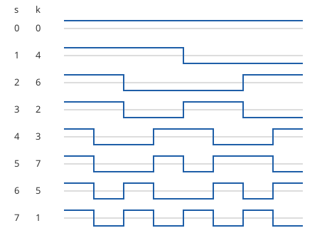

# Walsh–Hadamard 변환

# 개요

**Walsh–Hadamard 변환(Walsh–Hadamard transform)** 은 길이 $2^n$ 인 수열에 성분이 $\pm 1$ 인 [Hadamard 행렬](hadamard-matrices.md) $H\_{2^n}$ 을 곱하는 변환이다. 비트 두 개를 받아 참 거짓을 내는 함수를 비트 하나짜리 함수들의 곱으로 나누어 보려면, 입력 네 개에서의 값에 $4\times 4$ 부호 행렬을 곱해야 한다. 이 곱을 [고속 Fourier 변환](fft.md)처럼 둘씩 짝지어 더하고 빼는 단계로 쪼개면, 길이 $N=2^n$ 에서 곱셈 없이 $N\log\_2N$ 번의 덧셈과 뺄셈으로 끝난다.

# 직관

두 비트 $x\_1,x\_2$ 의 AND 를 참이면 $-1$, 거짓이면 $1$ 로 적는다. 입력 $00,01,10,11$ 에서 값은 $(1,1,1,-1)$ 이다. 이 함수를 상수 $1$, $(-1)^{x\_2}$, $(-1)^{x\_1}$, $(-1)^{x\_1+x\_2}$ 의 일차결합으로 쓰려면 각 함수와의 내적을 구한다.

내적은 다음 부호 행렬을 곱한 것이다.

$$
H\_4=\begin{pmatrix}1&1&1&1\cr 1&-1&1&-1\cr 1&1&-1&-1\cr 1&-1&-1&1\end{pmatrix}
$$

$H\_4(1,1,1,-1)^{\mathsf T}=(2,2,2,-2)$ 이고 $4$ 로 나누면 AND 는 다음과 같다.

$$
\mathrm{AND}(x\_1,x\_2)=\tfrac12+\tfrac12(-1)^{x\_2}+\tfrac12(-1)^{x\_1}-\tfrac12(-1)^{x\_1+x\_2}
$$

행렬 곱을 바로 하면 덧셈이 $4\times 3=12$ 번이다. 대신 먼저 이웃한 두 값끼리 더하고 빼면 $(1,1)\to(2,0)$, $(1,-1)\to(0,2)$ 로 $(2,0,0,2)$ 가 되고, 두 칸 떨어진 값끼리 더하고 빼면 $(2,0)\to(2,2)$, $(0,2)\to(2,-2)$ 로 $(2,2,2,-2)$ 가 된다. 덧셈과 뺄셈이 $8$ 번이다.

# 정의

$H\_1=(1)$ 이고 $H\_{2N}=H\_2\otimes H\_N$ 으로 정한 $2^n\times 2^n$ 행렬을 **Sylvester–Hadamard 행렬** 이라 한다. $H\_2$ 는 첫 행이 $1,1$, 둘째 행이 $1,-1$ 이다. 성분은 $j$ 와 $k$ 를 $n$ 비트로 적었을 때 다음과 같다.

$$
(H\_{2^n})\_{jk}=(-1)^{j\cdot k},\qquad j\cdot k=\sum\_{i=1}^nj\_ik\_i
$$

길이 $2^n$ 인 벡터 $x$ 에 대해 $\hat x=H\_{2^n}x$ 를 $x$ 의 **Walsh–Hadamard 변환** 이라 한다. 직관 절은 $n=2$ 다. 다음 절차를 **고속 Walsh–Hadamard 변환** 이라 한다.

```javascript
function fwht(x) { // x 의 길이는 2 의 거듭제곱
  const y = x.slice();
  for (let h = 1; h < y.length; h *= 2)
    for (let i = 0; i < y.length; i += 2 * h)
      for (let j = i; j < i + h; j++) {
        const a = y[j], b = y[j + h];
        y[j] = a + b;
        y[j + h] = a - b;
      }
  return y; // y = H x
}
```

# 성질

## 역변환

$H\_{2^n}H\_{2^n}^{\mathsf T}=2^nI$ 이고 $H\_{2^n}$ 은 대칭이므로 $H\_{2^n}^{-1}=2^{-n}H\_{2^n}$ 이다. 역변환은 같은 절차를 한 번 더 하고 $2^n$ 으로 나누는 것이다.

## 고속 변환의 정당성

정리. 고속 Walsh–Hadamard 변환은 $H\_{2^n}x$ 를 덧셈과 뺄셈 $n2^n$ 번으로 계산한다.

증명의 요지. [Kronecker 곱](kronecker-product.md)의 곱셈 규칙에서 다음이 성립한다.

$$
H\_{2^n}=\prod\_{i=1}^{n}\bigl(I\_{2^{n-i}}\otimes H\_2\otimes I\_{2^{i-1}}\bigr)
$$

각 인수는 $h=2^{i-1}$ 칸 떨어진 두 성분을 더하고 빼는 단계이고 덧셈과 뺄셈이 $2^n$ 번이다. 단계가 $n$ 개다.

## 군 위의 Fourier 변환

$x$ 를 군 $(\mathbb Z/2)^n$ 위의 함수로 보면 $\chi\_k(j)=(-1)^{j\cdot k}$ 가 그 군의 지표 전부이고, Walsh–Hadamard 변환은 이 군의 [Fourier 변환](fourier-transform.md)이다. 그러므로 합성곱 정리가 성립한다. $j\oplus k$ 를 비트마다의 배타적 논리합이라 하면 $(x\ast y)\_j=\sum\_kx\_ky\_{j\oplus k}$ 의 변환은 두 변환의 성분별 곱이다.

## Sequency 순서와 Paley 순서

$H\_{2^n}$ 의 한 행을 길이 $2^n$ 의 수열로 보고, 이웃한 두 성분의 부호가 바뀌는 횟수를 그 행의 **sequency** 라 한다. 주기 신호의 주파수에 해당하는 양이다. 정의의 순서(자연 순서, natural order)로 늘어놓은 $H\_8$ 의 행 $k=0,1,\dots,7$ 의 sequency 는 차례로 $0,7,3,4,1,6,2,5$ 다.

정리. $H\_{2^n}$ 의 행 $2^n$ 개의 sequency 는 $0$ 부터 $2^n-1$ 까지 한 번씩 나온다. Sequency 가 $s$ 인 행의 번호 $k$ 는 $s$ 의 Gray 부호(Gray code) $s\oplus\lfloor s/2\rfloor$ 를 $n$ 비트로 적고 비트 순서를 뒤집은 수다.

증명의 요지. $H\_{2N}=H\_2\otimes H\_N$ 이므로 $H\_N$ 의 행 $h$ 에서 $H\_{2N}$ 의 행 $(h,h)$ 와 $(h,-h)$ 가 나온다. $h$ 의 sequency 를 $c$ 라 하면 $h$ 는 $1$ 로 시작해 $(-1)^c$ 로 끝난다. 두 반쪽 안에서 부호가 $2c$ 번 바뀌고, 이음매에서 $(h,h)$ 는 $c$ 가 홀수일 때, $(h,-h)$ 는 $c$ 가 짝수일 때 한 번 더 바뀐다. 그래서 두 행의 sequency 는 $2c$ 와 $2c+1$ 이고, 이 재귀가 반사 Gray 부호의 재귀와 같다.

행을 sequency 순으로 늘어놓은 것을 **Walsh 순서(Walsh order, sequency order)** 라 한다. 아래 그림은 $H\_8$ 의 행을 Walsh 순서로 그린 것이다. 왼쪽 열이 sequency $s$, 둘째 열이 자연 순서의 번호 $k$ 이고, $s$ 번째 줄의 계단 함수는 부호가 정확히 $s$ 번 바뀐다.



자연 순서에서 번호 $2^{n-1}$ 인 행 $r\_1$ 은 앞 절반이 $1$, 뒤 절반이 $-1$ 이고, 번호 $2^{n-i}$ 인 행 $r\_i$ 는 부호가 $2^i-1$ 번 바뀌는 Rademacher 함수(Rademacher function)다. 번호 $p$ 의 비트 $p\_0,p\_1,\dots$ 에 대해 $r\_1^{p\_0}r\_2^{p\_1}\cdots$ 를 $p$ 번째에 두는 순서를 **Paley 순서(Paley order)** 라 한다. Paley 순서의 $p$ 번째 행은 자연 순서의 번호 $p$ 의 비트를 뒤집은 행이고, 그 sequency 는 Gray 부호가 $p$ 인 수다. $n=3$ 이면 Paley 순서의 sequency 는 $0,1,3,2,7,6,4,5$ 다.

세 순서는 행의 순열만 다르므로, 고속 변환의 결과를 이 순열로 다시 늘어놓으면 다른 순서의 변환이 나온다. $x=(0,1,2,\dots,7)$ 의 변환은 자연 순서로 $(28,-4,-8,0,-16,0,0,0)$ 이고 Walsh 순서로 $(28,-16,0,-8,0,0,0,-4)$ 다. 고르게 오르는 수열의 계수는 sequency 가 낮은 쪽에 크게 모인다.

# 활용

- [부울 함수의 Fourier 해석](boolean-fourier.md). 진리표의 Walsh–Hadamard 변환이 Fourier 계수이고, 직관 절의 AND 계산이 그 예다.
- 양자 회로. 큐비트 $n$ 개에 Hadamard 게이트를 하나씩 거는 연산은 $2^{-n/2}H\_{2^n}$ 이다. 균등한 중첩 상태를 만드는 첫 단계로 쓴다.
- 무작위 차원 축소. 부호를 무작위로 바꾼 뒤 Walsh–Hadamard 변환을 하고 성분 몇 개를 고르는 사상이 $O(N\log N)$ 시간에 [Johnson–Lindenstrauss 보조정리](johnson-lindenstrauss-lemma.md)의 사상을 준다[^1].
- 신호 압축. 천천히 변하는 신호는 Walsh 순서로 늘어놓은 계수가 sequency 가 낮은 쪽에 모이므로, sequency 가 높은 계수를 버려 압축한다. 곱셈 없이 덧셈과 뺄셈만 쓰므로 초기 영상 부호화에 쓰였다.
- 부호. 길이 $2^n$ 의 Hadamard 부호는 $H\_{2^n}$ 의 행과 그 부호를 바꾼 것을 부호어로 쓰고, 받은 단어의 변환에서 절댓값이 가장 큰 성분을 골라 복호한다.

[^1]: N. Ailon, B. Chazelle, "The fast Johnson–Lindenstrauss transform and approximate nearest neighbors", *SIAM Journal on Computing* 39 (2009), 302–322.

# 연관 문서

## 선수지식

- [Hadamard 행렬](hadamard-matrices.md)
- [고속 Fourier 변환](fft.md)

## 더 알아보기

아직 연결한 문서가 없다.

#algorithms #combinatorics #linear_algebra #signal_processing
