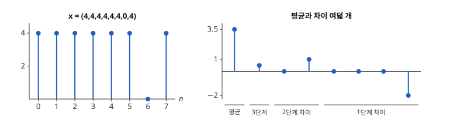

# 웨이블릿 변환

# 개요

**웨이블릿 변환(wavelet transform)** 은 신호를 위치와 폭이 서로 다른 짧은 파형들의 합으로 다시 적는 변환이다. 조용하던 녹음에 박수 소리가 한 번 들어가면, [이산 Fourier 변환](fourier.md)은 이 한 순간을 모든 주파수의 계수에 고르게 퍼뜨려 어디서 소리가 났는지 계수만으로는 알 수 없다. 웨이블릿 변환은 평균과 차이를 구간 크기를 두 배씩 늘려 가며 되풀이하고, 튄 위치 근처의 계수 몇 개에만 그 순간을 담는다.

# 직관

길이 $8$ 인 수열 $x=(4,4,4,4,4,4,0,4)$ 는 일곱째 값만 튄다. $x$ 는 모든 값이 $4$ 인 수열의 일곱째 값에서 $4$ 를 뺀 것이므로, 이산 Fourier 변환에서 $k\ne 0$ 인 모든 계수의 절댓값이 $4$ 이고, $0$ 인 계수가 하나도 없다.

[다중률 신호처리](multirate-signal-processing.md)의 평균과 차이를 쓴다. 이웃한 두 값 $(a,b)$ 를 평균 $\frac12(a+b)$ 와 차이 $\frac12(a-b)$ 로 바꾼다. 네 쌍에서 평균 $(4,4,4,2)$ 와 차이 $(0,0,0,-2)$ 가 나온다. 평균 네 개에 같은 일을 하면 평균 $(4,3)$ 과 차이 $(0,1)$ 이 나오고, 다시 하면 평균 $3.5$ 와 차이 $\frac12$ 가 나온다.

결과는 수 여덟 개 $3.5\mid\frac12\mid 0,1\mid 0,0,0,-2$ 이고 $0$ 이 아닌 것은 넷이다. 전체 평균 $3.5$ 를 빼면, 튄 값이 단계마다 그 위치를 덮는 차이 하나에만 나타난다. 차이를 역순으로 더하고 빼면 $x$ 가 그대로 돌아온다.

아래 그림의 왼쪽은 $x$, 오른쪽은 결과 여덟 개를 전체 평균, 3단계 차이, 2단계 차이, 1단계 차이의 순서로 놓은 것이다. 튄 값 하나가 왼쪽에서는 막대 하나의 빈자리로 보이고, 오른쪽에서는 $0$ 이 아닌 막대 넷으로 남는다.

# 정의

## Haar 웨이블릿

$\lbrack 0,1)$ 의 지시함수를 $\varphi$ 라 하고

$$
\psi(t)=\begin{cases}1 & 0\le t\lt\tfrac12\cr -1 & \tfrac12\le t\lt 1\cr 0 & \text{그 밖}\end{cases}
$$

를 **Haar 웨이블릿(Haar wavelet)** 이라 한다. 정수 $j,k$ 에 대해 $\psi_{j,k}(t)=2^{j/2}\psi(2^jt-k)$ 는 구간 $\lbrack k2^{-j},(k+1)2^{-j})$ 에 놓인 폭 $2^{-j}$ 의 파형이다. 직관 절의 차이는 각 단계에서 $x$ 를 계단함수로 보고 이 파형과 내적한 값을 상수배한 것이다.

## 다해상도 분석

$L^2(\mathbb R)$ 의 닫힌 부분공간열 $\cdots\subset V_{-1}\subset V_0\subset V_1\subset\cdots$ 와 함수 $\varphi$ 가 다음을 만족하면 **다해상도 분석(multiresolution analysis)** 이라 한다.

- $\bigcap_jV_j=\lbrace 0\rbrace$ 이고 $\bigcup_jV_j$ 가 $L^2(\mathbb R)$ 에서 조밀하다.
- $f(t)\in V_j$ 와 $f(2t)\in V_{j+1}$ 이 동치다.
- $\lbrace\varphi(t-k)\rbrace\_{k\in\mathbb Z}$ 가 $V_0$ 의 정규직교 기저다.

$\varphi$ 를 **척도 함수(scaling function)** 라 한다. Haar 의 경우 $V_j$ 는 구간 $\lbrack k2^{-j},(k+1)2^{-j})$ 마다 상수인 $L^2$ 함수 전체다.

## 척도 방정식

$\varphi\in V_0\subset V_1$ 이므로 계수열 $h_0$ 이 있어

$$
\varphi(t)=\sqrt2\sum_nh_0\lbrack n\rbrack\thinspace\varphi(2t-n)
$$

이다. 이것을 **척도 방정식(refinement equation)** 이라 한다. $h_1\lbrack n\rbrack=(-1)^nh_0\lbrack 1-n\rbrack$ 로 두고 $\psi(t)=\sqrt2\sum_nh_1\lbrack n\rbrack\varphi(2t-n)$ 를 그 다해상도 분석의 **웨이블릿(wavelet)** 이라 한다. Haar 의 경우 $h_0=(\frac1{\sqrt2},\frac1{\sqrt2})$ 이고 $\varphi(t)=\varphi(2t)+\varphi(2t-1)$, $\psi(t)=\varphi(2t)-\varphi(2t-1)$ 이다.

## 이산 웨이블릿 변환

길이 $N=2^J$ 인 수열에 저역 필터 $h_0$ 과 고역 필터 $h_1$ 로 된 두 채널 필터 뱅크의 분석 쪽을 적용하고, 저역 출력에 같은 분석을 되풀이한다. $J$ 번 되풀이해 얻은 저역 출력 $a_J$ 와 단계마다의 고역 출력 $d_1,\dots,d_J$ 를 **이산 웨이블릿 변환(discrete wavelet transform)** 이라 한다. 직관 절은 $J=3$ 이고 $h_0$, $h_1$ 의 $\frac1{\sqrt2}$ 를 $\frac12$ 로 바꾼 것이다.

# 성질

## Haar 계의 완비성

$\lbrace\psi_{j,k}\rbrace\_{j,k\in\mathbb Z}$ 는 $L^2(\mathbb R)$ 의 정규직교 기저다[^1]. $V_{j+1}$ 에서 $V_j$ 의 직교여공간을 $W_j$ 라 하면 $\lbrace\psi_{j,k}\rbrace\_k$ 가 $W_j$ 의 정규직교 기저이고, 다해상도 분석의 첫 조건에서 $L^2(\mathbb R)=\bigoplus_jW_j$ 가 나온다. 일반적인 다해상도 분석에서도 $h_1$ 로 정의한 $\psi$ 의 $\psi_{j,k}$ 가 같은 이유로 [Hilbert 공간](hilbert-spaces.md) $L^2(\mathbb R)$ 의 정규직교 기저가 된다.

## 소멸 모멘트

$m=0,\dots,p-1$ 에서 $\int t^m\psi(t)\thinspace dt=0$ 이면 $\psi$ 가 $p$ 개의 **소멸 모멘트(vanishing moment)** 를 갖는다고 한다. 그러면 $p-1$ 차 이하 다항식과 $\psi_{j,k}$ 의 내적이 $0$ 이다. $f$ 가 $\psi_{j,k}$ 의 받침 근처에서 $p$ 번 연속 미분가능하면 Taylor 전개로

$$
\lvert\langle f,\psi_{j,k}\rangle\rvert\le C\thinspace 2^{-j(p+1/2)}
$$

이다. 매끄러운 부분의 계수는 단계가 오를수록 빨리 작아지고, 큰 계수는 $f$ 가 매끄럽지 않은 자리에만 남는다. Haar 웨이블릿은 $p=1$ 이다.

## 받침이 콤팩트인 매끄러운 웨이블릿

Haar 웨이블릿은 불연속이다. 모든 $p\ge 1$ 에 대해 필터 길이가 $2p$ 이고 소멸 모멘트가 $p$ 개인, 받침이 콤팩트한 정규직교 웨이블릿이 존재한다. 이것을 Daubechies 웨이블릿(Daubechies wavelet)이라 하고, $p=1$ 이 Haar 다. $p$ 가 커지면 $\psi$ 의 매끄러움이 대략 $p$ 에 비례해 늘어난다[^2].

## 계산량과 국소성

단계마다 수열의 길이가 반으로 줄므로, 길이 $L$ 인 필터의 이산 웨이블릿 변환은 $L(N+N/2+N/4+\cdots)\le 2LN$ 번의 곱셈, 곧 $O(N)$ 번으로 계산된다. [고속 Fourier 변환](fft.md)의 $O(N\log N)$ 보다 적다. 입력의 한 값은 단계마다 약 $L/2$ 개의 계수에만 영향을 주므로, 한 점에서 튄 값은 $O(L\log N)$ 개의 계수에만 나타난다. 직관 절에서는 $L=2$ 이고 단계마다 하나였다.

# 활용

- 영상 압축. JPEG 2000(Joint Photographic Experts Group) 표준은 영상의 가로와 세로에 이산 웨이블릿 변환을 적용하고, 작은 계수를 거칠게 양자화해 저장한다.
- 잡음 제거. 무상관 잡음은 모든 계수에 고르게 퍼지고 신호는 큰 계수 몇 개에 모이므로, 문턱값보다 작은 계수를 $0$ 으로 만들고 역변환한다. 이것을 웨이블릿 수축(wavelet shrinkage)이라 한다.
- 희소 표현. [압축 센싱](compressed-sensing.md)은 웨이블릿 기저에서 계수 대부분이 $0$ 에 가까운 영상을 적은 측정으로 복원한다.
- 수치해석. 매끄러운 핵을 갖는 적분 작용소를 웨이블릿 기저로 적으면 행렬 성분 대부분이 작아져, 작은 성분을 버린 희소 행렬로 계산한다.

[^1]: A. Haar, "Zur Theorie der orthogonalen Funktionensysteme", *Mathematische Annalen* 69 (1910), 331–371.
[^2]: I. Daubechies, "Orthonormal bases of compactly supported wavelets", *Communications on Pure and Applied Mathematics* 41 (1988), 909–996.

# 연관 문서

## 선수지식

- [Hilbert 공간](hilbert-spaces.md)
- [다중률 신호처리](multirate-signal-processing.md)

## 더 알아보기

아직 연결한 문서가 없다.

#signal_processing #functional_analysis #analysis
