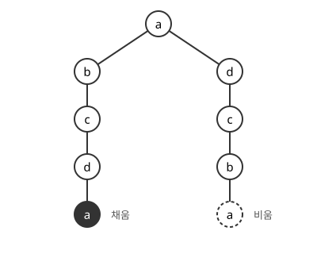

# Weitz 알고리즘

# 개요

**Weitz 알고리즘(Weitz's algorithm)** 은 그래프의 독립집합 수를 무작위 추출 없이 정해진 계산만으로 근사하는 방법이다. 정점이 수백 개인 그래프의 독립집합은 너무 많아 하나씩 셀 수 없고, 한 정점이 독립집합에 들어 있을 확률을 알면 그 정점을 지우며 개수를 곱으로 되살릴 수 있다. 그런데 그 확률을 구하는 데 고리가 많은 그래프 전체가 얽혀 든다.

한 정점에서 출발해 같은 정점을 두 번 밟지 않는 걸음들을 가지로 펼쳐 나무를 만들면, 나무에서는 확률이 아래에서 위로 한 번에 계산되고 그 값이 원래 그래프의 확률과 같다. 나무를 얕은 깊이에서 자르고, 먼 곳의 영향이 깊이에 따라 빨리 사라지는 범위에서 오차를 묶는다.

# 직관

정점 $a,b,c,d$ 를 차례로 이은 네 칸 고리 $C_4$ 에서 독립집합은 $7$ 개이고, 그 가운데 $a$ 를 담은 것은 $\lbrace a\rbrace$ 와 $\lbrace a,c\rbrace$ 둘이다. 일곱 개를 같은 확률로 뽑으면 $a$ 가 들어 있을 확률은 $2/7$ 이다.

나무라면 이 확률을 아래에서 위로 구한다. [단단한 알갱이 모형](hard-core-model.md)의 나무 재귀는 정점 $v$ 가 들어 있을 확률과 비어 있을 확률의 비 $R_v$ 를 자식들의 비로 적는다. 활동도가 $1$ 이면 다음과 같다.

$$
R_v=\prod_{w\text{ 는 }v\text{ 의 자식}}\frac{1}{1+R_w}
$$

$C_4$ 는 나무가 아니므로 $a$ 에서 같은 정점을 다시 밟지 않고 가는 걸음을 모두 펼친다. $a\to b\to c\to d$ 와 $a\to d\to c\to b$ 두 갈래가 나오고, 갈래의 끝에서 다음 걸음은 $a$ 로 돌아온다. 돌아온 $a$ 는 왼쪽 갈래에서는 채우고 오른쪽 갈래에서는 비운다. 아래 그림이 이 나무다.

채운 잎은 부모에 인수 $0$ 을, 비운 잎은 인수 $1$ 을 준다. 왼쪽 갈래는 아래에서부터 $R=0,1,1/2$ 이고 오른쪽 갈래는 $R=1,1/2,2/3$ 이다. 뿌리에서는 $R_a=\frac{1}{1+1/2}\cdot\frac{1}{1+2/3}=\frac25$ 이므로 $a$ 가 들어 있을 확률은 $\frac{2/5}{1+2/5}=\frac27$ 이다. 그래프에서 센 값과 같다.

# 정의

## 자기 회피 걸음 나무

그래프 $G=(V,E)$ 의 정점마다 이웃들의 순서를 하나 정해 둔다. 정점 $v$ 의 **자기 회피 걸음 나무(self-avoiding walk tree)** $T_{\mathrm{saw}}(G,v)$ 는 다음 나무다.

- 정점은 $v$ 에서 출발해 같은 정점을 두 번 밟지 않는 걸음이고, 뿌리는 길이 $0$ 인 걸음 $v$ 다. 걸음에 정점 하나를 이어 붙인 걸음이 그 자식이다.
- 걸음 $v,\dots,u,\dots,x$ 에서 $x$ 의 이웃 $u$ 가 이미 걸음 위에 있으면, 걸음에 $u$ 를 붙인 것을 잎으로 둔다. 걸음이 $u$ 를 떠난 간선을 $u\to u'$, 돌아온 간선을 $x\to u$ 라 할 때, $u$ 의 이웃 순서에서 $x$ 가 $u'$ 보다 뒤이면 이 잎을 **채운 잎**, 앞이면 **비운 잎** 으로 고정한다.

직관 절의 그림은 이웃 순서를 알파벳 순으로 둔 $T_{\mathrm{saw}}(C_4,a)$ 다. 왼쪽 갈래는 $a$ 를 $b$ 로 떠나 $d$ 에서 돌아오고, $a$ 의 순서에서 $d$ 가 $b$ 뒤이므로 채운 잎이다. 오른쪽 갈래는 $d$ 로 떠나 $b$ 에서 돌아오므로 비운 잎이다.

## 강한 공간 혼합

최대 차수가 $\Delta$ 인 그래프의 모임 위의 단단한 알갱이 모형이 **강한 공간 혼합(strong spatial mixing)** 을 만족한다는 것은, 상수 $C,\delta\gt0$ 이 있어 모든 그래프 $G$, 정점 $v$, 정점 집합 $\Lambda$ 와 $\Lambda$ 위의 두 고정 상태 $\sigma,\tau$ 에 대해 다음이 성립하는 것이다.

$$
\big\vert\mu(v\in I\mid\sigma)-\mu(v\in I\mid\tau)\big\vert\le C\thinspace e^{-\delta\thinspace\mathrm{dist}(v,\thinspace D)}
$$

$D$ 는 $\sigma$ 와 $\tau$ 가 다른 정점의 집합이다. 두 고정 상태가 $v$ 에서 멀리 떨어진 곳에서만 다르면 $v$ 가 들어 있을 확률이 거의 같다. 이 성질을 **상관 감쇠(correlation decay)** 라고도 한다.

# 성질

## Weitz 의 나무 정리

$G$ 위의 단단한 알갱이 모형에서 $v$ 가 들어 있을 확률은, $T_{\mathrm{saw}}(G,v)$ 위에서 채운 잎과 비운 잎을 고정한 단단한 알갱이 모형에서 뿌리가 들어 있을 확률과 같다[^1]. 정점에 고정 상태를 더 준 경우에도 나무의 해당 복사본을 같이 고정하면 성립한다.

증명의 요지. $v$ 의 이웃을 순서대로 $w_1,\dots,w_k$ 라 하고, $v$ 를 복사본 $v_1,\dots,v_k$ 로 갈라 $v_i$ 를 $w_i$ 에만 잇는다. $R_v$ 는 복사본을 하나씩 풀어 주는 비 $k$ 개의 곱으로 적히고, $i$ 번째 비에서는 $j\gt i$ 인 복사본 $v_j$ 를 채우고 $j\lt i$ 인 $v_j$ 를 비운다. 이 비는 $w_i$ 를 뿌리로 한 재귀의 인수 $1/(1+R_{w_i})$ 꼴이다. 각 $w_i$ 에서 같은 논증을 되풀이하면, $v$ 를 $w_i$ 로 떠나 $w_j$ 에서 돌아온 걸음의 끝은 $j\gt i$ 이면 채움, $j\lt i$ 이면 비움으로 고정된다.

## 자른 나무의 오차

자기 회피 걸음 나무는 정점 수가 깊이에 따라 지수적으로 늘어나므로 깊이 $L$ 에서 자르고 잘린 자리의 잎을 아무렇게나 고정한다. 강한 공간 혼합이 성립하면 이렇게 얻은 뿌리의 확률과 참값의 차는 $Ce^{-\delta L}$ 이하다. 최대 차수가 $\Delta$ 이면 자른 나무의 정점 수는 $\Delta^{L}$ 이하이므로 $L=O(\log(n/\varepsilon))$ 으로 잡으면 계산 시간이 $n$ 과 $1/\varepsilon$ 의 다항식이다. 지수에 $\log\Delta$ 가 들어가므로 $\Delta$ 를 고정해야 다항식이다.

## 유일성 문턱까지의 상관 감쇠

최대 차수가 $\Delta$ 인 그래프의 자기 회피 걸음 나무는 모든 정점의 차수가 $\Delta$ 인 무한 나무 $\mathbb T_\Delta$ 의 부분나무다. Weitz 는 $\mathbb T_\Delta$ 위에서 다음 조건이 성립하면 강한 공간 혼합이 성립하고, 그것이 모든 부분나무로, 따라서 최대 차수 $\Delta$ 인 모든 그래프로 옮겨 감을 증명했다[^1].

$$
\lambda\lt\lambda_c(\Delta)=\frac{(\Delta-1)^{\Delta-1}}{(\Delta-2)^{\Delta}}
$$

$\lambda_c(\Delta)$ 는 $\mathbb T_\Delta$ 위의 Gibbs 측도가 하나에서 여럿으로 바뀌는 유일성 문턱이다. $\Delta=3$ 이면 $\lambda_c=4$ 이므로 $\lambda=1$, 곧 독립집합의 수를 세는 문제는 최대 차수 $3$ 인 그래프에서 이 범위에 든다. $\Delta=6$ 이면 $\lambda_c=5^5/4^6\approx0.763$ 이라 $\lambda=1$ 이 범위 밖이다.

## 개수의 근사

정점을 $v_1,\dots,v_n$ 으로 늘어놓으면 분배함수가 다음 곱으로 적힌다.

$$
Z_G(\lambda)=\prod_{i=1}^{n}\frac{1}{\mu(v_i\notin I\mid v_1,\dots,v_{i-1}\notin I)}
$$

앞의 정점들을 비운 조건은 그 정점들을 지운 그래프와 같다. 각 인수를 자른 나무로 $1\pm\varepsilon/n$ 안으로 근사하면 곱은 $1\pm O(\varepsilon)$ 안에 든다. 그래서 $\lambda\lt\lambda_c(\Delta)$ 이면 최대 차수 $\Delta$ 인 그래프의 $Z_G(\lambda)$ 에 대한 완전 다항시간 근사 계획(fully polynomial-time approximation scheme, FPTAS)이 있다.

$C_4$ 에서는 $\frac{7}{5}\cdot\frac{5}{3}\cdot\frac{3}{2}\cdot 2=7$ 이다. 첫 인수는 직관 절의 $a$ 가 비어 있을 확률 $5/7$ 에서, 나머지는 $a$ 를 지운 경로 $b\text{–}c\text{–}d$, $c\text{–}d$, $d$ 에서 나온다.

$\lambda\gt\lambda_c(\Delta)$ 이면 $\Delta$ 정칙 그래프에서 $Z_G(\lambda)$ 를 근사하는 무작위 다항시간 알고리즘도 $\mathrm{NP}=\mathrm{RP}$ 가 아닌 한 없으므로[^2], 계산이 쉬운 범위와 어려운 범위가 $\lambda_c(\Delta)$ 에서 갈린다.

# 활용

- [근사 세기](approximate-counting.md)의 결정적 알고리즘. [Markov 연쇄](markov-chains.md)로 표본을 뽑지 않고 개수를 근사하는 방법이고, 무작위성 없이 상대오차를 보장한다.
- 다른 두 상태 스핀계. [Ising 모형](ising-model.md)의 반강자성 판본과 일반 두 상태 스핀계에서도 자기 회피 걸음 나무와 상관 감쇠로 유일성 문턱까지 FPTAS 를 얻는다.
- 표본 추출의 혼합 증명. 자기 회피 걸음 나무에서 영향이 줄어드는 것을 [Glauber 동역학](glauber-dynamics.md)의 혼합시간으로 옮긴 것이 스펙트럼 독립성(spectral independence)의 논증이고, 이것으로 유일성 문턱 전체에서 혼합시간이 다항식임이 증명되었다.
- 부호 있는 활동도와 다항식의 영점. 나무 재귀를 복소수 활동도로 넓혀 분배함수가 $0$ 이 되지 않는 영역을 찾고, 그 영역에서 다항식 보간으로 근사하는 Barvinok 의 방법과 이어진다.

[^1]: D. Weitz, "Counting independent sets up to the tree threshold", *Proceedings of the 38th ACM Symposium on Theory of Computing* (2006), 140–149.
[^2]: A. Sly, N. Sun, "The computational hardness of counting in two-spin models on d-regular graphs", *Annals of Probability* 42 (2014), 2383–2416.

# 연관 문서

## 선수지식

- [단단한 알갱이 모형](hard-core-model.md)
- [근사 세기](approximate-counting.md)

## 더 알아보기

아직 연결한 문서가 없다.

#probability #algorithms #graph_theory #complexity
