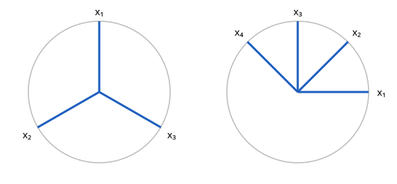

# Welch 상한

# 개요

**Welch 상한(Welch bound)** 은 $d$ 차원 공간에 단위 벡터 $N$ 개를 놓을 때, 서로 다른 두 벡터의 내적의 절댓값 가운데 가장 큰 것이 적어도 얼마인지 정하는 부등식이다. 평면에 단위 벡터 세 개를 $120^\circ$ 간격으로 놓으면 어느 두 벡터의 내적도 $-\tfrac12$ 이고, 네 개를 놓으면 어떻게 놓아도 내적의 절댓값이 $\tfrac12$ 보다 큰 쌍이 생긴다.

신호를 여러 송신자가 한 채널로 보낼 때 송신자마다 벡터 하나를 주면, 두 벡터의 내적이 서로 섞여 들어가는 간섭의 크기다. 이 부등식은 벡터의 수와 차원만으로 간섭의 최솟값을 주고, 그 값을 달성하는 배치가 무엇인지 정한다.

# 직관

아래 그림의 왼쪽은 평면에 단위 벡터 셋을 $120^\circ$ 간격으로 놓은 것이고, 오른쪽은 넷을 $45^\circ$ 간격으로 놓은 것이다. 벡터 대신 원점을 지나는 직선으로 보면 $x$ 와 $-x$ 는 같은 직선이라, 오른쪽은 평면의 직선 네 개를 고르게 놓은 것이다.

왼쪽에서 어느 두 벡터의 내적도 $\cos120^\circ=-\tfrac12$ 이고 절댓값은 $\tfrac12$ 이다. 오른쪽에서 이웃한 두 벡터의 내적은 $\cos45^\circ\approx0.707$ 이다.

벡터 하나하나의 각도를 따지지 않고 내적 전체를 한 번에 센다. 단위 벡터 $x_1,\dots,x_N$ 의 내적을 모두 제곱해 더한 값은 $N$ 개의 대각항 $1$ 과 나머지 $N(N-1)$ 개의 항으로 나뉜다. 이 합이 차원 $d$ 에 따라 아래로 막혀 있으면, 대각 밖의 항 가운데 하나는 평균 이상이어야 한다.

# 정의

$x_1,\dots,x_N$ 을 $\mathbb R^d$ 나 $\mathbb C^d$ 의 단위 벡터라 할 때 다음 값을 벡터족의 **최대 결맞음(maximal coherence)** 이라 한다.

$$
\mu=\max_{i\ne j}\vert\langle x_i,x_j\rangle\vert
$$

직관 절의 왼쪽은 $\mu=\tfrac12$, 오른쪽은 $\mu=\tfrac{\sqrt2}2$ 다.

$x_i$ 를 열로 둔 $d\times N$ 행렬을 $X$ 라 하고, $G=X^\ast X$ 를 **Gram 행렬(Gram matrix)** 이라 한다. $G$ 의 $(i,j)$ 성분은 $\langle x_j,x_i\rangle$ 이다. 다음을 만족하는 벡터족을 **단단한 프레임(tight frame)** 이라 한다.

$$
XX^\ast=\frac Nd I
$$

왼쪽의 세 벡터는 단단한 프레임이다. 세 벡터를 $(0,1)$, $(-\tfrac{\sqrt3}2,-\tfrac12)$, $(\tfrac{\sqrt3}2,-\tfrac12)$ 로 두면 첫 좌표의 제곱의 합과 둘째 좌표의 제곱의 합이 모두 $\tfrac32$ 이고 두 좌표의 곱의 합은 $0$ 이다. 그래서 $XX^\ast=\tfrac32I$ 다.

# 성질

## Welch 상한

정리. $\mathbb R^d$ 나 $\mathbb C^d$ 의 단위 벡터 $N$ 개 ($N\ge d$) 에서 다음이 성립한다[^1].

$$
\mu^2\ge\frac{N-d}{d(N-1)}
$$

증명의 요지. $G$ 는 대각합이 $N$ 이고 계수가 $d$ 이하인 양의 반정부호 행렬이다. $0$ 아닐 수 있는 고윳값 $\lambda_1,\dots,\lambda_d$ 에 [Cauchy–Schwarz 부등식](cauchy-schwarz.md)을 쓰면 다음이 나온다.

$$
\sum_{i,j}\vert\langle x_i,x_j\rangle\vert^2=\sum_k\lambda_k^2\ge\frac1d\Bigl(\sum_k\lambda_k\Bigr)^2=\frac{N^2}d
$$

대각항이 모두 $1$ 이므로 좌변은 다음 값 이하다.

$$
N+\sum_{i\ne j}\vert\langle x_i,x_j\rangle\vert^2\le N+N(N-1)\mu^2
$$

두 식을 합쳐 $\mu^2$ 에 대해 풀면 정리가 나온다.

$d=2$, $N=3$ 이면 우변은 $\tfrac14$ 이고 왼쪽 그림의 $\mu^2=\tfrac14$ 가 등호다. $N=4$ 이면 우변은 $\tfrac13$ 이고, 오른쪽 그림의 $\mu^2=\tfrac12$ 는 이보다 크다.

## 등호 조건

등호는 두 부등식이 모두 등호일 때 성립한다. 고윳값이 모두 같아야 하므로 벡터족이 단단한 프레임이고, 대각 밖의 $\vert\langle x_i,x_j\rangle\vert$ 가 모두 같아야 하므로 벡터들이 [등각 직선](equiangular-lines.md)을 이룬다. 두 조건을 함께 만족하는 벡터족을 **등각 단단한 프레임(equiangular tight frame)** 이라 한다.

실수 공간에서 등각 직선은 $\binom{d+1}2$ 개를 넘지 못하므로, 등각 단단한 프레임은 $N\le\binom{d+1}2$ 에서만 있다. $d=2$ 에서 $\binom32=3$ 이라 $N=4$ 의 등호가 불가능하고, 오른쪽 그림이 등호에 이르지 못하는 것과 맞는다. 복소 공간에서는 상한이 $d^2$ 이다.

## 큰 N 에서의 값

$N$ 이 $d$ 보다 훨씬 크면 우변은 $\tfrac1d$ 에 가깝다. 그래서 차원 $d$ 에서 결맞음은 벡터를 아무리 늘려도 $\tfrac1{\sqrt d}$ 근처까지만 내려가고, 단위 벡터를 $d$ 개 이하로 쓰면 정규직교 기저로 $\mu=0$ 을 얻는다.

# 활용

- [압축 센싱](compressed-sensing.md). 측정 행렬의 열들의 최대 결맞음이 작을수록 더 많은 0 아닌 성분을 가진 신호를 복원할 수 있고, Welch 상한이 그 결맞음의 하한이다.
- 부호 분할 다중 접속(code division multiple access, CDMA). 송신자마다 길이 $d$ 의 확산 수열을 줄 때 송신자 수 $N$ 에서 피할 수 없는 상호 간섭이 Welch 상한이다. 원래 Welch 가 이 문제로 부등식을 얻었다[^1].
- [두 그래프](two-graphs.md). 실수 등각 단단한 프레임은 두 고윳값을 갖는 Seidel 행렬, 곧 정칙 두 그래프와 대응한다.

[^1]: L. R. Welch, "Lower bounds on the maximum cross correlation of signals", *IEEE Transactions on Information Theory* 20 (1974), 397–399.

# 연관 문서

## 선수지식

- [등각 직선](equiangular-lines.md)

## 더 알아보기

아직 연결한 문서가 없다.

#linear_algebra #signal_processing #combinatorics
