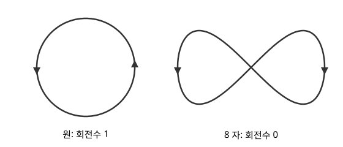

# Whitney–Graustein 정리

# 개요

**Whitney–Graustein 정리(Whitney–Graustein theorem)** 는 평면에 멈추거나 꺾이지 않고 그린 두 닫힌 곡선을, 그 성질을 유지한 채 연속으로 바꿔 서로 옮길 수 있는지가 접선 방향이 한 바퀴 동안 도는 횟수 하나로 정해진다는 정리다. 원과 8 자 곡선은 모두 매끄럽게 한 번에 그릴 수 있지만, 원을 아무리 주무르며 늘려도 어느 순간 뾰족한 점이 생기지 않고는 8 자가 되지 않는다. 이 정리는 원의 접선이 한 바퀴, 8 자의 접선이 $0$ 바퀴 돌기 때문에 둘을 옮길 수 없다는 것과, 회전수가 같으면 반드시 옮길 수 있다는 것을 함께 보인다.

# 직관

아래 그림의 왼쪽은 원 $\gamma(t)=(\cos t,\sin t)$, 오른쪽은 8 자 곡선 $\gamma(t)=(\sin t,\sin t\cos t)$ 다. 화살표는 $t$ 가 커지는 방향이다.

원의 속도 $(-\sin t,\cos t)$ 는 $t$ 가 $0$ 에서 $2\pi$ 까지 가는 동안 원점 둘레를 반시계 방향으로 한 번 돈다. 8 자의 속도 $(\cos t,\cos 2t)$ 는 어느 $t$ 에서도 $0$ 이 아니다. 그 방향은 $t=0$ 에서 $45^\circ$ 이고, 오른쪽 고리를 지나는 동안 시계 방향으로 $270^\circ$ 돌았다가 왼쪽 고리에서 반시계 방향으로 $270^\circ$ 돌아온다. 그래서 한 바퀴 동안 속도가 도는 횟수는 $0$ 이다.

곡선을 조금씩 바꾸어도 속도가 $0$ 이 되지 않으면, 속도가 도는 횟수는 정수이면서 연속으로 변하므로 바뀌지 않는다. 원에서 8 자로 가는 변형은 횟수를 $1$ 에서 $0$ 으로 바꿔야 하므로, 도중 어딘가에서 속도가 $0$ 인 점, 곧 곡선이 멈추거나 뾰족해지는 점을 거친다.

# 정의

**정칙 닫힌 곡선(regular closed curve)** 은 연속 미분 가능한 주기 $2\pi$ 의 사상 $\gamma:\mathbb R\to\mathbb R^2$ 로, 모든 $t$ 에서 $\gamma^\prime(t)\ne 0$ 인 것이다. 직관 절의 원과 8 자가 정칙 닫힌 곡선이다. 곡선이 자기 자신과 만나도 된다.

$\gamma$ 의 **회전수(rotation number, turning number)** $\mathrm{rot}(\gamma)$ 는 닫힌 경로 $\gamma^\prime$ 의 원점 둘레의 [감김수](winding-number.md)다. 원은 $\mathrm{rot}=1$, 8 자는 $\mathrm{rot}=0$ 이고, 원을 거꾸로 도는 $(\cos t,-\sin t)$ 는 $\mathrm{rot}=-1$ 이다.

두 정칙 닫힌 곡선 $\gamma_0,\gamma_1$ 사이의 **정칙 호모토피(regular homotopy)** 는 $s\in\lbrack 0,1\rbrack$ 마다 정칙 닫힌 곡선 $\gamma_s$ 를 주는 족으로, $\gamma_s(t)$ 와 $\gamma_s^\prime(t)$ 가 $(s,t)$ 에 대해 연속인 것이다. 원을 반지름 $1+s$ 로 키우는 $\gamma_s(t)=(1+s)(\cos t,\sin t)$ 는 정칙 호모토피다.

# 성질

## Whitney–Graustein 정리

두 정칙 닫힌 곡선이 정칙 호모토피로 이어지는 것은 회전수가 같은 것과 동치다. Whitney 가 1937 년에 발표했고, 정리를 Graustein 과 함께 얻은 것으로 적었다.[^1]

증명의 요지. 회전수가 같아야 하는 것은 직관 절의 논증이다. 거꾸로 회전수가 같으면, 먼저 매개변수를 바꾸고 크기를 맞추는 정칙 호모토피로 두 곡선을 속력 $1$, 길이 $2\pi$ 로 만든다. 그러면 단위 접선 $u_0,u_1:\mathbb R/2\pi\mathbb Z\to S^1$ 은 감김수가 같아 [덮개공간](covering-spaces.md)의 올림으로 호모토피 $u_s$ 가 있다.

$u_s$ 를 적분한 곡선은 닫히지 않을 수 있으므로 평균을 뺀다.

$$
\gamma_s(t)=\int_0^t\Bigl(u_s(\theta)-\frac{1}{2\pi}\int_0^{2\pi}u_s\Bigr)d\theta
$$

이 곡선은 닫혀 있고, 평균의 길이가 $1$ 보다 작으면 속도가 $0$ 이 되지 않는다. 평균의 길이가 $1$ 인 것은 $u_s$ 가 상수일 때뿐이므로, 상수를 거치지 않는 호모토피 $u_s$ 를 고르면 $\gamma_s$ 가 정칙 호모토피다.

## 형식적 해와 실제 해

정칙 닫힌 곡선마다 단위 접선 $\gamma^\prime/\vert\gamma^\prime\vert$ 은 $S^1$ 에서 $S^1$ 로 가는 사상이다. 정리는 정칙 닫힌 곡선의 정칙 호모토피류가 이 사상의 호모토피류, 곧 정수 하나와 일대일로 대응한다는 것이다. 미분 조건 "$\gamma^\prime\ne 0$" 을 푸는 문제가 그 조건에서 도함수를 잊어버린 사상의 호모토피 문제로 바뀐다. 이 꼴의 진술을 h 원리(h-principle)라 한다.

## 단순 닫힌 곡선의 회전수

자기 자신과 만나지 않는 정칙 닫힌 곡선의 회전수는 $\pm 1$ 이다. 이것이 Hopf 의 회전 정리(Hopf's Umlaufsatz)다.[^2] 따라서 자기 자신과 만나지 않는 두 곡선은 같은 방향으로 돌면 정칙 호모토피로 이어진다. 8 자는 자기 자신과 한 번 만나고 회전수가 $0$ 이다.

# 활용

- [곡률](curvature.md). 속력 $1$ 인 곡선의 부호 있는 곡률 $\kappa$ 는 단위 접선의 각의 변화율이므로, 한 바퀴 적분하면 $\int\kappa\thinspace ds=2\pi\thinspace\mathrm{rot}(\gamma)$ 다. 단순 닫힌 곡선에서는 Hopf 의 회전 정리로 이 값이 $\pm 2\pi$ 다.
- 구면 뒤집기. Smale 은 같은 꼴의 분류를 구면의 몰입(immersion)으로 넓혀, $\mathbb R^3$ 안의 구면을 매끄러운 몰입을 유지하며 안팎을 뒤집을 수 있음을 보였다.[^3] 평면 곡선에서는 회전수가 $1$ 과 $-1$ 로 달라 원을 거꾸로 도는 원으로 뒤집을 수 없다.
- [Nash 매장 정리](nash-embedding-theorem.md). $C^1$ 등거리 매장의 존재도 h 원리의 꼴이고, Gromov 는 두 결과를 볼록 적분(convex integration)이라는 한 방법으로 묶었다.

[^1]: H. Whitney, "On regular closed curves in the plane", *Compositio Mathematica* **4** (1937), 276–284.

[^2]: H. Hopf, "Über die Drehung der Tangenten und Sehnen ebener Kurven", *Compositio Mathematica* **2** (1935), 50–62.

[^3]: S. Smale, "A classification of immersions of the two-sphere", *Transactions of the American Mathematical Society* **90** (1959), 281–290.

# 연관 문서

## 선수지식

- [감김수](winding-number.md)

## 더 알아보기

아직 연결한 문서가 없다.

#topology #differential_geometry
