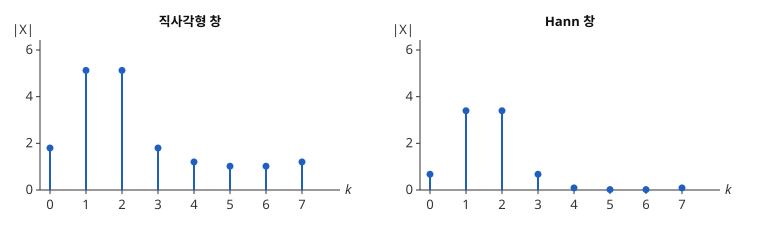

# 창함수

# 개요

**창함수(window function)** 는 유한 구간에서 잘라 낸 측정값에 곱해 양 끝의 값을 $0$ 쪽으로 줄이는 가중치 수열이다. 8 번 재는 동안 한 바퀴 반 도는 회전을 [이산 Fourier 변환](fourier.md)으로 바꾸면, 주파수 $1$ 과 $2$ 사이에 있어야 할 세기가 주파수 $0$ 부터 $7$ 까지 전부에 퍼진다. 측정값에 창함수를 곱한 뒤 변환하면 먼 주파수로 퍼지는 세기가 수십 분의 일로 줄어든다.

# 직관

길이 $N=8$ 인 수열 $x\lbrack t\rbrack=e^{2\pi i\cdot 1.5\thinspace t/8}$ 을 본다. 8 칸 동안 한 바퀴 반을 돈다. 이산 Fourier 변환은 이 수열을 주파수 $0,1,\dots,7$ 의 회전으로 나누는데, $1.5$ 는 그중 어느 것과도 같지 않다. 등비급수를 더하면 $X\lbrack k\rbrack=1+i\cot\bigl(\pi(1.5-k)/8\bigr)$ 이고, 절댓값은 $k=0,\dots,7$ 에서 차례로

$$
1.80,\quad 5.13,\quad 5.13,\quad 1.80,\quad 1.20,\quad 1.02,\quad 1.02,\quad 1.20
$$

이다. 가장 먼 $k=5,6$ 에도 $1$ 이 넘게 남는다.

이산 Fourier 변환은 수열을 8 칸마다 되풀이되는 것으로 다룬다. $x\lbrack 7\rbrack$ 다음에 $x\lbrack 0\rbrack$ 이 오는데, 한 바퀴 반을 돈 뒤라 $x\lbrack 7\rbrack$ 과 $x\lbrack 0\rbrack$ 사이에서 회전의 방향이 반 바퀴 뒤집힌다. 이 끊김을 회전 여러 개로 메우느라 모든 주파수에 값이 생긴다.

끊김이 양 끝에서 생겼으니 양 끝의 값을 줄인다. $x\lbrack t\rbrack$ 에 $w\lbrack t\rbrack=\frac12-\frac12\cos(2\pi t/8)$ 을 곱한다. $w\lbrack 0\rbrack=0$, $w\lbrack 4\rbrack=1$ 이고 그 사이에서 매끄럽게 오르내린다. 곱한 수열을 변환한 값의 절댓값은

$$
0.68,\quad 3.40,\quad 3.40,\quad 0.68,\quad 0.090,\quad 0.018,\quad 0.018,\quad 0.090
$$

이다. $k=5,6$ 의 값이 $1.02$ 에서 $0.018$ 로 줄었다. 아래 그림의 왼쪽이 곱하기 전, 오른쪽이 곱한 뒤다. 오른쪽에서는 $k=1,2$ 의 두 막대 밖이 거의 $0$ 이다.

곱한 수열 $w$ 가 창함수이고, 한 주파수의 세기가 다른 주파수로 퍼지는 현상이 스펙트럼 누설이다.

# 정의

## 창함수와 창을 곱한 변환

길이 $N$ 인 실수열 $w\lbrack 0\rbrack,\dots,w\lbrack N-1\rbrack$ 을 **창함수** 라 한다. 측정값 $x\lbrack 0\rbrack,\dots,x\lbrack N-1\rbrack$ 에 대해

$$
X_w\lbrack k\rbrack=\sum_{t=0}^{N-1}w\lbrack t\rbrack\thinspace x\lbrack t\rbrack\thinspace e^{-2\pi ikt/N},\qquad k=0,\dots,N-1
$$

을 창을 곱한 이산 Fourier 변환이라 한다. 직관 절의 두 목록은 같은 $x$ 에 대한 $\lvert X_w\lbrack k\rbrack\rvert$ 이고, 첫째는 모든 $w\lbrack t\rbrack=1$, 둘째는 $w\lbrack t\rbrack=\frac12-\frac12\cos(2\pi t/8)$ 인 경우다.

## 대표적인 창

- **직사각형 창(rectangular window)** 은 $w\lbrack t\rbrack=1$ 이다. 자르기만 하고 곱하지 않은 것과 같다.
- **Hann 창(Hann window)** 은 $w\lbrack t\rbrack=\frac12-\frac12\cos(2\pi t/N)$ 이다. 직관 절의 둘째 창이 $N=8$ 인 Hann 창이다.
- **Hamming 창(Hamming window)** 은 $w\lbrack t\rbrack=0.54-0.46\cos(2\pi t/N)$ 이다. 양 끝 값이 $0$ 이 아니라 $0.08$ 이다.

분모가 $N$ 인 위 꼴을 주기형(periodic)이라 한다. 분모를 $N-1$ 로 바꾸어 $w\lbrack 0\rbrack=w\lbrack N-1\rbrack$ 이 되게 한 꼴을 대칭형(symmetric)이라 한다. 주파수 분석에는 주기형을, [FIR 필터](fir-filters.md)(finite impulse response filter)의 계수 설계에는 대칭형을 쓴다.

## 창의 스펙트럼

창함수의 이산시간 [Fourier 변환](fourier-transform.md)

$$
W(\omega)=\sum_{t=0}^{N-1}w\lbrack t\rbrack\thinspace e^{-i\omega t}
$$

을 창의 스펙트럼이라 한다. $\lvert W\rvert$ 가 $\omega=0$ 을 둘러싸고 이루는 봉우리를 **주엽(main lobe)** 이라 하고, 그 양쪽의 첫 영점 사이 거리를 주엽의 폭이라 한다. 주엽 밖의 작은 봉우리들을 **곁엽(side lobe)** 이라 한다. 곁엽의 높이는 가장 높은 곁엽을 $\lvert W(0)\rvert$ 와 견준 데시벨 값 $20\log_{10}(\lvert W(\omega)\rvert/\lvert W(0)\rvert)$ 으로 적는다.

## 스펙트럼 누설

측정값이 주파수 $\omega_0$ 의 회전 하나 $x\lbrack t\rbrack=e^{i\omega_0t}$ 일 때 $X_w\lbrack k\rbrack=W(2\pi k/N-\omega_0)$ 이다. $\omega_0$ 가 $2\pi/N$ 의 정수배가 아니면 $W$ 를 영점이 아닌 자리에서 읽으므로 모든 $k$ 에 값이 생긴다. 이처럼 한 주파수의 세기가 다른 주파수의 계수에 나타나는 현상을 **스펙트럼 누설(spectral leakage)** 이라 한다. 주엽 안에서 읽힌 값은 이웃 주파수로의 누설이고, 곁엽에서 읽힌 값은 먼 주파수로의 누설이다.

# 성질

## 곱과 순환 합성곱

창의 이산 Fourier 변환을 $\hat w\lbrack m\rbrack$ 이라 하면

$$
X_w\lbrack k\rbrack=\frac1N\sum_{m=0}^{N-1}\hat w\lbrack m\rbrack\thinspace X\lbrack (k-m)\bmod N\rbrack
$$

이다. 이산 Fourier 변환의 [합성곱](convolution.md) 정리를 곱 쪽에 적용한 식이다. 주기형 Hann 창은 $w\lbrack t\rbrack=\frac12-\frac14e^{2\pi it/N}-\frac14e^{-2\pi it/N}$ 이므로 $\hat w$ 는 $m=0,1,N-1$ 에서만 $0$ 이 아니고

$$
X_w\lbrack k\rbrack=\tfrac12X\lbrack k\rbrack-\tfrac14X\lbrack k-1\rbrack-\tfrac14X\lbrack k+1\rbrack
$$

이다(첨자는 $N$ 으로 나눈 나머지). 직관 절의 둘째 목록이 이 식으로 계산된다. $X\lbrack k\rbrack=1+i\cot\varphi_k$, $\varphi_k=\pi(1.5-k)/8$ 을 넣으면 실수부가 $\frac12-\frac14-\frac14=0$ 으로 지워지고, 허수부의 $\cot$ 들도 이웃끼리 상쇄되어 $k=5$ 에서 $0.018$ 이 남는다.

## 주엽의 폭과 곁엽의 높이

직사각형 창의 스펙트럼은

$$
\lvert W(\omega)\rvert=\Bigl\lvert\frac{\sin(N\omega/2)}{\sin(\omega/2)}\Bigr\rvert
$$

이다. 등비급수를 더하면 나온다. 첫 영점이 $\omega=\pm 2\pi/N$ 이므로 주엽의 폭은 $4\pi/N$ 이다. Hann 창의 스펙트럼은 위 식의 $W$ 를 $\pm 2\pi/N$ 만큼 옮긴 두 사본과 섞은 것이라 첫 영점이 $\pm 4\pi/N$ 으로 밀리고 주엽의 폭은 $8\pi/N$ 이다. 세 창의 수치는 다음과 같다[^1].

| 창 | 주엽의 폭 | 가장 높은 곁엽 | 곁엽이 줄어드는 빠르기 |
| --- | --- | --- | --- |
| 직사각형 | $4\pi/N$ | $-13$ dB | $\lvert\omega\rvert^{-1}$ |
| Hann | $8\pi/N$ | $-31$ dB | $\lvert\omega\rvert^{-3}$ |
| Hamming | $8\pi/N$ | $-43$ dB | $\lvert\omega\rvert^{-1}$ |

곁엽을 낮추면 주엽이 넓어진다. 창을 정할 때는 이 둘 가운데 무엇을 줄일지 고른다.

## 끝점의 매끄러움과 곁엽

$w$ 를 $N$ 칸마다 되풀이한 수열을 연속함수의 표본으로 볼 때, 그 함수의 $m$ 번째 도함수에서 처음으로 끊김이 생기면 곁엽은 $\lvert\omega\rvert^{-(m+1)}$ 꼴로 줄어든다. 직사각형 창은 값 자체가 끊기므로 $m=0$ 이다. Hann 창은 $\frac12-\frac12\cos$ 의 값과 기울기가 양 끝에서 모두 $0$ 이고 2 계 도함수에서 처음 끊기므로 $m=2$ 다. Hamming 창은 양 끝 값이 $0.08$ 로 끊기므로 $m=0$ 이지만, 계수 $0.54$ 와 $0.46$ 이 첫 곁엽을 지우도록 골라져 가장 높은 곁엽이 Hann 창보다 낮다.

## 주파수가 맞을 때의 비용

$x\lbrack t\rbrack=e^{2\pi it/8}$ 처럼 주파수가 $2\pi/N$ 의 정수배이면 직사각형 창에서는 $X\lbrack 1\rbrack=8$ 이고 나머지가 $0$ 이다. 같은 수열에 Hann 창을 곱하면 합성곱 식에서 $X_w\lbrack 1\rbrack=4$, $X_w\lbrack 0\rbrack=X_w\lbrack 2\rbrack=-2$ 다. 누설이 없던 수열에서 값이 이웃 두 칸으로 번지고 봉우리가 절반이 된다.

봉우리의 높이 비 $\frac1N\sum_tw\lbrack t\rbrack$ 를 **결맞음 이득(coherent gain)** 이라 한다. 직사각형 창은 $1$, Hann 창은 $\frac12$ 다. 무상관 잡음의 세기는 $\sum_tw\lbrack t\rbrack^2$ 에 비례하므로, 같은 잡음에서 한 계수에 들어오는 잡음이 직사각형 창의 몇 배인지를 나타내는

$$
\mathrm{ENBW}=\frac{N\sum_tw\lbrack t\rbrack^2}{\bigl(\sum_tw\lbrack t\rbrack\bigr)^2}
$$

를 등가 잡음 대역폭(equivalent noise bandwidth, ENBW)이라 한다. Hann 창은 $\sum_tw\lbrack t\rbrack=N/2$, $\sum_tw\lbrack t\rbrack^2=3N/8$ 이므로 $\mathrm{ENBW}=1.5$ 다.

## 반씩 겹친 Hann 창의 합

주기형 Hann 창은 $N$ 이 짝수일 때 $w\lbrack t\rbrack+w\lbrack t+N/2\rbrack=1$ 을 만족한다. $\cos(\theta+\pi)=-\cos\theta$ 이므로 두 코사인 항이 지워진다. 그래서 신호를 반씩 겹친 조각으로 자르고 조각마다 Hann 창을 곱하면, 모든 조각을 제자리에 더한 합이 원래 신호와 같다.

# 활용

- [스펙트럼 추정](spectral-estimation.md)의 Welch 방법은 구간마다 창을 곱한 주기도를 평균한다. 그 문서의 정규화 상수 $U$ 는 위의 $\frac1N\sum_tw\lbrack t\rbrack^2$ 이다.
- [단시간 Fourier 변환](short-time-fourier-transform.md)은 조각마다 창을 곱해 변환하고, 반씩 겹친 Hann 창의 합이 $1$ 이라는 성질로 겹쳐 더하기 복원을 한다.
- [FIR 필터](fir-filters.md)의 창 방법은 이상적인 저역통과 응답을 대칭형 창으로 잘라 계수를 얻는다. 곁엽의 높이가 저지대역에 남는 진동의 크기가 된다.
- [Fejér 핵](fejer-kernel.md)은 Fourier 계수에 삼각형 창 $1-\lvert n\rvert/(N+1)$ 을 곱한 부분합의 핵이다. 이 창의 스펙트럼이 음이 아니어서 Gibbs 현상(Gibbs phenomenon)이 생기지 않는다.
- 주어진 곁엽 높이에서 주엽의 폭을 가장 좁게 하는 [Dolph–Chebyshev 창](dolph-chebyshev-window.md)과, 한 매개변수로 주엽의 폭과 곁엽의 높이를 조절하는 [Kaiser 창](kaiser-window.md)이 필터 설계에 쓰인다.

[^1]: F. J. Harris, "On the use of windows for harmonic analysis with the discrete Fourier transform", *Proceedings of the IEEE* 66 (1978), 51–83.

# 연관 문서

## 선수지식

- [이산 Fourier 변환](fourier.md)

## 더 알아보기

- [Dolph–Chebyshev 창](dolph-chebyshev-window.md)
- [Slepian 수열](slepian-sequences.md)
- [Kaiser 창](kaiser-window.md)

#signal_processing #analysis #statistics
