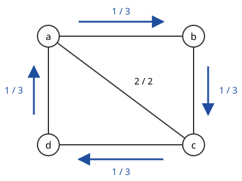

# 바람 부는 우편배달부 문제

# 개요

**바람 부는 우편배달부 문제(windy postman problem)** 는 길 하나를 지나는 비용이 방향마다 다른 그래프에서 모든 길을 한 번 이상 지나 출발점으로 돌아오는 가장 싼 걸음을 찾는 문제다. 언덕 동네의 길을 모두 치우는 제설차는 오르막에서 느리고 내리막에서 빠르므로, 같은 길도 어느 쪽으로 지나느냐에 따라 걸리는 시간이 다르다. 걸음을 길마다 지나는 횟수의 흐름으로 적으면, 모든 교차로에 붙은 길 수가 짝수일 때 이 문제는 [볼록 비용 흐름](convex-cost-flow.md) 하나로 풀린다.

# 직관

제설차가 차고에서 나와 동네의 길을 전부 치우고 돌아와야 한다. 아래 그림은 교차로 $a,b,c,d$ 와 길 다섯 개로 된 동네다. 네모를 이루는 네 길은 파란 화살표 방향으로 지나면 $1$, 반대로 지나면 $3$ 이 걸린다. 대각선 $ac$ 는 어느 방향이든 $2$ 다.

길마다 싼 방향으로 한 번씩 지나면 네모의 네 길에 $1$ 씩, 대각선에 $2$ 가 들어 합이 $6$ 이다. 그런데 $a$ 와 $c$ 에는 길이 세 개씩 붙어 있다. 닫힌 걸음은 교차로에 들어온 횟수만큼 나가므로 한 교차로에서 길을 지나는 횟수의 합은 짝수다. 세 길을 한 번씩만 지나면 합이 $3$ 이라 맞지 않으므로, $a$ 에 붙은 길 가운데 적어도 하나는 짝수 번 지나야 한다.

대각선을 $a\to c$, $c\to a$ 로 두 번 지나고 네모를 시계 방향으로 한 번씩 돌면 $4+4=8$ 이다. 다음 걸음도 길이가 $8$ 이다. $ab$ 와 $bc$ 를 싼 방향으로 두 번씩, 대각선을 $c\to a$ 로 한 번 지난다.

$$
a\to b\to c\to a\to b\to c\to d\to a
$$

[중국인 우편배달부 문제](chinese-postman-problem.md)처럼 길마다 비용을 하나로 정하면 이 차이가 사라진다. 네모를 시계 방향으로 돌면 $4$, 반시계 방향으로 돌면 $12$ 이므로, 어느 길을 더 지날지와 함께 어느 방향으로 지날지를 정해야 한다.

# 정의

## 바람 부는 우편배달부 문제

$G=(V,E)$ 를 연결된 무향 그래프라 하자. 변 $\lbrace u,v\rbrace$ 마다 $u$ 에서 $v$ 로 지나는 비용 $c(u,v)\ge 0$ 과 $v$ 에서 $u$ 로 지나는 비용 $c(v,u)\ge 0$ 이 있다. **바람 부는 우편배달부 문제** 는 모든 변을 적어도 한 번 지나는 닫힌 걸음 가운데 비용의 합이 최소인 것을 찾는 문제다. 변을 여러 번 지나면 지날 때마다 그 방향의 비용을 더한다.

직관 절에서 $c(a,b)=c(b,c)=c(c,d)=c(d,a)=1$, $c(b,a)=c(c,b)=c(d,c)=c(a,d)=3$, $c(a,c)=c(c,a)=2$ 이고 최솟값은 $8$ 이다. 모든 변에서 $c(u,v)=c(v,u)$ 이면 중국인 우편배달부 문제다.

## 흐름으로 쓴 꼴

걸음이 변 $\lbrace u,v\rbrace$ 를 $u$ 에서 $v$ 로 지나는 횟수를 $x_{uv}$ 라 하면 문제는 다음 정수계획이다.

$$
\begin{aligned}
\text{최소화}\quad&\sum_{\lbrace u,v\rbrace\in E}\bigl(c(u,v)x_{uv}+c(v,u)x_{vu}\bigr)\cr
\text{제약}\quad&\sum_{v}x_{uv}=\sum_{v}x_{vu}\quad(u\in V),\qquad x_{uv}+x_{vu}\ge 1\quad(\lbrace u,v\rbrace\in E)\cr
&x_{uv}\in\mathbb Z,\quad x_{uv}\ge 0
\end{aligned}
$$

첫 제약은 교차로마다 들어온 횟수와 나간 횟수가 같다는 것이고, 둘째 제약은 모든 변을 지난다는 것이다. 제약을 만족하는 $x$ 마다 $u$ 에서 $v$ 로 가는 호를 $x_{uv}$ 개 둔 유향 다중그래프는 모든 정점에서 들어오는 수와 나가는 수가 같고, 모든 변을 쓰므로 연결이다. 그래서 그 다중그래프에 [Euler 회로](eulerian-circuits.md)가 있고, 그것이 비용이 같은 닫힌 걸음이다.

변 $\lbrace u,v\rbrace$ 의 **알짜 흐름(net flow)** 은 $g_{uv}=x_{uv}-x_{vu}$ 다. 첫 제약은 $g$ 가 모든 정점에서 보존된다는 것과 같다. 직관 절의 첫 걸음에서 네모의 네 변은 시계 방향으로 $g=1$ 이고 대각선은 $g_{ac}=0$ 이다.

# 성질

## NP-어려움

바람 부는 우편배달부 문제는 NP-어려움(NP-hard, NP 는 nondeterministic polynomial time)이다. M. Guan 이 증명했다[^1]. [혼합 우편배달부 문제](mixed-postman-problem.md)가 이 문제의 특수 사례이므로 그 NP-완전성이 옮겨 온다. 혼합 그래프의 방향 없는 변은 두 방향의 비용을 그 길이로 같게 두고, 호 $u\to v$ 는 $c(u,v)$ 를 그 길이로, $c(v,u)$ 를 충분히 큰 수 $M$ 으로 둔다. $M$ 이 혼합 우편배달부 문제의 어떤 해의 길이보다 크면 최적 걸음은 호를 거꾸로 지나지 않는다.

## 대칭인 순환

모든 순환에서 한 방향으로 돈 비용과 반대 방향으로 돈 비용이 같으면, 이 문제는 변의 비용을 $s(u,v)=\bigl(c(u,v)+c(v,u)\bigr)/2$ 로 둔 중국인 우편배달부 문제와 같다. 이 경우도 Guan 이 다뤘다[^1].

증명의 요지. 차 $d(u,v)=c(u,v)-c(v,u)$ 의 순환 합이 모두 $0$ 이므로, 정점마다 수 $\pi(v)$ 가 있어 $d(u,v)=\pi(v)-\pi(u)$ 다. 걸음의 비용은 다음과 같이 쪼개진다.

$$
\sum_{\lbrace u,v\rbrace}\bigl(c(u,v)x_{uv}+c(v,u)x_{vu}\bigr)=\sum_{\lbrace u,v\rbrace}s(u,v)\bigl(x_{uv}+x_{vu}\bigr)+\frac12\sum_{\lbrace u,v\rbrace}\bigl(\pi(v)-\pi(u)\bigr)g_{uv}
$$

$g$ 가 모든 정점에서 보존되므로 둘째 합은 $0$ 이고, 비용은 변마다 지난 횟수 $x_{uv}+x_{vu}$ 에만 달려 있다.

한 층 오르는 데 $3$, 내려가는 데 $1$ 이 드는 언덕에서는 닫힌 걸음이 오른 층수와 내려간 층수가 같으므로 모든 순환이 대칭이다. 직관 절의 동네는 네모를 시계 방향으로 돌면 $4$, 반대로 돌면 $12$ 라 대칭이 아니다.

## Euler 그래프인 경우

모든 정점의 차수가 짝수이면 바람 부는 우편배달부 문제는 다항 시간에 풀린다. Z. Win 이 증명했다[^2].

증명의 요지. 변 하나의 비용을 알짜 흐름 $g$ 의 함수로 보면, $g\ge 1$ 일 때 $c(u,v)g$, $g\le -1$ 일 때 $c(v,u)\lvert g\rvert$ 이고, $g=0$ 일 때는 두 방향으로 한 번씩 지나야 하므로 $c(u,v)+c(v,u)$ 다. $g=0$ 의 값이 양옆 값의 평균보다 커서 이 함수는 볼록하지 않다.

최적해에서 $g$ 가 짝수인 변들의 집합을 $F$ 라 하자. $g$ 가 보존되므로 한 정점에서 $g$ 가 홀수인 변의 수는 짝수이고, 모든 차수가 짝수이므로 $F$ 의 변도 한 정점에 짝수 개씩 붙는다. 그래서 $F$ 는 겹치지 않는 순환들로 나뉜다.

순환 하나를 한 방향으로 따라가며 그 방향의 $g$ 를 모두 $1$ 늘리는 것과 모두 $1$ 줄이는 것을 견준다. 변마다 두 변화의 합은 짝수 $g\ne 0$ 에서 $0$ 이고 $g=0$ 에서 $-\bigl(c(u,v)+c(v,u)\bigr)$ 이므로, 한쪽은 비용을 늘리지 않는다. 이렇게 하면 모든 변의 $g$ 가 홀수인 최적해가 남는다.

$g$ 를 홀수로만 두면 변의 비용은 $g$ 의 볼록함수다. 모든 차수가 짝수이므로 변마다 방향을 하나씩 정해 모든 정점에서 들어오는 변과 나가는 변의 수를 같게 할 수 있고, 그 방향을 따라 $g=1+2k$ 로 쓰면 $k$ 는 임의의 정수이고 모든 정점에서 보존되는 흐름이다. 남는 문제는 $k$ 에 대한 볼록 비용 순환 문제이고 다항 시간에 풀린다.

직관 절의 동네에서는 $a$ 와 $c$ 의 차수가 홀수라 이 논증이 통하지 않는다. 길이 $8$ 인 세 최적해의 $F$ 는 $\lbrace ac\rbrace$, $\lbrace ab,bc\rbrace$, $\lbrace cd,da\rbrace$ 이고, 셋 다 $a$ 와 $c$ 에만 홀수 개의 변이 붙는 [T-join](t-joins.md)이라 순환으로 나뉘지 않는다.

## 홀수 절단 부등식

흐름으로 쓴 꼴에서 정수 조건을 빼면 선형계획 완화가 된다. 이 완화는 $x_{uv}=x_{vu}=1/2$ 처럼 변을 반 번씩 두 방향으로 지나는 해를 허용한다. 직관 절에서 네모를 시계 방향으로 한 번씩, 대각선을 반 번씩 두 방향으로 지나면 비용이 $4+2=6$ 이고 이것이 완화의 최솟값이다.

$S\subseteq V$ 를 한 끝만 $S$ 에 있는 변의 집합 $\delta(S)$ 의 크기가 홀수인 집합이라 하자. 닫힌 걸음은 $S$ 의 경계를 짝수 번 넘고 $\delta(S)$ 의 변을 하나씩은 지나므로 다음이 성립한다.

$$
\sum_{\lbrace u,v\rbrace\in\delta(S)}\bigl(x_{uv}+x_{vu}\bigr)\ge\lvert\delta(S)\rvert+1
$$

직관 절에서 $S=\lbrace a\rbrace$ 이면 $\lvert\delta(S)\rvert=3$ 이고, 비용 $6$ 인 완화의 해는 좌변이 $3$ 이라 이 부등식을 어긴다. M. Grötschel 과 Z. Win 은 이런 부등식을 더해 가는 절단평면법(cutting plane method)으로 이 문제를 풀었다[^3].

# 활용

- 경사진 도로의 경로 계획. 제설, 거리 청소, 쓰레기 수거에서 오르막과 내리막의 작업 시간이 다르면 경로가 이 문제로 세워진다. 일부 길만 작업하면 되는 경우는 [시골 우편배달부 문제](rural-postman-problem.md)와 합친 문제가 된다.
- 혼합 우편배달부 문제의 풀이. 일방통행 호를 큰 역방향 비용으로 바꾸면 혼합 우편배달부 문제가 이 문제로 옮겨지므로, 이 문제의 절단평면법과 Euler 그래프의 흐름 풀이를 혼합 그래프에 그대로 쓴다.
- 정수계획의 완화 간극. 변마다 두 방향의 횟수를 따로 두는 흐름 꼴은 선형계획 완화가 반정수 해를 내는 예이고, 홀수 절단 부등식은 T-join 문서의 T-cut 과 같은 홀짝 논증으로 그 해를 자른다.

[^1]: M. Guan, "On the windy postman problem", Discrete Applied Mathematics 9 (1984), 41–46.
[^2]: Z. Win, "On the windy postman problem on Eulerian graphs", Mathematical Programming 44 (1989), 97–112.
[^3]: M. Grötschel, Z. Win, "A cutting plane algorithm for the windy postman problem", Mathematical Programming 55 (1992), 339–358.

# 연관 문서

## 선수지식

- [혼합 우편배달부 문제](mixed-postman-problem.md)
- [볼록 비용 흐름](convex-cost-flow.md)

## 더 알아보기

아직 연결한 문서가 없다.

#graph_theory #algorithms #optimization #complexity
