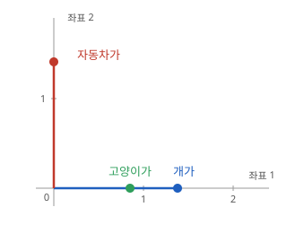

# 단어 임베딩

# 개요

**단어 임베딩(word embedding)** 은 낱말마다 짧은 실수 벡터를 하나씩 주어, 쓰임이 비슷한 낱말이 가까운 벡터를 받게 하는 방법이다. 말뭉치에 "개가 먹는다" 는 있고 "고양이가 먹는다" 는 없으면, 셈으로 만든 언어 모형은 "고양이가" 다음의 "먹는다" 와 "달린다" 를 구별하지 못한다. 단어 임베딩은 "고양이가" 와 "개가" 의 벡터를 가깝게 두어, 개에 대해 센 것을 고양이의 예측에 나누어 쓴다.

# 직관

말뭉치가 다음 다섯 문장이다.

- 개가 잔다
- 개가 먹는다
- 고양이가 잔다
- 자동차가 달린다
- 자동차가 멈춘다

[n-gram 언어 모형](n-gram-language-models.md)의 bigram 모형으로 "고양이가" 다음 낱말의 확률을 구한다. "고양이가" 뒤에는 "잔다" 만 한 번 나왔다. 할인 $D=1/2$ 의 Kneser–Ney 평활에서 덜어 낸 $1/2$ 은 앞에 온 낱말의 종류 수 비율로 나뉜다. "잔다" 는 두 종류, 나머지 셋은 한 종류 뒤에 왔고 서로 다른 낱말 쌍은 다섯이다.

$$
\begin{aligned}
P(\text{잔다}\mid\text{고양이가})&=\tfrac12+\tfrac12\cdot\tfrac25=0.7,\cr
P(\text{먹는다}\mid\text{고양이가})&=P(\text{달린다}\mid\text{고양이가})=P(\text{멈춘다}\mid\text{고양이가})=0.1.
\end{aligned}
$$

"먹는다" 와 "달린다" 가 같은 확률을 받는다. 이 모형에서 낱말은 서로 무관한 기호라서, "고양이가" 가 "자동차가" 보다 "개가" 와 비슷하게 쓰인다는 것이 계산에 들어가지 않는다.

낱말이 서로 비슷한지는 그 낱말 뒤에 오는 낱말로 잴 수 있다. 각 낱말 뒤에 "잔다, 먹는다, 달린다, 멈춘다" 가 몇 번 왔는지 세어 벡터로 적는다.

| 낱말     | 잔다 | 먹는다 | 달린다 | 멈춘다 |
| -------- | ---- | ------ | ------ | ------ |
| 개가     | 1    | 1      | 0      | 0      |
| 고양이가 | 1    | 0      | 0      | 0      |
| 자동차가 | 0    | 0      | 1      | 1      |

두 벡터가 이루는 각의 코사인으로 비슷함을 잰다. "개가" 와 "고양이가" 는 $1/\sqrt2\approx0.71$ 이고, "고양이가" 와 "자동차가" 는 $0$ 이다. 다음 낱말을 예측할 때 이 값을 쓰면 "고양이가" 다음의 "먹는다" 는 "개가" 의 셈을 빌려 "달린다" 보다 큰 확률을 받는다.

실제 말뭉치에서는 이 벡터의 길이가 어휘 수(수만)이고 대부분의 성분이 $0$ 이다. 이 표를 [특이값 분해](singular-value-decomposition.md)로 가장 큰 특이값 두 개만 남겨 줄이면 각 낱말이 좌표 두 개짜리 벡터가 된다. 특이값은 $(1+\sqrt5)/2\approx1.62$ 와 $\sqrt2\approx1.41$ 이고, 줄인 벡터는 다음과 같다.

$$
\text{개가}\mapsto(1.38,\thinspace 0),\qquad\text{고양이가}\mapsto(0.85,\thinspace 0),\qquad\text{자동차가}\mapsto(0,\thinspace 1.41)
$$

아래 그림이 세 벡터다. "개가" 와 "고양이가" 는 같은 방향에 있고 코사인이 $1$ 로 올라갔다. "자동차가" 는 그 둘과 직각이다. 낱말마다 이렇게 붙인 짧은 벡터를 단어 임베딩이라 한다.

# 정의

## 단어 임베딩

어휘 $V$ 와 차원 $d$ 에 대해 사상 $V\to\mathbb R^d$, $w\mapsto\mathbf w$ 를 **단어 임베딩** 이라 한다. $d$ 는 보통 $50$ 에서 $1000$ 사이이고 $\vert V\vert$ 보다 훨씬 작다. 두 낱말의 비슷함은 **코사인 유사도(cosine similarity)** 로 잰다.

$$
\cos(\mathbf w,\mathbf w')=\frac{\mathbf w\cdot\mathbf w'}{\Vert\mathbf w\Vert\thinspace\Vert\mathbf w'\Vert}
$$

직관 절의 두 좌표 벡터가 $d=2$ 인 단어 임베딩이고, "개가" 와 "고양이가" 의 코사인 유사도는 $1$ 이다.

## 동시 출현과 점별 상호정보

낱말 $w$ 를 중심으로 앞뒤 $L$ 개 안에 낱말 $c$ 가 나온 횟수를 $n(w,c)$ 라 한다. $c$ 를 $w$ 의 **문맥 낱말(context word)** 이라 하고 $L$ 을 창의 크기라 한다. $n(w)=\sum_c n(w,c)$, $n(c)=\sum_w n(w,c)$, $N=\sum\_{w,c}n(w,c)$ 로 둔다. 직관 절의 표는 창을 뒤쪽 한 낱말로 잡은 $n(w,c)$ 이고 $N=5$ 다.

셈은 자주 나오는 낱말일수록 커서, 어떤 낱말과 함께 나오든 큰 값을 받는다. 그래서 셈을 두 낱말이 서로 독립일 때의 기대값과 견준 **점별 상호정보(pointwise mutual information, PMI)** 를 쓴다.

$$
\mathrm{PMI}(w,c)=\log\frac{P(w,c)}{P(w)P(c)}=\log\frac{n(w,c)\thinspace N}{n(w)\thinspace n(c)}
$$

직관 절에서 "잔다" 는 "개가" 뒤에도 "고양이가" 뒤에도 한 번씩 왔다. 두 PMI 는 다음과 같다.

$$
\mathrm{PMI}(\text{고양이가},\text{잔다})=\log\tfrac52\approx0.92,\qquad\mathrm{PMI}(\text{개가},\text{잔다})=\log\tfrac54\approx0.22
$$

"개가" 는 두 번 나왔으므로 "잔다" 와 한 번 함께 나온 것이 덜 특별하다.

$n(w,c)=0$ 이면 $\mathrm{PMI}=-\infty$ 이므로 음수를 $0$ 으로 자른 **양의 점별 상호정보(positive PMI, PPMI)** $\max(\mathrm{PMI},0)$ 를 행렬 $M$ 의 성분으로 쓴다.

## 특이값 분해로 얻는 임베딩

$M$ 의 특이값 분해에서 큰 특이값 $d$ 개만 남긴 것을 $M\approx U_d\Sigma_d V_d^{\top}$ 라 한다. 행렬 $U_d\Sigma_d^{1/2}$ 의 $w$ 행을 $\mathbf w$ 로, $V_d\Sigma_d^{1/2}$ 의 $c$ 행을 문맥 벡터 $\mathbf c$ 로 둔다. 그러면 $\mathbf w\cdot\mathbf c$ 가 $M$ 의 $(w,c)$ 성분의 근사다. 직관 절의 계산은 셈 행렬에 $U_d\Sigma_d$ 를 쓴 것이다.

## 음수 표집 skip-gram

**skip-gram** 은 중심 낱말의 벡터 $\mathbf w$ 와 문맥 낱말의 벡터 $\mathbf c$ 의 내적으로 문맥 낱말을 예측하는 모형이다. 로지스틱 함수(logistic function) $\sigma(x)=1/(1+e^{-x})$ 로 $\sigma(\mathbf w\cdot\mathbf c)$ 를 "$c$ 가 $w$ 의 창 안에 나온다" 의 확률로 읽는다. **음수 표집(negative sampling)** 은 말뭉치에서 본 쌍 $(w,c)$ 마다 문맥 낱말 $k$ 개 $c_1,\dots,c_k$ 를 분포 $P(c)=n(c)/N$ 에서 무작위로 뽑아 "나오지 않은 쌍" 으로 쓴다[^1]. 다음 목적함수를 $\mathbf w$ 와 $\mathbf c$ 에 대해 최대화한다.

$$
\sum_{(w,c)}\Bigl(\log\sigma(\mathbf w\cdot\mathbf c)+\sum_{i=1}^{k}\log\sigma(-\mathbf w\cdot\mathbf c_i)\Bigr)
$$

바깥 합은 말뭉치의 모든 (중심 낱말, 창 안의 낱말) 쌍에 걸친다. 쌍 하나씩 [확률적 경사하강법](stochastic-gradient-descent.md)으로 갱신한다. 이 모형과 그 학습 프로그램을 word2vec 이라 부른다.

## 신경망 언어 모형

**신경망 언어 모형(neural language model)** 은 앞 $n-1$ 개 낱말의 임베딩을 이어 붙인 벡터 $\mathbf x(u)$ 를 [다층 퍼셉트론](multilayer-perceptron.md)에 넣어 낱말마다 점수 $s_v(u)$ 를 내고, 다음 낱말의 확률을 softmax 로 정한다[^2].

$$
P(v\mid u)=\frac{\exp s_v(u)}{\sum_{v'\in V}\exp s_{v'}(u)}
$$

임베딩과 신경망의 가중치를 함께 학습 말뭉치의 로그가능도를 최대화하도록 학습한다. 직관 절의 말뭉치에서 "고양이가" 와 "개가" 의 임베딩이 가까우면 $\mathbf x(\text{고양이가})$ 와 $\mathbf x(\text{개가})$ 가 가깝고, 다층 퍼셉트론이 연속함수이므로 두 문맥 뒤의 확률 분포도 가깝다.

# 성질

## 음수 표집과 PMI 행렬의 분해

Levy–Goldberg 정리(Levy–Goldberg theorem). 내적 $\mathbf w\cdot\mathbf c$ 를 쌍마다 따로 정할 수 있을 만큼 $d$ 가 크면, 음수 표집 skip-gram 목적함수의 기댓값은 다음에서 최대다[^3].

$$
\mathbf w\cdot\mathbf c=\mathrm{PMI}(w,c)-\log k
$$

증명의 요지. 목적함수의 기댓값에서 내적 $x=\mathbf w\cdot\mathbf c$ 가 들어간 항만 모으면 $n(w,c)\log\sigma(x)+B\log\sigma(-x)$ 이고, $B=k\thinspace n(w)\thinspace n(c)/N$ 은 $w$ 가 나올 때마다 뽑힌 $k$ 개 가운데 $c$ 가 나오는 횟수의 기댓값이다. $x$ 로 미분하면 $n(w,c)\sigma(-x)-B\sigma(x)=0$ 이고 $e^x=n(w,c)/B$ 가 나온다.

$d$ 가 작으면 skip-gram 은 행렬 $\mathrm{PMI}-\log k$ 의 저계수 분해를 가중 손실로 찾는 것이다. 특이값 분해로 얻는 임베딩은 같은 꼴의 행렬을 제곱오차로 분해한 것이다. 제곱오차에서 최적인 계수 $d$ 근사는 큰 특이값 $d$ 개를 남긴 것이다(Eckart–Young–Mirsky 정리(Eckart–Young–Mirsky theorem)).

## 벡터의 차와 유추

영어 말뭉치에서 학습한 임베딩에서 $\mathbf v\_{\text{king}}-\mathbf v\_{\text{man}}+\mathbf v\_{\text{woman}}$ 과 코사인 유사도가 가장 큰 낱말이 "queen" 이라는 것이 관찰되었다[^4]. "Paris − France + Italy" 가 "Rome" 이 되는 것처럼 나라와 수도, 동사의 시제에서도 같은 꼴이 관찰된다.

$\mathbf w\cdot\mathbf c=\mathrm{PMI}(w,c)$ 가 성립하는 분해에서 이 꼴은 PMI 의 등식으로 적힌다. 모든 문맥 낱말 $c$ 에 대해 다음이 성립한다고 하자.

$$
\mathrm{PMI}(\text{king},c)-\mathrm{PMI}(\text{man},c)=\mathrm{PMI}(\text{queen},c)-\mathrm{PMI}(\text{woman},c)
$$

그러면 다음 벡터 $\mathbf r$ 가 모든 문맥 벡터와 직교한다.

$$
\mathbf r=\mathbf v_{\text{king}}-\mathbf v_{\text{man}}-\mathbf v_{\text{queen}}+\mathbf v_{\text{woman}}
$$

문맥 벡터들이 $\mathbb R^d$ 를 생성하면 $\mathbf r=0$ 이고 유추의 등식이 정확히 성립한다.

## 벡터 하나에 담기는 뜻

낱말마다 벡터가 하나이므로 뜻이 여럿인 낱말("배" 의 과일, 탈것, 신체)은 그 뜻들이 나온 문맥의 셈이 합쳐진 벡터 하나를 받는다. 셈 행렬에서 그 낱말의 행은 뜻마다 따로 센 행들의 합이다.

# 활용

- 신경망의 입력층. 낱말을 받는 신경망은 첫 층에서 낱말을 임베딩으로 바꾼다. 임베딩을 미리 학습한 값으로 두거나 신경망 언어 모형처럼 함께 학습한다.
- 검색과 분류. 문서의 낱말 벡터를 평균해 문서 벡터로 쓰고 코사인 유사도로 가까운 문서를 찾는다.
- 잠재 의미 분석(latent semantic analysis). 낱말×문서 셈 행렬의 특이값 분해로 낱말과 문서에 같은 차원의 벡터를 준다. 문맥을 창 대신 문서 전체로 잡은 특이값 분해 임베딩이다.
- 사회적 편향의 측정. "he − she" 방향으로의 사영 길이로 직업 낱말에 들어간 성별 편향을 재고, 그 방향 성분을 빼는 보정이 제안되었다[^5].
- 낱말 밖의 대상. 그래프의 무작위 보행열을 문장으로, 정점을 낱말로 보고 같은 skip-gram 을 쓰면 정점의 벡터가 나온다(DeepWalk, node2vec).

[^1]: T. Mikolov, I. Sutskever, K. Chen, G. Corrado, J. Dean, "Distributed representations of words and phrases and their compositionality", Advances in Neural Information Processing Systems 26 (2013), 3111–3119.
[^2]: Y. Bengio, R. Ducharme, P. Vincent, C. Jauvin, "A neural probabilistic language model", Journal of Machine Learning Research 3 (2003), 1137–1155.
[^3]: O. Levy, Y. Goldberg, "Neural word embedding as implicit matrix factorization", Advances in Neural Information Processing Systems 27 (2014), 2177–2185.
[^4]: T. Mikolov, W. Yih, G. Zweig, "Linguistic regularities in continuous space word representations", Proceedings of the 2013 Conference of the North American Chapter of the Association for Computational Linguistics, 746–751.
[^5]: T. Bolukbasi, K.-W. Chang, J. Zou, V. Saligrama, A. Kalai, "Man is to computer programmer as woman is to homemaker? Debiasing word embeddings", Advances in Neural Information Processing Systems 29 (2016).

# 연관 문서

## 선수지식

- [n-gram 언어 모형](n-gram-language-models.md)
- [특이값 분해](singular-value-decomposition.md)

## 더 알아보기

- [GloVe](glove.md)
- [잡음 대조 추정](noise-contrastive-estimation.md)
- [계층적 softmax](hierarchical-softmax.md)
- [주의 메커니즘](attention-mechanism.md)

#machine_learning #linear_algebra #statistics #information_theory
