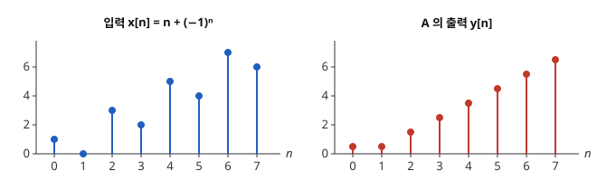
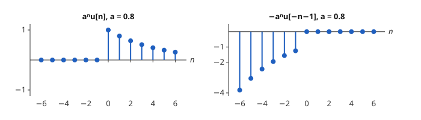
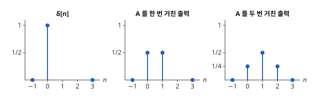
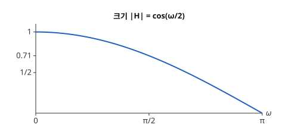
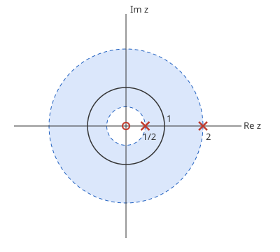

# z 변환

# 개요

**z 변환(z-transform)** 은 수열에 $z^{-1}$ 의 거듭제곱을 곱해 더한 급수로 수열을 적는 방법이다. 매일 잰 값이 $1, 0, 3, 2, 5, 4, \dots$ 처럼 오르내리며 늘어날 때, 오늘 값과 어제 값의 평균을 내면 오르내림이 사라지고 고르게 늘어나는 수열이 남는다. 이런 다듬기 장치를 만들려면 어떤 오르내림이 지워지고 어떤 변화가 남는지, 장치를 여러 개 이으면 무엇이 되는지 계산할 수 있어야 한다.

z 변환은 장치를 $z^{-1}$ 의 다항식으로 적는다. 장치를 잇는 것은 다항식의 곱이 되고, 어떤 오르내림이 지워지는지는 다항식에 수를 넣은 값으로 정해진다.

# 직관

디지털 신호는 일정한 간격으로 잰 수의 열이다. 아래 그림 왼쪽은 $n=0$ 부터 $1, 0, 3, 2, 5, 4, 7, 6$ 으로 오르내리며 늘어나는 수열 $x$ 다. 식으로는 $x\lbrack n\rbrack=n+(-1)^n$ 이고, $n\lt 0$ 에서는 $0$ 이다.

장치 A 는 지금 값과 바로 앞 값의 평균을 내보낸다.

$$
y\lbrack n\rbrack=\tfrac12 x\lbrack n\rbrack+\tfrac12 x\lbrack n-1\rbrack
$$

그림 오른쪽이 A 의 출력 $y$ 다. $n\ge 1$ 에서 $y\lbrack n\rbrack=n-\frac12$ 이므로 오르내림이 사라지고 한 칸에 $1$ 씩 늘어나는 직선만 남는다.

오르내림 $(-1)^n$ 은 이웃한 두 값의 부호가 반대여서 평균이 $0$ 이다. 늘어나는 부분 $n$ 은 평균을 내면 $\frac12$ 만큼 늦어질 뿐 남는다.

한 칸 늦추기를 $z^{-1}$ 을 곱하는 것으로 적는다. 수열 $x$ 를 다음 급수로 적는다.

$$
X(z)=\sum_n x\lbrack n\rbrack z^{-n}
$$

$x\lbrack n-1\rbrack$ 의 급수는 $z^{-1}X(z)$ 이므로, 장치 A 는 $X(z)$ 에 다항식 하나를 곱하는 것이다.

$$
Y(z)=\left(\tfrac12+\tfrac12 z^{-1}\right)X(z)
$$

어떤 수열이 지워지는지는 이 다항식에서 읽힌다. 수열 $x\lbrack n\rbrack=c^n$ 을 넣으면 $x\lbrack n-1\rbrack=c^{-1}x\lbrack n\rbrack$ 이므로 출력은 $(\frac12+\frac12 c^{-1})\thinspace c^n$ 이다. 입력에 다항식의 $z=c$ 에서의 값이 곱해진다.

오르내림 $(-1)^n$ 은 $c=-1$ 이고 다항식의 값이 $0$ 이라 지워진다. 상수 수열은 $c=1$ 이고 값이 $1$ 이라 그대로 남는다.

A 를 두 번 이으면 다항식을 두 번 곱한다.

$$
\left(\tfrac12+\tfrac12 z^{-1}\right)^2=\tfrac14+\tfrac12 z^{-1}+\tfrac14 z^{-2}
$$

두 번 거친 출력은 계수를 그대로 옮긴 다음 식이다. 수열을 위의 급수 $X(z)$ 로 적은 것을 z 변환이라 한다.

$$
w\lbrack n\rbrack=\tfrac14 x\lbrack n\rbrack+\tfrac12 x\lbrack n-1\rbrack+\tfrac14 x\lbrack n-2\rbrack
$$

# 정의

## 이산시간 신호와 z 변환

**이산시간 신호(discrete-time signal)** 는 함수 $x:\mathbb Z\to\mathbb C$ 이고, 값을 $x\lbrack n\rbrack$ 으로 적는다. $x$ 의 **z 변환** 은 다음 급수다.

$$
X(z)=\sum_{n=-\infty}^{\infty}x\lbrack n\rbrack z^{-n}
$$

이 급수가 절대수렴하는 $z\in\mathbb C\setminus\lbrace 0\rbrace$ 의 집합을 **수렴 영역(region of convergence, ROC)** 이라 한다. z 변환은 함수 $X$ 와 ROC 의 쌍이다.

$n\lt 0$ 에서 $0$ 인 신호를 **인과(causal)** 신호라 한다. **단위 계단(unit step)** $u\lbrack n\rbrack$ 은 $n\ge 0$ 에서 $1$, $n\lt 0$ 에서 $0$ 이다.

## 두 예

$x\lbrack n\rbrack=a^n u\lbrack n\rbrack$ 이면 등비급수에서 다음이 나온다.

$$
X(z)=\sum_{n\ge 0}(az^{-1})^n=\frac{1}{1-az^{-1}},\qquad \lvert z\rvert\gt \lvert a\rvert
$$

$x\lbrack n\rbrack=-a^n u\lbrack -n-1\rbrack$, 곧 $n\le -1$ 에서만 $-a^n$ 인 신호이면 다음이 나온다.

$$
X(z)=-\sum_{m\ge 1}(a^{-1}z)^m=\frac{1}{1-az^{-1}},\qquad \lvert z\rvert\lt \lvert a\rvert
$$

두 신호의 $X$ 가 같으므로 ROC 없이는 신호가 정해지지 않는다.

아래 그림은 $a=0.8$ 일 때 두 신호다. 왼쪽은 $n\ge 0$ 에서 $1$ 부터 줄어들고, 오른쪽은 $n\le -1$ 에서 $n$ 이 작아질수록 절댓값이 커진다.

## 선형 시불변 시스템

신호를 신호로 보내는 사상 $T$ 가 선형이고, 입력을 $k$ 칸 늦추면 출력도 $k$ 칸 늦춰지면 $T$ 를 **선형 시불변 시스템(linear time-invariant system, LTI system)** 이라 한다. 직관 절의 장치 A 가 그 예다.

**단위 임펄스(unit impulse)** $\delta\lbrack n\rbrack$ 은 $n=0$ 에서 $1$, 나머지에서 $0$ 인 신호다. $h=T\delta$ 를 $T$ 의 **임펄스 응답(impulse response)** 이라 한다.

아래 그림 왼쪽이 입력 $\delta$ 이고, 가운데와 오른쪽이 $\delta$ 를 장치 A 에 한 번, 두 번 넣은 출력이다. A 의 임펄스 응답은 $h\lbrack 0\rbrack=h\lbrack 1\rbrack=\frac12$ 이고 나머지가 $0$ 이다. 두 번 거친 출력의 높이 $\frac14,\frac12,\frac14$ 는 직관 절 다항식의 계수다.

입력은 늦춘 임펄스들의 합 $x=\sum_k x\lbrack k\rbrack\thinspace\delta\lbrack \cdot-k\rbrack$ 이다. 여기에 선형성과 시불변성을 쓰면 출력은 이산 [합성곱](convolution.md)이다.

$$
(Tx)\lbrack n\rbrack=(h\ast x)\lbrack n\rbrack=\sum_{k}h\lbrack k\rbrack\thinspace x\lbrack n-k\rbrack
$$

## 전달함수와 주파수 응답

임펄스 응답의 z 변환 $H(z)$ 를 **전달함수(transfer function)** 라 한다. 장치 A 의 전달함수는 $H(z)=\frac12+\frac12 z^{-1}$ 이고 ROC 는 $z\ne 0$ 전체다.

단위원 $\lvert z\rvert=1$ 이 ROC 에 들면 $H(e^{i\omega})$ 를 **주파수 응답(frequency response)** 이라 한다. 입력이 $x\lbrack n\rbrack=e^{i\omega n}$ 이면 출력은 $H(e^{i\omega})e^{i\omega n}$ 이다. 직관 절에서 $c=e^{i\omega}$ 로 놓은 경우다.

장치 A 의 주파수 응답은 다음과 같다.

$$
H(e^{i\omega})=\tfrac12(1+e^{-i\omega})=e^{-i\omega/2}\cos(\omega/2)
$$

$\omega=0$ 인 상수 수열은 그대로 지나가고, $\omega=\pi$ 인 수열 $1,-1,1,-1,\dots$ 은 $0$ 이 된다.

아래 그림은 크기 $\lvert H(e^{i\omega})\rvert=\cos(\omega/2)$ 를 $0\le\omega\le\pi$ 에서 그린 것이다. 빨리 진동하는 수열일수록 크기가 줄어든다.

# 성질

## 선형성과 이동

z 변환은 선형이다. $x\lbrack n-k\rbrack$ 의 z 변환은 $z^{-k}X(z)$ 이고 ROC 는 $0$ 을 넣고 빼는 것을 빼면 같다. 직관 절에서 한 칸 늦추기를 $z^{-1}$ 의 곱으로 적은 것이 이 성질이다.

## 합성곱 정리

$h$ 와 $x$ 의 ROC 의 교집합에서 다음이 성립한다.

$$
\mathcal Z\lbrace h\ast x\rbrace(z)=H(z)X(z)
$$

증명의 요지. 다음 이중합에서 $z^{-n}=z^{-k}z^{-(n-k)}$ 로 쪼갠다.

$$
\sum_n\sum_k h\lbrack k\rbrack\thinspace x\lbrack n-k\rbrack\thinspace z^{-n}
$$

교집합에서 두 급수가 절대수렴하므로 합의 순서를 바꿀 수 있고, 이중합이 $H(z)X(z)$ 로 나뉜다.

직관 절의 $(\frac12+\frac12 z^{-1})^2$ 이 이 정리의 예다.

## 수렴 영역의 모양

ROC 는 $r\lt \lvert z\rvert\lt R$ 꼴의 고리(annulus)이며 경계의 일부를 포함할 수 있다.

$n\ge 0$ 부분은 $w=z^{-1}$ 의 [멱급수](power-series.md)이므로 수렴반지름 바깥에 해당하는 $\lvert z\rvert\gt r$ 에서 수렴하고, $n\lt 0$ 부분은 $z$ 의 멱급수이므로 $\lvert z\rvert\lt R$ 에서 수렴한다.

인과 신호의 ROC 는 $\lvert z\rvert\gt r$ 꼴이고 무한대 쪽으로 열려 있다.

## 역변환

ROC 안의 원 $C$ 를 반시계 방향으로 돌면 다음이 성립한다.

$$
x\lbrack n\rbrack=\frac{1}{2\pi i}\oint_C X(z)z^{n-1}\thinspace dz
$$

$X(z)$ 는 고리 위에서 Laurent 급수(Laurent series)이고, 위 적분은 그 계수를 뽑는 공식이다.

$X$ 가 유리함수이면 [유수 정리](residue-theorem.md)로 적분을 계산하거나, 부분분수로 나눈 뒤 각 항에 두 예의 공식을 ROC 에 맞춰 쓴다.

예. 다음 $X$ 의 ROC 를 $\frac12\lt \lvert z\rvert\lt 2$ 로 잡는다.

$$
X(z)=\frac{1}{(1-\frac12 z^{-1})(1-2z^{-1})}=-\frac13\cdot\frac{1}{1-\frac12 z^{-1}}+\frac43\cdot\frac{1}{1-2z^{-1}}
$$

첫 항은 $\lvert z\rvert\gt \frac12$ 쪽이고, 둘째 항은 $\lvert z\rvert\lt 2$ 쪽이다. 두 예의 공식을 각 항에 쓰면 다음이 나온다.

$$
x\lbrack n\rbrack=-\tfrac13\left(\tfrac12\right)^n u\lbrack n\rbrack-\tfrac43\cdot 2^n u\lbrack -n-1\rbrack
$$

아래 그림에서 × 는 극 $\frac12$ 와 $2$, ○ 는 원점의 이중 영점, 색칠한 고리가 ROC, 실선 원이 단위원이다. 극 $\frac12$ 는 고리의 안쪽에, 극 $2$ 는 바깥쪽에 있다.

## 안정성

입력이 유계이면 출력도 유계인 시스템을 **BIBO 안정(bounded-input bounded-output stable)** 이라 한다.

LTI 시스템이 BIBO 안정일 필요충분조건은 $\sum_n\lvert h\lbrack n\rbrack\rvert\lt \infty$ 이고, 이것은 단위원이 $H$ 의 ROC 에 드는 것과 동치다[^1].

$H$ 가 유리함수이고 시스템이 인과이면 ROC 는 가장 바깥 극(pole)의 바깥이다. 따라서 모든 극이 단위원 안에 있는 것이 안정의 필요충분조건이다. $h\lbrack n\rbrack=a^n u\lbrack n\rbrack$ 은 극이 $z=a$ 이고 $\lvert a\rvert\lt 1$ 일 때만 안정이다.

## Fourier 변환과의 관계

단위원 위의 값은 다음과 같다.

$$
X(e^{i\omega})=\sum_n x\lbrack n\rbrack e^{-i\omega n}
$$

이것은 수열의 이산시간 Fourier 변환(discrete-time Fourier transform, DTFT)이고, 정수 위의 함수에 대한 [Fourier 변환](fourier-transform.md)이다.

길이 $N$ 인 수열에서 이것을 $\omega=2\pi k/N$ 의 $N$ 개 점에서만 계산한 것이 [이산 Fourier 변환](fourier.md)이다.

# 활용

- [생성함수](generating-functions.md). 인과 수열의 z 변환은 보통 생성함수 $A(w)=\sum a_nw^n$ 에 $w=z^{-1}$ 을 넣은 것이다. 선형 점화식을 생성함수로 푸는 계산과 무한 임펄스 응답(infinite impulse response, IIR) 필터의 응답을 구하는 계산이 같다.
- [Laplace 변환](laplace-transform.md). 연속 신호를 간격 $T$ 로 잰 수열의 z 변환은 연속 신호의 Laplace 변환에서 $z=e^{sT}$ 로 바꾼 것에 대응한다. 아날로그 필터를 디지털 필터로 옮기는 설계가 이 대응을 사용한다.
- 디지털 필터. 전달함수가 $z^{-1}$ 의 다항식인 필터를 [FIR 필터](fir-filters.md)(finite impulse response), 유리함수인 필터를 [IIR 필터](iir-filters.md)라 한다. 필터 설계는 극과 영점을 원하는 주파수 응답이 나오게 놓는 일이다.
- [표본화 정리](sampling-theorem.md). 연속 신호를 수열로 바꾸는 단계가 표본화이고, z 변환은 그 뒤의 수열을 다룬다.

[^1]: A. V. Oppenheim, R. W. Schafer, *Discrete-Time Signal Processing*, 3rd ed., Pearson (2010), 2.4절과 3.2절.

# 연관 문서

## 선수지식

- [생성함수](generating-functions.md)
- [멱급수](power-series.md)
- [신호처리 개관](signal-processing-overview.md)

## 더 알아보기

- [FIR 필터](fir-filters.md)
- [켑스트럼](cepstrum.md)

#signal_processing #analysis #complex_analysis
