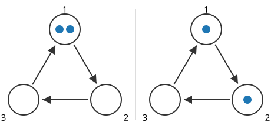

# Zero range 과정

# 개요

**Zero range 과정(zero range process)** 은 여러 칸에 입자가 몇 개씩 쌓여 있고, 각 칸이 쌓인 개수에 따라 정해진 빠르기로 입자를 하나씩 이웃 칸으로 내보내는 확률 과정이다. 고리 모양으로 이어진 창구 세 곳에 손님 둘이 있고, 창구마다 줄 맨 앞 손님을 처리해 다음 창구로 보낸다고 하자. 오래 지난 뒤 두 손님이 한 창구에 몰려 있을 확률과 흩어져 있을 확률을 묻는 것이 이 과정의 물음이다. Zero range 과정은 칸마다 개수의 분포를 곱한 꼴의 정상분포로 이 물음에 답하고, 처리 빠르기가 개수와 함께 줄어들면 입자들이 한 칸에 몰리는 현상도 계산한다.

# 직관

아래 그림은 칸 $1,2,3$ 이 $1\to 2\to 3\to 1$ 로 이어진 고리에 입자 두 개가 있는 두 배치다. 칸에 입자가 하나 이상 있으면 그 칸은 빠르기 $1$ 로 입자 하나를 화살표 방향의 다음 칸으로 보낸다. 칸 안의 입자 수는 빠르기에 상관없다.

배치는 입자 둘이 한 칸에 몰린 것 셋과 두 칸에 흩어진 것 셋, 모두 여섯이다. 왼쪽 배치 $(2,0,0)$ 에서는 칸 $1$ 만 입자를 보내므로 빠르기 $1$ 로 $(1,1,0)$ 으로 간다. 이 배치로 들어오는 길은 $(1,0,1)$ 에서 칸 $3$ 이 입자를 칸 $1$ 로 보내는 것 하나이고 빠르기는 $1$ 이다.

오른쪽 배치 $(1,1,0)$ 에서는 칸 $1$ 과 칸 $2$ 가 각각 빠르기 $1$ 로 보내므로 나가는 빠르기가 $2$ 다. 들어오는 길도 $(2,0,0)$ 에서 칸 $1$ 이 보내는 것과 $(0,1,1)$ 에서 칸 $3$ 이 보내는 것 둘이다. 여섯 배치에 확률 $1/6$ 씩을 주면 모든 배치에서 나가는 확률의 흐름과 들어오는 흐름이 같으므로, 이것이 정상분포다. 두 입자가 한 칸에 몰려 있을 확률은 $1/2$ 이다.

창구가 손님마다 따로 일해서 손님 $k$ 명이 있으면 빠르기 $k$ 로 내보내면, 두 손님은 서로 상관없이 고리를 도는 입자가 된다. 각자 세 칸에 고르게 있으므로 한 칸에 몰릴 확률은 $3\cdot(1/3)^2=1/3$ 이다. 내보내는 빠르기를 개수에 따라 어떻게 정하느냐가 몰림의 정도를 정한다.

# 정의

## 과정

유한 집합 $\Lambda$ 의 칸마다 입자 수 $\eta\_x\in\lbrace 0,1,2,\dots\rbrace$ 를 둔 배치 $\eta$ 위의 [연속시간 Markov 연쇄](continuous-time-markov-chains.md)를 생각한다. **빠르기 함수(rate function)** $g$ 는 $g(0)=0$ 이고 $k\ge 1$ 에서 $g(k)\gt 0$ 인 함수이고, $p(x,y)$ 는 $\Lambda$ 위의 확률 이동 행렬이다. 칸 $x$ 는 빠르기 $g(\eta\_x)$ 로 입자 하나를 내보내고, 그 입자는 확률 $p(x,y)$ 로 칸 $y$ 에 간다. 이 과정이 zero range 과정이고, F. Spitzer 가 도입했다[^1].

한 칸의 내보내는 빠르기가 그 칸의 입자 수에만 달려 있고 이웃 칸의 입자 수와 상관없어서 영 범위(zero range)라 부른다. 직관 절의 앞의 예는 $g(k)=1$ ($k\ge 1$), 뒤의 예는 $g(k)=k$ 이고, 둘 다 $p(x,x+1)=1$ 이다.

## 곱 꼴의 무게

$\phi\gt 0$ 에 대해 한 칸에 입자가 $k$ 개 있을 무게를 다음으로 둔다.

$$
w\_\phi(k)=\frac{\phi^k}{g(1)g(2)\cdots g(k)}
$$

$w\_\phi(0)=1$ 이다. $\phi$ 를 **퓨가시티(fugacity)** 라 한다. $Z(\phi)=\sum\_k w\_\phi(k)$ 가 유한한 $\phi$ 의 상한을 $\phi\_c$ 로 쓴다. 직관 절에서 $g(k)=1$ 이면 $w\_\phi(k)=\phi^k$ 이고, $g(k)=k$ 이면 $w\_\phi(k)=\phi^k/k!$ 이다.

# 성질

## 정상분포

$p$ 가 이중확률행렬, 곧 열의 합도 $1$ 인 행렬이면, 입자 수가 $N$ 인 배치들 위에서 다음이 정상분포다.

$$
\pi\_N(\eta)\propto\prod\_{x\in\Lambda}w\_\phi(\eta\_x)
$$

$\phi$ 는 $\sum\_x\eta\_x=N$ 위에서 상수로 빠지므로 아무 값이어도 같다. 직관 절의 고리에서 $g(k)=1$ 이면 모든 배치의 무게가 $1$ 이라 고른 분포이고, $g(k)=k$ 이면 $(2,0,0)$ 의 무게가 $1/2$, $(1,1,0)$ 의 무게가 $1$ 이라 몰린 배치 셋의 확률이 각각 $1/9$ 이다.

증명의 요지. 칸 $x$ 에서 $y$ 로 입자 하나를 옮긴 배치를 $\eta^{x\to y}$ 로 쓰면 $\pi(\eta^{x\to y})\thinspace g(\eta\_y+1)=\pi(\eta)\thinspace g(\eta\_x)$ 다. 배치 $\eta$ 로 들어오는 흐름을 입자를 받은 칸 $y$ 별로 묶으면 $\sum\_x\pi(\eta)\thinspace g(\eta\_y)\thinspace p(x,y)$ 이고, 열의 합이 $1$ 이라 이것이 $\pi(\eta)\thinspace g(\eta\_y)$ 다. $y$ 에 대해 더하면 나가는 흐름 $\pi(\eta)\sum\_y g(\eta\_y)$ 와 같다. $p$ 가 이중확률이 아니면 칸마다 다른 $\phi\_x$ 를 $\phi\_y=\sum\_x\phi\_x p(x,y)$ 의 해로 두면 같은 계산이 된다.

## 밀도와 몰림

칸 수를 한없이 늘리는 극한에서 칸마다 입자 수가 독립이고 분포가 $w\_\phi(k)/Z(\phi)$ 인 곱 측도를 쓴다. 그 평균 밀도 $R(\phi)=\phi Z'(\phi)/Z(\phi)$ 는 $\phi$ 에 대해 증가한다. 칸당 밀도 $\rho$ 가 주어지면 $R(\phi)=\rho$ 인 $\phi$ 를 고른다.

$\rho\_c=\lim\_{\phi\to\phi\_c}R(\phi)$ 가 유한하면 $\rho\gt\rho\_c$ 에서 맞는 $\phi$ 가 없다. 칸이 $L$ 개, 입자가 $\rho L$ 개인 고리의 정상분포에서는 $L\to\infty$ 일 때 남는 $(\rho-\rho\_c)L$ 개의 입자가 한 칸에 모이고 나머지 칸은 밀도 $\rho\_c$ 의 곱 측도를 따른다[^2]. 이것을 **몰림(condensation)** 이라 한다.

$g(k)=1+b/k$ 이면 $\phi\_c=1$ 이고 $w\_1(k)$ 가 $k^{-b}$ 정도로 줄어든다. 그래서 $\rho\_c=\sum\_k k\thinspace w\_1(k)/Z(1)$ 은 $b\gt 2$ 일 때만 유한하고, 이때 몰림이 일어난다[^3]. $g(k)=1$ 이면 $Z(1)$ 이 발산해 $\rho\_c=\infty$ 이므로 몰림이 없다.

## 배제 과정과의 대응

[단순 배제 과정](simple-exclusion-process.md)에서 입자가 오른쪽으로만 뛰는 경우, 곧 완전 비대칭 단순 배제 과정(totally asymmetric simple exclusion process, TASEP)을 고리 위에서 생각한다. 입자에 차례로 번호를 붙이고 입자 $i$ 앞의 빈 칸 수를 $\eta\_i$ 로 둔다. 입자 $i$ 가 한 칸 나아가면 $\eta\_i$ 가 $1$ 줄고 뒤따르는 입자의 $\eta\_{i-1}$ 이 $1$ 는다.

입자 $i$ 는 앞이 비어 있으면, 곧 $\eta\_i\ge 1$ 이면 빠르기 $1$ 로 나아간다. 그러므로 $\eta$ 는 $g(k)=1$ 이고 빈 칸을 입자로 본 zero range 과정이다. 정상분포가 고른 분포라는 것이 두 과정에서 같은 사실이다.

# 활용

- 닫힌 대기행렬 망. 창구가 고리나 망으로 이어지고 손님이 창구를 옮겨 다니는 망은 칸이 창구인 zero range 과정이다. 창구 하나가 손님 하나씩 처리하면 $g(k)=1$, 창구 $s$ 개가 함께 일하면 $g(k)=\min(k,s)$ 이다. 곱 꼴의 정상분포가 [대기행렬](queues.md) 이론의 Jackson 망 정리(Jackson's theorem)와 같다.
- 교통 흐름과 버스 몰림. 버스를 칸, 버스 사이 승객이나 간격을 입자로 두면 앞 버스가 늦을수록 더 늦어지는 몰림을 빠르기 함수가 줄어드는 경우로 다룬다.
- 유체역학 극한. 입자가 양쪽으로 같은 확률로 뛰는 경우, 칸 간격을 줄이고 시간을 늘린 극한에서 밀도 $\rho$ 가 $\partial\_t\rho=\Delta\Phi(\rho)$ 꼴의 비선형 확산 방정식을 따르고, $\Phi(\rho)$ 는 밀도 $\rho$ 에 맞는 퓨가시티다.

[^1]: F. Spitzer, "Interaction of Markov processes", *Advances in Mathematics* 5 (1970), 246–290.
[^2]: S. Großkinsky, G. M. Schütz, H. Spohn, "Condensation in the zero range process: stationary and dynamical properties", *Journal of Statistical Physics* 113 (2003), 389–410.
[^3]: M. R. Evans, "Phase transitions in one-dimensional nonequilibrium systems", *Brazilian Journal of Physics* 30 (2000), 42–57.

# 연관 문서

## 선수지식

- [단순 배제 과정](simple-exclusion-process.md)

## 더 알아보기

아직 연결한 문서가 없다.

#probability #analysis
